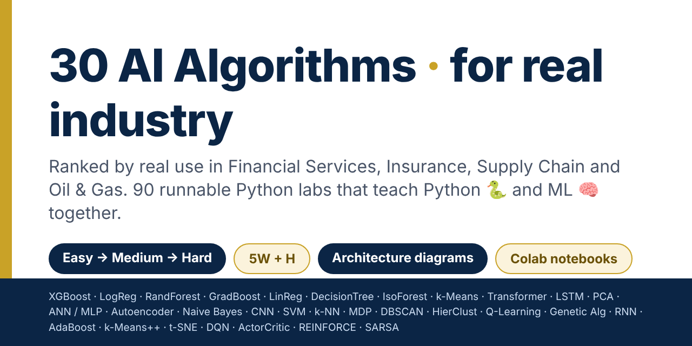
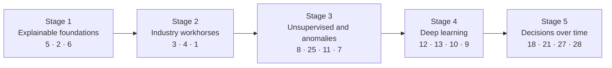

# The Architect's ML Playbook
### 30 AI algorithms · 90 Python labs · ranked for real industry



**Learn Python and machine learning together, through the problems banks, insurers, supply chains and energy companies actually solve.**

[](https://edwardsuresh.github.io/architects-ml-playbook/)


[](https://github.com/EdwardSuresh/architects-ml-playbook/actions/workflows/run-labs.yml)

Most ML tutorials teach algorithms in textbook order with toy data. This repository does three things differently:

1. **Ranked by real-world use** in Financial Services, Insurance, Supply Chain and Oil & Gas — so you learn what is used most, first.
2. **One business use case per algorithm, three depths.** Easy (intuition, by hand) → Medium (realistic data, standard library) → Hard (production: tuning, explainability, governance). Only the depth changes, never the context.
3. **Code that teaches two things at once.** Every script is annotated with `# 🐍 PY:` comments (Python language lessons) and `# 🧠 ML:` comments (machine-learning lessons).

Each lab also has **5 W's and an H**, an **architecture diagram**, the **real output**, and each algorithm has an **end-to-end production sequence diagram**, pitfalls and interview questions.

## 🚀 Start in 60 seconds
- **Easiest:** open the [interactive course](https://edwardsuresh.github.io/architects-ml-playbook/) (works offline too: download [`docs/index.html`](docs/index.html)).
- **Colab:** open any notebook in [`notebooks/`](notebooks) and click *Open in Colab*.
- **Locally:**
  ```bash
  git clone https://github.com/EdwardSuresh/architects-ml-playbook.git && cd architects-ml-playbook
  pip install -r requirements.txt
  python algorithms/01-xgboost/easy.py
  python scripts/run_all.py          # runs all 90 labs (~10 minutes on a laptop)
  ```
All data is **synthetic and generated inside each script** — no downloads, no real customer, policy or well data.

## 🏆 The 30 algorithms, ranked
Scores are 1–5 adoption in production per sector: **FS** Financial Services · **Ins** Insurance · **SC** Supply Chain · **O&G** Oil & Gas.

| # | Algorithm | Family | FS | Ins | SC | O&G | Lab use case | Notebook |
|---|---|---|---|---|---|---|---|---|
| 1 | [XGBoost](algorithms/01-xgboost/README.md) | Ensemble / Boosting | 5 | 5 | 5 | 4 | Financial Services: Real-time credit card fraud detection | [ipynb](notebooks/01-xgboost.ipynb) |
| 2 | [Logistic Regression](algorithms/02-logistic-regression/README.md) | Classification | 5 | 5 | 3 | 3 | Financial Services: Consumer loan default prediction and credit scorecard | [ipynb](notebooks/02-logistic-regression.ipynb) |
| 3 | [Random Forest](algorithms/03-random-forest/README.md) | Ensemble / Boosting | 5 | 5 | 4 | 4 | Insurance: Auto insurance claims fraud detection (SIU referral) | [ipynb](notebooks/03-random-forest.ipynb) |
| 4 | [Gradient Boosting](algorithms/04-gradient-boosting/README.md) | Ensemble / Boosting | 5 | 5 | 5 | 4 | Supply Chain: Predict late shipments (on-time delivery risk) | [ipynb](notebooks/04-gradient-boosting.ipynb) |
| 5 | [Linear Regression](algorithms/05-linear-regression/README.md) | Regression | 4 | 5 | 4 | 4 | Insurance: Auto insurance expected claim cost and premium pricing | [ipynb](notebooks/05-linear-regression.ipynb) |
| 6 | [Decision Tree](algorithms/06-decision-tree/README.md) | Classification | 4 | 5 | 4 | 3 | Insurance: Homeowners underwriting decision: Accept / Refer / Decline | [ipynb](notebooks/06-decision-tree.ipynb) |
| 7 | [Isolation Forest](algorithms/07-isolation-forest/README.md) | Anomaly Detection | 5 | 4 | 3 | 4 | Financial Services: AML suspicious transaction detection for the analyst alert queue | [ipynb](notebooks/07-isolation-forest.ipynb) |
| 8 | [k-Means Clustering](algorithms/08-k-means-clustering/README.md) | Clustering | 5 | 4 | 4 | 3 | Financial Services: Retail banking customer segmentation for personalized products | [ipynb](notebooks/08-k-means-clustering.ipynb) |
| 9 | [Transformer](algorithms/09-transformer/README.md) | Deep Learning | 5 | 4 | 3 | 3 | Insurance: Claim notes / first notice of loss text triage | [ipynb](notebooks/09-transformer.ipynb) |
| 10 | [LSTM](algorithms/10-lstm/README.md) | Deep Learning | 4 | 3 | 5 | 4 | Supply Chain: Weekly SKU demand forecasting for a distribution center | [ipynb](notebooks/10-lstm.ipynb) |
| 11 | [Principal Component Analysis (PCA)](algorithms/11-principal-component-analysis/README.md) | Dimensionality Reduction | 4 | 3 | 3 | 4 | Financial Services: Treasury yield curve risk factors for rate hedging | [ipynb](notebooks/11-principal-component-analysis.ipynb) |
| 12 | [Artificial Neural Network (ANN / MLP)](algorithms/12-artificial-neural-network/README.md) | Deep Learning | 4 | 4 | 3 | 3 | Insurance: Life insurance policy lapse prediction for retention outreach | [ipynb](notebooks/12-artificial-neural-network.ipynb) |
| 13 | [Autoencoders](algorithms/13-autoencoders/README.md) | Anomaly Detection | 4 | 3 | 3 | 4 | Oil & Gas: Gas compressor sensor anomaly detection for predictive maintenance | [ipynb](notebooks/13-autoencoders.ipynb) |
| 14 | [Naive Bayes](algorithms/14-naive-bayes/README.md) | Classification | 4 | 3 | 2 | 2 | Financial Services: Customer complaint routing to the right product team | [ipynb](notebooks/14-naive-bayes.ipynb) |
| 15 | [Convolutional Neural Network (CNN)](algorithms/15-convolutional-neural-network/README.md) | Deep Learning | 3 | 4 | 3 | 4 | Oil & Gas: Pipeline inspection - detecting corrosion pits and cracks in image patches | [ipynb](notebooks/15-convolutional-neural-network.ipynb) |
| 16 | [Support Vector Machine (SVM)](algorithms/16-support-vector-machine/README.md) | Classification | 3 | 3 | 2 | 4 | Oil & Gas: Lithology classification from well logs | [ipynb](notebooks/16-support-vector-machine.ipynb) |
| 17 | [k-Nearest Neighbors (k-NN)](algorithms/17-k-nearest-neighbors/README.md) | Classification | 3 | 3 | 3 | 3 | Supply Chain: Delivery transit-day estimation from similar past shipments | [ipynb](notebooks/17-k-nearest-neighbors.ipynb) |
| 18 | [Markov Decision Process (MDP)](algorithms/18-markov-decision-process/README.md) | Reinforcement Learning | 3 | 3 | 3 | 3 | Oil & Gas: Pump maintenance policy optimisation | [ipynb](notebooks/18-markov-decision-process.ipynb) |
| 19 | [DBSCAN](algorithms/19-dbscan/README.md) | Clustering | 3 | 4 | 3 | 3 | Insurance: Catastrophe claims hotspots after a hailstorm or tornado | [ipynb](notebooks/19-dbscan.ipynb) |
| 20 | [Hierarchical Clustering](algorithms/20-hierarchical-clustering/README.md) | Clustering | 4 | 2 | 2 | 2 | Financial Services: Portfolio diversification with correlation clustering and HRP | [ipynb](notebooks/20-hierarchical-clustering.ipynb) |
| 21 | [Q-Learning](algorithms/21-q-learning/README.md) | Reinforcement Learning | 2 | 2 | 3 | 2 | Supply Chain: Inventory reorder policy for one SKU | [ipynb](notebooks/21-q-learning.ipynb) |
| 22 | [Genetic Algorithms](algorithms/22-genetic-algorithms/README.md) | Optimization | 2 | 2 | 3 | 3 | Supply Chain: Delivery route optimization for one truck | [ipynb](notebooks/22-genetic-algorithms.ipynb) |
| 23 | [Recurrent Neural Network (RNN)](algorithms/23-recurrent-neural-network/README.md) | Deep Learning | 2 | 2 | 3 | 3 | Oil & Gas: Daily oil production rate forecasting for a well | [ipynb](notebooks/23-recurrent-neural-network.ipynb) |
| 24 | [AdaBoost](algorithms/24-adaboost/README.md) | Ensemble / Boosting | 2 | 2 | 2 | 2 | Oil & Gas: Drilling stuck-pipe early warning | [ipynb](notebooks/24-adaboost.ipynb) |
| 25 | [k-Means++](algorithms/25-k-means-plus-plus/README.md) | Clustering | 2 | 2 | 3 | 2 | Supply Chain: Choosing distribution center locations | [ipynb](notebooks/25-k-means-plus-plus.ipynb) |
| 26 | [t-SNE](algorithms/26-t-sne/README.md) | Dimensionality Reduction | 2 | 2 | 1 | 2 | Financial Services: Visualising card-transaction behaviour to reveal fraud clusters | [ipynb](notebooks/26-t-sne.ipynb) |
| 27 | [Deep Q-Network (DQN)](algorithms/27-deep-q-network/README.md) | Reinforcement Learning | 2 | 1 | 2 | 2 | Oil & Gas: Natural gas storage: daily Inject / Hold / Withdraw decisions | [ipynb](notebooks/27-deep-q-network.ipynb) |
| 28 | [Actor-Critic](algorithms/28-actor-critic/README.md) | Reinforcement Learning | 2 | 1 | 2 | 1 | Financial Services: Monthly Stocks / Bonds / Cash allocation | [ipynb](notebooks/28-actor-critic.ipynb) |
| 29 | [Policy Gradient (REINFORCE)](algorithms/29-policy-gradient/README.md) | Reinforcement Learning | 2 | 1 | 1 | 1 | Insurance: Renewal retention offers: which discount for which policyholder | [ipynb](notebooks/29-policy-gradient.ipynb) |
| 30 | [SARSA](algorithms/30-sarsa/README.md) | Reinforcement Learning | 1 | 1 | 2 | 1 | Supply Chain: Warehouse robot learning a safe route past a forklift lane | [ipynb](notebooks/30-sarsa.ipynb) |

## 🧭 Suggested learning path


## 📁 Repository layout
```
algorithms/NN-name/   README.md (5W+H, architecture, walkthrough) · easy.py · medium.py · hard.py · *_output.txt
notebooks/            one Colab-ready notebook per algorithm (all three levels)
docs/index.html       the interactive, tab-based course (GitHub Pages)
scripts/run_all.py    runs every lab and reports pass/fail and timing
```

## 👤 Author
**Rajaretnam Suresh Edward David** — TOGAF-certified Enterprise Architect with 25+ years across financial services (banking, capital markets, insurance and energy), focused on AI architecture and governance for regulated industries. [LinkedIn](https://www.linkedin.com/in/sureshedward)

## 🙏 Credits
The algorithm list was inspired by the *30 AI Algorithms* infographic shared by Rushika Rai on LinkedIn. The ranking, use cases, labs and diagrams are original to this repository.

## ⚖️ License and disclaimer
Code is released under the [MIT License](LICENSE). Educational material only: the data is synthetic, results are illustrative, and nothing here is financial, actuarial, engineering or investment advice. Production use in regulated industries requires your organisation's model-risk, fairness and safety review.

⭐ If this helps you learn, star the repo and share it with someone starting their ML journey.
