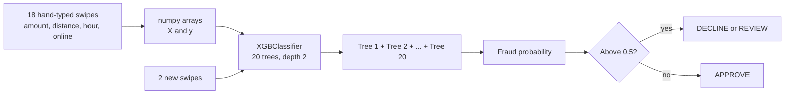
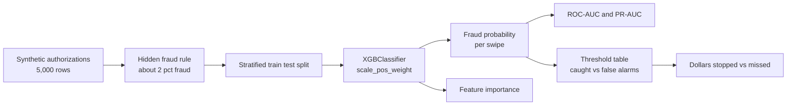
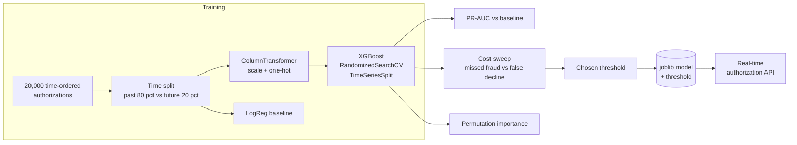
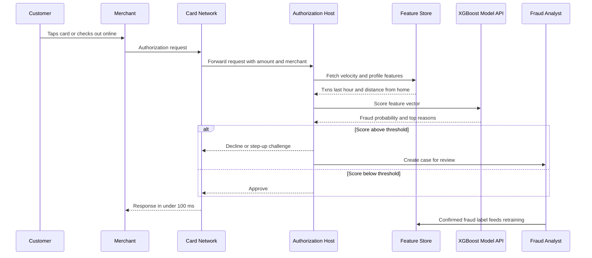

# 1. XGBoost

[](https://colab.research.google.com/github/EdwardSuresh/30-ai-algorithms/blob/main/notebooks/01-xgboost.ipynb)  

[All algorithms](../../README.md#-the-30-algorithms-ranked) · [2. Logistic Regression →](../02-logistic-regression/README.md)

> **XGBoost builds hundreds of small decision trees one after another, each new tree correcting the mistakes of the trees before it.**

💡 **Analogy:** Think of a cricket team reviewing match footage: the first coach fixes the biggest batting flaw, the next coach looks only at what is still going wrong, and so on. After many small corrections the team is far better than any single coach could make it.

## The use case (same for Easy, Medium and Hard)
**Financial Services — Real-time credit card fraud detection**

Every time a card is swiped or used online, the issuing bank has a few milliseconds to approve or decline. Only about 1-2% of authorizations are fraud, but each one costs the bank the full amount plus chargeback fees, while declining a good customer costs goodwill and call-centre time. The bank has rich history: amount, merchant category, channel, distance from home, velocity of recent transactions and account age. Success means catching more fraud dollars at the same or lower false-decline rate than today's rules.

## Industry adoption
| Sector | Score | Where you meet it |
|---|---|---|
| Financial Services | ■■■■■ 5/5 | Real-time card fraud scoring, credit risk challenger models, AML alert prioritisation. |
| Insurance | ■■■■■ 5/5 | Claims fraud triage, lapse/retention prediction and pricing models alongside GLMs. |
| Supply Chain | ■■■■■ 5/5 | Late-delivery risk, demand forecasting with engineered lag features, supplier risk scoring. |
| Oil & Gas | ■■■■□ 4/5 | Equipment failure prediction from sensor features and production rate estimation. |

**Why rank #1:** XGBoost is the default winner on tabular business data - the rows-and-columns data that banks, insurers and supply chains actually run on. It is fast, handles missing values and imbalance, and has mature explainability (SHAP), so it appears in fraud, credit, pricing and forecasting stacks everywhere.

## How it works
1. Start with a simple guess for everyone (the overall fraud rate, in log-odds).
2. Measure how wrong that guess is for each row (the gradient of the loss).
3. Fit a small decision tree that predicts those errors.
4. Add the tree's output to the running score, shrunk by the learning rate.
5. Repeat for hundreds of trees, with regularisation (L1/L2, max_depth, min_child_weight) to stop overfitting.
6. Convert the final summed score to a probability with the sigmoid function.

## Key terms
| Term | Meaning |
|---|---|
| boosting | Training models in sequence so each one focuses on what the previous ones got wrong. |
| learning_rate (eta) | How much each new tree is allowed to change the score; smaller = slower but safer. |
| max_depth | How many questions deep each tree can go; controls how complex interactions can get. |
| scale_pos_weight | Extra weight on the rare positive class (fraud) to counter imbalance. |
| PR-AUC | Area under the precision-recall curve; the honest metric when positives are rare. |
| early stopping | Stop adding trees when validation performance stops improving. |
| SHAP | A method that splits each prediction into per-feature contributions, used for reason codes. |

## 🟢 Easy — Score 2 new card swipes with 20 tiny trees
Train XGBoost on 18 hand-typed card authorizations and watch the fraud probability sharpen as trees are added.

| 5W + H | |
|---|---|
| **Who** | A fraud strategy analyst learning how the bank's authorization score is produced. |
| **What** | A tiny fraud model that says APPROVE or DECLINE/REVIEW for two new swipes. |
| **When** | During card authorization - the score must come back in milliseconds while the customer waits at the till. |
| **Where** | In the issuer's authorization path, between the card network request and the approve/decline response. |
| **Why** | To see that boosting is just many small trees adding up corrections, before scaling to millions of rows. |
| **How** | Type 18 swipes as Python lists, fit XGBClassifier with 20 depth-2 trees, and print the probability after 1, 3, 5, 10 and 20 trees. |

**Architecture**



**🧠 ML concepts:** Boosting: each tree fixes the errors of earlier trees, Learning rate as a step size, Predicted probability vs hard decision, Feature importance, Decision threshold  
**🐍 Python concepts:** Lists of lists, List repetition and concatenation, numpy arrays, f-string alignment specs, zip and sorted with a lambda key, List comprehension with inline if/else

**Steps the code performs**
1. Type 18 swipes and their fraud labels as Python lists
2. Convert them to numpy arrays
3. Fit an XGBoost model with 20 small trees
4. Score two new swipes using only the first k trees to see the score build up
5. Print which feature the trees relied on
6. Turn probabilities into approve/decline decisions

▶️ Code: [`easy.py`](easy.py) — run with `python easy.py`

<details><summary>Walkthrough</summary>

| Lines | What happens |
|---|---|
| 2-3 | Import numpy for arrays and the XGBoost classifier. XGBoost ships its own scikit-learn style wrapper so it feels like any sklearn model. |
| 5-13 | Each inner list is one card authorization: dollars, km from home, hour and an online flag. The last five are known fraud - big, far away, at night, mostly online. |
| 15-19 | Build the 0/1 labels with list arithmetic, convert to numpy, and print the fraud rate. Real fraud is ~1-2%; here it is 28% so the toy example has something to learn. |
| 21-25 | Create and train the booster. Each of 20 trees has at most 2 levels of questions, and each only moves the score by 30% of its opinion (learning_rate). |
| 27-35 | Score a normal coffee swipe and a suspicious 3am online swipe using only the first k trees. You can watch the fraud probability climb from 0.40 to 0.90 as trees accumulate - that is boosting. |
| 37-43 | Show which column the trees used. With 18 rows a single split on distance separates the classes, so it gets all the credit - a reminder that importance on tiny data is unstable. |
| 45-49 | Turn probabilities into actions with a 0.5 cut-off. In production the cut-off is set from the cost of fraud vs the cost of annoying a good customer. |

</details>

<details><summary>Real output</summary>

```text
Data shape: (18, 4) | fraud rows: 5 | fraud rate: 28%

Trees used | P(fraud) coffee swipe | P(fraud) 3am online swipe
         1 |                0.222 |                     0.398
         3 |                0.147 |                     0.582
         5 |                0.102 |                     0.703
        10 |                0.050 |                     0.853
        20 |                0.038 |                     0.898

Feature importance (gain share):
  km_from_home  ######################################## 1.00
  amount_usd                                             0.00
  hour_of_day                                            0.00
  is_online                                              0.00

Decisions: ['APPROVE', 'DECLINE/REVIEW']
```

</details>

**Try this next:** Change learning_rate to 1.0 and see how fast the probabilities jump - then try 0.05. · Add a 6th fraud swipe that is small and local (e.g. [9.0, 2, 14, 0]) and see how the model reacts. · Set max_depth=1 so every tree is a single question and compare the final probabilities.

## 🟡 Medium — Score 5,000 authorizations with 2% fraud
Train XGBoost on a realistic imbalanced card dataset and judge it with PR-AUC, thresholds and dollars stopped.

| 5W + H | |
|---|---|
| **Who** | A fraud data scientist building the first version of a card-not-present and card-present fraud score. |
| **What** | A fraud probability for every authorization plus a table showing caught fraud vs false alarms at three cut-offs. |
| **When** | Offline on last quarter's labelled authorizations, before the model is wired into real-time scoring. |
| **Where** | In a notebook or batch job reading from the fraud data mart; scores later move to the authorization API. |
| **Why** | Fraud is only ~2% of swipes, so accuracy is useless - the team must see recall, precision and dollars at stake. |
| **How** | Simulate 5,000 authorizations with a hidden non-linear fraud rule, stratified split, scale_pos_weight for imbalance, then PR-AUC and a threshold table. |

**Architecture**



**🧠 ML concepts:** Class imbalance and scale_pos_weight, Stratified train/test split, ROC-AUC vs PR-AUC, Confusion matrix and precision, Threshold trade-off, Row and column subsampling  
**🐍 Python concepts:** numpy default_rng generator, pandas DataFrame from a dict, Boolean masks with & and ~, Tuple unpacking from ravel(), Conditional expression to avoid divide-by-zero, Series.items() loop

**Steps the code performs**
1. Generate 5,000 authorizations with realistic columns
2. Create fraud labels from a hidden rule (far + card-not-present is very risky)
3. Split 70/30 keeping the fraud rate equal in both parts
4. Train XGBoost with scale_pos_weight to up-weight fraud
5. Report ROC-AUC and PR-AUC against a random baseline
6. Compare caught fraud and false alarms at three thresholds
7. Print top drivers and dollars stopped

▶️ Code: [`medium.py`](medium.py) — run with `python medium.py`

<details><summary>Walkthrough</summary>

| Lines | What happens |
|---|---|
| 2-6 | Imports: pandas for the table, sklearn for splitting and metrics, XGBoost for the model. |
| 8-21 | Generate 5,000 authorizations. Amounts are lognormal (many small, a few large), distance is exponential, and card_present is 70% yes - shapes close to real card data. |
| 23-30 | Create the ground truth. Fraud gets likelier at night, at risky merchants and especially when the card is far from home AND not present - an interaction trees can find. About 2% of rows end up as fraud. |
| 32-35 | Separate features from the label and split with stratify so the 30% test set keeps the same rare fraud rate. |
| 37-43 | Train 300 shallow trees. scale_pos_weight ~46 tells XGBoost one fraud row matters as much as 46 genuine rows; subsample and colsample add randomness that reduces overfitting. |
| 45-49 | Score the test set. ROC-AUC is 0.86 but PR-AUC is 0.16 - still 7x better than random (0.021). PR-AUC is the honest number when fraud is rare. |
| 51-56 | Loop over three cut-offs and unpack the confusion matrix. Lower thresholds catch more fraud but create more false alarms - the classic fraud trade-off. |
| 58-62 | Rank the drivers by importance and print ASCII bars so analysts can sanity-check the model. |
| 64-70 | Translate to money: fraud dollars stopped and missed at threshold 0.5, and how many good customers were inconvenienced. |

</details>

<details><summary>Real output</summary>

```text
Rows: 5000  fraud cases: 106  fraud rate: 2.12%
scale_pos_weight used: 46.3

ROC-AUC: 0.861
PR-AUC : 0.156  (random model = 0.021)

Threshold | caught fraud | missed | false alarms | precision
      0.5 |           18 |     14 |           84 |      0.18
      0.7 |            6 |     26 |           34 |      0.15
      0.9 |            3 |     29 |            8 |      0.27

Top drivers:
  card_present    ######### 0.19
  hour            ####### 0.16
  km_from_home    ####### 0.14
  merchant_risk   ####### 0.14
  txn_amount      ###### 0.13

At threshold 0.5: fraud $ stopped = $2,427, fraud $ missed = $1,384
Customers inconvenienced (declines/step-up) = 102 of 1500 swipes
```

</details>

**Try this next:** Remove scale_pos_weight and compare how many frauds are caught at 0.5. · Add a feature 'is_night' = hour < 5 explicitly and see if PR-AUC changes. · Try thresholds 0.2 and 0.3 - how many extra false alarms per extra fraud caught?

## 🔴 Hard — Real-time fraud scorer with cost-based cut-off
Build a time-aware, tuned XGBoost pipeline that beats a logistic baseline, picks a threshold on dollars, and is saved for deployment.

| 5W + H | |
|---|---|
| **Who** | The fraud ML team plus model risk management, who must approve the model before it scores live traffic. |
| **What** | A saved pipeline (encoder + scaler + XGBoost) and a business-chosen threshold, with PR-AUC, permutation importance and governance notes. |
| **When** | Trained on the first 80% of a quarter and tested on the last 20%, mimicking deployment on future traffic. |
| **Where** | Batch training in the model platform; the joblib artifact is served behind a low-latency authorization API. |
| **Why** | Fraud patterns drift and false declines cost real money and goodwill, so tuning, time-aware validation and a cost-based cut-off are required. |
| **How** | ColumnTransformer + XGBoost Pipeline, RandomizedSearchCV over TimeSeriesSplit on PR-AUC, cost sweep, permutation importance, joblib.dump to a temp dir. |

**Architecture**



**🧠 ML concepts:** Time-ordered validation to avoid leakage, Hyperparameter search on PR-AUC, Cost-sensitive threshold selection, Permutation importance, Baseline comparison, Model risk governance (SR 11-7)  
**🐍 Python concepts:** Functions with default arguments and docstrings, Pipeline step__param naming, min() with a key function, Dict comprehension to clean keys, if __name__ == '__main__' guard, tempfile and os.path

**Steps the code performs**
1. Simulate 20,000 time-ordered authorizations with categorical merchant and channel
2. Split by time: first 80% train, last 20% test
3. Fit a class-weighted logistic regression baseline
4. Tune XGBoost with RandomizedSearchCV over TimeSeriesSplit folds
5. Compare ROC-AUC and PR-AUC on the future test window
6. Sweep thresholds and pick the one with lowest total business cost
7. Explain the model with permutation importance
8. Save pipeline and threshold with joblib

▶️ Code: [`hard.py`](hard.py) — run with `python hard.py`

<details><summary>Walkthrough</summary>

| Lines | What happens |
|---|---|
| 2-15 | Imports for the full pipeline: preprocessing, baseline, time-series CV, search, metrics, explainability and persistence. |
| 17-21 | Constants: numeric and categorical column lists and the business costs - a missed fraud costs its dollar amount, a false decline about $15 of friction and call-centre time. |
| 24-51 | Simulate a quarter of authorizations sorted by time. Fraud rings hitting electronics and gift cards online at night form a three-way interaction (combo) that a linear model cannot express but trees can. |
| 54-60 | Wrap preprocessing and model in one Pipeline so exactly the same transforms run in training and in the live API. |
| 63-73 | Sweep cut-offs from 0.05 to 0.95. For each, total cost = dollars of fraud let through + $15 per good customer declined. min with a key picks the cheapest. |
| 76-83 | Split by time, not randomly: training on the past and testing on the future is how the model will actually be used. |
| 85-89 | Fit a class-weighted logistic regression baseline - XGBoost must beat it to justify the extra complexity. |
| 91-104 | Tune depth, learning rate, subsample and min_child_weight with 4 random combos, each scored by PR-AUC on 3 forward-in-time folds. |
| 107-119 | Report both models (XGBoost PR-AUC 0.23 vs 0.07 for the baseline), then the cost table. The chosen threshold 0.8 costs less than having no model at all. |
| 121-138 | Explain with permutation importance, print the model-risk reminders and save pipeline + threshold together with joblib. |

</details>

<details><summary>Real output</summary>

```text
Authorizations: 20,000  fraud rate: 1.61%
Best params: {'subsample': 0.9, 'min_child_weight': 1, 'max_depth': 3, 'learning_rate': 0.06}

Model               ROC-AUC   PR-AUC
LogReg baseline       0.769    0.070
XGBoost tuned         0.814    0.234
(PR-AUC of random guessing = 0.014)

Threshold | total cost $ | fraud caught | false declines
     0.05 |       56,070 |           55 |           3738
      0.2 |       34,100 |           51 |           2224
     0.35 |       19,249 |           40 |           1136
      0.5 |       11,086 |           31 |            503
     0.65 |        7,155 |           25 |            197
      0.8 |        5,526 |           17 |             49
     0.95 |        6,277 |            2 |              0
Chosen threshold 0.8: cost $5,526 vs $6,457 with no model

Permutation importance (PR-AUC drop):
  merchant_cat   +0.1414
  hour           +0.1204
  channel        +0.1117
  km_from_home   +0.1002
  amt_vs_avg     +0.0968
  card_present   +0.0598

Model risk: SR 11-7 validation, monthly PSI drift checks, reason codes for declines,
PCI-DSS for card data; fraud models are not credit decisions but still need governance.
Saved model + threshold to card_fraud_xgb.joblib (181 KB)
```

</details>

**Try this next:** Change COST_FP to 5 (a cheap step-up SMS instead of a decline) and see how the chosen threshold moves. · Set n_iter=8 in RandomizedSearchCV and check whether PR-AUC improves enough to justify the extra time. · Shuffle the split (train_test_split) instead of the time split and compare - optimistic results are a sign of leakage.

## 🔄 End-to-end production flow



## ⚠️ Pitfalls
- Judging the model by accuracy - 98% accuracy is achieved by approving everything. Use PR-AUC, recall at a fixed false-positive rate, and dollars.
- Random train/test splits on time-ordered data leak future patterns into training. Split by time and validate forward.
- Using a 0.5 threshold by default. Choose the cut-off from the cost of missed fraud vs false declines, and revisit it as volumes change.
- Label delay: chargebacks arrive weeks later, so recent data looks cleaner than it is. Exclude the most recent weeks from training or wait for labels to mature.
- Overfitting with deep trees and many rounds. Use early stopping, max_depth 3-6 and min_child_weight.
- Shipping without reason codes. Analysts and customers need to know why - add SHAP-based explanations and monitor drift.

**When NOT to use it:** Avoid it when you have very little data, need a fully transparent points-based model (e.g. some regulated credit scorecards), or the data is images, audio or free text where deep learning fits better.

## 🎤 Interview questions
<details><summary>Why does XGBoost usually beat a single decision tree or a random forest on tabular data?</summary>

It builds trees sequentially, each fitting the remaining error, so it reduces bias step by step while regularisation (shrinkage, depth limits, L1/L2) controls variance. Random forests average independent trees, which mainly reduces variance.

</details>
<details><summary>How do you handle a 1% fraud rate with XGBoost?</summary>

Use scale_pos_weight (or sample weights), evaluate with PR-AUC rather than accuracy, keep the split stratified or time-based, and pick the decision threshold from business costs rather than 0.5.

</details>
<details><summary>How would you explain an XGBoost decline to a regulator or customer?</summary>

Use SHAP values to break each score into per-feature contributions and map the top ones to reason codes. Back that with global importance, stability tests and model documentation under SR 11-7.

</details>

---
[All algorithms](../../README.md#-the-30-algorithms-ranked) · [2. Logistic Regression →](../02-logistic-regression/README.md)
