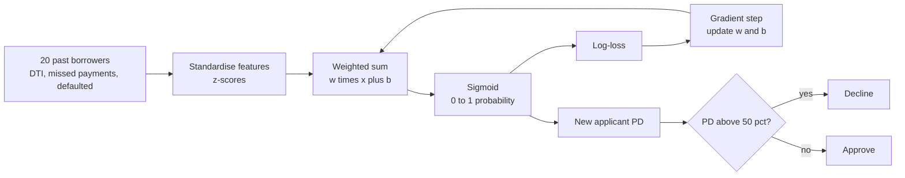
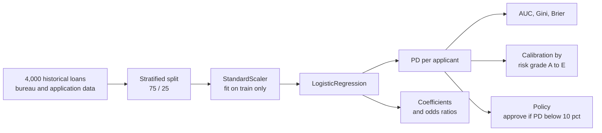
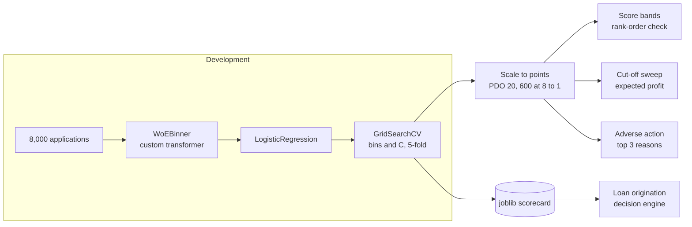
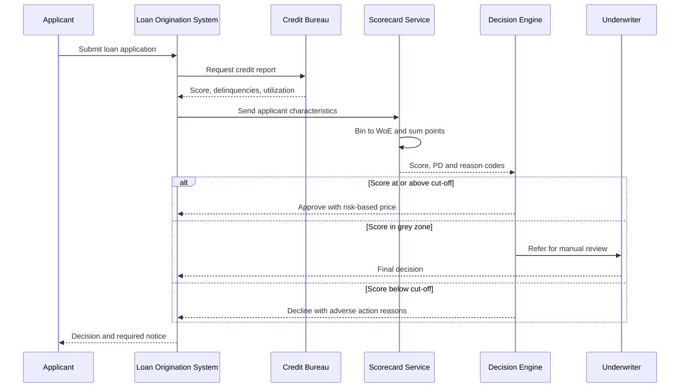

# 2. Logistic Regression

[](https://colab.research.google.com/github/EdwardSuresh/architects-ml-playbook/blob/main/notebooks/02-logistic-regression.ipynb)  

[← 1. XGBoost](../01-xgboost/README.md) · [All algorithms](../../README.md#-the-30-algorithms-ranked) · [3. Random Forest →](../03-random-forest/README.md)

> **Logistic regression adds up weighted inputs and squashes the total through an S-shaped curve to give the probability of a yes/no outcome.**

💡 **Analogy:** A bank loan officer keeps a mental tally: plus points for a steady job, minus points for missed payments, plus for low debt. Logistic regression is that tally written down precisely, with the final total converted into a percentage chance of default.

## The use case (same for Concept, Build and Production)
**Financial Services — Consumer loan default prediction and credit scorecard**

A lender approves thousands of unsecured personal loans a month and roughly 10-15% of them go bad within a year. Credit officers need a probability of default for every applicant to set approve/decline cut-offs, price the loan and reserve for losses. They have bureau data (credit score, delinquencies, inquiries, utilization) and application data (income, debt-to-income, employment). Success means a stable, well-calibrated score that rank-orders risk, passes model validation and fair-lending review, and produces clear adverse action reasons for every decline.

## Industry adoption
| Sector | Score | Where you meet it |
|---|---|---|
| Financial Services | ■■■■■ 5/5 | Credit card and personal loan application scorecards, PD models for IFRS 9 / CECL, collections prioritisation. |
| Insurance | ■■■■■ 5/5 | Policy lapse and renewal propensity, claim-reported-as-litigated probability, underwriting referral triage. |
| Supply Chain | ■■■□□ 3/5 | Probability a purchase order arrives late or a supplier fails an audit, as an interpretable baseline. |
| Oil & Gas | ■■■□□ 3/5 | Probability of a pipeline segment failing an inspection from age, coating and soil data. |

**Why rank #2:** Logistic regression is the workhorse of regulated decisions: most credit scorecards, many insurance propensity models and countless baselines are built on it. It is fast, stable, easy to validate and its coefficients translate directly into odds and reason codes that regulators accept.

## How it works
1. Give every input feature a weight (coefficient) and add an intercept.
2. Compute the weighted sum for each applicant - this is the log-odds.
3. Pass the log-odds through the sigmoid to get a probability between 0 and 1.
4. Measure error with log-loss, which punishes confident wrong answers heavily.
5. Adjust the weights (gradient descent or a solver like L-BFGS) to minimise log-loss, with optional regularisation.
6. Read each coefficient as a change in log-odds; exp(coefficient) is the odds ratio.

## Key terms
| Term | Meaning |
|---|---|
| sigmoid | The S-shaped function 1/(1+e^-z) that turns any number into a probability. |
| log-odds (logit) | ln(p / (1-p)); logistic regression is linear on this scale. |
| odds ratio | exp(coefficient): how much the odds multiply when that feature rises by one unit. |
| Gini | 2 x AUC - 1; the standard ranking-power metric in credit risk. |
| calibration | Whether predicted probabilities match observed rates (a 10% PD group defaults about 10% of the time). |
| Weight of Evidence (WoE) | ln(%good / %bad) in a bin; used to transform features for scorecards. |
| regularisation (C) | A penalty that shrinks coefficients to reduce overfitting; smaller C = stronger penalty. |

## 🟢 Concept — Hand-code default odds for 20 borrowers
Write logistic regression from scratch with numpy gradient descent and turn two applicants into probabilities of default.

| 5W + H | |
|---|---|
| **Who** | A credit analyst who wants to see what is inside the PD model the risk team uses. |
| **What** | A two-feature probability-of-default (PD) model trained by gradient descent in about 20 lines. |
| **When** | At application time - the lender needs a PD before deciding to approve, decline or reprice. |
| **Where** | On a laptop with plain numpy; the same maths runs inside every loan origination system's scoring engine. |
| **Why** | Logistic regression is the backbone of credit scoring; seeing weights move and log-loss fall builds real intuition. |
| **How** | Standardise debt-to-income and missed payments, loop 200 gradient steps on log-loss, then score two new applicants. |

**Architecture**



**🧠 ML concepts:** Sigmoid / logistic function, Log-loss (cross-entropy), Gradient descent, Feature standardisation, Odds ratios from coefficients  
**🐍 Python concepts:** List of tuples, numpy slicing [:, :2], Defining a function with def, Matrix multiplication with @, In-place update -=, Modulo % for periodic printing

**Steps the code performs**
1. Type 20 borrowers as tuples
2. Split features and labels and standardise them
3. Define the sigmoid function
4. Run 200 gradient-descent steps, printing log-loss
5. Convert weights to odds multipliers
6. Score two new applicants

▶️ Code: [`easy.py`](easy.py) — run with `python easy.py`

<details><summary>Walkthrough</summary>

| Lines | What happens |
|---|---|
| 4-10 | Twenty past borrowers typed as tuples: debt-to-income %, missed payments in two years, and whether they defaulted. Some rows break the pattern on purpose, like real life. |
| 11-16 | Turn the list into a numpy table, split features (first two columns) from the label, and z-score the features so both are on the same scale. |
| 18-20 | The sigmoid squashes any number into 0-1, which we read as probability of default. |
| 22-30 | Gradient descent: predict, measure log-loss, then move each weight a little in the direction that lowers the loss. (p - y) is the error for each borrower. |
| 31-33 | Print every 50 steps so you can watch the loss fall from 0.693 (coin flip) to 0.365 and the weights settle. |
| 35-36 | exp(weight) is an odds ratio: one standard deviation more missed payments multiplies the odds of default by about 6.5x. This is exactly how credit officers read models. |
| 38-44 | Standardise the new applicants with the SAME mean and std, apply the formula and turn PD into a decision. |

</details>

<details><summary>Real output</summary>

```text
step   0  log-loss 0.693  weights DTI=+0.14 missed=+0.16
step  50  log-loss 0.367  weights DTI=+1.19 missed=+1.61
step 100  log-loss 0.365  weights DTI=+1.27 missed=+1.81
step 150  log-loss 0.365  weights DTI=+1.29 missed=+1.86
step 200  log-loss 0.365  weights DTI=+1.29 missed=+1.88

Odds multiplier per +1 std of DTI: 3.65x, of missed payments: 6.55x
DTI 20%, missed 0 -> probability of default 2.1% -> APPROVE
DTI 48%, missed 3 -> probability of default 95.4% -> DECLINE
```

</details>

**Try this next:** Change lr to 0.05 and watch how many more steps the loss needs to settle. · Add a third feature (e.g. years at address) to every tuple and to the weights. · Change the decision cut-off from 0.5 to 0.2 - a typical bank is far more conservative.

## 🟡 Build — Calibrated PD model on 4,000 loans
Fit scikit-learn logistic regression on realistic loan data, read odds ratios, check calibration by risk grade and set an approval policy.

| 5W + H | |
|---|---|
| **Who** | A credit risk modeller preparing a PD model for an unsecured consumer loan product. |
| **What** | A 12-month probability-of-default model with AUC, Gini, Brier score, odds ratios and a calibration table. |
| **When** | During model development, using a historical cohort whose 12-month outcomes are known. |
| **Where** | In the risk analytics environment; output PDs feed pricing, approval cut-offs and loss provisioning. |
| **Why** | PDs must both rank risk (Gini) and be accurate in level (calibration) because they drive pricing and capital. |
| **How** | Simulate 4,000 loans, stratified split, StandardScaler + LogisticRegression, then AUC/Gini/Brier, odds ratios, quintile calibration and a PD < 10% approval policy. |

**Architecture**



**🧠 ML concepts:** Probability of default (PD), AUC and Gini coefficient, Brier score and calibration, Odds ratios from standardised coefficients, Avoiding leakage when scaling, Cut-off policy  
**🐍 Python concepts:** np.clip for realistic bounds, pandas column arithmetic, pd.qcut for buckets, groupby with named aggregation, Boolean masks and ~, Multi-line f-strings

**Steps the code performs**
1. Generate 4,000 loans with bureau-style features
2. Create default labels from a hidden logistic rule
3. Stratified train/test split
4. Scale on train only, fit logistic regression
5. Report AUC, Gini and Brier
6. Print coefficients as odds ratios
7. Check calibration by risk grade
8. Apply a PD < 10% approval policy

▶️ Code: [`medium.py`](medium.py) — run with `python medium.py`

<details><summary>Walkthrough</summary>

| Lines | What happens |
|---|---|
| 9-19 | Generate loans with realistic ranges: credit scores 450-850, DTI 2-70%, lognormal incomes and loan sizes, delinquencies and job tenure. |
| 20-24 | Hidden truth: lower credit score, higher DTI, more delinquencies and a bigger loan-to-income ratio raise the odds of default. About 13% default. |
| 26-34 | Split, then fit the scaler only on training data (fitting on all data would leak test information), and train the logistic regression. |
| 36-40 | Score the test set. AUC 0.77 means a random defaulter scores higher than a random good borrower 77% of the time; Gini = 2*AUC - 1 is what credit teams report. |
| 42-46 | Because features are scaled, coefficients are comparable. Credit score is the strongest: +1 std cuts the odds of default to 0.35x. |
| 48-55 | Bucket applicants into five grades by PD and compare average predicted PD with actual default rate. They track closely - the model is well calibrated. |
| 57-62 | Apply a simple policy: approve if PD < 10%. About 54% approved with a 5.3% bad rate vs 22.8% among declines. |

</details>

<details><summary>Real output</summary>

```text
Loans: 4000  12-month default rate: 13.3%
AUC 0.765 | Gini 0.530 | Brier 0.100

Coefficient (per 1 std) and odds ratio:
  credit_score     -1.059   odds x0.35
  months_employed  -0.291   odds x0.75
  annual_income_k  -0.264   odds x0.77
  loan_amount_k    +0.168   odds x1.18
  delinq_2y        +0.309   odds x1.36
  debt_to_income   +0.565   odds x1.76

Risk grade calibration:
         loans  predicted  actual
grade                            
A-best     200      0.017   0.020
B          200      0.045   0.070
C          200      0.088   0.085
D          200      0.159   0.155
E-worst    200      0.371   0.335

Policy PD < 10%: approve 54% of applicants, bad rate among approved 5.3% vs 22.8% among declined
```

</details>

**Try this next:** Add class_weight='balanced' and see what happens to calibration (predicted PDs inflate). · Drop credit_score and see how much Gini falls. · Change the policy to PD < 5% and compare approval rate vs bad rate.

## 🔴 Production — Points-based scorecard with adverse action
Build a production-style WoE scorecard: custom sklearn transformer, tuned via CV, scaled to points, with cut-off economics and adverse action reasons.

| 5W + H | |
|---|---|
| **Who** | Credit risk, model validation and compliance teams who must approve and explain every decline. |
| **What** | A saved scorecard pipeline producing a 3-digit score, score-band bad rates, a profit-based cut-off and top-3 decline reasons. |
| **When** | Built yearly or when performance degrades; used for every new application in real time. |
| **Where** | Model development platform; the joblib artifact is deployed to the loan origination decision engine. |
| **Why** | Regulators expect transparent, stable models; ECOA/Reg B requires specific adverse action reasons; points scorecards deliver both. |
| **How** | WoE binning class inside a Pipeline, GridSearchCV over bins and C, baseline comparison, PDO scaling to points, rank-ordering table, cut-off sweep, reason codes, joblib save. |

**Architecture**



**🧠 ML concepts:** Weight of Evidence (WoE) and Information Value (IV), Regularisation strength C, Points-to-double-odds (PDO) scaling, Rank-ordering and score bands, Profit-based cut-off, Adverse action reasons and fair lending  
**🐍 Python concepts:** Writing a class that inherits from sklearn base classes, __init__ vs fit and trailing-underscore attributes, Dict comprehension, Returning multiple values from a function, pd.cut with labels, Series.nlargest

**Steps the code performs**
1. Simulate 8,000 applications with a U-shaped utilization risk
2. Write a WoEBinner transformer that learns bins, WoE and IV
3. Tune bins and C with 5-fold stratified GridSearchCV
4. Compare against a raw-feature logistic regression baseline
5. Convert log-odds to scorecard points with PDO scaling
6. Check bad rate falls across score bands and sweep cut-offs for profit
7. Generate adverse action reasons for a declined applicant
8. Print fair-lending and model-risk notes and save the scorecard

▶️ Code: [`hard.py`](hard.py) — run with `python hard.py`

<details><summary>Walkthrough</summary>

| Lines | What happens |
|---|---|
| 2-16 | Imports and constants. PDO=20 means every 20 points doubles the good:bad odds; 600 points is anchored to 8:1 odds - standard scorecard scaling. |
| 19-34 | Simulate applications. Utilization is U-shaped: both near-zero and over-80% usage are riskier - a straight line cannot capture that, but bins can. |
| 37-60 | A custom transformer. fit() cuts each feature into quantile bins, counts goods and bads per bin, and stores WoE = ln(%good/%bad) and Information Value. |
| 62-65 | transform() replaces each raw value with its bin's WoE, so the logistic regression sees a smooth, monotone-friendly signal. |
| 68-78 | Convert log-odds into points: factor = PDO/ln2, offset anchors the base score. Each feature's points = -factor x WoE x coefficient. |
| 81-92 | Split, wrap binner + LR in a Pipeline, and tune number of bins and regularisation C with 5-fold stratified cross-validation on AUC. |
| 94-104 | Baseline on raw features scores Gini 0.59; the WoE scorecard reaches 0.62 because it captures the U-shape. IV shows credit score is the strongest characteristic. |
| 106-112 | Score the test set and check rank-ordering: bad rate falls from 47% in the lowest band to ~0% at 680+. |
| 114-120 | Sweep cut-offs using $0.9k margin per good loan and $6k loss per bad. 600 maximises expected profit in this simulation. |
| 122-135 | For the worst applicant, list the 3 characteristics with the biggest point shortfall vs the best bin - these become ECOA adverse action reasons. Then print governance notes and save. |

</details>

<details><summary>Real output</summary>

```text
Applications: 8,000  bad rate: 14.2%
Best params: {'lr__C': 1.0, 'woe__n_bins': 8}  CV AUC 0.801
Test AUC  raw LR 0.796 (Gini 0.593) | WoE scorecard 0.811 (Gini 0.623)

Feature           IV     coef
  credit_score    0.871  -1.079
  debt_to_income  0.173  -1.152
  utilization_pct 0.213  -1.171
  delinq_2y       0.054  -1.100
  months_employed 0.047  -1.189
  inquiries_6m    0.038  -1.154

Score range on test set: 480 - 709
         apps  bad_rate
band                   
<560      280     0.471
560-599   783     0.203
600-639   831     0.049
640-679   448     0.018
680+       58     0.000

Cut-off | approve % | bad rate | expected profit $k
    560 |       89% |     9.9% |          467
    580 |       76% |     7.1% |          743
    600 |       56% |     3.8% |          861
    620 |       38% |     2.4% |          672
    640 |       22% |     1.5% |          416

Declined applicant score 480. Top adverse action reasons:
  - credit_score (value 561.0), 106 points below best bin
  - utilization_pct (value 97.9), 48 points below best bin
  - debt_to_income (value 49.4), 44 points below best bin

Fair lending: no protected attributes used; run disparate-impact tests on proxies (ECOA/FHA).
Model risk: SR 11-7 documentation, independent validation, annual PSI/KS monitoring.
Saved scorecard to pd_scorecard.joblib
```

</details>

**Try this next:** Change PDO to 40 and BASE_ODDS to 20 - the ranking is identical, only the score scale changes. · Set the loss per bad loan to 10 (k$) and see where the profit-maximising cut-off moves. · Remove utilization_pct from FEATS and see how AUC and the adverse action reasons change.

## 🔄 End-to-end production flow



## ⚠️ Pitfalls
- Fitting the scaler or WoE bins on the full dataset leaks test information. Fit all preprocessing inside a Pipeline on training data only.
- Assuming linearity. Risk is often U-shaped or flat-then-steep; use WoE bins, splines or interaction terms and check rank-ordering.
- Highly correlated features (multicollinearity) give unstable or wrong-signed coefficients. Check VIF and drop or combine features.
- Using class_weight='balanced' then reading outputs as real PDs. Re-weighting breaks calibration - recalibrate or avoid it for PD models.
- Including protected attributes or close proxies (e.g. ZIP code) without testing for disparate impact under ECOA and fair-lending rules.
- Not monitoring population stability (PSI) and Gini after go-live; applicant mix shifts and scorecards decay.

**When NOT to use it:** Skip it when relationships are highly non-linear with many interactions and explainability is less critical (gradient boosting usually wins), or for unstructured data like images and text.

## 🎤 Interview questions
<details><summary>Why is logistic regression still the default for credit scorecards?</summary>

It is transparent, stable and easy to validate: coefficients map to points and odds ratios, which produce clear adverse action reasons. Its performance with good WoE binning is often close to more complex models.

</details>
<details><summary>What does a coefficient of 0.7 on a standardised feature mean?</summary>

A one-standard-deviation increase in that feature raises the log-odds by 0.7, which multiplies the odds of the event by exp(0.7), about 2.0x, holding other features constant.

</details>
<details><summary>How do you check a PD model is calibrated?</summary>

Group applicants by predicted PD (deciles or grades) and compare average predicted PD with actual default rate, using a Hosmer-Lemeshow test or calibration plot, and track the Brier score.

</details>

---
[← 1. XGBoost](../01-xgboost/README.md) · [All algorithms](../../README.md#-the-30-algorithms-ranked) · [3. Random Forest →](../03-random-forest/README.md)
