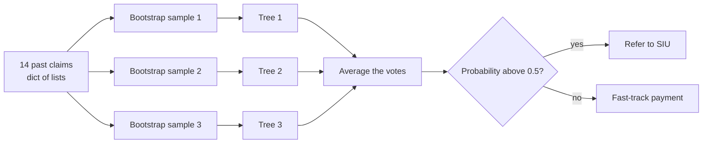
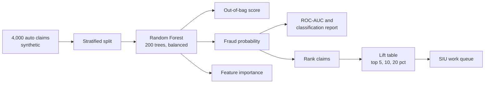
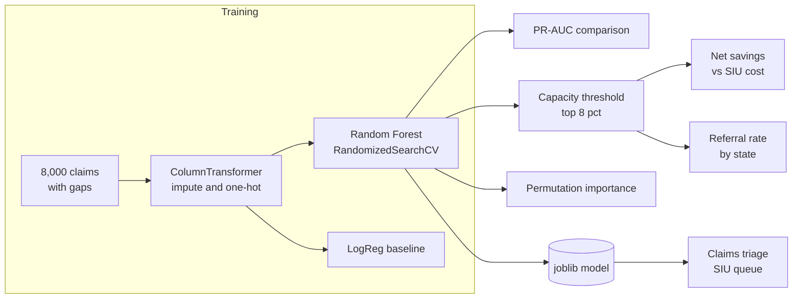
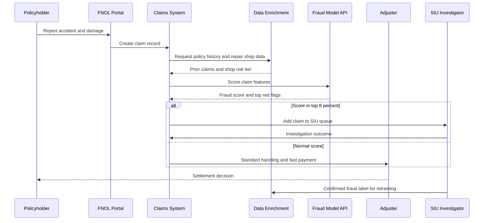

# 3. Random Forest

[](https://colab.research.google.com/github/EdwardSuresh/30-ai-algorithms/blob/main/notebooks/03-random-forest.ipynb)  

[← 2. Logistic Regression](../02-logistic-regression/README.md) · [All algorithms](../../README.md#-the-30-algorithms-ranked) · [4. Gradient Boosting →](../04-gradient-boosting/README.md)

> **A Random Forest trains many decision trees on random slices of the data and averages their votes.**

💡 **Analogy:** Instead of trusting one claims adjuster, you ask a hundred adjusters, each of whom has seen a different random pile of past claims and only looks at a few facts at a time. Their combined vote is far more reliable than any single opinion.

## The use case (same for Easy, Medium and Hard)
**Insurance — Auto insurance claims fraud detection (SIU referral)**

Industry estimates commonly put insurance fraud at around 10% of property-casualty losses, and auto claims are a frequent target: staged accidents, inflated repair bills and padded injury claims. Honest customers pay through higher premiums, while the SIU has only a handful of investigators who cannot review every claim. The insurer has claim details, policy tenure, police reports, witnesses, repair shop data and prior claims. Success means putting the most suspicious claims at the top of the SIU queue so investigators find more fraud per hour while honest claims are paid quickly.

## Industry adoption
| Sector | Score | Where you meet it |
|---|---|---|
| Financial Services | ■■■■■ 5/5 | Transaction fraud challenger models, customer churn, AML alert scoring. |
| Insurance | ■■■■■ 5/5 | Claims fraud SIU referral, subrogation opportunity detection, underwriting triage. |
| Supply Chain | ■■■■□ 4/5 | Supplier risk scoring, stock-out prediction, returns fraud detection. |
| Oil & Gas | ■■■■□ 4/5 | Pump and compressor failure prediction from sensor features, lithology classification from well logs. |

**Why rank #3:** Random Forest is the most forgiving strong model for tabular data: it works well with little tuning, resists overfitting and handles mixed feature types. It is a common first production model and challenger across fraud, claims, churn and equipment-failure use cases, though boosting often edges it on accuracy.

## How it works
1. Draw a bootstrap sample (random rows with replacement) from the training data.
2. Grow a decision tree on it; at every split, consider only a random subset of features.
3. Repeat for hundreds of trees, each different because of the random rows and features.
4. For a new case, every tree gives a prediction.
5. Average the trees' probabilities (or take the majority vote) for the final answer.
6. Use the rows each tree did not see (out-of-bag) as a built-in validation set.

## Key terms
| Term | Meaning |
|---|---|
| bagging | Bootstrap aggregating: train models on random resamples and average them. |
| max_features | How many columns each split may consider; lower values make trees more different. |
| min_samples_leaf | The smallest number of rows allowed in a leaf; larger values smooth predictions. |
| out-of-bag (OOB) score | Accuracy measured on rows a tree did not train on - free validation. |
| SIU | Special Investigations Unit - the insurer team that investigates suspected fraud. |
| lift | How much more often the target appears in a top-scored group than at random. |
| permutation importance | Drop in score when one feature's values are shuffled - less biased than impurity importance. |

## 🟢 Easy — Three trees vote on one suspicious claim
Train a tiny Random Forest on 14 hand-typed auto claims, inspect each tree's vote and see the forest average them.

| 5W + H | |
|---|---|
| **Who** | A claims manager curious how the SIU referral score is produced. |
| **What** | A forest that votes on whether a new auto claim should be referred to the Special Investigations Unit (SIU). |
| **When** | At first notice of loss (FNOL), when the adjuster opens the claim. |
| **Where** | In the claims system's triage step, before payment is authorised. |
| **Why** | Seeing individual trees disagree and then combine makes 'wisdom of the crowd' concrete. |
| **How** | Store 14 claims in a dict of lists, fit a 3-tree forest, print each tree's root question and vote, then compare with a 100-tree forest. |

**Architecture**



**🧠 ML concepts:** Bagging (bootstrap aggregation), Random feature subsets per split, Majority vote / probability averaging, Feature importance  
**🐍 Python concepts:** Dictionary of lists, list(dict) to get keys, np.column_stack, enumerate in a for loop, sorted with reverse=True, String repetition for ASCII bars

**Steps the code performs**
1. Type 14 claims as a dict of columns
2. Stack the columns into a feature matrix
3. Fit a 3-tree forest
4. Print each tree's first question and its vote on a new claim
5. Average into a forest probability
6. Compare with a 100-tree forest and print importances

▶️ Code: [`easy.py`](easy.py) — run with `python easy.py`

<details><summary>Walkthrough</summary>

| Lines | What happens |
|---|---|
| 5-12 | Fourteen past claims stored column by column: days since policy start, claim amount, police report, witnesses - and whether SIU confirmed fraud. |
| 13-16 | Turn the dict into a numeric matrix with one row per claim using column_stack. |
| 18-21 | Build 3 shallow trees, each on a random resample of the claims and each split only seeing 2 random columns - so the trees learn different rules. |
| 23-30 | Ask each tree about a suspicious new claim and print which column it asks about first. Different trees start with different questions. |
| 32-34 | The forest's probability is the average of the trees' probabilities - here all three say fraud. |
| 36-40 | With 100 trees the answer is steadier: the suspicious claim scores 1.00 and a routine one 0.00. |
| 42-45 | Importances show the forest leans on claim amount and the police report, matching adjuster intuition. |

</details>

<details><summary>Real output</summary>

```text
Claims: 14 | known fraud: 5

Each tree's vote on the new claim:
  tree 1: first question asks about 'claim_amount_k' -> vote FRAUD
  tree 2: first question asks about 'police_report' -> vote FRAUD
  tree 3: first question asks about 'days_policy_to_claim' -> vote FRAUD

Forest fraud probability: 1.00 -> Refer to SIU
100-tree forest: suspicious claim 1.00, routine claim 0.00

What the forest relies on:
  claim_amount_k         ************* 0.45
  police_report          ********** 0.36
  days_policy_to_claim   **** 0.14
  witnesses              * 0.04
```

</details>

**Try this next:** Change max_features to 4 so every tree sees all columns - do the trees still disagree? · Flip the police_report of the new claim to 1 and see how the probability changes. · Add a 15th claim that is fraud but looks routine and see whether the forest learns it.

## 🟡 Medium — Rank 4,000 claims for SIU review
Train a class-weighted Random Forest on synthetic auto claims, use out-of-bag validation and measure lift for SIU capacity.

| 5W + H | |
|---|---|
| **Who** | A claims analytics team supporting the SIU, which can only investigate a small share of claims. |
| **What** | A fraud score for every claim, a lift table for the top 5/10/20%, and the main red-flag drivers. |
| **When** | Nightly on newly reported claims, or at FNOL once enough fields are captured. |
| **Where** | In the claims data warehouse; scores are pushed to the SIU work queue. |
| **Why** | Only ~5% of claims are fraudulent; random review wastes investigator time, so ranking matters more than a yes/no. |
| **How** | Simulate 4,000 claims with hidden red-flag patterns, fit RandomForestClassifier with balanced_subsample and oob_score, then ROC-AUC, classification report and lift. |

**Architecture**



**🧠 ML concepts:** Class weighting for imbalance, Out-of-bag (OOB) validation, min_samples_leaf to limit overfitting, Precision and recall, Lift and capacity-based ranking, Impurity-based importance bias  
**🐍 Python concepts:** pandas boolean conditions with &, DataFrame.drop(columns=...), argsort and [::-1] reversal, Slicing the top k, pd.Series sort_values, DataFrame.query

**Steps the code performs**
1. Generate 4,000 claims with realistic fields
2. Label fraud from two hidden red-flag patterns
3. Stratified split
4. Train a balanced Random Forest with OOB scoring
5. Report ROC-AUC and precision/recall
6. Compute lift at SIU capacity levels
7. Print top drivers and dollars targeted

▶️ Code: [`medium.py`](medium.py) — run with `python medium.py`

<details><summary>Walkthrough</summary>

| Lines | What happens |
|---|---|
| 8-19 | Generate claims: days from policy start to loss, lognormal claim amounts, police report, witnesses, prior claims, injury, vehicle age, attorney. |
| 20-26 | Hidden patterns: an injury claim soon after the policy starts, or a large claim with no police report and no witnesses. About 5.5% fraud. |
| 28-31 | Separate features and label and make a stratified 75/25 split. |
| 33-40 | Train 200 trees. balanced_subsample re-weights fraud in each bootstrap; min_samples_leaf=10 stops trees memorising single claims; the OOB score is free validation. |
| 42-45 | Test ROC-AUC 0.82. At 0.5 the forest finds 42% of fraud with 37% precision - but SIU works a ranked queue, not a 0.5 cut. |
| 47-55 | Rank claims by score. The top 5% contains fraud at 42% - 7.6x better than random review. |
| 57-61 | Impurity importance highlights claim amount and policy age. Note it can over-rate many-valued columns like vehicle age. |
| 63-66 | Translate to money: reviewing the top 10% targets about $344k of fraudulent payouts. |

</details>

<details><summary>Real output</summary>

```text
Claims: 4000  confirmed fraud rate: 5.5%
Out-of-bag accuracy: 0.917
Test ROC-AUC: 0.819
              precision    recall  f1-score   support

       legit       0.97      0.96      0.96       945
       fraud       0.37      0.42      0.39        55

    accuracy                           0.93      1000
   macro avg       0.67      0.69      0.68      1000
weighted avg       0.93      0.93      0.93      1000

SIU capacity | fraud found | hit rate | lift vs random
top   5%     |          21 |    42.0% |    7.6x
top  10%     |          28 |    28.0% |    5.1x
top  20%     |          37 |    18.5% |    3.4x

Top red-flag drivers:
  claim_amount           ################## 0.310
  days_policy_to_claim   ############ 0.201
  vehicle_age_yrs        ######## 0.142
  num_witnesses          ###### 0.106
  police_report          ###### 0.101

Investigating top 10% (100 claims) targets $344,114 of fraudulent payouts
```

</details>

**Try this next:** Set class_weight=None and compare recall for the fraud class. · Change min_samples_leaf to 1 and compare OOB accuracy with test AUC - spot the overfitting. · Add a feature for claims reported on a Monday and see whether it shows up in importance.

## 🔴 Hard — SIU referral engine with capacity threshold
Build a production Random Forest pipeline with imputation and encoding, tuned by CV, compared with a baseline, thresholded by SIU capacity and checked for fairness.

| 5W + H | |
|---|---|
| **Who** | Claims analytics, SIU leadership, and the insurer's model governance / compliance team. |
| **What** | A saved pipeline that scores every claim, a capacity-based referral threshold, net savings estimate and permutation importance. |
| **When** | Retrained quarterly; scores run at FNOL and again when new claim facts arrive. |
| **Where** | Training on the analytics platform; the joblib model is called by the claims system's triage rules. |
| **Why** | Real claims data is messy (missing values, categories), SIU has fixed capacity, and NAIC and state rules require governed, non-discriminatory use. |
| **How** | ColumnTransformer (median impute + one-hot) + Random Forest, RandomizedSearchCV on PR-AUC, LogReg baseline, top-8% threshold, cost/benefit, permutation importance, state referral check, joblib. |

**Architecture**



**🧠 ML concepts:** Imputation inside the pipeline, Hyperparameter tuning (depth, leaf size, max_features), PR-AUC for rare events, Capacity-based thresholds, Permutation vs impurity importance, Fairness and governance (NAIC AI Bulletin)  
**🐍 Python concepts:** Functions with keyword defaults, Generators with yield, Conditional list building, Tuple unpacking of constants, groupby on an aligned Series, Dict bundling model + metadata

**Steps the code performs**
1. Simulate 8,000 claims including missing repair estimates and categorical fields
2. Build preprocessing with median imputation and one-hot encoding
3. Fit a logistic regression baseline
4. Tune the Random Forest with RandomizedSearchCV on PR-AUC
5. Set the threshold from SIU capacity (top 8%) and compute net savings
6. Explain with permutation importance
7. Check referral rates by state
8. Save model with its threshold

▶️ Code: [`hard.py`](hard.py) — run with `python hard.py`

<details><summary>Walkthrough</summary>

| Lines | What happens |
|---|---|
| 2-25 | Imports and constants: numeric, categorical and binary column groups, plus $450 per investigation and capacity for 8% of claims. |
| 28-54 | Simulate claims with three hidden fraud patterns, including a flagged repair shop inflating estimates. 5% of repair estimates are blanked to mimic real gaps. |
| 57-64 | Median-impute numbers, one-hot encode categories, pass binary flags through. Scaling is optional and only used for the logistic baseline. |
| 67-73 | A generator that yields one lift row at a time: how many fraud cases fall in the top 2/5/8/15% of scores. |
| 76-96 | Split, fit the baseline, and tune depth, leaf size and features-per-split with 5 random combos scored by PR-AUC on 3 folds. |
| 98-102 | Compare: the forest reaches PR-AUC 0.29 vs 0.20 for the baseline because fraud patterns are interactions. |
| 104-117 | Set the threshold so exactly 8% of claims are referred. That captures 61% of all fraud and nets roughly $790k after investigation costs. |
| 119-125 | Permutation importance on raw columns: police report, witnesses and claim amount drive the score. |
| 127-137 | Referral rates by state are similar, a first fairness check. Print governance notes and save model, threshold and capacity together. |

</details>

<details><summary>Real output</summary>

```text
Claims 8,000 | fraud rate 4.9% | train 6000 / test 2000
Best RF params: {'min_samples_leaf': 25, 'max_features': 0.5, 'max_depth': 6}

Model                 ROC-AUC  PR-AUC
LogReg baseline         0.705   0.195
Random Forest           0.788   0.294

Capacity threshold (top 8%): score >= 0.523
Referred | claims | fraud caught | share of all fraud
top   2% |     40 |           17 |      17%
top   5% |    100 |           36 |      37%
top   8% |    160 |           60 |      61%
top  15% |    300 |           67 |      68%
Fraud payouts avoided $863,343 - SIU cost $72,000 = net $791,343

Permutation importance (PR-AUC drop):
  police_report          +0.1629
  num_witnesses          +0.1612
  claim_amount           +0.1550
  days_policy_to_claim   +0.0579
  injury_claim           +0.0402
  vehicle_age_yrs        +0.0101

Referral rate by state: CA 9%, FL 9%, NY 7%, OK 7%, TX 8%
Governance: NAIC AI Model Bulletin + state unfair-claims laws -> model only PRIORITISES;
a human SIU investigator decides. Log reasons, monitor drift, re-validate yearly.
Saved siu_rf.joblib (902 KB)
```

</details>

**Try this next:** Change SIU_CAPACITY to 0.05 and 0.15 and compare net savings - where are the diminishing returns? · Add 'clf__n_estimators': [100, 300] to the search space and see if it helps. · Remove the 'state' column and confirm the model performs the same (it should - state carries no fraud signal here).

## 🔄 End-to-end production flow



## ⚠️ Pitfalls
- Training on SIU-confirmed labels only: claims never referred are never confirmed, so labels are biased. Add random audit samples to reduce selection bias.
- Using 0.5 as the threshold. SIU capacity is fixed - rank claims and refer the top N instead.
- Trusting impurity-based importance, which favours high-cardinality numeric columns. Confirm with permutation importance or SHAP.
- Very deep trees with min_samples_leaf=1 memorise claims; tune leaf size and depth with cross-validation.
- Large forests can be slow and big to deploy (hundreds of MB). Cap n_estimators and depth and measure latency.
- Letting the model deny claims automatically. Use it to prioritise investigation; a human decides, as unfair-claims-practice laws expect.

**When NOT to use it:** Avoid it when you need a compact, transparent formula (use logistic regression or a GLM), when you must extrapolate beyond the training range (trees cannot), or when latency and model size are tightly constrained.

## 🎤 Interview questions
<details><summary>Why does a Random Forest overfit less than a single deep decision tree?</summary>

Each tree overfits differently because it sees different rows and features; averaging many such noisy-but-different trees cancels out much of the variance while keeping low bias.

</details>
<details><summary>What is the out-of-bag score and why is it useful?</summary>

Each tree leaves out roughly a third of rows in its bootstrap sample; predicting those rows with only the trees that did not see them gives a validation score without a separate hold-out set.

</details>
<details><summary>Random Forest or XGBoost for claims fraud?</summary>

XGBoost often wins on accuracy after tuning, but Random Forest is more robust with little tuning and is easy to parallelise. In practice teams try both and choose on PR-AUC, stability and explainability.

</details>

---
[← 2. Logistic Regression](../02-logistic-regression/README.md) · [All algorithms](../../README.md#-the-30-algorithms-ranked) · [4. Gradient Boosting →](../04-gradient-boosting/README.md)
