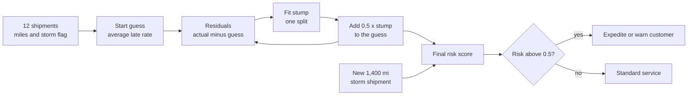
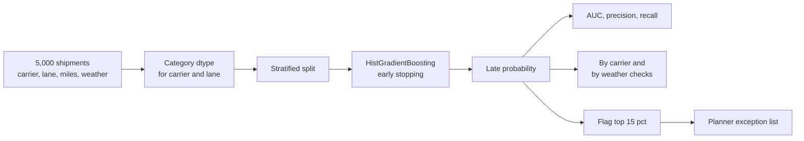
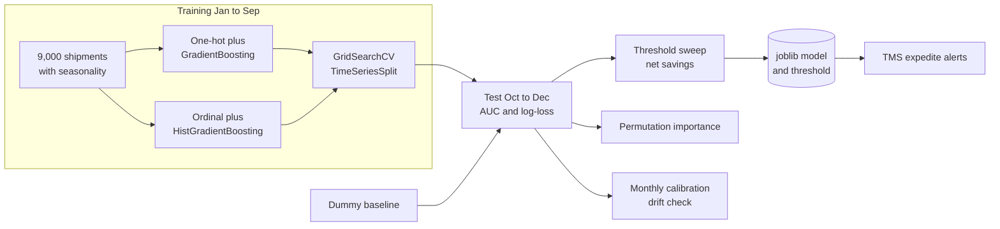
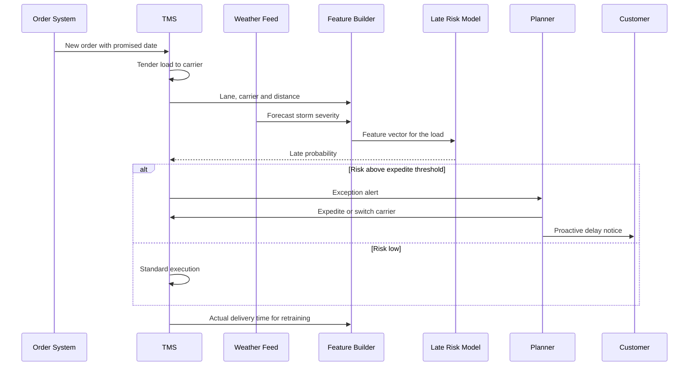

# 4. Gradient Boosting

[](https://colab.research.google.com/github/EdwardSuresh/architects-ml-playbook/blob/main/notebooks/04-gradient-boosting.ipynb)  

[← 3. Random Forest](../03-random-forest/README.md) · [All algorithms](../../README.md#-the-30-algorithms-ranked) · [5. Linear Regression →](../05-linear-regression/README.md)

> **Gradient boosting builds a strong model by adding small decision trees one at a time, each trained to fix the errors the model still makes.**

💡 **Analogy:** A dispatcher estimates delivery times. First guess: the average. Then she notices storms add delay and adjusts; then she notices long lanes add more and adjusts again. Each small correction targets what the previous estimate still got wrong - that is boosting.

## The use case (same for Concept, Build and Production)
**Supply Chain — Predict late shipments (on-time delivery risk)**

A shipper moves thousands of truckloads a month and roughly a third miss the promised delivery date. Late loads mean retailer chargebacks, stock-outs and angry customers, but expediting every load would be far too expensive. The company has carrier, lane, distance, promised transit time, pickup day, dock wait time, weather forecasts and each carrier's recent on-time record. Success means flagging the loads most likely to run late early enough to expedite, re-route or warn the customer, at a total cost lower than today.

## Industry adoption
| Sector | Score | Where you meet it |
|---|---|---|
| Financial Services | ■■■■■ 5/5 | Credit risk challenger models, prepayment and churn prediction, fraud scoring. |
| Insurance | ■■■■■ 5/5 | Claim severity and frequency models alongside GLMs, retention and cross-sell propensity. |
| Supply Chain | ■■■■■ 5/5 | On-time delivery risk, demand forecasting with lag features, warehouse labour planning. |
| Oil & Gas | ■■■■□ 4/5 | Rate-of-penetration prediction in drilling, equipment failure risk, production forecasting from well features. |

**Why rank #4:** Gradient boosting is the core idea behind XGBoost, LightGBM and CatBoost, and scikit-learn's GradientBoosting and HistGradientBoosting bring it to every Python shop without extra dependencies. It sits just below XGBoost because most large-scale production teams use one of the specialised libraries, but the sklearn versions are widely used for mid-size tabular problems.

## How it works
1. Start with a constant prediction (the average, or the log-odds of the average for classification).
2. Compute the gradient of the loss for each row - for squared error this is simply the residual.
3. Fit a small regression tree to those gradients.
4. Add the tree's output, multiplied by a learning rate, to the current predictions.
5. Repeat for many rounds; stop early when validation loss stops improving.
6. HistGradientBoosting speeds this up by bucketing features into histograms - the same trick LightGBM uses; XGBoost adds extra regularisation and engineering on top of the same core.

## Key terms
| Term | Meaning |
|---|---|
| residual | Actual value minus current prediction - what the model still gets wrong. |
| weak learner | A simple model (often a shallow tree) that is only slightly better than guessing on its own. |
| learning rate (shrinkage) | Fraction of each tree's correction actually applied; smaller values need more trees but generalise better. |
| HistGradientBoosting | scikit-learn's fast variant that bins features into up to 255 buckets, with native missing-value and category support. |
| early stopping | Stop adding trees once a held-out validation score stops improving. |
| log-loss | A metric that rewards confident correct probabilities and punishes confident wrong ones. |
| LightGBM / XGBoost | Specialised gradient boosting libraries with the same core idea plus speed and regularisation features. |

## 🟢 Concept — Five stumps learn which loads run late
Hand-code gradient boosting with five one-split trees on 12 shipments and watch the error shrink each round.

| 5W + H | |
|---|---|
| **Who** | A logistics planner who wants to understand how the late-shipment risk score is built. |
| **What** | A from-scratch boosting loop that predicts late-delivery risk from distance and a storm flag. |
| **When** | At tender time, when a load is booked with a carrier and a delivery date is promised. |
| **Where** | In a transportation management system (TMS) planning step; here on a laptop. |
| **Why** | Seeing 'fit the residuals, add a small step, repeat' by hand demystifies GradientBoosting, XGBoost and LightGBM. |
| **How** | Start from the average late rate, fit a depth-1 regression tree to the residuals, add half of its prediction, and repeat five times. |

**Architecture**



**🧠 ML concepts:** Residuals as the target for the next tree, Decision stumps as weak learners, Learning rate (shrinkage), Additive model: sum of trees, Why classifiers boost log-odds instead of raw probabilities  
**🐍 Python concepts:** Parallel lists combined with zip, np.full to create a filled array, Appending to a list in a loop, Indexing a literal list, enumerate with tuple unpacking, sum over a generator expression

**Steps the code performs**
1. Type 12 shipments as parallel lists
2. Start every prediction at the average late rate
3. Compute residuals and fit a one-split tree to them
4. Add half the tree's output and repeat five times
5. Print the split chosen and error each round
6. Score a new shipment by summing all trees

▶️ Code: [`easy.py`](easy.py) — run with `python easy.py`

<details><summary>Walkthrough</summary>

| Lines | What happens |
|---|---|
| 5-11 | Twelve shipments as parallel lists: miles, a storm flag and whether the load was late. zip glues them into rows. |
| 13-17 | The first 'model' is just the average late rate (0.50) for every shipment. learning_rate=0.5 means each tree contributes half its opinion. |
| 19-25 | Each round: compute residuals (what we still get wrong), fit a stump to them, and add half of its correction to the predictions. |
| 26-30 | Store the tree and print which feature and threshold it split on, plus the squared error. Error falls from 0.116 to 0.038 in five rounds. |
| 32-35 | Compare actual vs predicted risk for six shipments: storm loads score high, short dry loads score low. |
| 37-44 | Score a new storm shipment by starting at the average and adding every tree's contribution. The raw score overshoots 1.0, which is why real classifiers boost in log-odds. |

</details>

<details><summary>Real output</summary>

```text
Starting guess for every shipment: 0.50

round 1: split on storm    at     0.5 | squared error 0.116
round 2: split on distance at  1350.0 | squared error 0.077
round 3: split on storm    at     0.5 | squared error 0.054
round 4: split on distance at   875.0 | squared error 0.044
round 5: split on distance at  1600.0 | squared error 0.038

Shipment | miles | storm | actual | predicted risk
       0 |   120 |     0 |      0 |   0.10
       1 |   300 |     0 |      0 |   0.10
       2 |   450 |     1 |      1 |   0.71
       3 |   800 |     0 |      0 |   0.10
       4 |   950 |     1 |      1 |   0.83
       5 |  1200 |     0 |      0 |   0.22

New 1,400 mi storm lane -> raw score 1.09, clipped risk 1.00 -> expedite / warn customer
```

</details>

**Try this next:** Set learning_rate = 1.0 and compare the error after five rounds - then try 0.1. · Change max_depth to 2 so each tree can combine distance AND storm. · Run 20 rounds instead of 5 and watch whether training error keeps falling (and why that can overfit).

## 🟡 Build — Predict late loads across 5,000 shipments
Use scikit-learn HistGradientBoostingClassifier with native categoricals and early stopping to score late-delivery risk.

| 5W + H | |
|---|---|
| **Who** | A supply chain analytics team supporting transportation planners and customer service. |
| **What** | A late-delivery probability per shipment, checked by carrier and weather, and a 'flag the top 15%' action list. |
| **When** | When loads are tendered and again the day before pickup as weather forecasts update. |
| **Where** | In the TMS analytics layer; flagged loads appear in the planner's exception dashboard. |
| **Why** | About a third of loads miss the promise date; spotting them early lets planners expedite, re-route or warn customers. |
| **How** | Simulate 5,000 shipments, cast carrier and lane to category, train HistGradientBoosting with early stopping, then AUC, precision/recall, group checks and top-15% capture. |

**Architecture**



**🧠 ML concepts:** Histogram-based gradient boosting, Native categorical support, Early stopping on a validation split, ROC-AUC, precision and recall, Segment-level calibration checks, Rank-based action lists  
**🐍 Python concepts:** rng.choice with probabilities, astype('category'), DataFrame.assign, groupby with named aggregation, iterrows for small tables, np.quantile for cut-offs

**Steps the code performs**
1. Generate 5,000 shipments with carrier, lane, distance, weather and timing
2. Create late labels from a hidden rule
3. Mark carrier and lane as categorical
4. Train HistGradientBoosting with early stopping
5. Report AUC, precision and recall
6. Compare predicted vs actual late rates by carrier and weather
7. Flag the riskiest 15% of loads

▶️ Code: [`medium.py`](medium.py) — run with `python medium.py`

<details><summary>Walkthrough</summary>

| Lines | What happens |
|---|---|
| 8-21 | Generate shipments: carrier, lane, distance, weather severity 0-3, promised transit days, pickup weekday and dock wait hours. |
| 22-28 | The hidden rule: loads late when the promise is tight for the distance, in storms, with a weak carrier, on Friday pickups, and IL-OH in bad weather. About 31% are late. |
| 30-35 | Mark carrier and lane as pandas categories so the model can split on them directly, then make a stratified split. |
| 37-42 | Train with early stopping: 10% of training data is held back and boosting stops when it no longer improves - here after 66 trees. |
| 44-48 | AUC 0.83; at 0.5 the model catches 58% of late loads with 70% precision. |
| 50-57 | Group by carrier: predicted late rates track actual ones, and CheapHaul stands out at ~42% late. |
| 59-63 | Group by weather severity with ASCII bars: risk rises from about 19% in clear weather to about 50% in severe storms. |
| 66-70 | Flag the riskiest 15%: 85% of them really are late, and together they hold 41% of all late loads. |

</details>

<details><summary>Real output</summary>

```text
Shipments: 5000  late rate: 31.5%
Trees actually built (early stopping): 66
ROC-AUC 0.825 | precision 0.70 | recall 0.58

By carrier:
             shipments  actual_late  predicted_late
carrier                                            
BlueLine           399        0.271           0.297
CheapHaul          225        0.422           0.418
FastFreight        380        0.311           0.334
RegionalX          246        0.293           0.306

By weather severity (0 clear .. 3 storm):
  0: actual 19% predicted 18% #######
  1: actual 23% predicted 25% ##########
  2: actual 35% predicted 37% ##############
  3: actual 47% predicted 51% ####################

Flag top 15% (risk >= 0.70): 85% of them really were late vs 31% overall -> catches 41% of all late loads
```

</details>

**Try this next:** Set early_stopping=False and max_iter=400 - does test AUC improve or drop? · Drop 'carrier' and see how much AUC falls. · Change the flag share from 15% to 30% and compare precision vs capture.

## 🔴 Production — On-time risk engine with forward validation
Compare classic GradientBoosting with HistGradientBoosting on time-ordered data, tune both, pick an expedite threshold on dollars and monitor monthly calibration.

| 5W + H | |
|---|---|
| **Who** | Supply chain data science, transportation managers and carrier-relations teams. |
| **What** | A saved HistGradientBoosting pipeline, a cost-based expedite threshold, permutation importance and a monthly drift check. |
| **When** | Trained on Jan-Sep shipments and tested on Oct-Dec; retrained monthly in production. |
| **Where** | Batch training on the analytics platform; scores are served to the TMS for every tendered load. |
| **Why** | Late loads trigger customer chargebacks; expediting costs money too, so the cut-off must balance both, and seasonality makes time-aware validation essential. |
| **How** | Two pipelines (one-hot + GradientBoosting, ordinal + HistGradientBoosting), GridSearchCV with TimeSeriesSplit on log-loss, dummy baseline, threshold sweep on net savings, permutation importance, monthly calibration, joblib. |

**Architecture**



**🧠 ML concepts:** Classic vs histogram gradient boosting (and the link to XGBoost/LightGBM), Time-ordered cross-validation, Log-loss as a probability-quality metric, Break-even threshold from business costs, Permutation importance, Calibration drift monitoring  
**🐍 Python concepts:** os.environ for runtime settings, Datetime columns and the .dt accessor, Functions returning different pipelines by argument, dict.items() unpacking, time.time() for timing, Tuples as running 'best so far' trackers

**Steps the code performs**
1. Simulate a year of shipments with winter storms and hurricane season
2. Split by date: Jan-Sep train, Oct-Dec test
3. Build GradientBoosting and HistGradientBoosting pipelines
4. Tune both with TimeSeriesSplit and compare with a dummy baseline
5. Sweep thresholds for net expedite savings
6. Explain with permutation importance
7. Check monthly predicted vs actual late rate
8. Save the model and threshold

▶️ Code: [`hard.py`](hard.py) — run with `python hard.py`

<details><summary>Walkthrough</summary>

| Lines | What happens |
|---|---|
| 2-24 | Imports and constants. OMP_NUM_THREADS caps threads so HistGradientBoosting stays polite on small servers. A late load costs $800 in chargebacks; expediting costs $180. |
| 27-52 | Simulate a year of loads. Weather follows seasons (winter storms, hurricanes on GA-FL in autumn) and carrier late-rate history is a feature, like a real carrier scorecard. |
| 55-66 | Two pipelines. Classic GradientBoosting searches every split exactly on one-hot data; HistGradientBoosting bins features into 255 buckets and handles categories natively - the LightGBM idea, much faster on big data. |
| 69-74 | Split by date so the test set is the future quarter, which includes the harder December storms. |
| 76-89 | Tune both models with forward-in-time folds, scoring by log-loss (it rewards honest probabilities). A DummyClassifier gives the floor. |
| 91-98 | Compare on the future quarter: both boosters reach AUC ~0.83 vs 0.5 for the dummy; the hist model is kept for speed. |
| 100-111 | Sweep thresholds assuming expediting prevents 70% of late outcomes. Break-even risk is 180 / (0.7 x 800) = 0.32 and the best tested threshold is 0.3. |
| 113-117 | Permutation importance: promised days, distance and weather dominate - planners can act on all three. |
| 119-130 | Monthly calibration check (a light drift monitor): predicted and actual late rates stay within a few points. Then save model and threshold. |

</details>

<details><summary>Real output</summary>

```text
Train 6766 loads (late 33.0%) | Test 2234 loads (late 33.2%)
gbm   best {'clf__learning_rate': 0.05, 'clf__max_depth': 2} | tuned in 7.8s
hist  best {'clf__learning_rate': 0.1, 'clf__max_leaf_nodes': 15} | tuned in 2.0s

Model      ROC-AUC  log-loss
baseline     0.500     0.635
gbm          0.832     0.456
hist         0.829     0.458

Threshold | expedited | late loads caught | net savings $
      0.2 |      1273 |              636 |      127,020
      0.3 |       914 |              552 |      144,600
      0.4 |       720 |              478 |      138,080
      0.5 |       584 |              433 |      137,360
      0.6 |       451 |              358 |      119,300
      0.7 |       346 |              295 |      102,920
      0.8 |       251 |              227 |       81,940
Break-even risk = 0.32; best tested threshold 0.3

Permutation importance (AUC drop):
  promised_days          +0.1371
  distance_mi            +0.1259
  weather_severity       +0.0624
  carrier_late_rate_30d  +0.0126
  dock_wait_hrs          +0.0033
  lane_volume_7d         +0.0022

Month | actual late | predicted
   10 |       27.5% |     31.5%
   11 |       31.4% |     31.5%
   12 |       40.3% |     40.7%
Governance: carrier-scorecard use must be explainable to carriers; retrain monthly, alert if calibration gap > 5 pts.
Saved ontime_hgb.joblib
```

</details>

**Try this next:** Change EXPEDITE_COST to 400 and see the break-even and best threshold move up. · Replace TimeSeriesSplit with KFold(shuffle=True) and compare tuned scores - shuffling leaks seasonal patterns. · Add 'clf__max_depth': [3, 6] to the hist grid and check whether log-loss improves.

## 🔄 End-to-end production flow



## ⚠️ Pitfalls
- Random splits on time-ordered shipments leak seasonal patterns. Validate on later months than you train on.
- Too high a learning rate with too many trees overfits. Use a small learning rate with early stopping.
- Using classic GradientBoostingClassifier on hundreds of thousands of rows - it is slow. Use HistGradientBoosting, LightGBM or XGBoost at scale.
- Leaking the future: features like actual transit time or final delivery status must not be inputs. Only use what is known at prediction time.
- Setting the threshold at 0.5. Derive it from expedite cost vs late penalty (break-even = cost / (benefit x penalty)).
- Ignoring drift: carriers, lanes and weather change. Monitor calibration monthly and retrain on a schedule.

**When NOT to use it:** Avoid it when you need to extrapolate trends beyond the training range, when a simple transparent formula is mandated, or for raw images, audio or text where neural networks are better suited.

## 🎤 Interview questions
<details><summary>How does gradient boosting differ from a Random Forest?</summary>

A Random Forest grows independent deep trees in parallel and averages them to reduce variance. Gradient boosting grows shallow trees one after another, each fitting the remaining errors, which mainly reduces bias.

</details>
<details><summary>What is the relationship between sklearn's HistGradientBoosting, LightGBM and XGBoost?</summary>

All implement gradient-boosted trees. HistGradientBoosting is inspired by LightGBM's histogram binning; XGBoost adds second-order gradients, extra regularisation and its own hist method. Results are often similar; the libraries differ in speed, features and deployment tooling.

</details>
<details><summary>Why use early stopping?</summary>

Each extra tree reduces training error, but after a point it starts fitting noise. Early stopping watches a validation set and stops when its loss no longer improves, choosing the number of trees automatically.

</details>

---
[← 3. Random Forest](../03-random-forest/README.md) · [All algorithms](../../README.md#-the-30-algorithms-ranked) · [5. Linear Regression →](../05-linear-regression/README.md)
