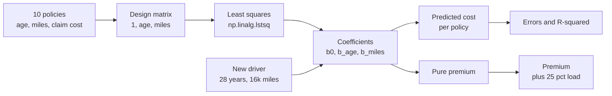
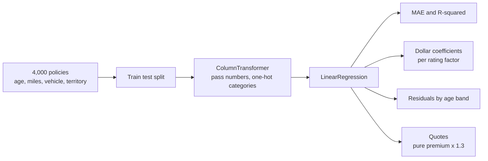
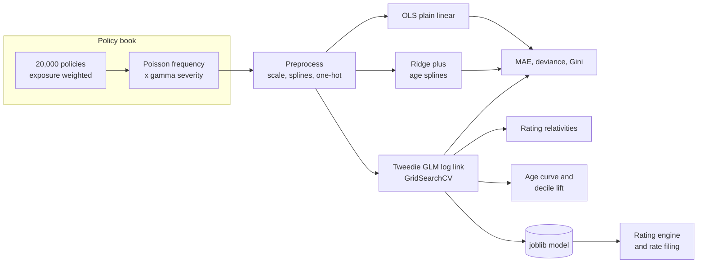
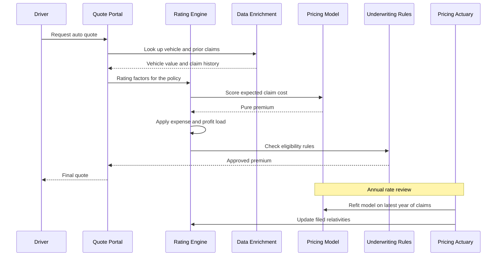

# 5. Linear Regression

[](https://colab.research.google.com/github/EdwardSuresh/architects-ml-playbook/blob/main/notebooks/05-linear-regression.ipynb)  

[← 4. Gradient Boosting](../04-gradient-boosting/README.md) · [All algorithms](../../README.md#-the-30-algorithms-ranked) · [6. Decision Tree →](../06-decision-tree/README.md)

> **Linear regression predicts a number as a weighted sum of input features, choosing the weights that make the squared prediction errors as small as possible.**

💡 **Analogy:** A taxi fare is a base charge plus a rate per mile plus a rate per minute. Linear regression looks at many past trips and works out the base charge and the rates that best explain the fares you actually paid.

## The use case (same for Easy, Medium and Hard)
**Insurance — Auto insurance expected claim cost and premium pricing**

An auto insurer must quote a price for every driver before knowing whether they will crash. Charge too little and the book loses money; charge too much and good drivers leave for competitors. Rating data includes driver age, miles driven, vehicle value, prior claims, territory and (where allowed) credit-based insurance score, plus a year of claims history. Success means a pure-premium model whose predictions balance to actual losses, rank risk well, stay positive and can be explained factor-by-factor in a rate filing.

## Industry adoption
| Sector | Score | Where you meet it |
|---|---|---|
| Financial Services | ■■■■□ 4/5 | CCAR/stress-testing loss projections, deposit balance forecasting, loss-given-default models. |
| Insurance | ■■■■■ 5/5 | Auto and home pricing (as GLMs), loss reserving trends, expense allocation. |
| Supply Chain | ■■■■□ 4/5 | Freight cost per mile estimation, demand baselines, lead-time estimation. |
| Oil & Gas | ■■■■□ 4/5 | Decline-curve and production trend baselines, drilling cost estimation, corrosion growth rates. |

**Why rank #5:** Linear regression and its generalised cousins (GLMs) are everywhere: insurance pricing, cost estimation, forecasting baselines and stress-testing models. It is rarely the most accurate model, but its transparency, speed and regulatory acceptance keep it in production across every industry.

## How it works
1. Write the prediction as intercept + weight1 x feature1 + weight2 x feature2 + ...
2. Measure error as the sum of squared differences between actual and predicted values.
3. Solve for the weights that minimise that error (a closed-form formula or a solver).
4. Read each weight as the change in the target for a one-unit change in that feature, holding others fixed.
5. Check residuals for patterns; add transformed features (splines, logs, interactions) where the line misfits.
6. For skewed, non-negative targets like insurance losses, move to a GLM (log link, Poisson/gamma/Tweedie) that keeps the same linear structure.

## Key terms
| Term | Meaning |
|---|---|
| coefficient | The amount the prediction changes for a one-unit increase in a feature, other features held fixed. |
| intercept | The predicted value when all features are zero (or at their reference level). |
| residual | Actual minus predicted; patterns in residuals reveal what the model misses. |
| R-squared | Share of the variation in the target explained by the model. |
| pure premium | Expected claim cost per policy-year, before expenses and profit are added. |
| GLM | Generalised linear model: a linear predictor passed through a link function, with a distribution suited to the data. |
| Tweedie | A distribution that combines a point mass at zero with a continuous positive tail - ideal for insurance losses. |
| relativity | A multiplicative rating factor, e.g. urban territory = 1.7x the base rate. |

## 🟢 Easy — Fit a pricing line through 10 drivers
Solve least squares with numpy to predict yearly claim cost from driver age and miles driven, then price a new policy.

| 5W + H | |
|---|---|
| **Who** | A pricing analyst or underwriter learning how a rating formula is estimated. |
| **What** | A two-variable linear formula for expected annual claim cost (the pure premium) and a quoted premium. |
| **When** | At quote time - every new auto policy needs an expected loss cost before expenses and profit are added. |
| **Where** | On a laptop with numpy; the same idea sits inside every rating engine's formula. |
| **Why** | Linear regression is the simplest way to turn risk factors into dollars and read each factor's effect directly. |
| **How** | Store 10 policies as dicts, build a design matrix with an intercept column, solve with np.linalg.lstsq, print errors and R-squared. |

**Architecture**



**🧠 ML concepts:** Least squares, Intercept and slopes, Residuals / errors, R-squared, Pure premium vs charged premium  
**🐍 Python concepts:** List of dicts, List comprehensions to extract a field, np.column_stack, Star-unpacking with coef, *_, Matrix multiplication with @, zip over four arrays

**Steps the code performs**
1. Type 10 policies as dicts
2. Extract age, miles and cost into arrays
3. Build the design matrix with an intercept column
4. Solve least squares for the coefficients
5. Print predictions, errors and R-squared
6. Price a new driver

▶️ Code: [`easy.py`](easy.py) — run with `python easy.py`

<details><summary>Walkthrough</summary>

| Lines | What happens |
|---|---|
| 4-16 | Ten policyholders, each a dict with driver age, annual miles (thousands) and last year's claim cost. |
| 17-20 | Pull each field into its own numpy array using list comprehensions. |
| 22-24 | Build the design matrix: a column of ones (for the intercept), then age and miles. |
| 25-30 | lstsq finds the coefficients with the smallest total squared error. Older drivers cost about $20 less per year of age; each 1,000 miles adds about $49. |
| 32-37 | Predict every policy and print actual vs predicted. Note the big positive errors for the youngest AND oldest drivers. |
| 39-42 | R-squared 0.89: the line explains most of the variation, but the pattern in the errors says age risk is curved, not straight. |
| 44-47 | Price a new driver: the formula gives expected claims (pure premium) and a 25% load covers expenses and profit. |

</details>

<details><summary>Real output</summary>

```text
cost = 1120 -19.6 x age +48.8 x miles_k
-> each extra year of age changes expected cost by $-19.6
-> each extra 1,000 miles driven adds $48.8

 age | miles_k | actual | predicted | error
  19 |      14 |   1650 |      1431 |  +219
  22 |      12 |   1380 |      1275 |  +105
  25 |      15 |   1290 |      1363 |   -73
  30 |      10 |    900 |      1021 |  -121
  35 |      12 |    870 |      1021 |  -151
  40 |       8 |    640 |       728 |   -88
  45 |      11 |    700 |       776 |   -76
  50 |       9 |    560 |       581 |   -21
  55 |      13 |    690 |       678 |   +12
  60 |       7 |    480 |       288 |  +192

R-squared: 0.890
New 28-year-old driving 16k miles: expected claims $1353, premium $1691
```

</details>

**Try this next:** Add an age-squared column (age ** 2) to X and see whether the errors at both ends shrink. · Remove miles from the model and compare R-squared. · Price a 70-year-old driver - is a negative age slope sensible that far out?

## 🟡 Medium — Pure premium model on 4,000 policies
Fit a scikit-learn linear regression with one-hot rating factors, read dollar coefficients and spot where a straight line misprices.

| 5W + H | |
|---|---|
| **Who** | A pricing actuary or analyst building a first-cut loss-cost model for a personal auto book. |
| **What** | A linear model for expected annual claim cost with dollar effects for each rating factor and quotes for new drivers. |
| **When** | During the annual rate review, using last year's policy and claims data. |
| **Where** | In the pricing team's analytics environment; results inform the rating plan filed with the state. |
| **Why** | Coefficients in dollars are easy to explain to underwriters and regulators, and residual checks show where the model is too simple. |
| **How** | Simulate 4,000 policies, one-hot encode territory and credit tier in a ColumnTransformer, fit LinearRegression, report MAE and R-squared, print coefficients and residuals by age band. |

**Architecture**



**🧠 ML concepts:** Multiple linear regression, One-hot encoding with a reference level, Interpreting coefficients holding others fixed, MAE and R-squared, Residual analysis to find non-linearity  
**🐍 Python concepts:** Series.map with a dict, np.maximum element-wise, ColumnTransformer and Pipeline, str.split to clean names, itertuples for fast row loops, zip over iterrows and predictions

**Steps the code performs**
1. Generate 4,000 policies with rating factors
2. Create claim cost from a hidden rule with a young-driver surcharge
3. Split into train and test
4. One-hot encode categories and fit LinearRegression
5. Report MAE and R-squared
6. Print the dollar coefficient for each factor
7. Compare actual vs predicted by age band
8. Quote two new drivers

▶️ Code: [`medium.py`](medium.py) — run with `python medium.py`

<details><summary>Walkthrough</summary>

| Lines | What happens |
|---|---|
| 11-20 | Generate policies: driver age, annual miles, vehicle value, prior claims, credit tier and territory. |
| 22-27 | Hidden truth: cost rises with miles, vehicle value, prior claims, urban territory and weaker credit tier - plus a surcharge that only applies to drivers under 30. |
| 29-31 | Name the numeric and categorical columns and split 75/25. |
| 33-38 | One-hot encode credit tier and territory (dropping one reference level each) and fit the regression inside a Pipeline. |
| 40-42 | MAE $148 per policy and R-squared 0.54 - claims are noisy, so a moderate R-squared is normal in insurance. |
| 44-50 | Each coefficient is a dollar effect: +$210 per prior claim, +$252 for urban vs rural, +$152 for credit tier C vs A. |
| 52-59 | Residuals by age band: drivers 25 and under are underpriced by about $117 - the straight line cannot capture the young-driver surcharge. |
| 62-66 | Quote two new drivers: pure premium from the model, times 1.3 for expenses and profit. |

</details>

<details><summary>Real output</summary>

```text
Policies: 4000  mean annual claim cost: $1,128
Test MAE $148 | R-squared 0.536

Intercept: $619
  driver_age             -2.8 $
  annual_miles_k        +22.7 $
  vehicle_value_k        +5.5 $
  prior_claims_3y      +210.0 $
  credit_tier_B         +70.6 $
  credit_tier_C        +152.5 $
  territory_suburban    +70.5 $
  territory_urban      +251.8 $

Age band | actual $ | predicted $ | gap
(17, 25] |     1321 |        1203 |  +117
(25, 35] |     1087 |        1166 |   -79
(35, 50] |     1086 |        1129 |   -43
(50, 80] |     1089 |        1079 |    +9
Quote age 20, urban: pure premium $1,533 -> charged $1,993
Quote age 45, rural: pure premium $910 -> charged $1,183
```

</details>

**Try this next:** Add a 'young' column = max(0, 30 - age) to the features and watch the age-band gaps close. · Remove credit_tier and see how the other coefficients change (omitted-variable effect). · Try sklearn's Ridge(alpha=10) and compare coefficients and MAE.

## 🔴 Hard — Rate plan: OLS vs splines vs Tweedie GLM
Compare plain OLS, Ridge with age splines and a tuned Tweedie GLM on an exposure-weighted policy book, then produce relativities, an age curve and lift.

| 5W + H | |
|---|---|
| **Who** | Pricing actuaries, the chief actuary sign-off, and state regulators who review rate filings. |
| **What** | A saved Tweedie GLM pricing model with multiplicative rating relativities, an indicated age curve, balance and decile lift checks. |
| **When** | Annual or semi-annual rate review, using a full year of policy exposure and claims. |
| **Where** | In the actuarial modelling environment; relativities flow into the rating engine and the rate filing. |
| **Why** | Most policies have $0 claims and a few are very large; OLS can predict negative premiums, while the Tweedie GLM with log link is the actuarial standard for pure premium. |
| **How** | Simulate 20,000 policies with Poisson frequency and gamma severity, build three pipelines, tune Tweedie power and alpha with exposure weights, compare MAE, deviance and Gini, then extract relativities and save. |

**Architecture**



**🧠 ML concepts:** Ordinary least squares vs generalised linear models, Tweedie distribution (compound Poisson-gamma), Log link and multiplicative relativities, Exposure weights, Spline features for non-linear effects, Gini / Lorenz lift and balance checks  
**🐍 Python concepts:** List comprehension with a conditional expression, Passing fit params as step__param, Nested ColumnTransformer with remainder, String slicing to clean names, DataFrame.iloc with a repeated index, pd.qcut(labels=False)

**Steps the code performs**
1. Simulate a policy book with exposure, Poisson claim counts and gamma severities
2. Build preprocessing with optional age splines
3. Fit OLS and Ridge-with-splines baselines using exposure weights
4. Tune a Tweedie GLM's power and alpha with cross-validation
5. Compare MAE, Tweedie deviance, Gini and minimum prediction
6. Check balance and print rating relativities
7. Show the age curve and decile lift
8. Print regulatory notes and save the model

▶️ Code: [`hard.py`](hard.py) — run with `python hard.py`

<details><summary>Walkthrough</summary>

| Lines | What happens |
|---|---|
| 2-18 | Imports and column lists. TweedieRegressor is scikit-learn's GLM for insurance-style data. |
| 21-43 | Simulate a policy book. Claim frequency is log-linear with a U-shaped age curve (young and very old drivers riskier); exposure is the share of a year the policy was in force. |
| 44-49 | Each claim's size is gamma-distributed, larger for pricier cars. Pure premium = total loss / exposure; about 89% of policies have $0. |
| 52-58 | Preprocessing: scale numbers and one-hot categories; optionally replace age with spline basis columns so a linear model can bend. |
| 61-67 | Ordered Lorenz Gini: sort policies by predicted risk and measure how quickly actual losses pile up - the actuarial lift metric. |
| 70-89 | Set up OLS and Ridge-with-splines, and tune the Tweedie GLM's power (1.3-1.7) and penalty alpha with exposure-weighted 3-fold CV. |
| 91-101 | Compare models. MAE is similar, but OLS and Ridge predict NEGATIVE premiums (-$268), while the GLM's log link keeps every price positive with the best deviance. |
| 103-114 | Balance check (predicted total close to actual), then exp(coefficient) gives relativities: urban x1.71, credit tier C x1.80 - exactly how rate filings read. |
| 116-122 | Predict the same reference driver at different ages: the GLM recovers the U-shape - $1,212 at 18, lowest in mid-life, rising again at 80. |
| 125-135 | Decile lift: the riskiest tenth costs 4.7x the safest. Then print regulatory notes and save the model. |

</details>

<details><summary>Real output</summary>

```text
Policies 20,000 | with a claim 11.2% | avg pure premium $833
Tweedie best: {'alpha': 0.01, 'power': 1.3}

Model                   MAE $   Tweedie dev   Gini  min pred $
OLS (plain linear)       1,419        151.5  0.242       -268
Ridge + age splines      1,404        148.9  0.303       -224
Tweedie GLM (log link)   1,401        147.4  0.295        201

Balance: predicted $2,578,328 vs actual $2,563,758

Rating relativities (categorical factors):
  territory_suburban   x1.20
  territory_urban      x1.71
  vehicle_use_commute  x0.90
  vehicle_use_pleasure x0.78
  credit_tier_B        x1.24
  credit_tier_C        x1.80

Age | indicated pure premium (reference driver)
 18 | $  1,212 ############
 22 | $    871 ########
 30 | $    595 #####
 45 | $    463 ####
 65 | $    447 ####
 80 | $    614 ######

Actual loss cost, lowest vs highest predicted decile: $407 vs $1,906 (4.7x)

Regulatory: rates must not be excessive, inadequate or unfairly discriminatory (state rating laws);
credit-based factors are restricted in some states; NAIC AI Bulletin expects governance + testing.
Saved auto_pure_premium_glm.joblib
```

</details>

**Try this next:** Fix power=1.0 (Poisson) and 1.9 (near gamma) and compare deviance and Gini. · Remove the spline step (preprocessor(False)) for the GLM and look at the age curve. · Drop credit_tier (banned in some states) and see how much lift and balance change.

## 🔄 End-to-end production flow



## ⚠️ Pitfalls
- Using plain OLS for insurance losses: it can predict negative premiums and is dominated by a few huge claims. Use a log-link GLM (Poisson, gamma or Tweedie).
- Ignoring exposure: a policy in force for 3 months should count less than a full-year policy. Pass exposure as a weight or offset.
- Assuming straight-line effects. Age risk is U-shaped; use bands, splines or polynomial terms and check residuals.
- Correlated rating factors (e.g. age and years licensed) produce unstable coefficients. Check correlations and regularise (Ridge) if needed.
- Judging only by R-squared. For pricing, check balance, lift (Gini), and stability of relativities year over year.
- Using factors that are banned or restricted (e.g. credit in some states, protected classes). Confirm with compliance before filing.

**When NOT to use it:** Avoid plain linear regression when the target is binary, counts, or heavily skewed with many zeros (use logistic regression or GLMs), or when strong non-linear interactions dominate and accuracy matters more than transparency.

## 🎤 Interview questions
<details><summary>Why do actuaries use GLMs instead of ordinary linear regression for pricing?</summary>

Insurance losses are non-negative, highly skewed and mostly zero. A GLM with a log link and Poisson/gamma/Tweedie distribution respects that, keeps predictions positive, and gives multiplicative relativities that slot directly into a rating plan.

</details>
<details><summary>How do you interpret a coefficient of 210 on prior_claims_3y in a linear model?</summary>

Holding all other features constant, each additional prior claim in the last three years raises the expected annual claim cost by about $210.

</details>
<details><summary>What does a low R-squared mean in insurance pricing?</summary>

Individual claims are mostly random, so R-squared is naturally low. The model can still be valuable if it is balanced and separates risk well, which is why actuaries focus on lift charts, Gini and deviance.

</details>

---
[← 4. Gradient Boosting](../04-gradient-boosting/README.md) · [All algorithms](../../README.md#-the-30-algorithms-ranked) · [6. Decision Tree →](../06-decision-tree/README.md)
