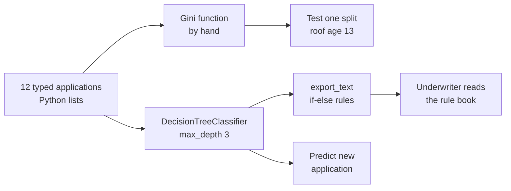
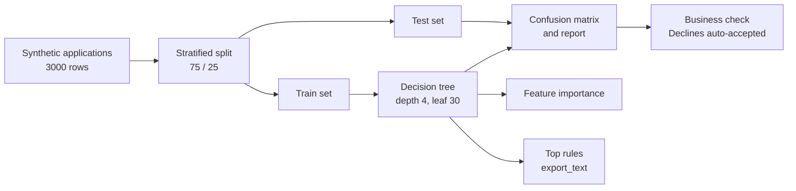
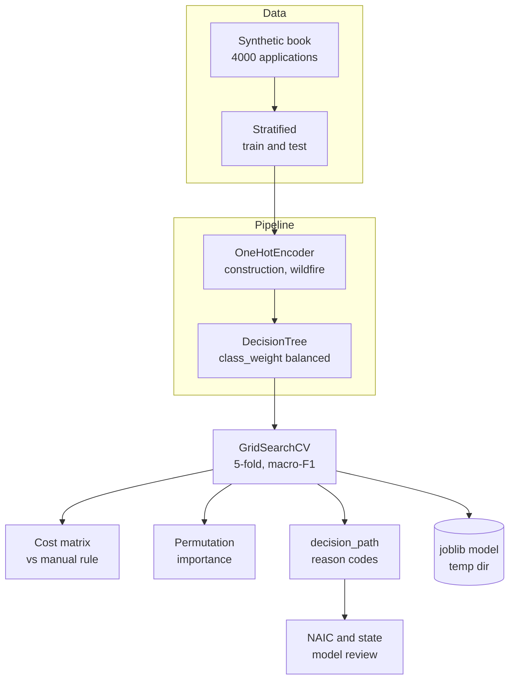
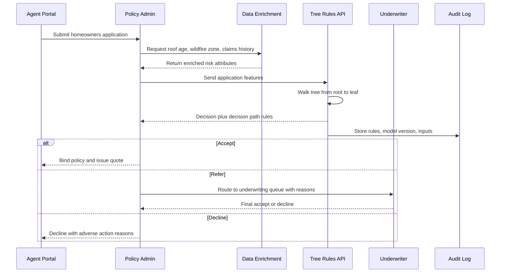

# 6. Decision Tree

[](https://colab.research.google.com/github/EdwardSuresh/architects-ml-playbook/blob/main/notebooks/06-decision-tree.ipynb)  

[← 5. Linear Regression](../05-linear-regression/README.md) · [All algorithms](../../README.md#-the-30-algorithms-ranked) · [7. Isolation Forest →](../07-isolation-forest/README.md)

> **A decision tree learns a flowchart of yes/no questions about the input columns that ends in a prediction at each leaf.**

💡 **Analogy:** It is like the game of 20 Questions played by a seasoned underwriter: 'Is the roof older than 20 years? Any claims in the last 5 years? Is the house in a wildfire zone?' Each answer sends you down a different branch until you land on Accept, Refer or Decline.

## The use case (same for Easy, Medium and Hard)
**Insurance — Homeowners underwriting decision: Accept / Refer / Decline**

A homeowners insurer receives thousands of new-business applications a week and every one used to sit in an underwriter's queue. Most are clean risks that could be accepted straight away, a smaller group needs a human to look at roof photos or claim history, and a few are clearly outside appetite. The insurer has historic applications with roof age, prior claims, wildfire zone, construction type, distance to fire station, a credit-based insurance score and the final underwriter decision. Success means auto-accepting the clean risks, sending true edge cases to underwriters, almost never auto-accepting a risk that should be declined, and being able to print the exact rule behind every decision for regulators.

## Industry adoption
| Sector | Score | Where you meet it |
|---|---|---|
| Financial Services | ■■■■□ 4/5 | Banks use shallow trees to derive transparent credit policy rules and to segment collections strategies. |
| Insurance | ■■■■■ 5/5 | Insurers use trees for underwriting triage, claims fast-track rules and rating-factor discovery. |
| Supply Chain | ■■■■□ 4/5 | Distribution centers use trees to decide expedite vs standard shipping and to flag late-supplier risk. |
| Oil & Gas | ■■■□□ 3/5 | Operators use trees to route well alarms and to encode maintenance decision logic from sensor thresholds. |

**Why rank #6:** Decision trees are the most explainable non-linear model there is: the model literally prints as a set of if-else rules that a regulator, underwriter or auditor can read. Insurers and banks use them for rule discovery, segmentation and as the building block of Random Forest and XGBoost, which is why they rank high even though a single tree is rarely the most accurate model.

## How it works
1. Start with all training rows in one group (the root node).
2. For every column and every possible threshold, measure how 'pure' the two resulting groups would be (Gini impurity or entropy).
3. Pick the single question that makes the groups purest and split the data in two.
4. Repeat the same search inside each child group (recursive splitting).
5. Stop when a depth limit, a minimum leaf size or a purity target is reached.
6. Each leaf predicts the majority class of the training rows that landed there.
7. To score a new case, walk it from the root down the yes/no branches to a leaf.

## Key terms
| Term | Meaning |
|---|---|
| Node / leaf | A node asks one question; a leaf is the end of a branch that gives the answer. |
| Gini impurity | The chance that two random rows in a group have different labels; 0 means the group is pure. |
| max_depth | The maximum number of questions in a row; the main brake on overfitting. |
| min_samples_leaf | The smallest number of training rows a leaf may hold, so no rule is built on a handful of cases. |
| Pruning (ccp_alpha) | Cutting back branches that add complexity without enough accuracy gain. |
| export_text | A scikit-learn function that prints the trained tree as readable if-else rules. |
| Decision path | The exact list of questions one applicant passed through; useful as a reason code. |

## 🟢 Easy — Hand-build the underwriting rule book from 12 applications
Compute Gini impurity by hand for one candidate split, then let scikit-learn grow a 3-level tree and print its rules.

| 5W + H | |
|---|---|
| **Who** | A new underwriting analyst who wants to see how a tree turns past decisions into rules. |
| **What** | Twelve typed-in homeowners applications with roof age, prior claims, wildfire zone and home value, each labelled Accept, Refer or Decline. |
| **When** | During a lunch-and-learn before the insurer pilots automated triage. |
| **Where** | A laptop Python session; no database, the data is inside the script. |
| **Why** | To build intuition that a tree is just a stack of the purest yes/no questions. |
| **How** | Write a tiny Gini function, test the split roof_age_yrs <= 13, then fit DecisionTreeClassifier(max_depth=3) and print export_text. |

**Architecture**



**🧠 ML concepts:** Gini impurity, Choosing the best split, Tree depth as a complexity limit, Readable rules with export_text, Predicting by walking the tree  
**🐍 Python concepts:** Lists of lists as a table, List comprehensions with if filters, zip to walk two lists together, set() to get unique values, Defining a function with def, f-strings with format specs

**Steps the code performs**
1. Type 12 applications and their decisions as Python lists.
2. Define a Gini impurity function and compute it for all 12 rows.
3. Split rows on roof_age_yrs <= 13 and compute Gini for each side.
4. Fit a DecisionTreeClassifier with max_depth=3.
5. Print the learned rules with export_text.
6. Score a brand-new application and print the decision.

▶️ Code: [`easy.py`](easy.py) — run with `python easy.py`

<details><summary>Walkthrough</summary>

| Lines | What happens |
|---|---|
| 1 | Import the tree model and export_text, the helper that prints a tree as rules. |
| 3-14 | A Python list of lists holds 12 applications (one row each, four numbers). A second list holds the matching decisions in the same order; the features list gives the columns names for printing. |
| 16-22 | The gini function counts the share of each decision in a group and returns 1 minus the sum of squared shares. All 12 rows mixed together give 0.653, a very impure group. |
| 24-29 | Two list comprehensions with zip split the rows by roof age. Each side is purer (0.444 and 0.500) than the parent, which is exactly what the tree looks for at every node. |
| 31-34 | scikit-learn repeats that search over every column and threshold. max_depth=3 limits it to three questions so the rule book stays short. |
| 36-38 | export_text prints the tree as indented if-else rules. The tree chose roof_age_yrs <= 19 first, then wildfire_zone and home value. |
| 40-42 | predict needs a list of rows, so the new application is wrapped in an outer list. It follows roof <= 19, wildfire zone > 0.5 and lands on Refer. |

</details>

<details><summary>Real output</summary>

```text
Gini of all 12 applications: 0.653
roof <= 13 -> ['Accept', 'Accept', 'Accept', 'Accept', 'Refer', 'Refer']  gini=0.444
roof  > 13 -> ['Refer', 'Refer', 'Refer', 'Decline', 'Decline', 'Decline'] gini=0.500

Learned underwriting rules:
|--- roof_age_yrs <= 19.00
|   |--- wildfire_zone <= 0.50
|   |   |--- roof_age_yrs <= 15.00
|   |   |   |--- class: Accept
|   |   |--- roof_age_yrs >  15.00
|   |   |   |--- class: Refer
|   |--- wildfire_zone >  0.50
|   |   |--- class: Refer
|--- roof_age_yrs >  19.00
|   |--- home_value_k <= 257.50
|   |   |--- class: Decline
|   |--- home_value_k >  257.50
|   |   |--- class: Refer

New application [14, 2, 1, 280] -> Refer
```

</details>

**Try this next:** Change the hand split from roof_age_yrs <= 13 to prior_claims_5yr <= 1 and compare the two Gini values. · Set max_depth=1 and see which single question the tree considers most important. · Add two more Decline rows with high claims and see how the printed rules change.

## 🟡 Medium — Learn underwriting rules from 3,000 applications
Train and test a depth-limited tree on realistic synthetic homeowners data and read its rules, importances and errors.

| 5W + H | |
|---|---|
| **Who** | The underwriting analytics team preparing a triage pilot. |
| **What** | 3,000 synthetic applications with six risk columns and an Accept/Refer/Decline label driven by a hidden guideline. |
| **When** | Before go-live, to check whether a tree can reproduce underwriter decisions on unseen applications. |
| **Where** | A Jupyter or VS Code notebook against an extract from the policy admin system. |
| **Why** | To measure accuracy on held-out data and see which risk factors drive the decision. |
| **How** | Stratified train/test split, DecisionTreeClassifier(max_depth=4, min_samples_leaf=30), confusion matrix, classification report, feature importance and the top of the rule book. |

**Architecture**



**🧠 ML concepts:** Train/test split with stratify, Overfitting control with max_depth and min_samples_leaf, Confusion matrix and per-class recall, Impurity-based feature importance, Business-focused error check  
**🐍 Python concepts:** pandas DataFrame from a dict, np.select for multi-way labels, DataFrame.drop and column selection, Series.sort_values and .items(), String repetition for ASCII bars

**Steps the code performs**
1. Generate 3,000 applications with realistic risk columns.
2. Create a hidden risk score and turn it into Accept/Refer/Decline.
3. Split 75/25 keeping the class mix (stratify).
4. Fit a depth-4 tree with at least 30 policies per leaf.
5. Print train vs test accuracy, confusion matrix and classification report.
6. Print feature importance bars and the first two levels of rules.
7. Count true Declines that the model would auto-accept.

▶️ Code: [`medium.py`](medium.py) — run with `python medium.py`

<details><summary>Walkthrough</summary>

| Lines | What happens |
|---|---|
| 1-5 | Import numpy and pandas for data, plus the tree, the split helper and the metric functions. |
| 7-19 | A fixed seed and a dict of numpy arrays build a 3,000-row DataFrame with realistic column names such as roof_age_yrs and credit_insurance_score. |
| 21-29 | A hidden risk score mixes the drivers plus noise; np.select turns it into three labels. Home value and fire-station distance barely matter, which the tree should discover. |
| 31-35 | X holds inputs, y the decision. stratify=y keeps the same Accept/Refer/Decline mix in train and test. |
| 37-43 | max_depth=4 and min_samples_leaf=30 stop the tree memorising noise. Train and test accuracy are close (0.73 vs 0.75), a sign it is not overfitting. |
| 44-48 | The confusion matrix shows where errors go. Most mistakes are between neighbouring classes (Refer vs Accept), and only 3 Declines were predicted as Accept. |
| 50-55 | feature_importances_ adds up how much each column reduced impurity. Prior claims and roof age dominate; home value scores zero, matching the hidden guideline. |
| 57-63 | export_text with max_depth=1 prints only the top two levels so a reviewer sees the core logic, then a one-line business check counts risky auto-accepts. |

</details>

<details><summary>Real output</summary>

```text
Decision mix: {'Accept': 1477, 'Refer': 1138, 'Decline': 385}
Train accuracy: 0.734
Test accuracy : 0.745

Confusion matrix (rows=true):
          Accept  Refer  Decline
Accept      350     19        0
Refer       110    159       16
Decline       3     43       50

              precision    recall  f1-score   support

      Accept       0.76      0.95      0.84       369
     Decline       0.76      0.52      0.62        96
       Refer       0.72      0.56      0.63       285

    accuracy                           0.75       750
   macro avg       0.74      0.68      0.70       750
weighted avg       0.74      0.75      0.73       750

Feature importance:
  prior_claims_5yr         0.336 #############
  roof_age_yrs             0.295 ###########
  wildfire_zone            0.193 #######
  credit_insurance_score   0.176 #######
  dist_fire_station_mi     0.000
  home_value_k             0.000

Top of the rule book:
|--- roof_age_yrs <= 20.50
|   |--- prior_claims_5yr <= 1.50
|   |   |--- truncated branch of depth 3
|   |--- prior_claims_5yr >  1.50
|   |   |--- truncated branch of depth 3
|--- roof_age_yrs >  20.50
|   |--- prior_claims_5yr <= 1.50
|   |   |--- truncated branch of depth 3
|   |--- prior_claims_5yr >  1.50
|   |   |--- truncated branch of depth 3
... (output trimmed)
```

</details>

**Try this next:** Remove min_samples_leaf and set max_depth=None; compare train vs test accuracy to see overfitting. · Change criterion to 'entropy' and check whether the top split changes. · Increase the wildfire weight in the hidden risk formula and watch its importance rise.

## 🔴 Hard — Production underwriting tree with tuning, cost and reason codes
Build a tuned, class-balanced tree pipeline, compare it to a manual rule on business cost, explain decisions and save the model.

| 5W + H | |
|---|---|
| **Who** | A senior data scientist and the underwriting model-risk reviewer. |
| **What** | A Pipeline (one-hot encoding plus DecisionTreeClassifier) tuned by grid search, scored on macro-F1 and a dollar cost matrix, with permutation importance and per-applicant decision paths. |
| **When** | At model approval time before the tree is deployed behind the quoting API. |
| **Where** | The insurer's model development environment; the saved joblib file is promoted to the scoring service. |
| **Why** | Regulators and state DOIs expect transparent, documented underwriting logic, and the business needs fewer costly auto-accepts of bad risks. |
| **How** | GridSearchCV over depth, leaf size and pruning with 5-fold stratified CV, class_weight='balanced', cost matrix vs a rule of thumb, permutation importance, decision_path reason codes and joblib save. |

**Architecture**



**🧠 ML concepts:** Pipelines with ColumnTransformer, Grid search with stratified cross-validation, Class imbalance via class_weight, Cost-sensitive evaluation, Permutation importance, Per-decision explanations with decision_path  
**🐍 Python concepts:** Functions with default arguments and docstrings, Module-level constants, numpy matrix element-wise multiply, DataFrame.iloc double brackets to keep 2-D, Tuple unpacking in a for loop, os.path and tempfile for safe saving

**Steps the code performs**
1. Generate 4,000 applications including categorical construction and wildfire zone.
2. Build a pipeline: one-hot encode categories, pass numbers through, fit a balanced tree.
3. Grid-search depth, leaf size and pruning with 5-fold stratified CV on macro-F1.
4. Evaluate on the test set and compute dollar cost vs a simple manual rule.
5. Rank features with permutation importance.
6. Print top rules and the decision path for one applicant as reason codes.
7. Print a regulatory note and save the model with joblib to a temp folder.

▶️ Code: [`hard.py`](hard.py) — run with `python hard.py`

<details><summary>Walkthrough</summary>

| Lines | What happens |
|---|---|
| 1-20 | Imports and constants. NUM and CAT lists name the numeric and categorical columns so the pipeline and later code stay in sync. |
| 23-44 | make_book generates 4,000 applications. Wildfire zone and construction are text categories, like real policy data, and the hidden guideline mixes six risk drivers. |
| 47-55 | build_pipeline one-hot encodes the categories and passes numbers through (trees do not need scaling). class_weight='balanced' up-weights the rarer Decline class. |
| 58-65 | business_cost multiplies the confusion matrix by a dollar cost matrix. Auto-accepting a true Decline costs 2,500 dollars of expected claim leakage, far more than an extra referral. |
| 68-83 | GridSearchCV tries 30 combinations of depth, leaf size and ccp_alpha with 5-fold stratified CV and keeps the best macro-F1 pipeline. |
| 85-92 | Test scores plus a comparison with a manual rule (refer anyone with a prior claim). The tree costs about 22k dollars vs 161k for the rule on the same 1,000 applications. |
| 94-99 | permutation_importance shuffles one column at a time and measures the F1 drop. It is model-agnostic and less biased than impurity importance. |
| 101-118 | export_text shows the top rules; decision_path lists the nodes applicant 0 passed through, giving a plain-English reason code for an underwriter or regulator. |
| 120-126 | A regulatory note on NAIC model governance and credit-based insurance score rules, then joblib saves the whole pipeline to a temporary directory. |

</details>

<details><summary>Real output</summary>

```text
Class mix (train): {'Refer': 1251, 'Accept': 1200, 'Decline': 549}
Best params: {'tree__ccp_alpha': 0.001, 'tree__max_depth': 6, 'tree__min_samples_leaf': 10} CV macro-F1=0.775
Test macro-F1: 0.791
Confusion (rows=true A/R/D): [[320, 80, 0], [35, 331, 51], [0, 39, 144]]
Business cost  model=$22,370  vs  rule-of-thumb=$160,660

Permutation importance (macro-F1 drop):
  prior_claims_5yr         +0.252 ###############
  roof_age_yrs             +0.233 ##############
  wildfire_zone            +0.141 ########
  credit_insurance_score   +0.095 #####
  construction             +0.036 ##
  dist_fire_station_mi     +0.014

Top rules (depth<=2):
|--- roof_age_yrs <= 20.50
|   |--- prior_claims_5yr <= 0.50
|   |   |--- wildfire_zone_high <= 0.50
|   |   |   |--- truncated branch of depth 4
|   |   |--- wildfire_zone_high >  0.50
|   |   |   |--- truncated branch of depth 2
|   |--- prior_claims_5yr >  0.50
|   |   |--- prior_claims_5yr <= 1.50
|   |   |   |--- truncated branch of depth 4
|   |   |--- prior_claims_5yr >  1.50
|   |   |   |--- truncated branch of depth 4
|--- roof_age_yrs >  20.50

Applicant 0 -> Accept; path:
  roof_age_yrs = 15.0 <= 20.5
  prior_claims_5yr = 0.0 <= 0.5
  wildfire_zone_high = 0.0 <= 0.5
  credit_insurance_score = 737.0 > 620.5

Model-risk note: credit_insurance_score use must follow state law; log rules + version.
Saved model -> ho_underwriting_tree.joblib (9395 bytes)
```

</details>

**Try this next:** Raise the cost of a Decline-accepted error to 10,000 and add a post-rule that sends any Accept with prior_claims_5yr >= 2 to Refer; compare cost. · Drop credit_insurance_score (some states restrict it) and measure how much macro-F1 you lose. · Add max_leaf_nodes to the grid and find the smallest tree within 0.01 F1 of the best.

## 🔄 End-to-end production flow



## ⚠️ Pitfalls
- Growing the tree without limits: it memorises the training book and fails on new business. Always set max_depth, min_samples_leaf or ccp_alpha and check test scores.
- Trusting a single tree as stable: small data changes can flip the top split. Check stability with cross-validation or move to Random Forest / XGBoost if accuracy matters more than readability.
- Ignoring rare classes: Decline is uncommon, so an unweighted tree may never predict it. Use class_weight or a cost matrix.
- Reading impurity importance as truth: it favours columns with many distinct values. Confirm with permutation importance.
- Using prohibited or proxy variables: some rating factors are restricted by state law. Review features with compliance and test for unfair discrimination.
- Letting thresholds drift unnoticed: roof-age or wildfire maps change over time. Monitor input drift and retrain on a schedule.

**When NOT to use it:** Avoid a single tree when you need the best possible accuracy on complex, noisy data or very smooth numeric relationships; use Random Forest, gradient boosting or a GLM instead and keep a tree only as an explanation aid.

## 🎤 Interview questions
<details><summary>How does a decision tree choose where to split?</summary>

At each node it tries every column and threshold and picks the split that most reduces impurity, usually Gini or entropy, in the two child groups. It then repeats this greedily inside each child until a stopping rule is met.

</details>
<details><summary>How do you stop a decision tree from overfitting?</summary>

Limit its size with max_depth, min_samples_leaf or max_leaf_nodes, prune with cost-complexity pruning (ccp_alpha), and choose those settings with cross-validation. Ensembles like Random Forest also reduce variance.

</details>
<details><summary>Why might an insurer prefer a single tree over XGBoost?</summary>

A single shallow tree prints as rules that underwriters, auditors and regulators can read and challenge, and every decision has an exact path. The insurer may accept slightly lower accuracy for that transparency, or use the tree as a surrogate to explain a more complex model.

</details>

---
[← 5. Linear Regression](../05-linear-regression/README.md) · [All algorithms](../../README.md#-the-30-algorithms-ranked) · [7. Isolation Forest →](../07-isolation-forest/README.md)
