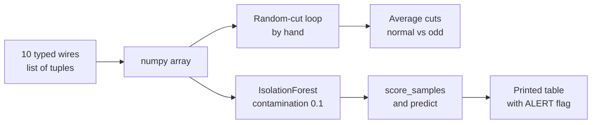
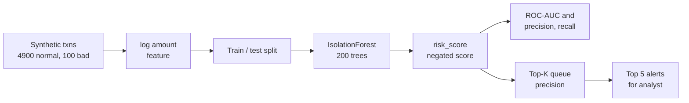
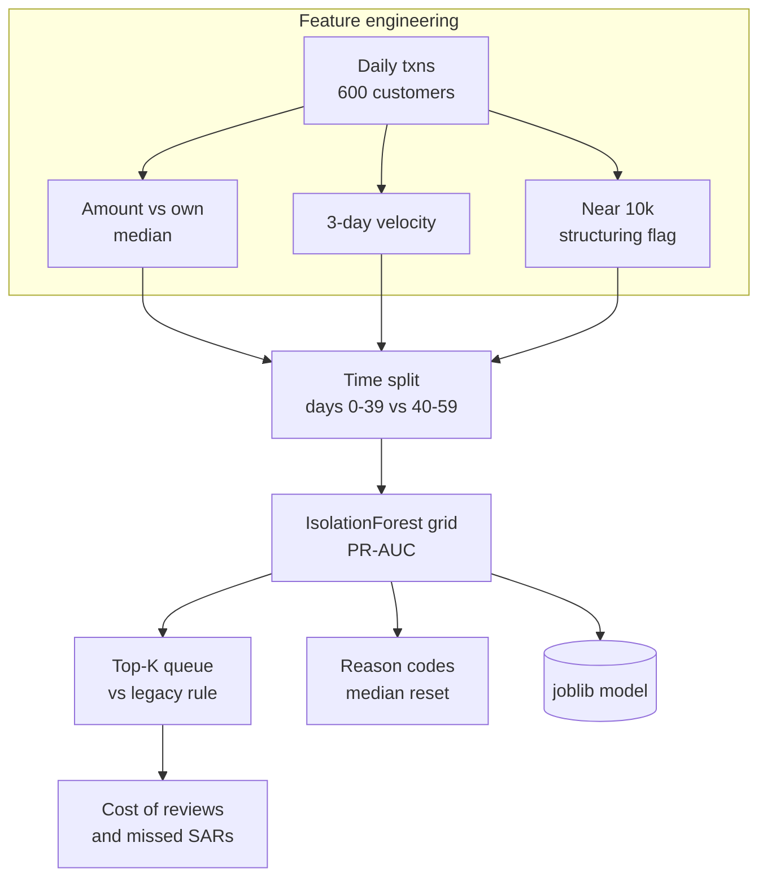
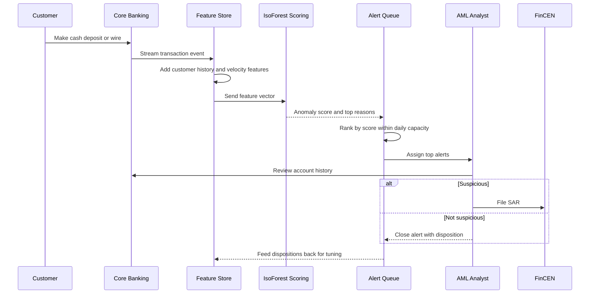

# 7. Isolation Forest

[](https://colab.research.google.com/github/EdwardSuresh/architects-ml-playbook/blob/main/notebooks/07-isolation-forest.ipynb)  

[← 6. Decision Tree](../06-decision-tree/README.md) · [All algorithms](../../README.md#-the-30-algorithms-ranked) · [8. k-Means Clustering →](../08-k-means-clustering/README.md)

> **Isolation Forest flags unusual records by measuring how few random cuts it takes to separate each record from all the others.**

💡 **Analogy:** Imagine a bank teller sorting a stack of deposit slips by asking random questions like 'over $5,000?' or 'after 10 pm?'. An ordinary slip keeps landing in a crowd and needs many questions to stand alone, but a $9,800 cash deposit at 3 am from a new country is alone after one or two questions. The fewer questions needed, the more suspicious the slip.

## The use case (same for Concept, Build and Production)
**Financial Services — AML suspicious transaction detection for the analyst alert queue**

A retail bank must monitor every transaction for money laundering and file Suspicious Activity Reports (SARs) when analysts confirm suspicion. Its legacy rule engine ('cash over $8,000') misses new patterns and produces many false alerts, so analysts waste hours while real laundering slips through. The bank has transaction amount, cash or wire type, cross-border flag, time of day, account age and each customer's history, but very few confirmed SAR labels. Success means a ranked daily alert queue where the top alerts are mostly truly suspicious, within the team's review capacity, with a reason for every alert.

## Industry adoption
| Sector | Score | Where you meet it |
|---|---|---|
| Financial Services | ■■■■■ 5/5 | Banks score wires, cash deposits and card activity to feed AML and fraud analyst queues. |
| Insurance | ■■■■□ 4/5 | Insurers flag claims with unusual amounts, timing or provider patterns for the special investigations unit. |
| Supply Chain | ■■■□□ 3/5 | Distribution centers spot abnormal shrinkage, odd invoice amounts or unusual shipment lead times. |
| Oil & Gas | ■■■■□ 4/5 | Operators flag abnormal compressor vibration, pressure or flow readings before equipment trips. |

**Why rank #7:** Most fraud, money-laundering and equipment-failure problems have very few confirmed labels, so an unsupervised detector that needs no labels is extremely valuable. Isolation Forest is fast, scales to millions of rows, handles mixed features with little tuning and is built into scikit-learn, which makes it a default first anomaly model in banks and industrial monitoring.

## How it works
1. Take a random sample of rows (for example 256).
2. Build an isolation tree: pick a random column and a random split value between its min and max, and split the sample.
3. Keep splitting randomly until each row is alone or a depth limit is hit.
4. Record the path length: how many splits it took to isolate each row.
5. Repeat for many trees (a forest) and average the path lengths.
6. Convert the average path length to an anomaly score: short paths mean anomalies.
7. Pick a threshold (contamination or analyst capacity) to turn scores into alerts.

## Key terms
| Term | Meaning |
|---|---|
| Path length | The number of random splits needed to isolate a record; short = unusual. |
| Anomaly score | A number derived from the average path length; in scikit-learn lower score_samples means more anomalous. |
| contamination | The share of data you expect to be anomalous; it sets the default alert threshold. |
| max_samples | How many rows each tree sees; small samples make isolation fast and help spot outliers. |
| Unsupervised | The model learns from features only, with no fraud or SAR labels. |
| Alert queue | The ranked list of flagged transactions that AML analysts review each day. |
| SAR | Suspicious Activity Report: the filing a US bank makes to FinCEN when an analyst confirms suspicion. |

## 🟢 Concept — Spot 1 weird wire among 10
See the isolation idea with random cuts by hand, then let IsolationForest flag the odd transaction among ten.

| 5W + H | |
|---|---|
| **Who** | A new AML analyst curious how the model picks alerts. |
| **What** | Ten typed-in wire transfers with amount, hour and a new-country flag; one is a 9,800 dollar wire at 3 am to a new country. |
| **When** | During analyst onboarding, before they start working the real queue. |
| **Where** | A short Python script on a laptop; the data lives in the code. |
| **Why** | To build trust that the model is not magic: odd records really do get isolated faster. |
| **How** | Write a loop that cuts randomly until one amount is alone, average over 200 runs, then fit IsolationForest and print scores and flags. |

**Architecture**



**🧠 ML concepts:** Isolation by random splits, Path length as an anomaly signal, Averaging over many trees, contamination sets the alert threshold, Anomaly score vs label (-1 / +1)  
**🐍 Python concepts:** Tuples inside a list, while loops, Boolean mask indexing in numpy, Conditional expression (x if cond else y), enumerate and zip together, f-string alignment

**Steps the code performs**
1. Type ten wire transfers as tuples and convert them to a numpy array.
2. Write a function that cuts randomly until a chosen amount is isolated.
3. Run it 200 times for a normal and the odd transaction and compare average cuts.
4. Fit IsolationForest with contamination=0.1.
5. Print each transaction with its score and an ALERT flag.

▶️ Code: [`easy.py`](easy.py) — run with `python easy.py`

<details><summary>Walkthrough</summary>

| Lines | What happens |
|---|---|
| 1-11 | Ten wires are typed as tuples (amount, hour, new country). np.array turns them into a 10 x 3 grid that scikit-learn can use. |
| 13-25 | cuts_to_isolate repeatedly picks a random split between the min and max amount and keeps only the side holding the target, counting cuts until it is alone. |
| 27-31 | A list comprehension runs the experiment 200 times. The normal 1,200 dollar wire needs about 5.6 cuts, the 9,800 dollar wire only about 1.1. That gap is the whole algorithm. |
| 33-38 | IsolationForest does the same with 100 random trees over all columns. predict returns -1 for anomalies, and score_samples gives a continuous score where lower means stranger. |
| 40-44 | enumerate and zip print a neat table. Only transaction 8 (score -0.80) is flagged ALERT; the normal wires sit around -0.39 to -0.53. |

</details>

<details><summary>Real output</summary>

```text
Shape of data: (10, 3)
txn 0 amount=  1200: avg cuts to isolate = 5.58
txn 8 amount=  9800: avg cuts to isolate = 1.08

  #  amount hour newCtry  score  flag
  0    1200   10       0 -0.391
  1     850   11       0 -0.430
  2    1500   14       0 -0.489
  3     990    9       0 -0.470
  4    1100   15       0 -0.434
  5    1300   13       0 -0.410
  6     700   16       0 -0.535
  7    1250   10       0 -0.394
  8    9800    3       1 -0.800  ALERT
  9    1050   12       0 -0.387
```

</details>

**Try this next:** Change transaction 8 to 1,400 dollars at hour 14 with newCtry 0 and see if anything is still flagged. · Set contamination=0.2 and notice a second, borderline wire becomes an alert. · Add a second suspicious wire and check whether two anomalies 'hide' each other.

## 🟡 Build — Score 5,000 transactions into an analyst queue
Fit IsolationForest on realistic synthetic transactions and judge it the way an AML team does: by precision in the top of the queue.

| 5W + H | |
|---|---|
| **Who** | The AML analytics team evaluating a model to supplement legacy rules. |
| **What** | 5,000 synthetic transactions (2 percent suspicious) with amount, night, cash, cross-border, velocity and account age. |
| **When** | During a proof of concept, using a labelled sample of past SAR outcomes to grade the unsupervised model. |
| **Where** | An analytics notebook against a transaction extract. |
| **Why** | Analysts can only review so many alerts, so the top of the ranked list must be rich in true suspicious activity. |
| **How** | Log-transform amount, fit IsolationForest on features only, compute ROC-AUC, precision and recall, and precision at top-10/30/50. |

**Architecture**



**🧠 ML concepts:** Unsupervised training, labelled evaluation, Log transform for skewed amounts, ROC-AUC for ranking quality, Precision and recall of alerts, Precision at K for capacity-limited queues  
**🐍 Python concepts:** Helper function returning a DataFrame, pd.concat and sample(frac=1) to shuffle, Boolean to int with astype, nlargest to rank rows, groupby with mean for profiles

**Steps the code performs**
1. Generate 4,900 normal and 100 suspicious transactions with a helper function.
2. Add log_amount to tame the long tail.
3. Split into train and test, stratified on the label.
4. Fit IsolationForest on features only (no labels).
5. Compute risk scores, alerts, ROC-AUC, precision and recall.
6. Show precision at top-10, 30 and 50 and the top five alerts.
7. Compare average profiles of alerted vs non-alerted transactions.

▶️ Code: [`medium.py`](medium.py) — run with `python medium.py`

<details><summary>Walkthrough</summary>

| Lines | What happens |
|---|---|
| 1-8 | Imports, a fixed seed and the class sizes: 4,900 normal and 100 suspicious (2 percent, already high for AML). |
| 10-20 | make_txns builds one block of transactions from parameters, so the same code produces both normal and suspicious behaviour. |
| 22-27 | Suspicious rows have larger amounts, more cash, more cross-border, higher velocity and younger accounts. pd.concat stacks the blocks and sample(frac=1) shuffles them. |
| 29-32 | log1p squashes very large amounts so they do not dominate the random cuts. The test split is stratified to keep the 2 percent rate. |
| 34-42 | IsolationForest is fitted on features only. score_samples is negated so a higher risk_score means more suspicious, which is easier for analysts to read. |
| 44-48 | ROC-AUC of 0.958 shows strong ranking. With contamination=0.02 the model raises 34 alerts; about half are truly suspicious. |
| 50-54 | Precision at K mirrors analyst capacity: 9 of the top 10 are real, but by the top 50 precision falls to 38 percent. This tells the bank how many analysts are worth staffing. |
| 56-62 | nlargest lists the top five alerts and groupby compares profiles: alerted transactions average about 3,700 dollars vs 670 for the rest. |

</details>

<details><summary>Real output</summary>

```text
Rows: 5000  suspicious rate: 2.0%
ROC-AUC: 0.958   alert precision: 0.50   alert recall: 0.57
Alerts raised: 34 of 1500 test transactions
  top-10  queue:  9 truly suspicious (90%)
  top-30  queue: 17 truly suspicious (57%)
  top-50  queue: 19 truly suspicious (38%)

Top 5 alerts for the AML analyst:
 txn_amount  cash_deposit  cross_border  txns_last_24h  acct_age_days  risk_score
    3645.18             1             1              5             11       0.754
    6853.18             1             1              5            762       0.753
    8432.62             0             1              6            404       0.735
    9067.31             0             1              6            843       0.732
    5370.12             1             0              7            523       0.727

Average profile by alert flag:
       txn_amount  cash_deposit  txns_last_24h
alert
0          668.95          0.09           2.02
1         3709.16          0.44           3.68
```

</details>

**Try this next:** Drop log_amount and use raw txn_amount; compare ROC-AUC. · Change contamination to 0.01 and 0.05 and watch precision and recall trade off. · Remove acct_age_days from feats and see which top alerts change.

## 🔴 Production — Customer-aware AML scoring with tuning, baseline and reason codes
Build behaviour-based AML features, tune IsolationForest on PR-AUC with a time-ordered split, beat a legacy rule on cost and explain each alert.

| 5W + H | |
|---|---|
| **Who** | The AML model owner, the BSA officer and model validation (second line). |
| **What** | 60 days of daily activity for 600 customers, a few of whom start laundering; features compare each transaction to the customer's own history. |
| **When** | Before replacing or supplementing the legacy rule in the production transaction-monitoring system. |
| **Where** | The bank's model development platform; the saved model is deployed to the nightly scoring batch. |
| **Why** | Regulators expect a risk-based, tuned and validated monitoring program; analysts need fewer false alerts and clear reasons. |
| **How** | Per-customer features (amount vs own median, 3-day velocity, near-10k flag), time-ordered train/test, grid over trees, sample size and feature fraction scored by PR-AUC, top-K capacity analysis, cost vs rule, median-reset explanations and joblib save. |

**Architecture**



**🧠 ML concepts:** Behavioural features relative to a customer's own history, Time-ordered split to avoid look-ahead, PR-AUC for rare positives, Capacity-based thresholds (top-K), Local explanations by feature reset, Model risk under SR 11-7  
**🐍 Python concepts:** Nested loops for a grid search, groupby().transform with lambda, np.searchsorted for rolling counts, sorted with a key lambda, Pipeline with FunctionTransformer, Docstrings and helper functions

**Steps the code performs**
1. Simulate 60 days of transactions where 12 customers start laundering in the last 20 days.
2. Engineer per-customer features: amount vs own median, 3-day velocity, near-10k flag.
3. Split by time: train on days 0-39, test on days 40-59.
4. Grid-search n_estimators, max_samples and max_features on PR-AUC.
5. Compare top-K alert precision with the legacy cash-over-8k rule.
6. Explain the top alert by resetting each feature to the median.
7. Compute review vs missed-SAR cost, print a governance note and save the model.

▶️ Code: [`hard.py`](hard.py) — run with `python hard.py`

<details><summary>Walkthrough</summary>

| Lines | What happens |
|---|---|
| 1-15 | Imports and the FEATS list. Keeping feature names in one constant avoids train/score mismatches, a common production bug. |
| 18-40 | simulate builds a daily transaction log. Twelve customers start laundering in the last 20 days: more frequent, larger, more cash, night and cross-border activity. |
| 43-57 | add_features compares each amount to the customer's own past median (shift prevents peeking at today), counts transactions in the last 3 days with searchsorted, and flags near-10k amounts. |
| 66-73 | A time-ordered split trains on days 0-39 and tests on the latest 20 days, exactly how the model will be used. The legacy rule is computed as a baseline. |
| 75-89 | Nested loops try 8 settings and keep the best PR-AUC. PR-AUC focuses on the rare suspicious class. The comment notes that real tuning uses a separate validation window. |
| 91-102 | Precision at 25, 50 and 100 alerts maps to analyst capacity. The model catches 73 of 75 suspicious transactions in 100 alerts; the rule catches only 16. |
| 104-116 | For the top alert, each feature is reset to the training median and the score drop is measured. The biggest lift (amount vs own median) becomes the reason code shown to the analyst. |
| 118-130 | A simple cost model (40 dollars per review, 5,000 per missed SAR) shows about 14k vs 296k for the rule. A governance note and joblib save finish the job. |

</details>

<details><summary>Real output</summary>

```text
Train txns=8417  Test txns=4154  test suspicious=75
Best (n_estimators, max_samples, max_features) = (300, 1024, 0.6)  PR-AUC=0.971
ROC-AUC=0.999
  top-25  alerts ->  25/75 suspicious caught  precision=100%
  top-50  alerts ->  50/75 suspicious caught  precision=100%
  top-100 alerts ->  73/75 suspicious caught  precision=73%
  rule baseline   ->  16/75 caught using 17 alerts  precision=94%

Why is cust 120 day 56 top of queue? (score=0.789)
  amt_vs_cust_avg  value=    13.15  score lift=+0.055
  log_amount       value=     9.18  score lift=+0.037
  cross_border     value=     1.00  score lift=+0.030
  txns_last_3d     value=     3.00  score lift=+0.021
  is_night         value=     1.00  score lift=+0.021

Cost @top-100: model=$14,000  rule=$295,680
Governance: SR 11-7 validation + BSA/AML tuning docs; analyst, not model, files the SAR.
Saved -> aml_iforest.joblib
```

</details>

**Try this next:** Lower the laundering amount range to 500-3,000 dollars and see whether amt_vs_cust_avg still finds them. · Add a per-customer cross-border share feature and re-run the grid. · Replace top-K with a score threshold chosen on days 30-39 and report precision on days 40-59.

## 🔄 End-to-end production flow



## ⚠️ Pitfalls
- Treating every anomaly as crime: unusual is not illegal (bonuses, home purchases). Combine scores with rules, customer risk ratings and analyst review.
- Setting contamination blindly: it silently sets the alert threshold. Choose the threshold from analyst capacity and validation precision instead.
- Using only global features: a 5,000 dollar wire is normal for one customer and extreme for another. Add features relative to the customer's own history and peer group.
- Random train/test splits on time data: future behaviour leaks into training. Split by date and score the most recent period.
- No feedback loop: analyst dispositions are gold labels. Store them and use them to tune thresholds or train a supervised model later.
- Launching without documentation: AML models are subject to model validation and regulatory exams. Document data, tuning, below-the-line testing and limitations.

**When NOT to use it:** If you have plenty of reliable labelled fraud or SAR outcomes, a supervised model such as gradient boosting will usually rank cases better; use Isolation Forest when labels are scarce or new patterns must be caught.

## 🎤 Interview questions
<details><summary>Why does Isolation Forest work without labels?</summary>

Anomalies are few and different, so random splits separate them from the rest in fewer steps. Averaging path length over many random trees gives a reliable score without ever seeing a fraud label.

</details>
<details><summary>How would you choose the alert threshold for an AML queue?</summary>

Start from analyst capacity (alerts per day) and the cost of a missed SAR vs a review, then measure precision at that capacity on a recent labelled window. Contamination is only a default and should not be the final business threshold.

</details>
<details><summary>What are the weaknesses of Isolation Forest?</summary>

It can struggle when anomalies sit in dense regions or depend on subtle combinations of features, and axis-aligned cuts can create artefacts. Scores are also hard to explain directly, so you add reason codes or pair it with supervised models when labels grow.

</details>

---
[← 6. Decision Tree](../06-decision-tree/README.md) · [All algorithms](../../README.md#-the-30-algorithms-ranked) · [8. k-Means Clustering →](../08-k-means-clustering/README.md)
