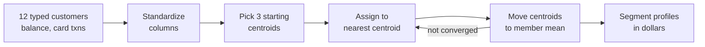
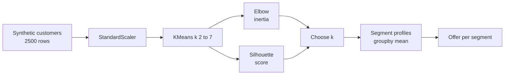
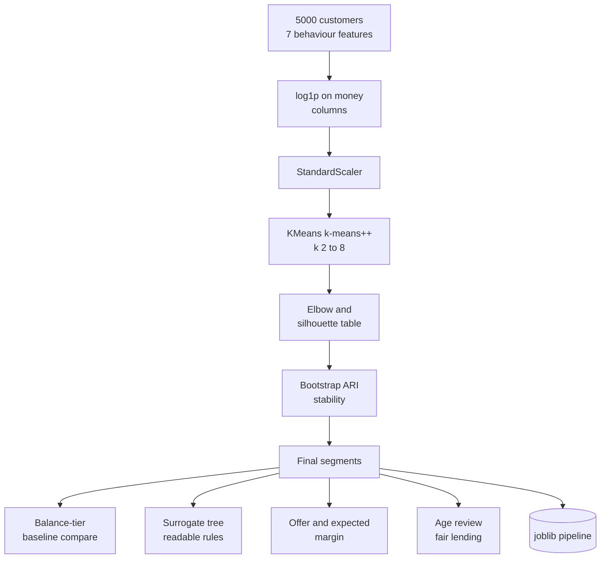
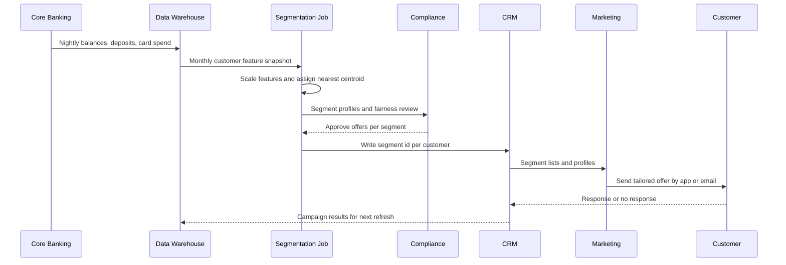

# 8. k-Means Clustering

[](https://colab.research.google.com/github/EdwardSuresh/architects-ml-playbook/blob/main/notebooks/08-k-means-clustering.ipynb)  

[← 7. Isolation Forest](../07-isolation-forest/README.md) · [All algorithms](../../README.md#-the-30-algorithms-ranked) · [9. Transformer →](../09-transformer/README.md)

> **k-Means splits data into k groups by repeatedly assigning each point to its nearest group centre and moving each centre to the average of its members.**

💡 **Analogy:** Think of a youth soccer coach with 40 kids and 4 practice cones. Each kid runs to the nearest cone, then each cone is moved to the middle of its crowd, and the kids re-pick their nearest cone. After a few rounds nobody switches and you have four natural groups.

## The use case (same for Easy, Medium and Hard)
**Financial Services — Retail banking customer segmentation for personalized products**

A regional retail bank sends the same credit card and savings offers to every customer, and response rates are low while some customers receive offers that do not fit their situation. The bank holds balances, monthly deposits, card spend, digital login share, loan-to-balance ratio, number of products and overdraft history for each customer. Marketing wants a few clear, stable segments with names they can design offers for, and compliance wants the segments to avoid proxying for protected classes. Success means well-separated, stable segments, each with a sensible offer and a measurable expected margin.

## Industry adoption
| Sector | Score | Where you meet it |
|---|---|---|
| Financial Services | ■■■■■ 5/5 | Retail banks segment customers by balances, spending and digital use to tailor product offers. |
| Insurance | ■■■■□ 4/5 | Insurers cluster policyholders or claims to design products and route claims handling. |
| Supply Chain | ■■■■□ 4/5 | Retailers cluster stores or SKUs by demand pattern to set replenishment policies. |
| Oil & Gas | ■■■□□ 3/5 | Operators cluster wells by production decline curves to plan interventions. |

**Why rank #8:** k-Means is the workhorse of customer and asset segmentation: it is simple, fast on millions of rows and its output (a handful of average profiles) is easy for marketing and business leaders to understand. Almost every bank, insurer and retailer runs some form of it, but it ranks below the supervised models because segments still need human interpretation and it assumes round, similar-sized clusters.

## How it works
1. Scale the features so each one counts equally in the distance.
2. Choose k and place k starting centres (k-means++ spreads them out smartly).
3. Assignment step: put every customer in the cluster of its nearest centre.
4. Update step: move each centre to the average of its assigned customers.
5. Repeat the two steps until assignments stop changing.
6. Run several random starts (n_init) and keep the solution with the lowest inertia.
7. Choose k with the elbow method and silhouette score, then profile and name each segment.

## Key terms
| Term | Meaning |
|---|---|
| Centroid | The average point of a cluster; its profile describes the segment. |
| Inertia | Total squared distance of points to their own centroid; lower means tighter clusters. |
| Elbow method | Plot inertia against k and pick the k where improvements start to flatten. |
| Silhouette score | From -1 to 1, how much closer a point is to its own cluster than to the next one; higher is better. |
| k-means++ | A smart way to pick starting centres far apart, reducing bad solutions. |
| Standardization | Rescaling each feature to mean 0 and standard deviation 1 so units do not dominate distance. |
| Adjusted Rand Index | A 0-1 style score of how similar two clusterings are; used to test segment stability. |

## 🟢 Easy — Run k-Means by hand on 12 bank customers
Implement the assignment and update steps in plain numpy and watch 12 customers settle into 3 segments.

| 5W + H | |
|---|---|
| **Who** | A marketing analyst learning what clustering actually does. |
| **What** | Twelve typed-in customers with average balance and monthly card transactions. |
| **When** | Before the first segmentation workshop with the marketing team. |
| **Where** | A short numpy script; no libraries beyond numpy. |
| **Why** | To see that k-Means is just 'join the nearest centre, move the centre' repeated until stable. |
| **How** | Standardize two columns, start from a deliberately poor set of centres, loop over assign and update steps printing labels and inertia each round. |

**Architecture**



**🧠 ML concepts:** Distance-based grouping, Why features must be scaled, Assignment and update steps, Inertia as a quality measure, Convergence  
**🐍 Python concepts:** numpy arrays and axis arguments, Broadcasting with None to add an axis, argmin to find the nearest centre, List comprehension inside np.array, break out of a for loop, Filtering a list with zip

**Steps the code performs**
1. Type 12 customers as a numpy array and give them names.
2. Standardize both columns.
3. Pick 3 starting centroids (a deliberately poor start).
4. Loop: compute distances, assign each customer to the nearest centroid, move centroids.
5. Print labels and inertia each iteration and stop when centroids stop moving.
6. Print each segment's average balance and card activity in original units.

▶️ Code: [`easy.py`](easy.py) — run with `python easy.py`

<details><summary>Walkthrough</summary>

| Lines | What happens |
|---|---|
| 1-10 | A 12 x 2 numpy array holds average balance (in thousands) and card transactions per month for three visible personas. A list comprehension creates names C00 to C11. |
| 12-14 | Broadcasting subtracts each column mean and divides by its standard deviation in one line, so a 30k balance does not overpower a count of 50 transactions. |
| 16-18 | k=3 and the starting centres are rows 0, 1 and 4. Two of them are in the same persona, a poor start that shows how the algorithm recovers. |
| 20-26 | X[:, None, :] minus centroids[None, :, :] gives every customer-to-centre difference at once; argmin picks the nearest centre for each customer. |
| 27-36 | Each centre moves to the mean of its members and inertia is printed. Inertia falls from 2.87 to 0.97 in three rounds, then np.allclose detects no movement and the loop breaks. |
| 38-44 | Segments are described in original dollars and counts: low-balance heavy card users, high-balance savers and mid-life families, each with its customer names. |

</details>

<details><summary>Real output</summary>

```text
iter 0: labels=[0, 1, 0, 1, 2, 2, 2, 2, 0, 0, 0, 0] inertia=2.867
iter 1: labels=[1, 1, 0, 1, 2, 2, 2, 2, 0, 0, 0, 0] inertia=1.797
iter 2: labels=[1, 1, 1, 1, 2, 2, 2, 2, 0, 0, 0, 0] inertia=0.970
iter 3: labels=[1, 1, 1, 1, 2, 2, 2, 2, 0, 0, 0, 0] inertia=0.970
Converged - centroids stopped moving.

Segment profiles (original units):
Segment 0: avg balance $  8.6k, 23.8 card txns/mo -> ['C08', 'C09', 'C10', 'C11']
Segment 1: avg balance $  1.1k, 47.5 card txns/mo -> ['C00', 'C01', 'C02', 'C03']
Segment 2: avg balance $ 26.2k,  7.2 card txns/mo -> ['C04', 'C05', 'C06', 'C07']
```

</details>

**Try this next:** Remove the scaling line (use X = customers.astype(float)) and see how balance alone drives the result. · Set k = 2 and k = 4 and compare final inertia. · Start from rows 0, 4, 8 and count how many iterations convergence takes.

## 🟡 Medium — Segment 2,500 customers and pick k with elbow and silhouette
Use scikit-learn KMeans on realistic synthetic banking data, choose k with the elbow and silhouette scores, and map segments to offers.

| 5W + H | |
|---|---|
| **Who** | The bank's customer analytics team. |
| **What** | 2,500 synthetic customers with age, balance, card activity, digital share, loan ratio and number of products. |
| **When** | During campaign planning for the next quarter. |
| **Where** | A notebook against a monthly customer snapshot from the data warehouse. |
| **Why** | Marketing needs a small number of meaningful segments to design offers for. |
| **How** | StandardScaler, KMeans for k=2 to 7, print inertia and silhouette, pick the best k, profile segments with groupby and assign offers with simple rules. |

**Architecture**



**🧠 ML concepts:** Feature scaling with StandardScaler, Elbow method, Silhouette score, Multiple restarts with n_init, Profiling clusters to give them business meaning  
**🐍 Python concepts:** List of dicts as configuration, Looping and appending DataFrames then pd.concat, np.clip for valid ranges, max with key=dict.get, groupby().mean() and size(), iterrows for row-wise rules

**Steps the code performs**
1. Generate four hidden personas of customers with realistic columns.
2. Standardize all features.
3. Fit KMeans for k from 2 to 7 and print inertia and silhouette with ASCII bars.
4. Choose k with the best silhouette.
5. Refit with that k and profile each segment.
6. Map each segment to a suggested offer.

▶️ Code: [`medium.py`](medium.py) — run with `python medium.py`

<details><summary>Walkthrough</summary>

| Lines | What happens |
|---|---|
| 1-7 | Imports and a fixed seed so the synthetic customer base is the same every run. |
| 9-29 | A list of dicts describes four hidden personas. For each, numpy generates realistic columns and np.clip keeps values in valid ranges; pd.concat stacks them into 2,500 customers. |
| 31-33 | StandardScaler gives each feature mean 0 and standard deviation 1. Without it, balance in thousands would dominate the distance. |
| 35-43 | For k from 2 to 7 the loop fits KMeans and prints inertia and silhouette. Inertia always falls; the drop slows after k=4 (the elbow) and silhouette peaks at k=4 (0.481). |
| 45-50 | max(results, key=results.get) returns the k with the highest silhouette, then the final model is fitted and each customer gets a segment id. |
| 52-56 | groupby('segment').mean() builds a profile per segment. The four personas are recovered: digital young, mortgage families, affluent savers and stretched borrowers. |
| 58-69 | Simple business rules turn profiles into offers. Clusters have no names by themselves; a human reads the profile and decides what each segment means. |

</details>

<details><summary>Real output</summary>

```text
Customers: 2500  features: ['age', 'avg_balance_k', 'card_txns_month', 'digital_login_share', 'loan_balance_ratio', 'num_products']

 k   inertia  silhouette
 2      8657     0.396  ***************
 3      5054     0.475  *******************
 4      3591     0.481  *******************
 5      2980     0.450  ******************
 6      2644     0.417  ****************
 7      2457     0.407  ****************

Best k by silhouette: 4

Segment profiles:
           age  avg_balance_k  card_txns_month  digital_login_share  loan_balance_ratio  num_products  customers
segment
0        42.00          12.15            30.24                 0.60                0.69          3.67        676
1        62.82          55.74            10.00                 0.30                0.13          2.69        498
2        27.33           2.70            44.95                 0.88                0.13          1.60        909
3        48.22           1.30            12.41                 0.26                0.98          1.46        417

Suggested offers:
  Segment 0 (676 cust, age 42): Mortgage refinance + 529 college saver
  Segment 1 (498 cust, age 63): Wealth advisory / CDs
  Segment 2 (909 cust, age 27): Cash-back card + mobile-first savings
  Segment 3 (417 cust, age 48): Debt consolidation + budgeting tools
```

</details>

**Try this next:** Remove StandardScaler and see how the best k and segments change. · Drop the age column from the model and check whether the segments stay similar. · Merge the stretched borrowers into the mortgage persona (same loan ratio) and see if silhouette still picks 4.

## 🔴 Hard — Stable, explainable and fair segmentation pipeline
Build a production segmentation pipeline with log transforms, elbow plus silhouette selection, bootstrap stability, a surrogate tree, a baseline comparison and an expected-margin view.

| 5W + H | |
|---|---|
| **Who** | The customer analytics lead, marketing and the fair-lending compliance reviewer. |
| **What** | 5,000 synthetic customers with long-tailed money columns and behaviour features; age is kept out of the model for a fairness review. |
| **When** | Before segments are written to the CRM and used for credit and deposit offers. |
| **Where** | The bank's analytics platform; the saved pipeline scores every customer monthly. |
| **Why** | Segments must be well separated, stable when refreshed, explainable to marketing and not a proxy for protected classes. |
| **How** | Pipeline of log1p plus StandardScaler plus KMeans(k-means++), elbow and silhouette table, bootstrap ARI stability, balance-tier baseline, z-score fingerprints, surrogate decision tree, expected margin per offer and joblib save. |

**Architecture**



**🧠 ML concepts:** Log transform for skewed money features, k selection with elbow and silhouette, Cluster stability via bootstrap and Adjusted Rand Index, Comparing against a simple baseline segmentation, Surrogate decision tree for explainability, Fairness review with held-out protected attributes  
**🐍 Python concepts:** Tuple unpacking in a for loop over persona specs, Functions returning DataFrames, Pipeline slicing with pipe[:-1], pct_change for elbow drops, Dict of tuples for offer economics, tempfile and joblib for model saving

**Steps the code performs**
1. Generate 5,000 customers from four personas with long-tailed balances.
2. Build a pipeline: log1p money columns, scale, KMeans with k-means++.
3. Print inertia, percent inertia drop and silhouette for k=2 to 8 and choose k.
4. Check stability by refitting on 80 percent bootstraps and computing ARI.
5. Compare silhouette against a simple balance-tier baseline.
6. Explain segments with z-score fingerprints and a surrogate tree.
7. Assign offers, estimate expected margin, print a fairness note and save the pipeline.

▶️ Code: [`hard.py`](hard.py) — run with `python hard.py`

<details><summary>Walkthrough</summary>

| Lines | What happens |
|---|---|
| 1-18 | Imports and feature lists. Money columns are listed separately as SKEWED so they can get a log transform. |
| 21-40 | make_customers loops over persona tuples and generates lognormal balances (long tails like real banks). Age is created but never fed to the model. |
| 43-49 | build_pipeline chains log1p, StandardScaler and KMeans with k-means++ and 10 restarts, so scoring new customers applies exactly the same steps. |
| 52-65 | choose_k fits k=2 to 8 and records inertia, silhouette and percent drop in inertia. The drop falls from 40 percent to 25 then 12, and silhouette peaks at k=4. |
| 68-76 | stability refits on four 80 percent samples with different seeds and compares labels with the Adjusted Rand Index. 0.999 means the segments are real, not random. |
| 79-96 | The final model labels everyone. A naive balance-quartile segmentation scores silhouette 0.19 vs 0.43 for k-Means on the same features. |
| 98-108 | Z-score fingerprints show what makes each segment different, and a depth-3 surrogate tree reproduces 98.7 percent of assignments as readable rules. |
| 110-129 | pick_offer maps median profiles to an offer and the expected margin is size times response rate times margin per response. |
| 131-137 | A fair-lending note explains why age is held out and reviewed afterwards, then joblib saves the full pipeline to a temp directory. |

</details>

<details><summary>Real output</summary>

```text
Customers=5000  model features=7 (age held out for fairness review)
 k   inertia  silhouette  inertia_drop_%
 2 23170.453       0.330             NaN
 3 13903.243       0.423            40.0
 4 10363.190       0.433            25.5
 5  9107.703       0.392            12.1
 6  8274.489       0.363             9.1
 7  7838.239       0.253             5.3
 8  7422.073       0.328             5.3
Chosen k=4  bootstrap stability ARI=0.999
Silhouette  k-means=0.433  vs balance-tier baseline=0.191

Segment fingerprint (z-scores):
         avg_balance_k  monthly_deposits_k  card_spend_k  digital_login_share  loan_balance_ratio  num_products  overdrafts_12m
segment
0                 0.40                0.59          0.37                 0.05                0.75          0.78           -0.38
1                -1.17               -1.08         -1.51                -1.20                1.50         -0.56            1.83
2                -0.65               -0.68         -0.16                 1.06               -0.80         -0.43           -0.22
3                 1.54                1.27          0.98                -1.02               -0.80          0.14           -0.52

Surrogate tree fidelity=0.987; first rules:
|--- loan_balance_ratio <= 0.4
|   |--- avg_balance_k <= 12.7
|   |   |--- monthly_deposits_k <= 8.9
|   |   |   |--- class: 2
|   |   |--- monthly_deposits_k >  8.9
|   |   |   |--- class: 0
|   |--- avg_balance_k >  12.7
|   |   |--- digital_login_share <= 0.6

seg  size  med_age  offer     expected_margin
  0  1387      42  refi      $    66,576
  1   800      47  hardship  $     4,800
  2  1808      27  card      $    21,696
  3  1005      63  wealth    $    54,270

Fairness check: age is held out; review segments that skew by age before credit offers.
Saved -> retail_segments_kmeans.joblib
```

</details>

**Try this next:** Remove the log1p step and compare silhouette and stability. · Force k=3 and see which two personas merge and how expected margin changes. · Compute the share of customers over 60 in each segment and flag any segment above 70 percent for compliance review.

## 🔄 End-to-end production flow



## ⚠️ Pitfalls
- Forgetting to scale features: the column with the biggest units dominates. Standardize and log-transform skewed money columns.
- Picking k by habit: always check elbow, silhouette and business usefulness together.
- Assuming clusters are stable: refresh runs can reshuffle segments and confuse campaigns. Test stability and map new clusters to old ones before publishing.
- Letting outliers create tiny clusters: a few millionaires can pull a centroid. Cap or log-transform extreme values.
- Treating segments as facts: k-Means will always return k groups even when none exist. Validate with silhouette and business review.
- Ignoring fair lending: segments used for credit offers must not proxy for age, race or other protected classes. Review composition with compliance.

**When NOT to use it:** Avoid k-Means when clusters are irregular in shape, very different in size or density, or when data is mostly categorical; consider DBSCAN, Gaussian mixture models or k-prototypes instead.

## 🎤 Interview questions
<details><summary>How do you choose k in k-Means?</summary>

Combine the elbow method (where inertia stops dropping sharply), the silhouette score (how well separated clusters are) and business judgement about how many segments can actually be acted on. Stability across bootstraps is a useful tie-breaker.

</details>
<details><summary>Why must data be scaled before k-Means?</summary>

k-Means uses Euclidean distance, so a feature measured in thousands of dollars outweighs one measured in counts or percentages. Standardizing puts every feature on the same footing.

</details>
<details><summary>What are the main limitations of k-Means?</summary>

It assumes roughly round, similar-sized clusters, is sensitive to outliers and starting points, and needs k in advance. For odd shapes or noise use DBSCAN or Gaussian mixtures.

</details>

---
[← 7. Isolation Forest](../07-isolation-forest/README.md) · [All algorithms](../../README.md#-the-30-algorithms-ranked) · [9. Transformer →](../09-transformer/README.md)
