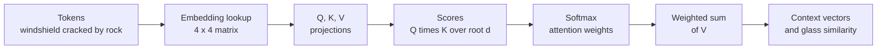
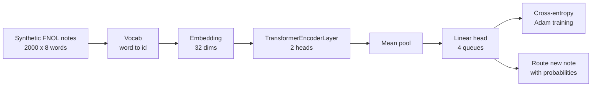
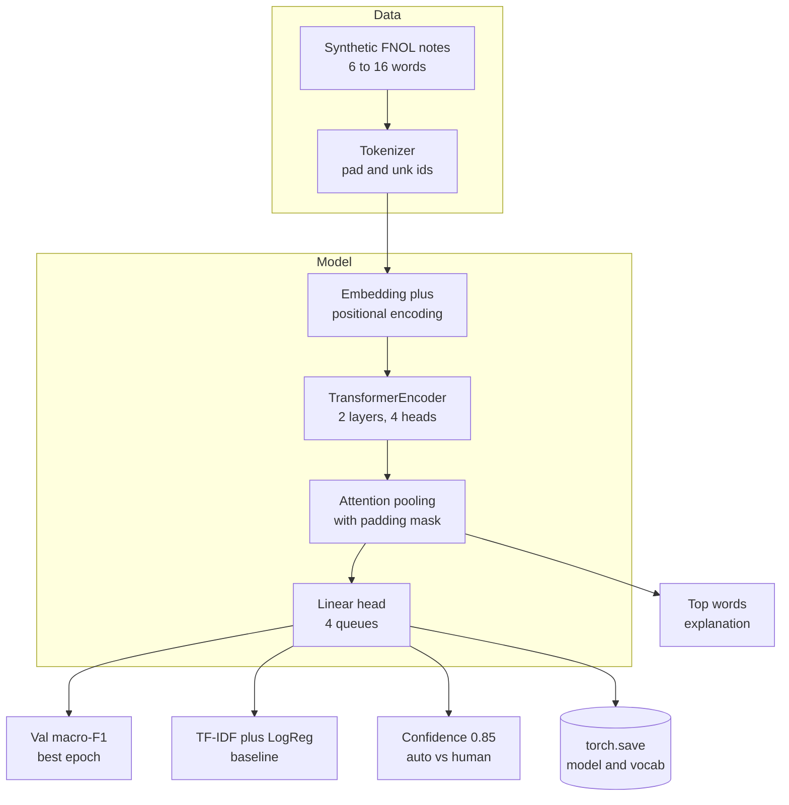
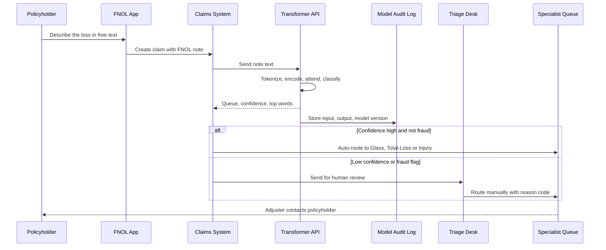

# 9. Transformer

[](https://colab.research.google.com/github/EdwardSuresh/30-ai-algorithms/blob/main/notebooks/09-transformer.ipynb)  

[← 8. k-Means Clustering](../08-k-means-clustering/README.md) · [All algorithms](../../README.md#-the-30-algorithms-ranked) · [10. LSTM →](../10-lstm/README.md)

> **A Transformer is a neural network that reads a whole sequence at once and uses self-attention to let every word look at every other word to build context.**

💡 **Analogy:** Picture a claims adjuster reading a note with a highlighter in each hand. For every word, they glance at all the other words and highlight the ones that change its meaning: 'cracked' looks at 'windshield', 'not' looks at 'injured'. Self-attention is that highlighting, done by many readers (heads) in parallel.

## The use case (same for Easy, Medium and Hard)
**Insurance — Claim notes / first notice of loss text triage**

When a policyholder reports a loss, the call-centre or app captures a short free-text note such as 'windshield cracked by rock on highway' or 'car rolled, airbags deployed, driver taken to hospital'. Today a triage desk reads every note and routes it by hand to Auto-Glass, Total-Loss, Injury or Fraud-review queues, which delays simple glass claims and lets injury claims wait. The insurer has thousands of historic notes with the queue each one finally went to. Success means routing most claims automatically within seconds at high accuracy, sending low-confidence and fraud-flagged claims to people, and showing which words drove each decision.

## Industry adoption
| Sector | Score | Where you meet it |
|---|---|---|
| Financial Services | ■■■■■ 5/5 | Banks classify complaints, extract data from loan documents and summarize call transcripts with Transformer models. |
| Insurance | ■■■■□ 4/5 | Insurers triage first notice of loss notes, read medical bills and extract fields from policy documents. |
| Supply Chain | ■■■□□ 3/5 | Logistics teams parse shipping documents and emails and some forecast demand with time-series Transformers. |
| Oil & Gas | ■■■□□ 3/5 | Operators search maintenance logs and incident reports and classify safety observations from free text. |

**Why rank #9:** Transformers power every modern large language model (GPT, Claude, BERT) and have become the default for text, documents and increasingly time series. Banks and insurers use them for document intake, claims notes, complaints and call-centre text, but they rank below simpler models in day-to-day volume because they cost more to run, need more governance and are harder to explain.

## How it works
1. Split the text into tokens (words or sub-words) and turn each into an id.
2. Look up a learned embedding vector for every token and add a positional encoding so word order is known.
3. Self-attention: each token makes a query, key and value vector; query-key dot products decide how much to attend to every other token.
4. Softmax turns those scores into weights and each token becomes a weighted blend of the value vectors.
5. Multiple heads do this in parallel, then a small feed-forward network, residual connections and layer normalization follow; this block is stacked several times.
6. Pool the final token vectors (or use a special token) and feed a classification head.
7. Train with cross-entropy on labelled examples, often starting from a model pre-trained on huge text by self-supervision.

## Key terms
| Term | Meaning |
|---|---|
| Token | A word or word-piece the model reads; each maps to an integer id. |
| Embedding | A learned vector of numbers that represents a token's meaning. |
| Self-attention | Each token scores every other token (query dot key) and mixes their values by those weights. |
| Multi-head attention | Several attention calculations in parallel, each free to focus on a different relationship. |
| Positional encoding | Numbers added to embeddings so the model knows word order. |
| Padding mask | A flag telling attention to ignore filler tokens added to make notes the same length. |
| Pre-training / fine-tuning | Learn general language on huge text first, then adapt to a specific task with fewer labels. |
| LLM | Large Language Model: a very large Transformer, usually decoder-only like GPT, trained to predict the next token. |

## 🟢 Easy — Compute self-attention by hand on a 4-word claim note
Calculate scaled dot-product self-attention in numpy for 'windshield cracked by rock' and read the attention weights.

| 5W + H | |
|---|---|
| **Who** | A claims operations lead or architect who wants to understand what 'attention' means. |
| **What** | Four words with hand-made 4-number embeddings and small query, key and value matrices. |
| **When** | Before evaluating vendor or in-house Transformer models for FNOL triage. |
| **Where** | A numpy-only script; no deep-learning library needed. |
| **Why** | Attention is the core idea behind every Transformer and LLM; seeing the numbers removes the mystery. |
| **How** | Build Q, K, V with matrix multiplication, compute Q times K transpose divided by square root of d, apply softmax per row and multiply by V. |

**Architecture**



**🧠 ML concepts:** Embeddings as vectors, Query, key and value, Scaled dot-product attention, Softmax as normalized weights, Context-aware token vectors  
**🐍 Python concepts:** Dictionaries mapping words to lists, List comprehension to build a matrix, The @ matrix-multiply operator, Defining a function with keepdims broadcasting, zip to print labelled rows, str.join with a generator

**Steps the code performs**
1. Define four tokens and a hand-made embedding for each.
2. Create query, key and value matrices and project the embeddings.
3. Compute raw attention scores Q times K transpose divided by square root of d.
4. Apply softmax per row to get attention weights.
5. Multiply weights by V to get context-aware vectors.
6. Compare the sentence vector with an Auto-Glass direction.

▶️ Code: [`easy.py`](easy.py) — run with `python easy.py`

<details><summary>Walkthrough</summary>

| Lines | What happens |
|---|---|
| 1-16 | A dict maps each word to a hand-made vector; the first two numbers loosely mean 'glass-related'. A list comprehension stacks them into a 4 x 4 matrix X. |
| 18-24 | W_q, W_k, W_v are the projection matrices a real model learns; here they are near-identity. The @ operator produces queries, keys and values for every word at once. |
| 26-31 | Q @ K.T gives a 4 x 4 grid: how much each word (row) matches each other word (column). Dividing by the square root of d keeps numbers in a stable range. |
| 33-43 | softmax exponentiates and divides by the row sum (keepdims keeps the shape for broadcasting). Each row now sums to 1: 'windshield' gives 0.32 to itself and 0.31 to 'cracked' but only 0.14 to 'by'. |
| 45-47 | A @ V blends value vectors by the weights, so 'cracked' now carries information from 'windshield' and 'rock'. |
| 48-51 | Averaging the context vectors and comparing with a glass direction gives 0.96, a crude Auto-Glass routing signal. The least-attended word is the filler 'by'. |

</details>

<details><summary>Real output</summary>

```text
Raw attention scores (row = word looking, col = word looked at):
  windshield [0.88 0.83 0.07 0.54]
     cracked [0.83 0.82 0.07 0.49]
          by [0.03 0.03 0.02 0.03]
        rock [0.48 0.43 0.05 0.33]

Attention weights (each row sums to 1):
  windshield 0.32 0.31 0.14 0.23
     cracked 0.32 0.31 0.15 0.23
          by 0.25 0.25 0.25 0.25
        rock 0.29 0.27 0.19 0.25

Context-aware vector for 'cracked': [0.71 0.71 0.06 0.11]
Similarity to Auto-Glass queue: 0.96
Word 'by' receives the least attention: by
```

</details>

**Try this next:** Change the embedding of 'rock' to [0, 0, 1, 0] and see how attention to it changes. · Remove the division by np.sqrt(d) and observe the weights become sharper. · Add a fifth word 'injured' with vector [0, 0, 1, 1] and check the glass similarity.

## 🟡 Medium — Train a tiny Transformer encoder to route 2,000 FNOL notes
Build and train a one-layer PyTorch Transformer encoder that classifies synthetic claim notes into four queues.

| 5W + H | |
|---|---|
| **Who** | A data scientist on the claims analytics team. |
| **What** | 2,000 synthetic 8-word FNOL notes with queue labels, 5 percent of labels flipped to mimic mis-routing. |
| **When** | During a proof of concept before investing in a larger pre-trained model. |
| **Where** | A CPU-only Python environment with PyTorch. |
| **Why** | To learn the moving parts (vocab, embedding, encoder layer, pooling, head, training loop) on a problem small enough to run in seconds. |
| **How** | Build a word vocab, encode notes as id tensors, define an nn.Module with Embedding plus TransformerEncoderLayer plus Linear, train with Adam for 6 epochs and score a new note. |

**Architecture**



**🧠 ML concepts:** Tokenization and vocabulary, Embedding layer, Transformer encoder layer (attention plus feed-forward), Mean pooling for classification, Mini-batch training with cross-entropy, Label noise limits accuracy  
**🐍 Python concepts:** Classes inheriting from nn.Module, super().__init__(), Set and dict comprehensions, random.sample, choices and shuffle, with torch.no_grad() context manager, dict.get with a default

**Steps the code performs**
1. Generate notes from queue keywords, cross-queue noise words and filler words.
2. Flip 5 percent of labels to mimic real mis-routing.
3. Build a vocabulary and convert notes to id tensors.
4. Define a tiny Transformer classifier.
5. Train for 6 epochs in mini-batches and print test accuracy per epoch.
6. Print per-queue accuracy and route a brand-new note.

▶️ Code: [`medium.py`](medium.py) — run with `python medium.py`

<details><summary>Walkthrough</summary>

| Lines | What happens |
|---|---|
| 1-9 | Imports, one CPU thread (the box is shared) and fixed seeds. QUEUES lists the four routing destinations. |
| 11-29 | A dict of keyword lists per queue plus common filler words. make_note mixes 2 queue words, 1-2 words from other queues and filler, then shuffles, so notes are messy. |
| 31-42 | A nested list comprehension builds 2,000 notes; 5 percent get a random label. A set comprehension collects unique words and a dict gives each an id, with 0 reserved for padding. |
| 44-58 | TinyClaimTransformer subclasses nn.Module: Embedding turns ids into vectors, one TransformerEncoderLayer applies 2-head self-attention plus a feed-forward net, and mean pooling plus Linear gives four queue scores. |
| 60-77 | The training loop shuffles indices, steps through batches of 64, computes cross-entropy, back-propagates and updates with Adam. Test accuracy climbs from 0.63 to 0.90 in six epochs. |
| 79-84 | Per-queue accuracy (0.86 to 0.94) shows no queue is neglected. Label noise means 100 percent is not possible. |
| 86-94 | A new note is encoded with dict.get so unknown words like 'after' become 0. Softmax probabilities route it to Injury at 0.95, despite the Total-Loss word 'rolled'. |

</details>

<details><summary>Real output</summary>

```text
Vocab size=38  train=1600  test=400  example=['highway', 'airbags', 'reported', 'frame', 'highway', 'windshield', 'er', 'on']
epoch 1  last-batch loss=1.128  test acc=0.627
epoch 2  last-batch loss=0.817  test acc=0.812
epoch 3  last-batch loss=0.430  test acc=0.873
epoch 4  last-batch loss=0.434  test acc=0.885
epoch 5  last-batch loss=0.343  test acc=0.900
epoch 6  last-batch loss=0.508  test acc=0.902

Per-queue test accuracy:
  AutoGlass    0.94  (n=99)
  TotalLoss    0.86  (n=106)
  Injury       0.90  (n=114)
  FraudReview  0.91  (n=81)

New FNOL note: insured reported neck pain after car rolled on highway
  Injury       0.95 ############################
  TotalLoss    0.05 #
  AutoGlass    0.00
  FraudReview  0.00
```

</details>

**Try this next:** Change heads=2 to heads=4 and d=32 to d=16 and compare accuracy and speed. · Raise label noise from 0.05 to 0.20 and watch test accuracy fall. · Write your own note such as 'rock chipped windshield, cash only repair shop' and see how the model splits Glass vs Fraud.

## 🔴 Hard — FNOL routing pipeline with masking, explanations, baseline and governance
Build a fuller Transformer claim router with tokenizer, positional encoding, padding mask, 2-layer multi-head encoder, attention-pooling explanations, early stopping, a TF-IDF baseline and a human-in-the-loop threshold.

| 5W + H | |
|---|---|
| **Who** | The claims AI team, the claims operations owner and model governance. |
| **What** | 2,400 variable-length synthetic notes (6-16 words) with a 'not injured' phrase that depends on word order, and 5 percent label noise. |
| **When** | Pre-production, deciding whether the Transformer is worth deploying over a simpler model. |
| **Where** | A CPU training job; the saved model and vocab are served behind the claims system's routing API. |
| **Why** | Fast correct routing cuts glass cycle time and gets injured claimants help sooner, while regulators expect explainable, monitored AI decisions. |
| **How** | Tokenizer class with pad and unknown ids, sine-cosine positional encoding, nn.TransformerEncoder with src_key_padding_mask, attention pooling whose weights explain decisions, train/val/test with best-epoch selection, TF-IDF plus logistic regression baseline, confidence threshold and torch.save. |

**Architecture**



**🧠 ML concepts:** Tokenizer with padding and unknown tokens, Positional encoding, Multi-head self-attention via nn.TransformerEncoder, Padding masks, Attention pooling as a (partial) explanation, Baseline comparison and human-in-the-loop thresholds  
**🐍 Python concepts:** Classes with __init__ and methods, register_buffer for non-trained tensors, Slice assignment to insert into a list, map with tuple unpacking, lambda functions, Dict comprehension to copy model state

**Steps the code performs**
1. Generate variable-length notes, including a 'not injured' phrase for non-injury claims.
2. Split 70/15/15 into train, validation and test and build a tokenizer on train only.
3. Define positional encoding and a 2-layer, 4-head encoder with attention pooling.
4. Train 10 epochs with AdamW, keeping the best validation macro-F1.
5. Compare test macro-F1 with a TF-IDF plus logistic regression baseline.
6. Explain one routed note by its top attention words.
7. Apply a 0.85 confidence threshold, print a governance note and save the model.

▶️ Code: [`hard.py`](hard.py) — run with `python hard.py`

<details><summary>Walkthrough</summary>

| Lines | What happens |
|---|---|
| 1-26 | Imports, seeds, one CPU thread and constants. PAD and UNK are special tokens, MAXLEN fixes the note length, and KEYWORDS hold each queue's vocabulary. |
| 28-48 | make_note builds 6-16 word notes and inserts 'driver injured' for Injury or sometimes 'not injured' for other queues using slice assignment. build_data adds 5 percent label noise. |
| 50-61 | Tokenizer builds itos (id to string) and stoi (string to id) from training notes only. encode maps unknown words to 1 and pads with 0 up to MAXLEN. |
| 63-75 | PositionalEncoding creates fixed sine and cosine waves of different frequencies and adds them to embeddings, so 'not injured' differs from 'injured ... not'. register_buffer stores it with the model without training it. |
| 77-98 | ClaimRouter stacks two encoder layers with 4 heads. src_key_padding_mask stops attention looking at padding. Attention pooling learns one weight per word; those weights are returned for explanation. |
| 100-122 | train runs AdamW in mini-batches, scores validation macro-F1 each epoch and keeps a copy of the best weights, a simple form of early stopping. |
| 124-152 | Data is split, tensors are built and the model trained (about 19k parameters). The TF-IDF plus logistic regression baseline scores 0.958 vs 0.939: on short keyword notes a cheap model is enough, an honest and common finding. |
| 154-162 | For a glass note the model returns AutoGlass at 0.99 and the highest attention goes to 'not' (which rules out Injury) and 'cracked'. Attention is a helpful hint, not a full proof of why. |
| 164-177 | Claims with confidence of 0.85 or more (93 percent) are auto-routed at 0.958 accuracy; the rest go to the triage desk. A governance note mentions LLMs and the NAIC AI bulletin, and torch.save stores weights, vocab and queue names. |

</details>

<details><summary>Real output</summary>

```text
notes train/val/test = 1680/360/360  vocab=50
params=18,853
  epoch  1  val macro-F1=0.706
  epoch  2  val macro-F1=0.810
  epoch  3  val macro-F1=0.906
  epoch  4  val macro-F1=0.941
  epoch  5  val macro-F1=0.947
  epoch  6  val macro-F1=0.941
  epoch  7  val macro-F1=0.944
  epoch  8  val macro-F1=0.950
  epoch  9  val macro-F1=0.952
  epoch 10  val macro-F1=0.953

Test macro-F1  Transformer=0.939   TF-IDF+LogReg baseline=0.958
Lesson: on short keyword notes a cheap baseline can match or beat it; Transformers pay off on long, messy text.
              precision    recall  f1-score   support

   AutoGlass       0.95      0.94      0.94        99
   TotalLoss       0.91      0.99      0.95        87
      Injury       0.96      0.95      0.96        84
 FraudReview       0.94      0.88      0.91        90

    accuracy                           0.94       360
   macro avg       0.94      0.94      0.94       360
weighted avg       0.94      0.94      0.94       360

Note: claimant reported windshield cracked by rock on highway driver not injured
Route -> AutoGlass (p=0.99)  top words by attention:
  not          0.16 ######
  claimant     0.16 ######
  by           0.11 ####
  cracked      0.10 ####

Auto-route 93% of claims at accuracy 0.958; rest go to triage desk.
Governance: log model version, attention explanations and overrides for NAIC AI audit.
Saved -> claim_router.pt
```

</details>

**Try this next:** Remove the positional encoding (return x in forward) and compare test F1 on notes containing 'not injured'. · Make notes longer (MAXLEN=40) with more filler and cross-queue words and see whether the Transformer overtakes TF-IDF. · Change the 0.85 threshold to 0.95 and report the auto-route share vs accuracy trade-off.

## 🔄 End-to-end production flow



## ⚠️ Pitfalls
- Skipping a simple baseline: TF-IDF plus logistic regression often matches a Transformer on short, keyword-heavy text. Always compare before paying for GPUs.
- Building the vocabulary on all data: words from test notes leak into training. Fit the tokenizer on training data only.
- Forgetting the padding mask: the model attends to filler tokens and learns noise from note length.
- Treating attention weights as a complete explanation: they show focus, not causation. Combine with perturbation tests or SHAP-style methods for audits.
- Sending sensitive text to an external LLM without controls: claim notes contain PII and health data. Use approved, private deployments with data-handling agreements.
- No human-in-the-loop: auto-route only high-confidence cases and keep fraud and low-confidence claims with people, logging every override.

**When NOT to use it:** Do not reach for a Transformer when the text is short and keyword driven, labelled data is tiny, or latency and cost budgets are tight; a TF-IDF plus linear model or a few rules may be cheaper, faster and easier to govern.

## 🎤 Interview questions
<details><summary>What is self-attention in one paragraph?</summary>

Each token produces a query, key and value vector. The dot product of a token's query with every key, scaled and passed through softmax, gives weights that say how much to attend to each token, and the output is the weighted sum of values. This lets every word use context from the whole sentence in one step.

</details>
<details><summary>Why do Transformers need positional encoding?</summary>

Attention itself treats input as a set and ignores order. Adding positional encodings (fixed sine-cosine or learned) to embeddings tells the model where each token sits, so 'not injured' differs from 'injured, not at fault'.

</details>
<details><summary>How does an encoder classifier like BERT differ from GPT?</summary>

Encoder models read the whole text in both directions and are ideal for classification and extraction. GPT-style decoders use causal masking to predict the next token and are used for generation; both are Transformers and both can be fine-tuned or prompted for triage.

</details>

---
[← 8. k-Means Clustering](../08-k-means-clustering/README.md) · [All algorithms](../../README.md#-the-30-algorithms-ranked) · [10. LSTM →](../10-lstm/README.md)
