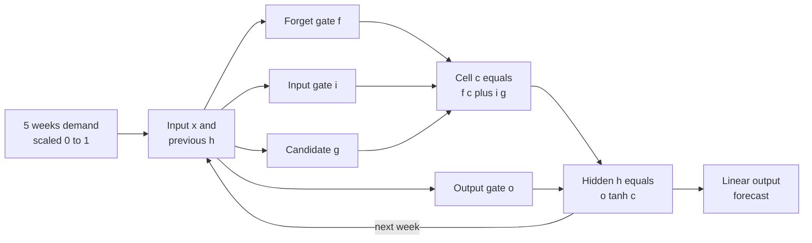
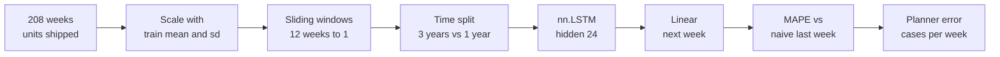
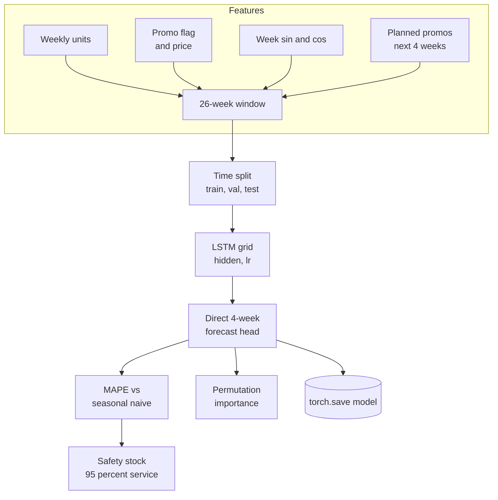
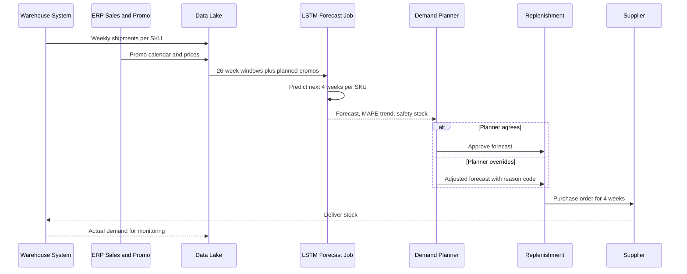

# 10. LSTM

[](https://colab.research.google.com/github/EdwardSuresh/architects-ml-playbook/blob/main/notebooks/10-lstm.ipynb)  

[← 9. Transformer](../09-transformer/README.md) · [All algorithms](../../README.md#-the-30-algorithms-ranked) · [11. Principal Component Analysis (PCA) →](../11-principal-component-analysis/README.md)

> **An LSTM is a recurrent neural network that reads a sequence step by step and uses gates to decide what to remember, what to forget and what to output at each step.**

💡 **Analogy:** Think of a distribution-center planner with a whiteboard. Each week they read the new numbers, erase notes that no longer matter (forget gate), write down anything important like an upcoming promotion (input gate), and tell the buyer only the part needed for next week's order (output gate). The whiteboard is the LSTM's cell memory.

## The use case (same for Concept, Build and Production)
**Supply Chain — Weekly SKU demand forecasting for a distribution center**

A distribution center restocks thousands of SKUs every week and buyers order from forecasts built on spreadsheets and 'same week last year'. Holiday peaks and promotions are badly predicted, so the DC runs out during promotions and carries too much stock afterwards. The company has several years of weekly shipments per SKU, the promotion calendar and price history. Success means a lower forecast error than the seasonal-naive method, especially in promotion weeks, a 4-week forecast that feeds purchase orders and smaller safety stock for the same service level.

## Industry adoption
| Sector | Score | Where you meet it |
|---|---|---|
| Financial Services | ■■■■□ 4/5 | Banks forecast ATM cash demand and call-centre volumes and model transaction sequences for fraud. |
| Insurance | ■■■□□ 3/5 | Insurers forecast weekly claim counts after storms and model sequences of policyholder events. |
| Supply Chain | ■■■■■ 5/5 | Retailers and distributors forecast weekly SKU demand per distribution center including promotions and holidays. |
| Oil & Gas | ■■■■□ 4/5 | Operators forecast well production and predict pump or compressor failure from sensor time series. |

**Why rank #10:** Long Short-Term Memory networks were the standard deep-learning model for sequences for a decade and are still widely used for demand forecasting, sensor time series and transaction sequences. They capture seasonality, promotions and long memory better than simple statistical models when there is enough history, but gradient boosting with lag features and newer Transformer forecasters often compete, which keeps LSTM at rank 10.

## How it works
1. Arrange history into sliding windows, for example the last 26 weeks as input and the next 1-4 weeks as target.
2. At each time step the cell receives the current input and the previous hidden state.
3. The forget gate (sigmoid, 0-1) decides how much of the old cell memory to keep.
4. The input gate and candidate (tanh) decide what new information to write into memory.
5. The cell state is updated: c = f * c_old + i * candidate; the output gate then produces the hidden state h = o * tanh(c).
6. After the last step, a linear layer turns the final hidden state into the forecast.
7. Train the weights with backpropagation through time to minimize forecast error (for example MSE).

## Key terms
| Term | Meaning |
|---|---|
| Recurrent network | A neural network that processes a sequence one step at a time while carrying a memory forward. |
| Cell state (c) | The LSTM's long-term memory lane that flows through time with small, gated changes. |
| Hidden state (h) | The short-term output at each step, used for predictions and passed to the next step. |
| Forget / input / output gates | Sigmoid switches between 0 and 1 that control erasing, writing and revealing memory. |
| Sliding window | Turning one long series into many (past N weeks, next week) training examples. |
| MAPE | Mean Absolute Percentage Error: average forecast miss as a percent of actual demand. |
| Seasonal-naive baseline | Forecast that this week will equal the same week last year; a model must beat it. |
| Safety stock | Extra inventory held to cover forecast error during supplier lead time. |

## 🟢 Concept — Step one LSTM cell through 5 weeks of demand
Compute the forget, input, candidate and output gates and the cell and hidden states by hand in numpy for five weeks of SKU demand.

| 5W + H | |
|---|---|
| **Who** | A demand planner or architect who wants to see inside an LSTM. |
| **What** | Five weeks of scaled shipments for one SKU and a single 2-unit LSTM cell with random weights. |
| **When** | Before trusting a deep-learning forecast in the replenishment process. |
| **Where** | A numpy-only script on a laptop. |
| **Why** | The gate equations are the whole idea of an LSTM; seeing their numbers week by week makes the model less of a black box. |
| **How** | Create W, U and b per gate with dict comprehensions, loop over weeks computing sigmoid and tanh gates, update c and h, then map h to an (untrained) forecast. |

**Architecture**



**🧠 ML concepts:** Recurrent processing step by step, Gates as 0-1 switches (sigmoid), Cell state vs hidden state, Forget-gate bias trick, Output layer maps memory to a forecast  
**🐍 Python concepts:** Dict comprehensions, Defining small helper functions, Passing a function as an argument, enumerate with start=1, The @ operator for matrix and dot products, Multi-line f-strings

**Steps the code performs**
1. Type five weeks of scaled demand.
2. Initialize empty hidden and cell states.
3. Create random weights and biases for the four gates, with forget bias +1.
4. For each week compute f, i, g and o.
5. Update the cell state and hidden state and print them.
6. Turn the final hidden state into an untrained week-6 forecast.

▶️ Code: [`easy.py`](easy.py) — run with `python easy.py`

<details><summary>Walkthrough</summary>

| Lines | What happens |
|---|---|
| 1-11 | Five weeks of shipments are scaled to 0-1 (1.0 = 1,000 cases). The LSTM's two memories h and c start as zero vectors of size 2. |
| 13-20 | Dict comprehensions create input weights W, hidden weights U and biases b for the forget, input, candidate and output gates. A +1 forget bias makes the cell remember by default. |
| 22-27 | sigmoid squashes numbers to 0-1. gate() takes the gate name and an activation function as arguments, showing that Python functions can be passed around like values. |
| 29-39 | enumerate(start=1) loops over weeks. Each gate combines this week's demand and last week's h. The forget gate stays around 0.75, so roughly three quarters of old memory is kept each week. |
| 40-44 | The two LSTM equations: c = f*c + i*g updates long memory and h = o*tanh(c) is the short memory. The printout shows c accumulating slowly over the five weeks. |
| 46-50 | A linear output layer maps h to a forecast. With random weights it says 506 cases, far from the roughly 600 trend, which is why training is needed. |

</details>

<details><summary>Real output</summary>

```text
week 1: demand=0.42 f=[0.75 0.73] i=[0.53 0.58] c=[-0.026 -0.028] h=[-0.015 -0.015]
week 2: demand=0.45 f=[0.75 0.73] i=[0.54 0.59] c=[-0.045 -0.041] h=[-0.026 -0.022]
week 3: demand=0.50 f=[0.75 0.73] i=[0.54 0.6 ] c=[-0.061 -0.048] h=[-0.036 -0.027]
week 4: demand=0.61 f=[0.76 0.73] i=[0.55 0.62] c=[-0.078 -0.058] h=[-0.048 -0.032]
week 5: demand=0.58 f=[0.76 0.73] i=[0.55 0.62] c=[-0.086 -0.056] h=[-0.052 -0.032]

Untrained forecast for week 6: 506 cases (training would tune W, U, b)
```

</details>

**Try this next:** Set b['forget'] to -3 and see how quickly the cell state forgets. · Increase hidden to 4 and inspect the larger gate vectors. · Add a promotion spike (0.95) in week 4 and watch c react.

## 🟡 Build — Train a PyTorch LSTM on 4 years of weekly SKU demand
Train a one-layer PyTorch LSTM on sliding 12-week windows of a seasonal series and beat a naive last-week forecast on the final year.

| 5W + H | |
|---|---|
| **Who** | A supply-chain data scientist piloting deep-learning forecasts. |
| **What** | 208 weeks of synthetic shipments for one SKU with trend, yearly seasonality and noise. |
| **When** | During a pilot before scaling to many SKUs. |
| **Where** | A CPU Python environment with PyTorch; data would come from the warehouse system. |
| **Why** | To learn windowing, time-ordered splitting, scaling and the LSTM training loop on one clear series. |
| **How** | Scale with training statistics, make 12-week windows, train on the first 3 years, test on the last year, compare MAPE with last-week naive. |

**Architecture**



**🧠 ML concepts:** Sliding-window supervised framing, Time-ordered train/test split, Scaling with training statistics only, LSTM layer and last hidden state, MAPE and a naive baseline  
**🐍 Python concepts:** Vectorized numpy maths, Function returning two tensors, Slicing with [i:i + window], Ellipsis indexing [..., None], Class with __init__ and forward, Modulo for periodic printing

**Steps the code performs**
1. Generate 4 years of weekly demand with trend, seasonality and noise.
2. Scale the series with training-period mean and standard deviation.
3. Build 12-week sliding windows and next-week targets.
4. Split by time: first 3 years train, last year test.
5. Train an LSTM plus Linear model for 200 epochs with Adam and MSE.
6. Compare test MAPE with a naive last-week forecast and print a sample table.

▶️ Code: [`medium.py`](medium.py) — run with `python medium.py`

<details><summary>Walkthrough</summary>

| Lines | What happens |
|---|---|
| 1-14 | Imports, one CPU thread and seeds. numpy builds 208 weeks of demand in one vectorized line: base level, slow trend, a yearly sine wave and random noise. |
| 16-19 | The mean and standard deviation come from the first 156 weeks only, so the test year does not leak into scaling. |
| 21-30 | make_windows uses list comprehensions with slices: each X is 12 weeks, each y the following week. [..., None] adds a feature axis giving shape (samples, 12, 1). |
| 31-34 | The first 144 windows (ending inside year 3) train the model; the 52 windows of year 4 are the test set. Shuffling across time would leak future information. |
| 36-47 | DemandLSTM wraps nn.LSTM with batch_first=True and a Linear layer. Only the last time step's hidden state is used as the summary of the 12 weeks. |
| 49-59 | Full-batch training for 200 epochs with Adam and MSE loss; training error falls from 0.24 to 0.15 (in scaled units). |
| 61-76 | Predictions are un-scaled to cases. LSTM MAPE is 10.2 percent vs 12.1 percent for 'same as last week', about 95 cases average error per week. |

</details>

<details><summary>Real output</summary>

```text
Weeks of history: 208  min=342  max=1415
Train windows=144  Test windows=52
epoch  40  train MSE=0.2444
epoch  80  train MSE=0.2025
epoch 120  train MSE=0.1824
epoch 160  train MSE=0.1662
epoch 200  train MSE=0.1537

Test MAPE  LSTM=10.2%   naive last-week=12.1%

week  actual  lstm  naive
 156    1111   974    816
 157    1009  1023   1111
 158     879  1033   1009
 159    1099  1032    879
 160     970  1033   1099
 161    1178  1037    970
 162    1244  1064   1178
 163    1073  1112   1244

Planner view: average absolute error = 95 cases/week
```

</details>

**Try this next:** Change WINDOW from 12 to 52 so the model sees a full year, and compare MAPE. · Add a seasonal-naive baseline (same week last year) and see whether the LSTM still wins. · Double the noise level and watch both MAPEs rise.

## 🔴 Production — Multivariate 4-week forecast with promos, baseline, MAPE and safety stock
Build a multivariate, multi-step LSTM forecaster with promotions and price, tune it on a validation window, beat seasonal-naive on MAPE and translate the error into safety stock.

| 5W + H | |
|---|---|
| **Who** | The demand-planning lead, the replenishment team and the supply-chain analytics owner. |
| **What** | 260 weeks of SKU demand with holiday peaks, 15 percent promo weeks and price changes, plus the known promo calendar for the next 4 weeks. |
| **When** | Before the forecast is allowed to drive weekly purchase orders. |
| **Where** | A scheduled forecasting job; the saved model is reloaded each week for every SKU in the DC. |
| **Why** | Promotions and holidays cause the biggest stock-outs and overstock; a better forecast reduces both and lowers safety stock. |
| **How** | Five input features plus future promo flags, train/validation/test split by time, grid over hidden size and learning rate with best-epoch selection, direct 4-week output, MAPE by horizon and on promo weeks, permutation importance, safety-stock calculation and torch.save. |

**Architecture**



**🧠 ML concepts:** Multivariate sequence inputs, Known-future covariates (planned promotions), Train/validation/test split by time, Direct multi-step forecasting, Seasonal-naive baseline and MAPE by horizon, Permutation importance and safety stock from forecast error  
**🐍 Python concepts:** Functions with docstrings and defaults, np.hstack and np.repeat to build inputs, Nested loops for a grid search, min over dict items with a key lambda, Dict comprehension mapping names to column lists, tempfile plus torch.save

**Steps the code performs**
1. Simulate 5 years of weekly demand with trend, seasonality, holiday peak, promo lift and price elasticity.
2. Add week-of-year sine and cosine features and scale with training statistics.
3. Build 26-week windows with the next 4 weeks of planned promos as extra inputs.
4. Split by time into train, validation and the final 52 weeks for test.
5. Grid-search hidden size and learning rate, keeping the best validation epoch.
6. Compare MAPE by horizon and on promo weeks against seasonal-naive.
7. Compute permutation importance and safety stock, then save the model.

▶️ Code: [`hard.py`](hard.py) — run with `python hard.py`

<details><summary>Walkthrough</summary>

| Lines | What happens |
|---|---|
| 1-13 | Imports, a single CPU thread and constants: 26 weeks of history in, 4 weeks out, and five input features. |
| 16-32 | make_history simulates demand with trend, yearly seasonality, a holiday bump, a 35 percent promo lift and price elasticity of -1.2. Week sine and cosine tell the model where it is in the year. |
| 35-46 | windows builds each example: the last 26 weeks of all features plus the planned promo flags for the next 4 weeks (known in advance), repeated across time steps with np.repeat and joined with np.hstack. |
| 49-59 | Forecaster is an LSTM followed by dropout and a Linear head that outputs all 4 future weeks at once (direct multi-step), avoiding error compounding. |
| 62-81 | fit trains with Adam, checks validation MSE every epoch and keeps the best weights, which is simple early stopping. |
| 89-110 | Time split: weeks before 182 train, 182-207 validate, last 52 test. Scaling uses training weeks only. A grid over hidden size and learning rate picks hidden=16, lr=0.01 on validation. |
| 112-130 | MAPE per horizon vs seasonal-naive: about 8.6 percent vs 22.2 percent overall. On promo weeks the gap is huge (10.8 vs 36.1 percent) because last year's same week had no promo. |
| 132-144 | Permutation importance shuffles one feature group at a time. Future promo flags matter most (+11.3 points), confirming the value of feeding the promo calendar. |
| 146-161 | Safety stock = 1.65 x error sigma x square root of lead time gives 314 units for the LSTM vs 986 for seasonal-naive at 95 percent service. A governance line and torch.save finish. |

</details>

<details><summary>Real output</summary>

```text
windows train/val/test = 153/23/49  inputs per step = 9
  hidden=16 lr=0.01   val MSE=0.100
  hidden=16 lr=0.003  val MSE=0.119
  hidden=32 lr=0.01   val MSE=0.147
  hidden=32 lr=0.003  val MSE=0.142
Chosen hidden=16 lr=0.01

MAPE by horizon   LSTM   seasonal-naive
  week +1         10.2%    22.0%
  week +2          7.5%    22.2%
  week +3          8.4%    22.3%
  week +4          8.3%    22.2%
  overall          8.6%    22.2%
Week+1 MAPE on promo weeks: LSTM 10.8% vs naive 36.1%

Feature importance (MAPE increase when shuffled):
  units         +4.7 pts
  promo         +1.4 pts
  price         +0.5 pts
  week_sin      -0.5 pts
  week_cos      +4.4 pts
  future_promo +11.3 pts
Safety stock (LSTM          ): sigma=  135  ->   314 units at 95% service
Safety stock (seasonal-naive): sigma=  423  ->   986 units at 95% service

Next 4-week forecast: [948, 1681, 1572, 954]  actual: [1054, 1860, 2045, 1377]
Governance: version the model, monitor weekly MAPE drift, log planner overrides in S&OP.
Saved -> sku_lstm.pt
```

</details>

**Try this next:** Remove the future promo flags from windows (skip np.hstack) and measure how much promo-week MAPE gets worse. · Change lead_weeks to 4 and see the safety-stock impact. · Add a 2-layer LSTM (layers=2) to the grid and check whether validation improves.

## 🔄 End-to-end production flow



## ⚠️ Pitfalls
- Random shuffling of time series: the model sees the future. Always split by date and use walk-forward validation.
- Scaling with all data: the test period's level leaks into training. Fit scalers on training weeks only.
- Skipping a seasonal-naive baseline: many deep models fail to beat 'same week last year'. Report both.
- Ignoring known future drivers: promotions and price changes are planned in advance; feed them as covariates or forecasts will miss promo spikes.
- Training one huge model per SKU with too little history: short series overfit. Pool SKUs into a global model or use simpler methods for sparse items.
- Judging by MAPE alone on low-volume SKUs: MAPE explodes near zero. Use WAPE or MAE for slow movers and tie error to inventory cost.

**When NOT to use it:** Avoid LSTMs for short or sparse demand histories, intermittent slow movers or when you need fast, explainable forecasts across thousands of SKUs; exponential smoothing, ARIMA or gradient boosting with lag features are often as accurate and cheaper.

## 🎤 Interview questions
<details><summary>Why do LSTMs handle long sequences better than a simple RNN?</summary>

The cell state carries information forward with only gated, additive updates, so gradients do not vanish as quickly as in a plain RNN. The forget, input and output gates learn what to keep and what to drop.

</details>
<details><summary>How do you validate a demand-forecasting model correctly?</summary>

Use time-ordered splits or rolling-origin (walk-forward) validation, scale with training data only, and compare against naive and seasonal-naive baselines with metrics like MAPE, WAPE and bias, broken down by horizon and promo weeks.

</details>
<details><summary>How does forecast accuracy connect to inventory?</summary>

Safety stock is roughly a service-level z-score times the standard deviation of forecast error times the square root of lead time. Lower forecast error directly reduces the safety stock needed for the same service level.

</details>

---
[← 9. Transformer](../09-transformer/README.md) · [All algorithms](../../README.md#-the-30-algorithms-ranked) · [11. Principal Component Analysis (PCA) →](../11-principal-component-analysis/README.md)
