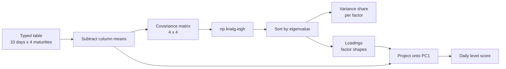
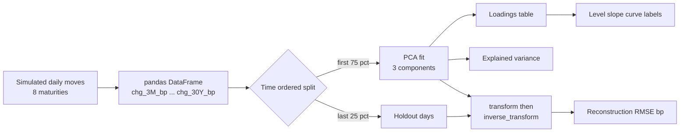
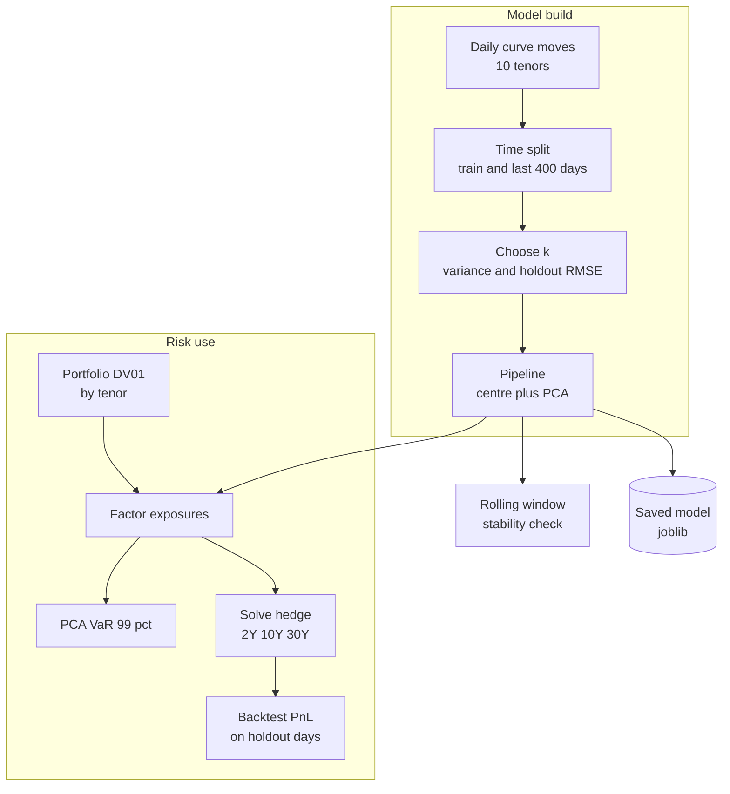
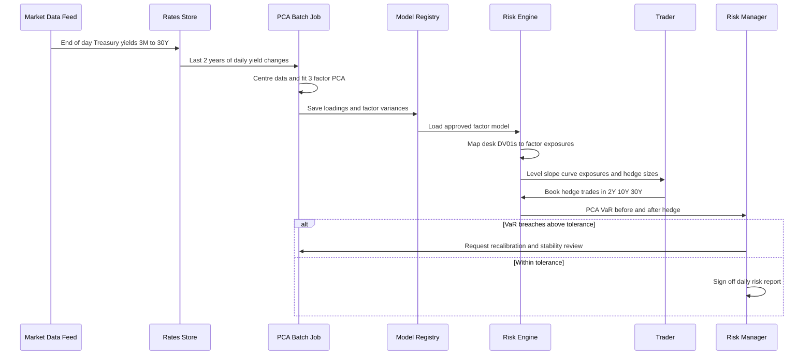

# 11. Principal Component Analysis (PCA)

[](https://colab.research.google.com/github/EdwardSuresh/architects-ml-playbook/blob/main/notebooks/11-principal-component-analysis.ipynb)  

[← 10. LSTM](../10-lstm/README.md) · [All algorithms](../../README.md#-the-30-algorithms-ranked) · [12. Artificial Neural Network (ANN / MLP) →](../12-artificial-neural-network/README.md)

> **PCA finds the few directions in which many correlated numbers move together, so you can describe the data with far fewer numbers.**

💡 **Analogy:** Imagine 10 friends on a seesaw-shaped bench: when one end goes up, everyone near it goes up too. Instead of tracking all 10 heads, you track just 'how high is the whole bench' and 'how tilted is it' - two numbers that tell you almost everything.

## The use case (same for Concept, Build and Production)
**Financial Services — Treasury yield curve risk factors for rate hedging**

A bank's treasury and rates desk holds bonds and swaps across maturities from 3 months to 30 years, and every daily rate move changes their value. Hedging each maturity separately is costly and noisy, and risk managers need a simple story for why the portfolio gained or lost. Daily changes in Treasury yields are freely available and highly correlated, which makes them ideal for PCA. Success means three named factors (level, slope, curvature) that explain about 99% of curve moves, a factor-based VaR, and a small set of hedge trades that cut daily P&L swings sharply.

## Industry adoption
| Sector | Score | Where you meet it |
|---|---|---|
| Financial Services | ■■■■□ 4/5 | Rates desks reduce a 10-point Treasury curve into level, slope and curvature factors for hedging and VaR. |
| Insurance | ■■■□□ 3/5 | Insurers compress dozens of correlated economic scenario variables before asset-liability matching. |
| Supply Chain | ■■■□□ 3/5 | Planners compress hundreds of correlated SKU demand series into a few demand drivers for forecasting. |
| Oil & Gas | ■■■■□ 4/5 | Refineries and plants monitor many correlated process sensors with PCA and alarm when the residual error jumps. |

**Why rank #11:** PCA has been a standard tool on rates desks and in market-risk teams for decades, because a handful of factors explain almost all yield-curve movement. It is also used everywhere as a preprocessing step to shrink many correlated sensor or survey columns into a few. It ranks below the big supervised workhorses because it rarely makes the final business decision on its own.

## How it works
1. Arrange the data as a table: rows are observations (days), columns are features (maturities).
2. Subtract each column's average so every feature is centred at zero (and scale if units differ).
3. Compute the covariance matrix: how strongly each pair of columns moves together.
4. Find its eigenvectors (directions) and eigenvalues (variance along each direction).
5. Sort directions by variance; the first few principal components carry most of the information.
6. Project each row onto those top directions to get a short list of factor scores.
7. Optionally rebuild the original columns from the scores to measure what was lost.

## Key terms
| Term | Meaning |
|---|---|
| Principal component | A new axis that is a weighted mix of the original columns, chosen to capture as much variance as possible. |
| Loading | The weight of one original column inside a component; for yields it shows how each maturity reacts to that factor. |
| Explained variance ratio | The share of total movement captured by each component. |
| Eigenvector / eigenvalue | The direction of a component and the amount of variance along it, found from the covariance matrix. |
| Level / slope / curvature | The classic three yield-curve factors: parallel shift, steepening/flattening, and belly-versus-wings bend. |
| DV01 | Dollar value of a 1 basis point (0.01%) rise in yield; a bond position's rate sensitivity. |
| Reconstruction error | How far the data rebuilt from only k components is from the real data. |

## 🟢 Concept — Find level, slope and curve by hand on 10 days
Compute PCA from scratch with numpy on 10 days x 4 maturities and see the level factor emerge.

| 5W + H | |
|---|---|
| **Who** | A junior risk analyst learning why the desk talks about 'level' and 'slope'. |
| **What** | Ten typed-in days of yield changes for 3M, 2Y, 10Y and 30Y, decomposed into factors. |
| **When** | Before trusting a library, to understand what PCA actually computes. |
| **Where** | A notebook on a laptop - no market data feed needed. |
| **Why** | Seeing the covariance matrix and eigenvectors makes later library output easy to read. |
| **How** | Centre the columns, build the covariance matrix, call np.linalg.eigh, sort, and project. |

**Architecture**



**🧠 ML concepts:** Centring data before PCA, Covariance matrix, Eigenvectors as factor shapes, Eigenvalues as explained variance, Projection to factor scores  
**🐍 Python concepts:** Lists and 2-D numpy arrays, axis=0 aggregation, Broadcasting subtraction, Slicing with [::-1] to reverse, enumerate and f-string formatting, Matrix multiply with @

**Steps the code performs**
1. Type 10 days of yield changes for 4 maturities into a numpy array.
2. Subtract each column's mean.
3. Compute the 4x4 covariance matrix.
4. Get eigenvalues and eigenvectors with eigh and sort largest first.
5. Fix eigenvector signs and print the variance share and loadings.
6. Project each day onto PC1 to get a single level-move score.

▶️ Code: [`easy.py`](easy.py) — run with `python easy.py`

<details><summary>Walkthrough</summary>

| Lines | What happens |
|---|---|
| 1-17 | Import numpy and type a small table: each row is a trading day, each column is a maturity, values are basis-point changes. Notice all maturities tend to move the same way on the same day - that shared movement is what PCA will find. |
| 18-22 | Python: mean(axis=0) gives one average per column and broadcasting subtracts it from every row. ML: PCA measures movement around the average, so centring is required. |
| 24-27 | np.cov builds the covariance matrix; rowvar=False tells numpy that columns are variables. Big numbers off the diagonal mean two maturities move together. |
| 29-35 | eigh solves the eigen problem for symmetric matrices. argsort()[::-1] reorders from biggest to smallest variance, and we flip signs so the 30Y loading is positive, because a factor and its negative describe the same direction. |
| 37-42 | Each eigenvalue divided by the total gives the share of variance. PC1 loadings are all positive (whole curve up or down = level); PC2 goes from negative at the short end to positive at the long end (slope). |
| 44-47 | Matrix multiplying the centred data by the PC1 vector turns each day's 4 numbers into 1 number: how much the whole curve shifted that day. |

</details>

<details><summary>Real output</summary>

```text
Data shape (days, maturities): (10, 4)

Covariance matrix (bp^2):
[[ 2.9  5.6  6.9  6.1]
 [ 5.6 12.7 15.4 13.8]
 [ 6.9 15.4 20.  18.8]
 [ 6.1 13.8 18.8 18.2]]

Factor       variance share   loadings on ['3M', '2Y', '10Y', '30Y']
PC1 level?      96.3%        [0.21 0.48 0.62 0.58]
PC2 slope?       3.0%        [-0.39 -0.67  0.05  0.64]
PC3 curve?       0.7%        [ 0.89 -0.44 -0.04  0.08]
PC4 noise        0.0%        [ 0.09  0.36 -0.78  0.5 ]

Day-by-day PC1 score (how much the whole curve shifted):
[  7.8  -7.    1.2  10.8 -10.1  -3.3   4.2  -8.7   5.7  -0.7]
```

</details>

**Try this next:** Change day 6 so the short end rises and the long end falls sharply, and watch PC2's share grow. · Remove the sign-flip line and rerun - the loadings may come out negative, with identical meaning. · Add a fifth maturity column (5Y) and check that PC1 still dominates.

## 🟡 Build — sklearn PCA on 6 years of synthetic yield moves
Fit sklearn PCA on 1,500 days of 8-maturity yield changes, read the factor shapes, and test reconstruction on later days.

| 5W + H | |
|---|---|
| **Who** | A market-risk analyst building the desk's factor model. |
| **What** | 1,500 daily changes across 8 Treasury maturities, reduced to 3 factors. |
| **When** | Monthly or quarterly when the factor model is refreshed. |
| **Where** | A Python batch job in the risk analytics environment. |
| **Why** | Three factors are easier to hedge, explain and report than eight correlated maturities. |
| **How** | Generate realistic data, split by time, fit PCA(n_components=3), inspect loadings and holdout error. |

**Architecture**



**🧠 ML concepts:** Explained variance ratio, Loadings interpretation, Time-ordered train/test split, Reconstruction error as a quality metric, When not to standardise features  
**🐍 Python concepts:** Dictionaries and list(dict.values()), np.outer to build tables, List comprehension for column names, pandas DataFrame and insert, Boolean checks with .all()

**Steps the code performs**
1. Build level, slope and curvature shapes across 8 maturities.
2. Simulate 1,500 days of random factor shocks plus noise.
3. Put the moves into a DataFrame with dated rows.
4. Split without shuffling: earlier 75% train, latest 25% test.
5. Fit PCA with 3 components and print variance shares and loadings.
6. Rebuild the test days from 3 factors and measure RMSE in bp.
7. Label the factors and print a plain business summary.

▶️ Code: [`medium.py`](medium.py) — run with `python medium.py`

<details><summary>Walkthrough</summary>

| Lines | What happens |
|---|---|
| 1-7 | Import numpy, pandas, PCA and the splitter, and fix the random seed so the output is repeatable. |
| 8-25 | Create three smooth shapes - flat (level), rising with log-maturity (slope) and a hump around 3 years (curvature) - and combine random daily shocks with them using np.outer. This mimics how real curves behave. |
| 27-32 | Python: a list comprehension builds column names, and a DataFrame adds labels and a business-day date column so the table reads like a real rates file. |
| 34-37 | ML: for time series we never shuffle - the model is fit on the past and checked on later, unseen days. |
| 39-44 | PCA(n_components=3).fit learns the factors. No StandardScaler, because every column is already in basis points and the bigger-moving maturities should count more. |
| 46-51 | components_ holds the loadings; we transpose so rows are maturities and flip signs for a consistent view. PC1 is roughly flat, PC2 runs from negative to positive, PC3 dips in the 2Y-5Y belly. |
| 53-58 | transform compresses each test day into 3 numbers and inverse_transform rebuilds 8 maturities. A test RMSE of about half a basis point versus 6 bp typical moves shows almost nothing important was lost. |
| 60-72 | Simple rules name the factors, then the script turns the variance shares into a business statement about how many hedges the desk needs. |

</details>

<details><summary>Real output</summary>

```text
Sample rows:
trade_date  chg_3M_bp  chg_6M_bp  chg_1Y_bp  chg_2Y_bp  chg_5Y_bp  chg_10Y_bp  chg_20Y_bp  chg_30Y_bp
2019-01-02       1.61       1.68       1.35       1.68       2.01        3.99        5.05        5.07
2019-01-03       0.12      -0.63      -1.85      -1.35      -2.63       -2.57       -2.18       -2.76
2019-01-04       4.47       4.49       3.95       2.51       2.24        3.03        2.37        3.08

Train days: 1125, Test days: 375

Explained variance ratio: [0.9512 0.0374 0.0054]
Top 3 factors together explain 99.40% of daily moves

Loadings (rows = maturities):
       PC1    PC2    PC3
3M   0.332 -0.556  0.307
6M   0.337 -0.406  0.274
1Y   0.346 -0.252 -0.032
2Y   0.349 -0.100 -0.616
5Y   0.359  0.081 -0.548
10Y  0.364  0.251  0.093
20Y  0.368  0.390  0.223
30Y  0.371  0.480  0.304

Test reconstruction RMSE: 0.49 bp (typical daily move ~6.2 bp)

Factor interpretation:
  PC1 all same sign?       True  -> LEVEL (parallel shift)
  PC2 short vs long sign:  -0.56 vs +0.48  -> SLOPE (steepen/flatten)
  PC3 belly vs wings:      -0.62 vs +0.31/+0.30  -> CURVATURE (butterfly)

Business read-out for the rates desk:
  Hedging the LEVEL factor alone covers 95% of daily risk.
  Adding SLOPE and CURVE hedges brings that to 99%.
  So 3 hedge trades can replace hedging 8 maturities separately.
```

</details>

**Try this next:** Set n_components=1 and compare the test RMSE - how much does slope matter? · Wrap PCA in a pipeline with StandardScaler and see how the loadings change. · Double the curvature shock std (1.2 to 2.4) and watch PC3's variance share rise.

## 🔴 Production — Factor VaR, hedge and stability checks for a bond book
Choose the number of factors, compute PCA-based VaR for a bond portfolio, solve a 3-trade factor hedge, backtest it and check factor stability.

| 5W + H | |
|---|---|
| **Who** | The market-risk team and rates traders, with model validation reviewing the work. |
| **What** | A saved PCA pipeline that drives daily factor exposures, VaR and hedge recommendations for a 10-tenor curve. |
| **When** | Run daily for exposures and VaR; recalibrated when backtests or stability checks flag drift. |
| **Where** | Inside the bank's risk engine batch, with the model stored in a registry. |
| **Why** | Factor hedging removes most rate risk with few trades, and regulators expect documented, backtested risk models. |
| **How** | Pipeline of centring plus PCA, k chosen by variance target and holdout error, DV01 mapped to factors, a linear solve for hedge sizes, a holdout P&L backtest and rolling-window loading comparisons. |

**Architecture**



**🧠 ML concepts:** Choosing k with a variance target and holdout error, Sign convention for comparable loadings, Factor-based parametric VaR, Hedging by neutralising factor exposures, Out-of-sample backtesting and regime shifts, Stability of components over rolling windows  
**🐍 Python concepts:** Functions with default arguments and docstrings, sklearn Pipeline and named_steps, pandas Series label indexing, zip over two lists, if __name__ == '__main__' guard, tempfile and joblib for saving

**Steps the code performs**
1. Simulate 2,000 days of 10-tenor moves with a higher-volatility regime at the end.
2. Keep the last 400 days aside and pick k as the smallest giving 99% variance.
3. Fit the centring plus PCA pipeline and print sign-fixed loadings.
4. Map the portfolio's key-rate DV01 to factor exposures and compute 99% VaR.
5. Solve for 2Y/10Y/30Y hedge DV01s that zero all three factor exposures.
6. Backtest hedged versus unhedged P&L on the holdout days and count VaR breaches.
7. Compare rolling-window loadings to the full sample and save the pipeline.

▶️ Code: [`hard.py`](hard.py) — run with `python hard.py`

<details><summary>Walkthrough</summary>

| Lines | What happens |
|---|---|
| 1-17 | Imports, warning suppression, seed, and the 10 tenors with their maturities in years. |
| 19-29 | simulate_curve_moves builds level/slope/curve shapes and multiplies shocks by 1.8 after day 1,400 to mimic a volatile regime, so later checks have something to catch. |
| 32-45 | choose_k tries 1 to 6 components inside a Pipeline (centre only, since all inputs are in bp) and records cumulative variance and holdout RMSE. The smallest k reaching 99% is chosen - here 3. |
| 48-53 | oriented_loadings puts components in a labelled DataFrame and flips signs so 30Y is positive. Without this, two fits of the same model can look opposite. |
| 56-61 | pca_var: exposure to each factor is DV01 times loadings; factors are uncorrelated, so P&L variance is the sum of exposure squared times factor variance. 2.326 is the 99% normal quantile. |
| 64-75 | stability refits PCA on 250-day windows and measures the absolute cosine similarity with the full-sample shapes; values near 1.0 mean the factors keep their meaning. |
| 78-104 | Main flow: time split, choose k, fit and print loadings, then define a long bond book with DV01 at 2Y/5Y/10Y/30Y and compute VaR before hedging. |
| 105-115 | np.linalg.solve finds hedge sizes in 2Y, 10Y and 30Y that make all three factor exposures zero. PCA VaR after the hedge is zero by construction - which is why we must backtest. |
| 117-122 | Backtest on the holdout uses real 10-tenor moves: P&L volatility falls about 95%. The unhedged VaR breach rate is far above 1% because the holdout sits in the high-volatility regime - a real-world signal to recalibrate. |
| 124-135 | Stability results are printed, the pipeline is saved with joblib to a temp folder, and an SR 11-7 model-risk note is printed. |

</details>

<details><summary>Real output</summary>

```text
Choosing number of factors (target 99% variance):
 k  cum_var  test_rmse_bp
 1   0.9586        2.1687
 2   0.9893        0.9399
 3   0.9949        0.4956
 4   0.9957        0.4618
 5   0.9965        0.4220
 6   0.9972        0.3758
-> chosen k = 3

Loadings:
       3M    6M    1Y    2Y    3Y    5Y    7Y   10Y   20Y   30Y
PC1  0.30  0.30  0.31  0.32  0.32  0.32  0.32  0.32  0.32  0.33
PC2 -0.56 -0.40 -0.26 -0.12 -0.03  0.07  0.16  0.23  0.38  0.46
PC3  0.34  0.28  0.05 -0.41 -0.54 -0.36 -0.09  0.11  0.31  0.32
Interpretation: PC1=level (all +), PC2=slope (short - / long +), PC3=curvature (belly vs wings)

Portfolio factor exposures ($ per 1-unit factor move): [30532. 17899. -3578.]
PCA 99% 1-day VaR before hedge: $1,552,526
Hedge DV01 by tenor (negative = sell futures/pay swaps): {'2Y': -51922, '10Y': 17932, '30Y': -60919}
PCA 99% 1-day VaR after hedge:  $0

Out-of-sample daily P&L std: before $1,070,187  after $51,472
VaR breach rate (unhedged) on test: 8.75% (expect ~1%; higher = regime shift)

Rolling-window stability (|cosine| vs full-sample loadings):
window_start  PC1   PC2   PC3  vol_bp
  2018-01-02  1.0 0.999 0.995   5.641
  2018-12-18  1.0 0.998 0.997   6.012
  2019-12-03  1.0 1.000 0.994   6.108
  2020-11-17  1.0 0.999 0.999   6.177
  2021-11-02  1.0 0.994 0.994   6.571
  2022-10-18  1.0 0.998 0.998   8.417
  2023-10-03  1.0 0.999 0.998  11.131
  2024-09-17  1.0 0.999 0.999  11.686
Windows with a factor shape below 0.95 similarity: 0 of 8

Saved pipeline -> yield_pca.joblib
Model-risk note (SR 11-7): document factor choice, re-estimate window, VaR backtest
breaches and stability results; recalibrate when volatility regime changes.
```

</details>

**Try this next:** Change the 1.8 volatility multiplier to 1.0 and see the VaR breach rate drop toward 1%. · Fit the model on only the last 250 training days so it reflects recent volatility, and compare breaches. · Hedge with only 10Y (k=1 style) and measure how much P&L volatility remains.

## 🔄 End-to-end production flow



## ⚠️ Pitfalls
- Standardising yield changes in bp blindly - when all columns share a unit, scaling can overweight quiet short-end tenors; decide deliberately.
- Running PCA on yield levels instead of daily changes - levels trend and give misleading factors; use changes.
- Ignoring eigenvector sign flips between refits - fix a sign convention before comparing or automating hedges.
- Assuming factors are stable forever - check rolling windows and backtest VaR, especially across volatility regimes.
- Trusting PCA VaR of zero after a hedge - residual tenor risk outside the top factors remains; always backtest on full moves.
- Fitting on all data including the test period - keep time order to avoid look-ahead bias.

**When NOT to use it:** Avoid PCA when relationships are strongly non-linear or when you need each output tied to an original, named feature for explanation; also avoid it when you have a clear target to predict and could use a supervised method directly.

## 🎤 Interview questions
<details><summary>Why do the first three principal components of yield changes get called level, slope and curvature?</summary>

Their loadings have those shapes: PC1 has the same sign across all maturities (parallel shift), PC2 changes sign from short to long end (steepening/flattening), and PC3 has opposite signs in the belly versus the wings (butterfly). Together they usually explain around 95-99% of daily variance.

</details>
<details><summary>When should you standardise features before PCA?</summary>

Standardise when features are in different units or scales, otherwise the largest-unit column dominates. When all features share a meaningful unit, like basis points, centring only is often better because it keeps real differences in volatility.

</details>
<details><summary>How do you choose the number of components?</summary>

Use a cumulative explained-variance target such as 95-99%, look for the elbow, and check reconstruction error on holdout data. In risk work, also check whether each extra factor is stable and interpretable.

</details>

---
[← 10. LSTM](../10-lstm/README.md) · [All algorithms](../../README.md#-the-30-algorithms-ranked) · [12. Artificial Neural Network (ANN / MLP) →](../12-artificial-neural-network/README.md)
