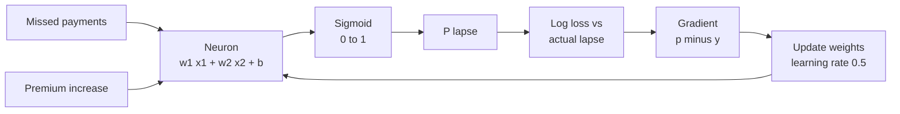
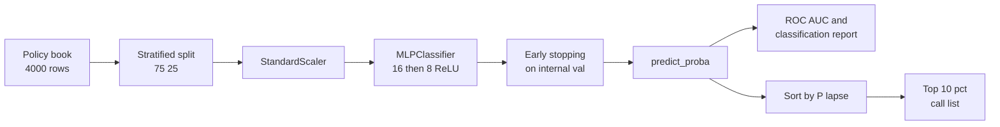
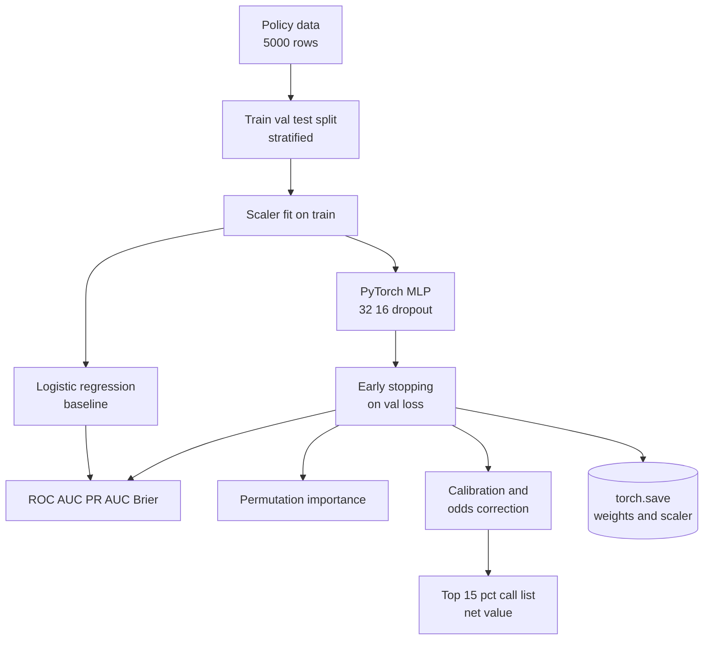
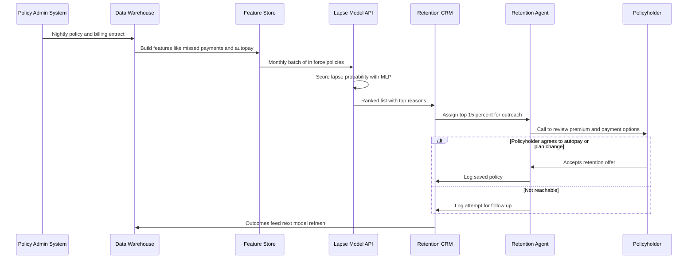

# 12. Artificial Neural Network (ANN / MLP)

[](https://colab.research.google.com/github/EdwardSuresh/architects-ml-playbook/blob/main/notebooks/12-artificial-neural-network.ipynb)  

[← 11. Principal Component Analysis (PCA)](../11-principal-component-analysis/README.md) · [All algorithms](../../README.md#-the-30-algorithms-ranked) · [13. Autoencoders →](../13-autoencoders/README.md)

> **A neural network stacks layers of simple 'weighted sum then squash' units so it can learn curved, interacting patterns from examples.**

💡 **Analogy:** Think of a cricket selection panel: each selector (neuron) weighs a few stats differently and gives an opinion, a second panel weighs those opinions, and a chairman makes the final call. Training is the panel reviewing past mistakes and adjusting how much each selector trusts each stat.

## The use case (same for Concept, Build and Production)
**Insurance — Life insurance policy lapse prediction for retention outreach**

When a life policy lapses, the carrier loses years of future premium and the family loses its protection, often without realising it. Insurers hold policy data such as policy age, premium changes, missed payments, autopay status, agent contacts and cash value. The retention team can only call a fraction of the book each month, so it needs a ranked list of who is most likely to lapse. Success means the top-ranked calls catch a large share of future lapses, probabilities are trustworthy for budgeting, and the model is documented for regulators.

## Industry adoption
| Sector | Score | Where you meet it |
|---|---|---|
| Financial Services | ■■■■□ 4/5 | Card issuers use neural networks in real-time fraud scoring alongside rules and tree models. |
| Insurance | ■■■■□ 4/5 | Life and P&C carriers predict policy lapse and renewal propensity to target retention offers. |
| Supply Chain | ■■■□□ 3/5 | Retailers use MLPs on demand features (price, promotions, calendar) for SKU-level forecasts. |
| Oil & Gas | ■■■□□ 3/5 | Operators use MLPs as fast surrogate models of reservoir or process simulators. |

**Why rank #12:** Multi-layer perceptrons are the building block of all deep learning and are widely used for tabular scoring in banks and insurers. On plain tabular data they often only match gradient-boosted trees while being harder to explain, which keeps them below the tree ensembles in day-to-day adoption.

## How it works
1. Each input feature (missed payments, autopay, etc.) feeds every neuron in the first hidden layer.
2. A neuron computes a weighted sum plus a bias, then applies an activation such as ReLU or sigmoid.
3. Outputs of one layer become inputs of the next; the final neuron outputs a lapse probability.
4. A loss function (log-loss) measures how wrong the predictions are versus actual outcomes.
5. Backpropagation computes how much each weight contributed to the error.
6. Gradient descent nudges every weight slightly to reduce the loss; repeat for many epochs.
7. Stop when validation loss stops improving (early stopping) to avoid memorising the training data.

## Key terms
| Term | Meaning |
|---|---|
| Neuron | A unit that computes a weighted sum of inputs plus bias and passes it through an activation function. |
| Activation function | A squashing or bending function (ReLU, sigmoid) that lets the network learn non-linear patterns. |
| Backpropagation | The chain-rule method that works out each weight's share of the error. |
| Epoch | One full pass of the training data through the network. |
| Learning rate | How big a step the optimiser takes when adjusting weights. |
| Early stopping | Stop training when validation performance stops improving and keep the best weights. |
| Class weight | Extra penalty on mistakes for the rarer class (lapses) so the model does not ignore it. |
| Calibration | Whether predicted probabilities match real outcome rates, for example 20% scores lapse about 20% of the time. |

## 🟢 Concept — One neuron learns who will lapse
Train a single sigmoid neuron with hand-written forward pass and backpropagation on 8 policyholders.

| 5W + H | |
|---|---|
| **Who** | A retention analyst curious how a neural network actually learns. |
| **What** | Eight policyholders described by missed payments and premium increase, labelled lapsed or not. |
| **When** | Before using any library, to see the learning loop with nothing hidden. |
| **Where** | A plain Python script with only numpy. |
| **Why** | Every big network is millions of these neurons; understanding one makes the rest less magic. |
| **How** | Compute weighted sum, apply sigmoid, measure log-loss, compute gradients, update weights 300 times. |

**Architecture**



**🧠 ML concepts:** Neuron as weighted sum plus bias, Sigmoid activation, Log-loss, Backpropagation for one neuron, Gradient descent and learning rate  
**🐍 Python concepts:** Defining a function with def, numpy matrix-vector multiply with @, Broadcasting a scalar bias, In-place update operators -=, zip and enumerate together, f-string alignment

**Steps the code performs**
1. Type 8 policyholders with two features and a lapse label.
2. Define the sigmoid function.
3. Start with small random weights and zero bias.
4. Loop 300 epochs: forward pass, loss, gradient, update.
5. Print loss and weights every 100 epochs.
6. Show each customer's predicted lapse probability and score a new customer.

▶️ Code: [`easy.py`](easy.py) — run with `python easy.py`

<details><summary>Walkthrough</summary>

| Lines | What happens |
|---|---|
| 1-8 | Each row is a customer with missed payments and premium increase (divided by 10 so both inputs are a similar size). y holds the lapse outcome. |
| 10-12 | sigmoid turns any number into a value between 0 and 1, which we read as a probability. |
| 14-18 | Random small starting weights, zero bias and a learning rate. A fixed seed makes the run repeatable. |
| 20-26 | Forward pass for all 8 customers at once with X @ w + b, then log-loss: low when confident and right, very high when confident and wrong. |
| 27-33 | For sigmoid plus log-loss the error signal is just p - y. Multiplying by inputs gives each weight's gradient; we step weights the opposite way. |
| 34-35 | Every 100 epochs we print progress: loss falls from 0.67 to 0.03 and the missed-payments weight grows largest. |
| 37-43 | Print each customer's probability next to the truth, then score a new customer with 1 missed payment and a 10% premium rise. |

</details>

<details><summary>Real output</summary>

```text
epoch   0  loss=0.666  w=[0.34 0.1 ]  b=-0.01
epoch 100  loss=0.079  w=[2.19 0.96]  b=-3.45
epoch 200  loss=0.043  w=[2.6  1.47]  b=-4.58
epoch 300  loss=0.030  w=[2.85 1.81]  b=-5.28

Customer  missed  prem_inc  lapsed  P(lapse)
       0       0        0%       0      0.01
       1       0        5%       0      0.01
       2       1        2%       0      0.11
       3       0       10%       0      0.03
       4       2       15%       1      0.96
       5       3        8%       1      0.99
       6       2       20%       1      0.98
       7       4       12%       1      1.00

New customer lapse probability: 0.35
```

</details>

**Try this next:** Set lr = 5.0 and see whether the loss jumps around instead of falling smoothly. · Add a third feature column (on_autopay 0/1) and a third weight. · Flip one label to make the data noisy and see the final loss stay higher.

## 🟡 Build — sklearn MLP ranks 4,000 policies for outreach
Train a scaled two-hidden-layer MLPClassifier on 4,000 synthetic policies and turn scores into an outreach list.

| 5W + H | |
|---|---|
| **Who** | The retention analytics team supporting the outbound call centre. |
| **What** | 4,000 policies with 8 features and a lapse flag, modelled with an sklearn neural net. |
| **When** | Monthly, before the call centre plans its outreach. |
| **Where** | A Python notebook or scheduled job against the policy data mart. |
| **Why** | Calling the riskiest 10% should catch far more lapses than random calls. |
| **How** | Pipeline of StandardScaler and MLPClassifier with early stopping, stratified split, ROC-AUC and a top-decile lift check. |

**Architecture**



**🧠 ML concepts:** Feature scaling for neural nets, Hidden layers and ReLU, Early stopping with patience, ROC-AUC vs accuracy on imbalanced data, Lift in the top decile  
**🐍 Python concepts:** Building a DataFrame from a dict, Vectorised boolean logic with | and comparisons, make_pipeline and indexing a step with [-1], DataFrame.assign and sort_values, groupby then mean

**Steps the code performs**
1. Generate 4,000 policies with realistic columns.
2. Create lapse outcomes from a non-linear rule with interactions.
3. Stratified train/test split.
4. Fit StandardScaler plus MLPClassifier(16, 8) with early stopping.
5. Report ROC-AUC and precision/recall at a 0.5 cut-off.
6. Rank test policies and measure the lapse rate in the top 10%.
7. Compare average predicted risk by autopay status.

▶️ Code: [`medium.py`](medium.py) — run with `python medium.py`

<details><summary>Walkthrough</summary>

| Lines | What happens |
|---|---|
| 1-13 | Imports, warning suppression and a seeded random generator; n is the number of policies. |
| 15-26 | Python builds the policy table from a dict of arrays. Distributions are picked to look real: premiums are log-normal, missed payments are Poisson counts. |
| 28-37 | ML: the hidden truth includes a U-shape in policy age and a premium-increase-times-no-autopay interaction. A neural net can learn these without us hand-coding them. |
| 39-43 | Separate features and target, then split 75/25 with stratify so both halves have the same lapse rate. |
| 45-56 | The pipeline scales inputs then trains a 16-8 neuron network. early_stopping holds out 10% of training data and stops after 25 epochs with no gain; n_iter_ shows when it stopped. |
| 58-62 | ROC-AUC measures ranking quality. At a 0.5 cut-off recall for lapses is low - normal for a minority class, and why we rank instead of using a fixed cut. |
| 64-73 | Sorting by probability, the top 10% lapse at roughly 3x the book average. groupby confirms autopay customers have much lower predicted risk - a sensible business check. |

</details>

<details><summary>Real output</summary>

```text
 policy_age_years  insured_age  annual_premium_usd  premium_increase_pct  missed_payments_12m  on_autopay  agent_contacts_12m  cash_value_usd  lapsed
                2           38               880.0                     0                    2           1                   3          1781.0       0
               19           66               700.0                    10                    0           0                   0          1199.0       0
               16           23              2911.0                     0                    0           0                   3           530.0       0

Policies: 4000, lapse rate: 17.7%
Training stopped after 56 epochs

Test ROC-AUC: 0.790
              precision    recall  f1-score   support

    in_force      0.857     0.971     0.911       823
      lapsed      0.647     0.249     0.359       177

    accuracy                          0.843      1000
   macro avg      0.752     0.610     0.635      1000
weighted avg      0.820     0.843     0.813      1000

Top 10% riskiest policies: actual lapse rate 58.0% vs book average 17.7%
Calling them reaches 33% of all lapses with 100 calls.

Average predicted lapse risk by autopay:
on_autopay
0    0.261
1    0.106
```

</details>

**Try this next:** Remove StandardScaler from the pipeline and compare the ROC-AUC. · Change hidden_layer_sizes to (4,) and then (64, 32) - does bigger help? · Set n_iter_no_change back to 10 (the default) and watch training stop too early.

## 🔴 Production — PyTorch lapse model with weights, calibration and budget
Build a PyTorch MLP with class weights and early stopping, benchmark against logistic regression, explain it, calibrate it and pick an outreach volume.

| 5W + H | |
|---|---|
| **Who** | Retention data scientists, with actuarial and model-governance reviewers. |
| **What** | A production-style lapse scorer with a challenger baseline, explanations, calibrated probabilities and a saved model. |
| **When** | Retrained quarterly and scored monthly; calibration checked each quarter. |
| **Where** | Training in a Python job; the saved weights and scaler served by the lapse model API. |
| **Why** | Insurers must justify models to regulators, and finance needs real probabilities to budget the retention programme. |
| **How** | Train/val/test split, train-only scaling, BCEWithLogitsLoss with pos_weight, mini-batch Adam, early stopping, permutation importance, decile calibration, odds correction and a cost-benefit cut-off. |

**Architecture**



**🧠 ML concepts:** Class imbalance with pos_weight, Mini-batch training and dropout, Early stopping on validation loss, Challenger baseline comparison, Permutation importance, Probability calibration after re-weighting  
**🐍 Python concepts:** Subclassing nn.Module with __init__ and forward, Dict comprehension to copy model weights, torch.no_grad context manager, Functions returning pandas Series, List of tuples in a for loop, String repetition for ASCII bars

**Steps the code performs**
1. Generate 5,000 policies with a non-linear lapse rule and log-transform money columns.
2. Split into train, validation and test; fit the scaler on train only.
3. Train the MLP with weighted loss, mini-batches and early stopping.
4. Train a balanced logistic regression as the baseline and compare metrics.
5. Compute permutation importance for the MLP.
6. Check calibration by quintile and correct the odds for class weighting.
7. Choose the top 15% for calls, estimate net value, save model and print governance note.

▶️ Code: [`hard.py`](hard.py) — run with `python hard.py`

<details><summary>Walkthrough</summary>

| Lines | What happens |
|---|---|
| 1-22 | Imports, one torch thread (the machine is shared), seeds and the feature list in one place so every function uses the same order. |
| 24-35 | make_policies builds the synthetic book with interactions and a U-shaped policy-age effect, then draws lapse outcomes. |
| 38-47 | LapseMLP subclasses nn.Module: two hidden ReLU layers with dropout and one output logit. forward defines how data flows. |
| 50-79 | train_mlp: pos_weight makes a missed lapse cost about 6x more. Each epoch shuffles into 128-row batches, then measures validation loss; the best weights are copied and restored when patience runs out. |
| 82-99 | predict switches to eval mode and applies sigmoid. permutation_importance shuffles one column at a time; the bigger the AUC drop, the more the model depends on it. |
| 102-105 | calibration_table groups policies into 5 bins by score and compares average prediction with actual lapse rate. |
| 108-129 | Main flow: log money columns, split, scale on train only, train both models. The MLP edges the baseline on ROC-AUC, while logistic wins PR-AUC - a reminder that a simple baseline is a serious challenger. |
| 131-143 | Autopay, premium increase and missed payments dominate. Class weights inflate scores (82% predicted vs 40% actual in the top bin), so we divide the odds by the weight to bring the mean back near the true lapse rate. |
| 145-157 | With budget for 15% of calls, the list reaches half of all lapses; a simple call-cost vs saved-value formula gives expected net value. The model and scaler are saved together and a NAIC governance note is printed. |

</details>

<details><summary>Real output</summary>

```text
Policies 5000, lapse rate 13.3%
MLP early-stopped at epoch 27, best val loss 0.9537

Model        ROC-AUC  PR-AUC  Brier
Logistic     0.808    0.457   0.181
MLP          0.814    0.401   0.192

Permutation importance (ROC-AUC drop) for the MLP:
  on_autopay             +0.1230 ########################
  premium_increase_pct   +0.0894 #################
  missed_payments_12m    +0.0579 ###########
  policy_age_years       +0.0242 ####
  cash_value_usd         +0.0130 ##
  agent_contacts_12m     +0.0083 #
  insured_age            +0.0008 
  annual_premium_usd     +0.0000 

Calibration of MLP (class weights inflate probabilities):
      pred  actual
bin               
0    0.112   0.020
1    0.211   0.045
2    0.347   0.045
3    0.578   0.160
4    0.818   0.395
Mean predicted after odds correction 0.149 vs actual 0.133; Brier 0.095

Call top 150 policies: reach 67/133 lapses (50%); expected net value $24,150
Saved model -> lapse_mlp.pt
Governance: NAIC AI Model Bulletin - document data, test for unfair discrimination,
keep the logistic baseline as a challenger, and monitor calibration quarterly.
```

</details>

**Try this next:** Remove pos_weight from the loss and compare PR-AUC and the calibration table. · Change the call budget from 15% to 5% and 30% and find the best net value. · Remove the interaction term from make_policies and see whether the MLP still beats logistic regression.

## 🔄 End-to-end production flow



## ⚠️ Pitfalls
- Feeding unscaled inputs - large-unit columns like premium dominate and training stalls; always scale, fitting the scaler on training data only.
- Judging by accuracy on imbalanced data - an 87% 'nobody lapses' model is useless; use ROC-AUC, PR-AUC and top-decile capture.
- Using class-weighted scores as real probabilities - re-weighting inflates them; recalibrate before budgeting or pricing.
- Stopping too early or too late - set early-stopping patience sensibly and keep the best validation weights.
- Skipping a simple baseline - logistic regression or gradient boosting often matches an MLP on tabular data with far easier explanation.
- Using features regulators prohibit or close proxies for them - review inputs for unfair discrimination before deployment.

**When NOT to use it:** Avoid a neural network on small tabular datasets, or where every decision must be explained feature by feature to a customer or regulator; a logistic regression or tree model is usually simpler and just as accurate.

## 🎤 Interview questions
<details><summary>Why might an MLP fail to beat logistic regression on tabular insurance data?</summary>

Tabular data with few features and mostly monotonic effects is already well captured by a linear model, and MLPs need more data and tuning. Gradient-boosted trees are usually the stronger non-linear challenger on tabular data.

</details>
<details><summary>What does early stopping do and why is it a form of regularisation?</summary>

It watches validation loss each epoch and stops once it stops improving, restoring the best weights. This limits how far the network can fit noise in the training data, similar in effect to shrinking the weights.

</details>
<details><summary>How does class weighting affect predicted probabilities?</summary>

It tells the loss to care more about the minority class, which pushes scores upward, so probabilities become over-confident for that class. If you need true probabilities you must recalibrate, for example by odds correction, Platt scaling or isotonic regression.

</details>

---
[← 11. Principal Component Analysis (PCA)](../11-principal-component-analysis/README.md) · [All algorithms](../../README.md#-the-30-algorithms-ranked) · [13. Autoencoders →](../13-autoencoders/README.md)
