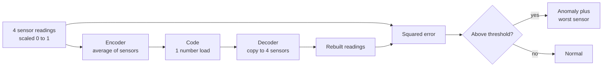
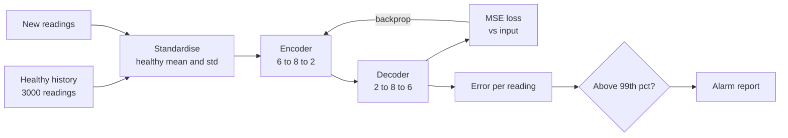
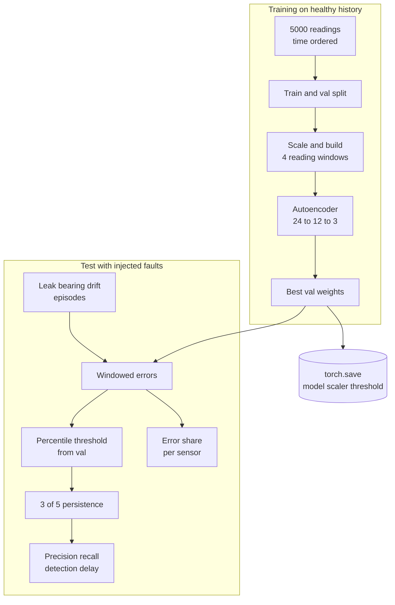
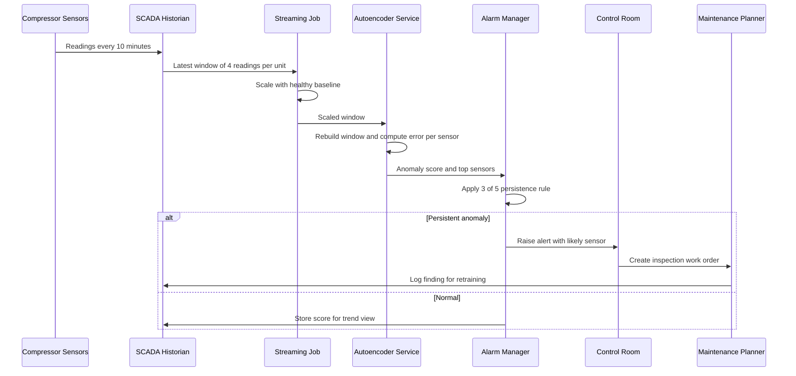

# 13. Autoencoders

[](https://colab.research.google.com/github/EdwardSuresh/30-ai-algorithms/blob/main/notebooks/13-autoencoders.ipynb)  

[← 12. Artificial Neural Network (ANN / MLP)](../12-artificial-neural-network/README.md) · [All algorithms](../../README.md#-the-30-algorithms-ranked) · [14. Naive Bayes →](../14-naive-bayes/README.md)

> **An autoencoder is a neural network that learns to squeeze normal data into a small code and rebuild it, so anything it cannot rebuild well is probably abnormal.**

💡 **Analogy:** A seasoned compressor technician can glance at the gauges and say 'with this load, I expect these readings'. When the gauges disagree with what they would expect, they know something is off - the autoencoder learns that same 'expected picture' from healthy history.

## The use case (same for Easy, Medium and Hard)
**Oil & Gas — Gas compressor sensor anomaly detection for predictive maintenance**

Gas compression stations keep pipelines flowing, and an unplanned compressor trip can cut throughput and cost a great deal per day in lost deliveries and emergency repairs. Each unit streams vibration, temperature, pressure, flow and motor current readings, but real failures are rare and seldom well labelled. Simple fixed limits on each sensor miss faults where every reading is in range but the readings no longer agree with each other. Success means catching developing faults hours before a trip, with few false alarms, and pointing technicians to the likely sensor or component.

## Industry adoption
| Sector | Score | Where you meet it |
|---|---|---|
| Financial Services | ■■■■□ 4/5 | Banks use autoencoders to flag unusual card or wire transaction patterns for fraud and AML review. |
| Insurance | ■■■□□ 3/5 | Insurers flag claims whose combination of details is unlike normal claims for special investigation. |
| Supply Chain | ■■■□□ 3/5 | Logistics firms detect abnormal shipment sensor traces such as temperature excursions in cold chains. |
| Oil & Gas | ■■■■□ 4/5 | Operators monitor compressors, pumps and turbines for early signs of failure from many correlated sensors. |

**Why rank #13:** Autoencoders are a go-to method for spotting anomalies when labelled failures are rare, which is common in equipment monitoring and fraud. They need more data, tuning and monitoring than tree or statistical methods, so they rank below the classic supervised workhorses but above most niche techniques.

## How it works
1. Collect sensor readings from periods when the equipment was known to be healthy.
2. Scale each sensor so they are on comparable ranges.
3. The encoder layers compress each reading (or window of readings) into a small code - the bottleneck.
4. The decoder layers rebuild the full set of sensors from that code.
5. Train by minimising the difference between input and rebuilt output on healthy data only.
6. On new data, compute the reconstruction error; set an alarm threshold from healthy validation errors.
7. Look at which sensors have the largest error to tell engineers where to look.

## Key terms
| Term | Meaning |
|---|---|
| Encoder | The part of the network that compresses the input into a short code. |
| Decoder | The part that rebuilds the original input from the code. |
| Bottleneck | The small middle layer; its size limits what the network can memorise, forcing it to learn normal patterns. |
| Reconstruction error | How different the rebuilt input is from the real input - the anomaly score. |
| Self-supervised | Training where the input itself is the target, so no failure labels are needed. |
| Percentile threshold | An alarm level set so that, for example, only 1% of healthy data would exceed it. |
| Alarm persistence | Requiring several flagged readings in a row before alarming, to cut one-off false alarms. |

## 🟢 Easy — Compress 4 sensors to 1 number and rebuild
Use a hand-made linear encoder and decoder in numpy to see how reconstruction error exposes a bearing fault.

| 5W + H | |
|---|---|
| **Who** | A reliability engineer new to machine learning. |
| **What** | Eight healthy compressor readings and two new readings, one with a vibration spike. |
| **When** | Before training any network, to understand the core idea. |
| **Where** | A short numpy script. |
| **Why** | Seeing that 'cannot rebuild it' equals 'unusual' makes autoencoder alarms easy to trust. |
| **How** | Encode = average the four sensors into a load number, decode = copy it back to four sensors, compare. |

**Architecture**



**🧠 ML concepts:** Encoder and decoder, Bottleneck code, Reconstruction error as anomaly score, Threshold from healthy data, Per-sensor error attribution  
**🐍 Python concepts:** 2-D numpy arrays, Defining a function that returns a tuple, List comprehension, Dictionaries and .items(), Conditional expression, np.argmax for the index of the largest value

**Steps the code performs**
1. Type 8 healthy readings where all sensors move with load.
2. Define a fixed encoder (average) and decoder (copy back).
3. Compute reconstruction error on every healthy row.
4. Set the threshold at 3x the worst healthy error.
5. Score a normal reading and a bearing-wear reading.
6. Report which sensor has the largest error.

▶️ Code: [`easy.py`](easy.py) — run with `python easy.py`

<details><summary>Walkthrough</summary>

| Lines | What happens |
|---|---|
| 1-15 | Eight healthy readings: on a healthy compressor all four sensors rise and fall with the load, so each row has nearly equal values. |
| 17-21 | The encoder is a dot product with four 0.25 weights, giving one 'load' number. The decoder multiplies it back into four values - a tiny linear autoencoder. |
| 23-26 | reconstruct returns both the code and the rebuilt vector as a tuple. |
| 28-33 | A list comprehension computes mean squared error for each healthy row; the alarm threshold is set to 3x the worst healthy error. |
| 35-40 | Two new readings: a normal one and one where vibration is high while everything else is normal - classic early bearing wear. |
| 41-50 | For each reading we rebuild, measure error and label it. The bearing case has an error about 80x the threshold, and argmax points at vibration. |

</details>

<details><summary>Real output</summary>

```text
Healthy reconstruction errors: [1.2e-04 1.2e-04 1.3e-04 1.3e-04 5.0e-05 5.0e-05 1.3e-04 5.0e-05]
Alarm threshold: 0.00038

normal load   code=0.500 rebuilt=[0.5 0.5 0.5 0.5] error=0.00005 -> ok
              biggest error on: temperature
bearing wear  code=0.597 rebuilt=[0.6 0.6 0.6 0.6] error=0.03052 -> ANOMALY
              biggest error on: vibration
```

</details>

**Try this next:** Change the bearing-wear vibration from 0.90 to 0.60 - is it still caught? · Make every sensor 0.95 at once (high but consistent load) and confirm it is NOT flagged. · Change the threshold multiplier from 3 to 1.5 and see if the normal reading starts alarming.

## 🟡 Medium — PyTorch autoencoder flags valve leaks
Train a small PyTorch autoencoder on healthy compressor data and detect valve-leak readings by reconstruction error.

| 5W + H | |
|---|---|
| **Who** | A data scientist on the asset-integrity team. |
| **What** | 3,000 healthy readings of 6 sensors for training, plus new normal and faulty readings for testing. |
| **When** | When a compressor has enough healthy history but too few labelled failures for supervised learning. |
| **Where** | A Python job reading historian data, run on CPU. |
| **Why** | A leak can keep every sensor within its own limits while breaking the normal relationship between them. |
| **How** | Standardise with healthy statistics, train a 6-8-2-8-6 network to copy its input, set the threshold at the 99th percentile of healthy error. |

**Architecture**



**🧠 ML concepts:** Training only on normal data, Bottleneck smaller than input, Mean squared error loss, Percentile-based threshold, False alarm rate vs detection rate  
**🐍 Python concepts:** Functions with default keyword arguments, pandas column-wise arithmetic, lambda functions, nn.Sequential layer stacking, torch.no_grad context manager

**Steps the code performs**
1. Simulate 6 sensors driven by load and ambient temperature.
2. Create healthy train, healthy test and faulty test sets.
3. Standardise every set with the healthy training mean and std.
4. Build and train a 6-8-2-8-6 autoencoder for 300 epochs.
5. Compute reconstruction error and set the threshold at the 99th percentile.
6. Report false alarm rate and detection rate.

▶️ Code: [`medium.py`](medium.py) — run with `python medium.py`

<details><summary>Walkthrough</summary>

| Lines | What happens |
|---|---|
| 1-8 | Imports, one CPU thread and fixed seeds for repeatable results. |
| 10-29 | make_readings creates sensors as formulas of hidden load and ambient temperature plus noise. With fault=True, flow drops and temperature rises - a valve leak where the gas recirculates. |
| 31-34 | Build 3,000 healthy training rows, 500 new healthy rows and 50 faulty rows, and print each sensor's mean and std. |
| 35-40 | Standardise using only healthy training statistics. The lambda converts any DataFrame to a scaled float tensor. |
| 42-51 | The network narrows 6 sensors to a 2-number code and widens back to 6. Two numbers are just enough to describe load and ambient, but not a fault. |
| 53-60 | The input is also the target. Each epoch computes MSE, backpropagates and updates weights; training error falls from 1.20 to about 0.04. |
| 62-73 | recon_error gives one error per row. The threshold is the 99th percentile of healthy training error, so roughly 1% of healthy readings would alarm. |
| 75-81 | On new data the false alarm rate stays near 1% while most valve-leak readings are caught, followed by a plain-English maintenance message. |

</details>

<details><summary>Real output</summary>

```text
      vibration_mm_s  discharge_temp_f  suction_pressure_psi  discharge_pressure_psi  flow_mmscfd  motor_current_a
mean             4.1             232.0                 365.0                  1110.1         48.0            290.1
std              0.5              11.7                   9.6                    52.7          7.0             35.3
epoch   0  train MSE 1.2011
epoch 100  train MSE 0.0581
epoch 200  train MSE 0.0453
epoch 300  train MSE 0.0429

Threshold (99th pct of normal error): 0.1924
Median error  normal: 0.0328   faulty: 0.2993

False alarm rate on new normal data: 0.6%
Valve-leak readings detected:        82.0%

Maintenance read-out: a high error means the sensors no longer agree with each other
the way they do on a healthy compressor - send a technician before the valve fails.
```

</details>

**Try this next:** Change the bottleneck from 2 to 6 neurons and see detection fall as the net learns to copy faults too. · Use the 95th percentile as threshold and compare false alarms and detection. · Make the leak milder (flow drop 2-4) and see how detection changes.

## 🔴 Hard — Windowed autoencoder with alarm tuning and sensor blame
Detect injected compressor faults from 40-minute sensor windows, pick a threshold from validation percentiles, measure precision/recall and attribute alarms to sensors.

| 5W + H | |
|---|---|
| **Who** | The predictive-maintenance team, control-room operators and reliability engineers. |
| **What** | A time-aware autoencoder service with a chosen threshold, persistence rule, per-sensor explanations and saved artefacts. |
| **When** | Scoring every 10 minutes; retrained after overhauls or seasonal change. |
| **Where** | A streaming job beside the SCADA historian; alerts go to the alarm manager. |
| **Why** | Engineers need early, trustworthy alarms that say where to look, without flooding the control room. |
| **How** | Simulate autocorrelated healthy data, train on windows with validation-based early stopping, sweep percentile thresholds, add 3-of-5 persistence, score labelled fault episodes and compute error shares per sensor. |

**Architecture**



**🧠 ML concepts:** Sliding windows for time-series context, Validation-based early stopping, Threshold selection by percentile sweep, Precision and recall on rare events, Alarm persistence to reduce false alarms, Per-feature reconstruction error attribution  
**🐍 Python concepts:** Generator expression unpacked into three variables, List of tuples driving a loop, pandas .loc slice assignment, np.stack and reshape, Class with two sub-networks, Rolling sums with pandas

**Steps the code performs**
1. Simulate 5,000 healthy readings with mean-reverting load and a daily temperature cycle.
2. Simulate a test period and inject three ramping fault episodes with labels.
3. Scale with train statistics and turn readings into 4-step windows.
4. Train the autoencoder and keep the best validation weights.
5. Sweep 95/99/99.5 percentile thresholds with and without persistence.
6. Report detection delay and top sensors for each fault episode.
7. Report false-alarm hours, save the model, scaler and threshold.

▶️ Code: [`hard.py`](hard.py) — run with `python hard.py`

<details><summary>Walkthrough</summary>

| Lines | What happens |
|---|---|
| 1-17 | Imports, thread and seed settings, the sensor list and the window length of 4 readings (40 minutes). |
| 19-35 | simulate makes realistic, time-ordered data: load is pulled back toward 70% each step with small random pushes, and ambient follows a daily sine wave. |
| 38-50 | inject_faults adds a valve leak, bearing wear and a pressure sensor drift, each ramping in gradually, and returns a 0/1 label per reading. |
| 53-65 | to_windows stacks each reading with its 3 predecessors into one 24-value row. The AE class has separate encoder and decoder with a 3-number code. |
| 68-83 | train_ae uses shuffled mini-batches and keeps the weights with the lowest validation error - simple early stopping. |
| 86-104 | sensor_errors reshapes error into windows x time x sensors and averages over time, giving error per sensor. persist alarms only when 3 of the last 5 windows are flagged; prf computes precision and recall. |
| 106-122 | Main flow: train and validate on healthy data only, inject faults into a separate test period, scale and window everything with train statistics. |
| 124-131 | Threshold sweep: higher percentiles raise precision and lower recall. Persistence trades a little recall for steadier alarms. |
| 133-145 | For each fault we print the time to first alarm and the two sensors with the largest error share; bearing wear points at vibration and the drift at discharge pressure. |
| 147-154 | False-alarm hours on healthy periods are reported, then the model, scaler and threshold are saved together and an API safety note is printed. |

</details>

<details><summary>Real output</summary>

```text
Windows train/val/test: 3997/997/1397  best val MSE 0.1014

Percentile  threshold  precision  recall  (raw / with 3-of-5 persistence)
       95     0.1729   0.62/0.71    0.77/0.72
       99     0.2151   0.86/0.84    0.73/0.67
     99.5     0.2370   0.91/0.86    0.68/0.65

Chosen threshold: 99th percentile = 0.2151

Per-episode detection and top sensor by error share:
  valve leak             first alarm after 220 min  | flow_mmscfd 31%, suction_pressure_psi 22%
  bearing wear           first alarm after 40 min   | vibration_mm_s 73%, flow_mmscfd 7%
  pressure sensor drift  first alarm after 170 min  | discharge_pressure_psi 49%, suction_pressure_psi 26%

False-alarm time on healthy periods: 2.7 h of 211 h
Saved model, scaler and threshold -> compressor_ae.pt
Safety note: alarms support, not replace, API 618/670 machinery protection trips;
retrain after overhauls and log every alarm outcome for threshold review.
```

</details>

**Try this next:** Change WINDOW to 1 and then 8 and compare recall and detection delay. · Shrink the code size from 3 to 1 and watch false alarms rise. · Change persistence to 2-of-3 and find a better precision/recall balance for the control room.

## 🔄 End-to-end production flow



## ⚠️ Pitfalls
- Training on data that secretly contains faults - the model learns to rebuild them; clean training periods using maintenance logs.
- Setting the threshold by looking at the test faults - choose it from healthy validation data only.
- Making the bottleneck too wide - the network learns to copy anything, faults included; keep the code small.
- Ignoring operating-mode changes like startups, seasons or overhauls - include them in training or retrain after them.
- Alarming on single readings - add persistence rules and report the top sensors so operators trust the alerts.
- Scaling with statistics from all data including faults - always use healthy training statistics.

**When NOT to use it:** Avoid autoencoders when you have plenty of labelled failures (a supervised classifier will do better) or very few sensors and little history, where simple limits, PCA or Isolation Forest are easier to build and explain.

## 🎤 Interview questions
<details><summary>Why train an autoencoder only on normal data for anomaly detection?</summary>

It then learns only the normal relationships between features, so normal inputs rebuild well and abnormal inputs rebuild poorly. If faults are in the training data, the model may learn to rebuild them and the error signal weakens.

</details>
<details><summary>How do you choose the anomaly threshold?</summary>

Take a high percentile, such as 99th, of reconstruction error on healthy validation data, then tune it with the business using alarm budgets, precision and recall on any known incidents. Never tune it on the same incidents used to report performance.

</details>
<details><summary>How does an autoencoder compare with PCA for anomaly detection?</summary>

A linear autoencoder with squared-error loss learns the same subspace as PCA. Non-linear activations let an autoencoder capture curved relationships, at the cost of more tuning and less transparency.

</details>

---
[← 12. Artificial Neural Network (ANN / MLP)](../12-artificial-neural-network/README.md) · [All algorithms](../../README.md#-the-30-algorithms-ranked) · [14. Naive Bayes →](../14-naive-bayes/README.md)
