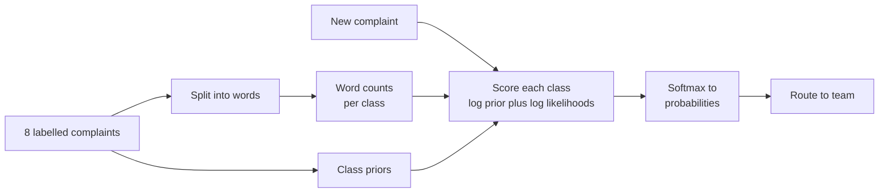
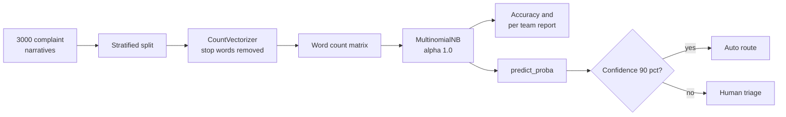
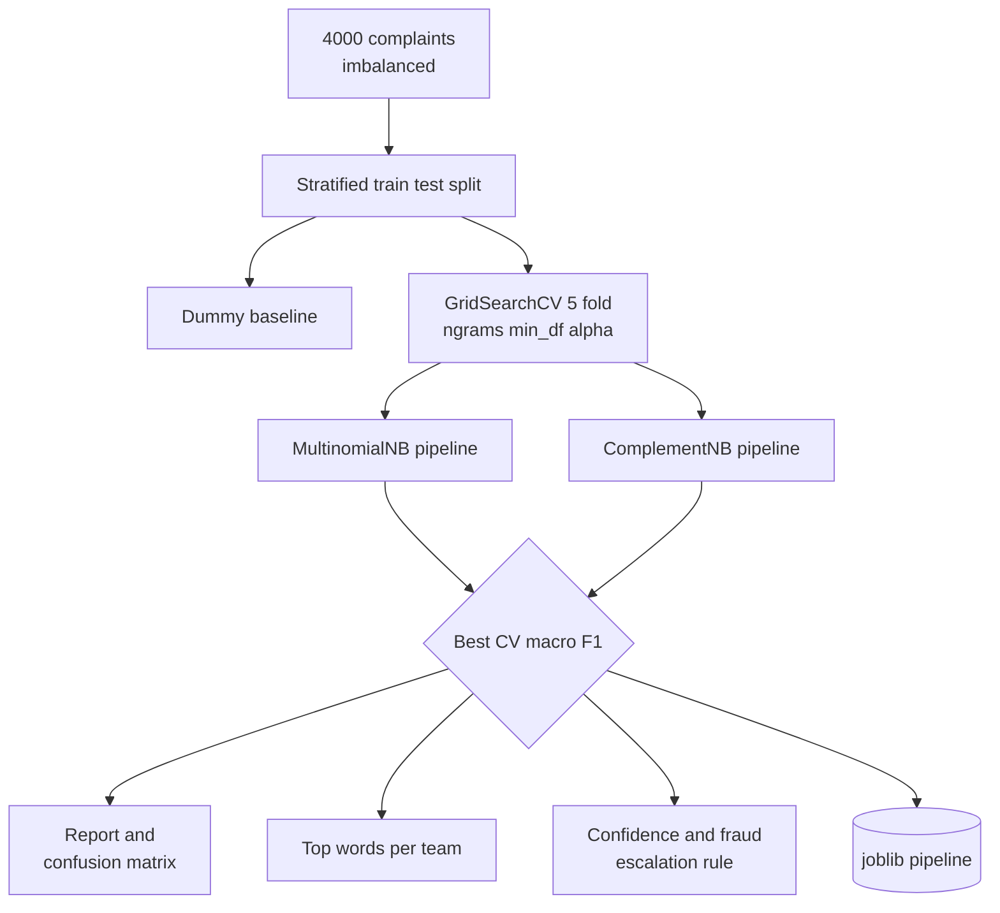
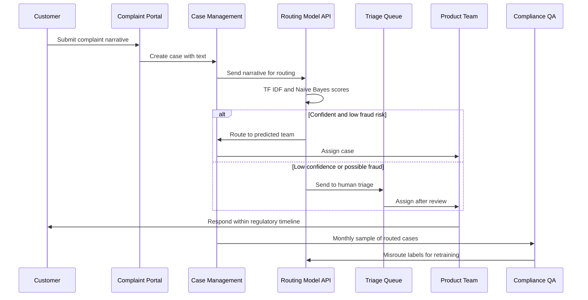

# 14. Naive Bayes

[](https://colab.research.google.com/github/EdwardSuresh/30-ai-algorithms/blob/main/notebooks/14-naive-bayes.ipynb)  

[← 13. Autoencoders](../13-autoencoders/README.md) · [All algorithms](../../README.md#-the-30-algorithms-ranked) · [15. Convolutional Neural Network (CNN) →](../15-convolutional-neural-network/README.md)

> **Naive Bayes classifies items by multiplying how likely each word or feature is under each class, assuming the features are independent.**

💡 **Analogy:** A bank call-centre veteran hears 'escrow' and thinks mortgage, hears 'unauthorized' and thinks fraud, and weighs all the clue words together to pick a team. They treat each clue separately rather than reasoning about how clues interact - that is the 'naive' part, and it still works surprisingly well.

## The use case (same for Easy, Medium and Hard)
**Financial Services — Customer complaint routing to the right product team**

Banks receive thousands of written complaints each month through web forms, email and regulator portals such as the CFPB complaint database. Each must reach the right team - credit cards, mortgage servicing, fraud or fees - quickly, because regulators expect timely responses and misrouted fraud cases can cost customers money. Manual triage is slow and inconsistent, but years of labelled complaint narratives already exist. Success means most complaints are routed automatically and accurately, fraud cases are rarely missed, and uncertain cases go to a human triage queue.

## Industry adoption
| Sector | Score | Where you meet it |
|---|---|---|
| Financial Services | ■■■■□ 4/5 | Banks route customer complaints, emails and chat messages to the right team using text classifiers like Naive Bayes. |
| Insurance | ■■■□□ 3/5 | Insurers triage first notice of loss notes into claim types and flag possible fraud keywords. |
| Supply Chain | ■■□□□ 2/5 | Shippers categorise free-text exception notes (damaged, delayed, wrong address) from carriers. |
| Oil & Gas | ■■□□□ 2/5 | Operators classify maintenance work-order text into failure modes for reliability analysis. |

**Why rank #14:** Naive Bayes is fast, cheap and a strong baseline for text classification, so banks commonly use it for routing emails, complaints and documents. Transformer models and gradient boosting now beat it on accuracy for most tasks, so it is more often a baseline or a lightweight component than the headline model.

## How it works
1. Count how often each class appears in the training data to get prior probabilities.
2. For each class, count how often each word appears in that class's documents.
3. Turn counts into P(word | class), adding a small smoothing value so unseen words are not zero.
4. For a new document, add up log P(class) and log P(word | class) for every word in it.
5. The class with the highest total score wins; scores can be converted to probabilities.
6. Tune the smoothing (alpha) and the text features (n-grams, TF-IDF) with cross-validation.

## Key terms
| Term | Meaning |
|---|---|
| Prior | How common a class is before looking at the text. |
| Likelihood | P(word | class): how often a word shows up in that class's documents. |
| Naive independence | The simplifying assumption that words contribute separately, ignoring how they interact. |
| Laplace smoothing (alpha) | Adding a small count to every word so a word never seen in a class does not zero out its probability. |
| Bag of words | Representing text as word counts, ignoring word order. |
| TF-IDF | Word weights that down-weight words common across all documents, such as 'account'. |
| N-gram | A sequence of n words treated as one feature, such as 'late fee'. |
| ComplementNB | A Naive Bayes variant that learns from all other classes and often does better on imbalanced text data. |

## 🟢 Easy — Count words and apply Bayes by hand
Build a word-count Naive Bayes classifier in pure Python on 8 complaints and route a new one.

| 5W + H | |
|---|---|
| **Who** | A complaints operations analyst learning how text classifiers decide. |
| **What** | Eight labelled complaints across Credit Card, Mortgage, Fraud and Fees, and one new complaint to route. |
| **When** | Before using scikit-learn, to see the probability arithmetic. |
| **Where** | A plain Python script using only the standard library. |
| **Why** | Understanding priors, word likelihoods and smoothing explains why the model makes each routing call. |
| **How** | Count words per class, compute smoothed log-probabilities, add them up and pick the highest. |

**Architecture**



**🧠 ML concepts:** Prior probability, Likelihood P(word | class), Laplace smoothing, Working in log space, Turning scores into probabilities  
**🐍 Python concepts:** List of tuples, Set and dict comprehensions, collections.Counter, Functions with default arguments, sorted with a key lambda, max with key=dict.get

**Steps the code performs**
1. Type 8 complaints with their product labels.
2. Count words for each class with Counter and build the vocabulary.
3. Compute class priors.
4. Define a scoring function using log prior plus smoothed log likelihoods.
5. Score a new complaint against every class.
6. Convert scores to probabilities and route.

▶️ Code: [`easy.py`](easy.py) — run with `python easy.py`

<details><summary>Walkthrough</summary>

| Lines | What happens |
|---|---|
| 1-15 | Import math and Counter, then type 8 complaints as (text, label) tuples - two per team. |
| 17-25 | A set comprehension finds the unique labels. A Counter per class tallies words, and the vocabulary is every word seen in any class. |
| 27-28 | The prior is each class's share of the training data - 25% each here. |
| 30-38 | class_score adds log P(class) and log P(word / class) for each word. Adding logs avoids multiplying many tiny numbers. alpha=1 is Laplace smoothing. |
| 40-45 | Score the new complaint 'unauthorized charge on my credit card' against all four teams and print them best first. |
| 47-52 | Subtracting the max and exponentiating turns log-scores into probabilities. Credit Card wins at 64% with Fraud second - a genuinely ambiguous complaint a human should probably check. |

</details>

<details><summary>Real output</summary>

```text
Vocabulary size: 33
Top words in Fraud: [('my', 2), ('fraud', 2), ('someone', 1)]

New complaint: 'unauthorized charge on my credit card'
  Credit Card  log-score  -20.77
  Fraud        log-score  -21.87
  Fees         log-score  -22.57
  Mortgage     log-score  -23.40
Route to: Credit Card team (probability 64%)
```

</details>

**Try this next:** Add 'unauthorized' to one Credit Card example and see whether the routing flips. · Set alpha to 0.01 and watch how much more extreme the probabilities become. · Add a third Fraud example and see how the prior and likelihoods change.

## 🟡 Medium — CountVectorizer plus MultinomialNB on 3,000 complaints
Train a bag-of-words Multinomial Naive Bayes on 3,000 synthetic complaints and measure routing accuracy.

| 5W + H | |
|---|---|
| **Who** | A data analyst supporting the complaints management team. |
| **What** | 3,000 synthetic CFPB-style narratives with mixed topics and some mislabelled cases. |
| **When** | When setting up a first automated routing model to replace manual triage. |
| **Where** | A Python job reading exported complaint narratives. |
| **Why** | Naive Bayes trains in seconds, needs little tuning and is easy to explain to compliance. |
| **How** | CountVectorizer turns text into word counts, MultinomialNB learns word probabilities per team, and confident predictions are auto-routed. |

**Architecture**



**🧠 ML concepts:** Bag-of-words features, Multinomial Naive Bayes, Stratified split for multi-class data, Precision, recall and F1 per class, Confidence-based routing  
**🐍 Python concepts:** Dict of lists, List comprehension with a filter, rng.choice and in-place shuffle, str.join to build text, zip over predictions, Boolean masks for subsets

**Steps the code performs**
1. Generate 3,000 complaints from product phrases, filler and cross-topic phrases.
2. Add about 8% label noise to mimic customers picking the wrong product.
3. Split into stratified train and test sets.
4. Convert text to word counts with CountVectorizer.
5. Train MultinomialNB and print the per-team report.
6. Route three new complaints and measure accuracy on confident predictions.

▶️ Code: [`medium.py`](medium.py) — run with `python medium.py`

<details><summary>Walkthrough</summary>

| Lines | What happens |
|---|---|
| 1-8 | Imports and a seeded random generator. |
| 10-24 | Each product has typical phrases, and filler phrases appear in every complaint, just like real narratives. |
| 25-40 | For each product, build complaints from 2 product phrases and 3 filler phrases. 40% also mention another product, and 8% get a random wrong label - realistic messiness. |
| 41-43 | Build the DataFrame and show a few rows plus the class counts. |
| 45-54 | Stratified split, then CountVectorizer learns the vocabulary on training text only and turns each complaint into a row of word counts. |
| 56-62 | MultinomialNB learns P(word / team). Accuracy around 94% is close to the ceiling set by the 8% mislabelled data. |
| 64-71 | Three new complaints are routed with probabilities. predict_proba returns one row per complaint, and argmax picks the team. |
| 73-77 | Auto-route only confident cases. Naive Bayes is famously over-confident, so almost everything clears 90% - a reason to calibrate or use a stricter rule in production. |

</details>

<details><summary>Real output</summary>

```text
                                                                                    complaint_text  product
          account hacked they will not respond scam wire transfer my account they will not respond    Fraud
                  i called the bank please help my account account hacked unauthorized transaction    Fraud
my account refinance closing delayed i called the bank on my statement mortgage payment misapplied Mortgage

Class counts:
product
Credit Card    1032
Mortgage        742
Fraud           618
Fees            608

Vocabulary: 62 words; matrix shape (2250, 62)

Test accuracy: 0.940
              precision    recall  f1-score   support

 Credit Card      0.954     0.961     0.958       258
        Fees      0.928     0.934     0.931       152
       Fraud      0.939     0.890     0.914       155
    Mortgage      0.932     0.957     0.944       185

    accuracy                          0.940       750
   macro avg      0.938     0.936     0.937       750
weighted avg      0.940     0.940     0.940       750

Fraud        99%  <- 'someone opened a card in my name identity theft'
Fees         92%  <- 'they charged an overdraft fee twice this month'
Mortgage     99%  <- 'my escrow went up and the mortgage payment doubled'

Auto-route 98% of complaints at >=90% confidence; accuracy on those 94.0%
```

</details>

**Try this next:** Remove stop_words='english' and compare the vocabulary size and accuracy. · Set the label-noise rate from 0.08 to 0 and see accuracy rise. · Change alpha to 0.01 and 10 and compare the per-team F1 scores.

## 🔴 Hard — Tuned TF-IDF Naive Bayes router with fraud escalation
Tune a TF-IDF plus Naive Bayes pipeline with grid search, compare MultinomialNB and ComplementNB on imbalanced data, explain it and set a routing threshold.

| 5W + H | |
|---|---|
| **Who** | The complaints analytics team, with compliance and fraud operations as stakeholders. |
| **What** | A saved routing pipeline with tuned n-grams and smoothing, per-team words, a confusion matrix and a confidence plus fraud-escalation rule. |
| **When** | Retrained monthly on newly labelled complaints; thresholds reviewed with compliance. |
| **Where** | A model API called by the case-management system when each complaint arrives. |
| **Why** | Misrouted fraud complaints harm customers and regulators expect timely, fair complaint handling. |
| **How** | Pipeline with TfidfVectorizer and NB, 5-fold stratified GridSearchCV on macro-F1, dummy baseline, model choice by CV score, confusion matrix, top words and a threshold table. |

**Architecture**



**🧠 ML concepts:** TF-IDF with n-grams, Grid search with stratified cross-validation, Macro-F1 for imbalanced classes, MultinomialNB vs ComplementNB, Confusion matrix analysis, Explaining NB with per-class word probabilities  
**🐍 Python concepts:** Module-level constants in CAPS, Passing a class as a function argument, isinstance checks, Dict comprehension over enumerate, max with a key lambda, joblib and tempfile for saving

**Steps the code performs**
1. Generate 4,000 imbalanced complaints with cross-topic mentions and label noise.
2. Split and score a most-frequent-class baseline.
3. Grid search ngram range, min_df and alpha for MultinomialNB and ComplementNB.
4. Choose the model with the best cross-validated macro-F1.
5. Print the classification report and confusion matrix.
6. Print the most characteristic words per team.
7. Build a threshold table with fraud escalation and save the pipeline.

▶️ Code: [`hard.py`](hard.py) — run with `python hard.py`

<details><summary>Walkthrough</summary>

| Lines | What happens |
|---|---|
| 1-16 | Imports for vectorising, Naive Bayes variants, grid search, metrics and saving. |
| 17-37 | Phrases per product, shared filler and class shares. Fraud is only 10% of volume yet the most urgent - typical of real complaint data. |
| 39-50 | make_complaints builds narratives with cross-topic mentions and 6% label noise; str(label) keeps labels as plain strings. |
| 53-62 | build_search wraps TF-IDF and the NB class in a Pipeline so each CV fold learns its own vocabulary. The grid tries unigrams vs bigrams, min_df and four alpha values, scored on macro-F1. |
| 65-78 | top_words assigns each word to the team where it is most probable and lists the most probable ones - an easy explanation for compliance. ComplementNB weights are flipped because it models the other classes. |
| 81-99 | The dummy baseline scores only 0.15 macro-F1. Both NB variants reach about 0.93; bigrams win in both grids, and Fraud recall is reported separately because it matters most. |
| 101-110 | The winner is chosen by CV score, not test score. The confusion matrix shows most errors are Fees or Fraud complaints routed to Credit Card - the overlapping topics. |
| 112-124 | Top words make sense (escrow, pmi for Mortgage; hacked, unauthorized for Fraud). The threshold table shows how many cases auto-route when anything with a fraud probability of 30% or more goes to a human. |
| 126-130 | Save the whole pipeline with joblib and print a compliance note on response timelines and monthly misroute audits. |

</details>

<details><summary>Real output</summary>

```text
Class mix: {'Credit Card': 0.41, 'Mortgage': 0.28, 'Fees': 0.2, 'Fraud': 0.11}
Baseline (always Credit Card) macro-F1: 0.146

MultinomialNB  best CV macro-F1 0.938 | test macro-F1 0.929 | Fraud recall 0.845
               best params {'nb__alpha': 0.5, 'tfidf__min_df': 3, 'tfidf__ngram_range': (1, 2)}
ComplementNB   best CV macro-F1 0.935 | test macro-F1 0.930 | Fraud recall 0.827
               best params {'nb__alpha': 1.0, 'tfidf__min_df': 1, 'tfidf__ngram_range': (1, 2)}

Chosen model: MultinomialNB
              precision    recall  f1-score   support

 Credit Card      0.945     0.966     0.955       411
        Fees      0.963     0.901     0.931       202
       Fraud      0.912     0.845     0.877       110
    Mortgage      0.931     0.971     0.951       277

    accuracy                          0.941      1000
   macro avg      0.938     0.921     0.929      1000
weighted avg      0.941     0.941     0.941      1000

Confusion matrix (rows = true team, columns = routed team):
             Credit Card  Fees  Fraud  Mortgage
Credit Card          397     1      4         9
Fees                  10   182      3         7
Fraud                  9     4     93         4
Mortgage               4     2      2       269

Most distinctive words per team:
  Credit Card  card, balance, payment, statement, statement balance, card statement
  Fees         fee, fee charged, charged, statement fee, paper, paper statement
  Fraud        account, hacked, account hacked, unauthorized, transaction, unauthorized transaction
  Mortgage     escrow, loan, late loan, escrow account, pmi, pmi removed

Threshold  auto-routed  accuracy-on-auto  sent-to-human
   0.5        89.1%        94.9%          10.9%
   0.6        88.4%        95.2%          11.6%
   0.7        86.9%        95.2%          13.1%
   0.8        83.6%        95.1%          16.4%

... (output trimmed)
```

</details>

**Try this next:** Add 'tfidf__ngram_range': (1, 3) to the grid and check whether trigrams help. · Lower Fraud's share to 0.03 and compare MultinomialNB and ComplementNB Fraud recall. · Change the fraud escalation cut-off from 0.3 to 0.1 and see how many more cases go to humans.

## 🔄 End-to-end production flow



## ⚠️ Pitfalls
- Treating Naive Bayes probabilities as calibrated - they are usually over-confident; calibrate before using them as risk scores.
- Fitting the vectoriser on all data before splitting - this leaks test vocabulary; keep it inside a Pipeline.
- Judging by accuracy on imbalanced classes - use macro-F1 and per-class recall, especially for Fraud.
- Ignoring label noise from customer-selected product fields - audit a sample and clean labels before training.
- Leaving alpha at the default - tune smoothing and n-grams with cross-validation.
- Using it for long, nuanced text where meaning depends on word order or negation - consider transformer models there.

**When NOT to use it:** Avoid Naive Bayes when you need well-calibrated probabilities, when features are strongly dependent, or when meaning hinges on word order and negation; modern transformer models handle nuanced language better.

## 🎤 Interview questions
<details><summary>Why is Naive Bayes called naive, and why does it still work for text?</summary>

It assumes every word is independent of the others given the class, which is clearly false. For classification it only needs the right class to score highest, not exact probabilities, and word evidence is strong enough that the ranking is usually right.

</details>
<details><summary>What does the alpha parameter do?</summary>

It is additive smoothing: it adds alpha to every word count so words never seen in a class get a small non-zero probability. Small alpha trusts the data more; large alpha flattens probabilities and reduces overfitting.

</details>
<details><summary>When would you choose ComplementNB over MultinomialNB?</summary>

When classes are imbalanced, because ComplementNB estimates word weights from all other classes, which gives more stable estimates for small classes. It often matches or beats MultinomialNB on text, so compare both with cross-validation.

</details>

---
[← 13. Autoencoders](../13-autoencoders/README.md) · [All algorithms](../../README.md#-the-30-algorithms-ranked) · [15. Convolutional Neural Network (CNN) →](../15-convolutional-neural-network/README.md)
