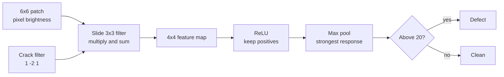
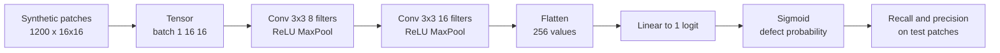
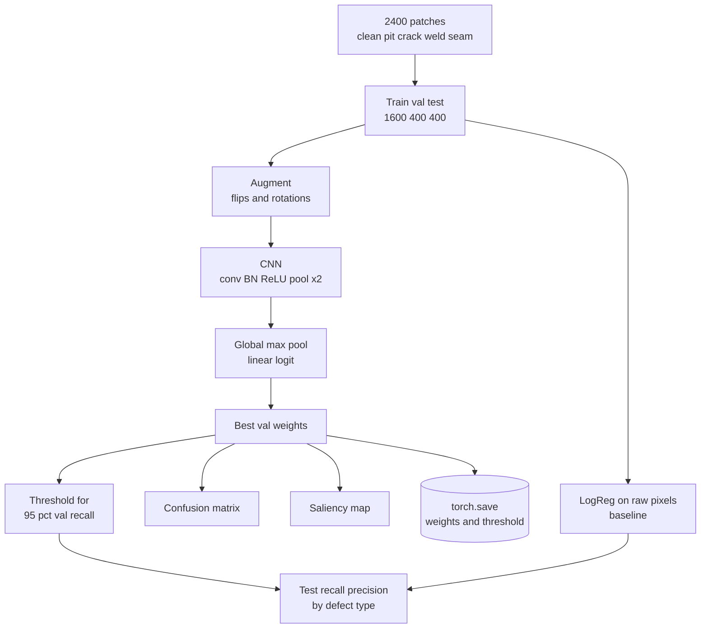
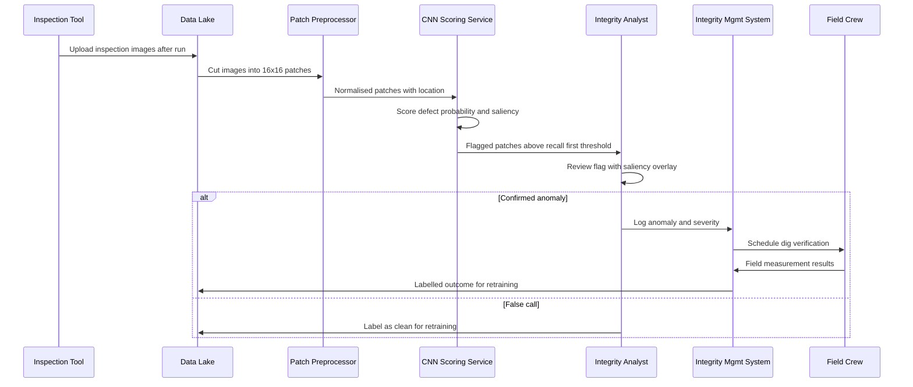

# 15. Convolutional Neural Network (CNN)

[](https://colab.research.google.com/github/EdwardSuresh/architects-ml-playbook/blob/main/notebooks/15-convolutional-neural-network.ipynb)  

[← 14. Naive Bayes](../14-naive-bayes/README.md) · [All algorithms](../../README.md#-the-30-algorithms-ranked) · [16. Support Vector Machine (SVM) →](../16-support-vector-machine/README.md)

> **A CNN learns small image filters that slide across a picture to detect local patterns like edges and spots, then combines them to recognise objects or defects.**

💡 **Analogy:** An inspector runs a small magnifying glass across a pipe photo, square by square, looking for tell-tale shapes - a dark dot, a thin line. A CNN does the same with many 'magnifying glasses' at once, and learns from examples which shapes matter.

## The use case (same for Concept, Build and Production)
**Oil & Gas — Pipeline inspection - detecting corrosion pits and cracks in image patches**

Pipeline operators collect huge volumes of in-line inspection and camera data, and analysts must find small corrosion pits and cracks before they grow into leaks or ruptures. Manual review is slow, tiring and inconsistent across analysts, while a missed defect can harm people, the environment and the operator's licence to operate. The data is grayscale image patches of pipe wall, a small share of which contain defects confirmed by digs. Success means catching nearly every real defect, keeping false calls low enough that analysts are not flooded, and showing analysts which pixels triggered each flag.

## Industry adoption
| Sector | Score | Where you meet it |
|---|---|---|
| Financial Services | ■■■□□ 3/5 | Banks read cheques, ID documents and statements with CNN-based OCR and document classifiers. |
| Insurance | ■■■■□ 4/5 | Insurers estimate vehicle and roof damage from claim photos and drone or aerial imagery. |
| Supply Chain | ■■■□□ 3/5 | Warehouses and factories inspect packages and products on conveyor lines for damage or defects. |
| Oil & Gas | ■■■■□ 4/5 | Pipeline and facility operators detect corrosion, cracks and leaks in inspection images and drone footage. |

**Why rank #15:** CNNs are the standard for image tasks such as damage assessment, document reading and asset inspection, which are growing fast in insurance and oil and gas. Most core business data is tabular rather than images, so CNNs rank below the tabular workhorses in overall enterprise usage.

## How it works
1. The image is a grid of pixel brightness values (one channel for grayscale).
2. A convolution layer slides small filters (for example 3x3) over the image and records how strongly each spot matches.
3. ReLU keeps positive matches; pooling shrinks the map and keeps the strongest responses.
4. Stacked convolution layers combine simple edges into larger shapes such as pits or cracks.
5. A final layer turns the detected patterns into a defect probability.
6. Training adjusts all filter weights by backpropagation so the filters become useful detectors.
7. Augmentation (flips, rotations) and validation-based early stopping help the model generalise.

## Key terms
| Term | Meaning |
|---|---|
| Convolution | Sliding a small filter over the image and summing element-wise products at each position. |
| Filter / kernel | A small grid of learned weights that responds to a particular local pattern. |
| Feature map | The output grid showing where a filter's pattern was found. |
| Pooling | Downsampling that keeps the strongest (max) or average response in each small block. |
| Channel | One layer of image data, such as grayscale (1) or RGB (3), or one filter's output. |
| Data augmentation | Creating extra training images by flipping or rotating existing ones. |
| Saliency map | A heatmap of which pixels most influenced the model's score, used to explain predictions. |

## 🟢 Concept — One 3x3 filter finds a crack by hand
Slide a hand-made 3x3 crack filter over a 6x6 patch in numpy and see where it lights up.

| 5W + H | |
|---|---|
| **Who** | An integrity engineer curious what a CNN actually computes. |
| **What** | A 6x6 grayscale patch with one dark vertical crack and a clean patch for comparison. |
| **When** | Before training any network, to understand convolution itself. |
| **Where** | A short numpy script. |
| **Why** | Every CNN layer is just many of these filters, learned instead of hand-made. |
| **How** | Nested loops slide the filter, multiply and sum, then apply ReLU and max pooling to decide. |

**Architecture**



**🧠 ML concepts:** Convolution as sliding multiply-and-sum, Filters as pattern detectors, Feature maps, ReLU activation, Max pooling to a single score  
**🐍 Python concepts:** 2-D numpy arrays, Tuple unpacking of .shape, Nested for loops, 2-D slicing, Element-wise multiply with *, Generator expression inside max

**Steps the code performs**
1. Type a 6x6 patch with a dark crack column.
2. Define a vertical dark-line filter.
3. Slide the filter across every 3x3 window and build the feature map.
4. Apply ReLU and take the maximum as the defect score.
5. Locate the strongest response and print a verdict.
6. Run the same filter on a clean patch.

▶️ Code: [`easy.py`](easy.py) — run with `python easy.py`

<details><summary>Walkthrough</summary>

| Lines | What happens |
|---|---|
| 1-14 | The patch is a 6x6 grid: 9 is bright steel, 1 is the dark crack in column 3. Printing it lets you see the picture as numbers. |
| 16-24 | The kernel adds the left and right neighbours and subtracts twice the centre. Over a dark line between bright steel, that gives a large positive number. |
| 26-35 | Python loops over every position where a 3x3 window fits (4x4 positions), slices the window, multiplies it element-wise by the kernel and sums. That is exactly what a convolution layer does. |
| 37-39 | The feature map peaks at 48 in the column centred on the crack; columns next to it go negative and flat steel gives 0. |
| 41-48 | ReLU removes negatives, max pooling keeps the strongest value, and unravel_index finds where it was - pointing straight at the crack. |
| 50-53 | On a uniform clean patch every window sums to 0, so the same filter says clean. |

</details>

<details><summary>Real output</summary>

```text
Inspection patch (dark column = crack):
[[9 9 9 1 9 9]
 [9 9 9 1 9 9]
 [9 9 9 1 9 9]
 [9 9 9 1 9 9]
 [9 9 9 1 9 9]
 [9 9 9 1 9 9]]

Filter (vertical dark-line detector):
[[ 1 -2  1]
 [ 1 -2  1]
 [ 1 -2  1]]

Feature map after convolution:
[[  0 -24  48 -24]
 [  0 -24  48 -24]
 [  0 -24  48 -24]
 [  0 -24  48 -24]]

Strongest crack response: 48 at feature-map column 2 (image column 3)
Verdict: DEFECT - send for dig verification
Clean patch response: 0 -> clean
```

</details>

**Try this next:** Make the crack horizontal (a dark row) and see the vertical filter miss it; then transpose the kernel. · Change the crack pixels from 1 to 6 (faint crack) and see whether the score still passes 20. · Add random noise with np.random.normal(0, 1, (6, 6)) to the clean patch and check for false alarms.

## 🟡 Build — Tiny PyTorch CNN on 1,200 inspection patches
Generate synthetic pipe-wall patches with pits and cracks and train a two-layer PyTorch CNN to flag defects.

| 5W + H | |
|---|---|
| **Who** | A data scientist supporting the pipeline integrity team. |
| **What** | 1,200 synthetic 16x16 grayscale patches, about 30% with a pit or crack. |
| **When** | When moving from hand-made filters to filters learned from examples. |
| **Where** | A CPU Python job - the model has only about 1,500 weights. |
| **Why** | Learned filters handle defects of any size, angle and position far better than hand rules. |
| **How** | Two Conv-ReLU-MaxPool blocks and a linear output trained with BCE loss and Adam for 10 epochs. |

**Architecture**



**🧠 ML concepts:** Learned convolution filters, Stacked conv and pooling layers, Channels and tensor shapes, Binary cross-entropy with logits, Recall as the key metric for safety  
**🐍 Python concepts:** Functions with branches, np.mgrid coordinate grids, List comprehension plus np.stack, unsqueeze to add a dimension, Generator expression in sum, Boolean masks combined with &

**Steps the code performs**
1. Write a patch generator for clean steel, corrosion pits and cracks.
2. Generate 1,200 labelled patches and convert to a 4-D tensor.
3. Split 80/20 into train and test.
4. Build a two-block CNN and count its parameters.
5. Train 10 epochs with shuffled mini-batches.
6. Report accuracy, recall and precision on test patches.

▶️ Code: [`medium.py`](medium.py) — run with `python medium.py`

<details><summary>Walkthrough</summary>

| Lines | What happens |
|---|---|
| 1-8 | Imports, one CPU thread, seeds and the patch size. |
| 11-29 | make_patch draws grainy bright steel with gentle shading. Defects are a dark Gaussian blob (pit) or a thin dark line at a random angle (crack). |
| 31-36 | About 30% of 1,200 patches get a defect. A list comprehension makes each patch and np.stack builds one array. |
| 38-42 | unsqueeze(1) adds the channel dimension so shapes are (batch, 1, 16, 16), what Conv2d expects. The first 80% is training data. |
| 44-56 | Each Conv2d learns 3x3 filters like the easy level's crack filter; MaxPool halves the size twice to 4x4, then a linear layer gives one logit. About 1,500 parameters. |
| 58-68 | Each epoch shuffles indices, splits into 64-patch batches and runs forward, loss, backward and step. The printed loss falls steadily. |
| 70-83 | Sigmoid turns logits into probabilities. Precision is perfect but recall is only about 0.74 - faint pits are missed, which motivates the Production level. |

</details>

<details><summary>Real output</summary>

```text
Patches: (1200, 16, 16), defect rate 30.3%
Trainable parameters: 1505
epoch  2  last batch loss 0.609
epoch  4  last batch loss 0.507
epoch  6  last batch loss 0.409
epoch  8  last batch loss 0.250
epoch 10  last batch loss 0.123

Test accuracy: 0.925
Defects caught: 51/69  (recall 0.74)
False calls on clean steel: 0  (precision 1.00)

Inspection read-out: patches flagged as defects go to an integrity engineer for review;
missed defects (false negatives) are the costly error, so recall is the key number.
```

</details>

**Try this next:** Train for 20 epochs instead of 10 and see whether recall improves. · Lower the decision threshold from 0.5 to 0.3 and compare recall and false calls. · Change the first Conv2d to 4 filters and then 16 filters and compare results.

## 🔴 Production — Recall-first CNN with augmentation and saliency
Train a production-style defect CNN with augmentation and class weighting, set a recall-first threshold on validation data, compare with a pixel baseline and explain flags with saliency.

| 5W + H | |
|---|---|
| **Who** | The integrity data-science team, with integrity analysts and regulatory compliance as users. |
| **What** | A saved CNN and threshold that flags pits and cracks, with per-defect-type recall and a pixel-level explanation. |
| **When** | After each in-line inspection run; revalidated whenever field digs reveal misses. |
| **Where** | A batch scoring service feeding flagged patches to the analyst review tool. |
| **Why** | Missed defects can lead to failures, so the model must hit a recall target, and analysts need to see why it flagged a patch. |
| **How** | Nuisance weld seams in data, flips and rotations as augmentation, batch norm, global max pooling, pos_weight for imbalance, best-validation weights, a threshold chosen for 95% validation recall, a logistic-regression baseline and gradient saliency. |

**Architecture**



**🧠 ML concepts:** Data augmentation for orientation invariance, Batch normalisation, Global max pooling for position independence, Class weighting for rare defects, Recall-first threshold on validation data, Gradient saliency for explanation  
**🐍 Python concepts:** Classes with configurable __init__, slice objects for reusable index ranges, List comprehension with a condition, Unpacking tuples from a list, String indexing to draw ASCII art, zip to print two maps side by side

**Steps the code performs**
1. Generate 2,400 patches with pits, cracks and harmless weld seams, 15% defects.
2. Split into train, validation and test.
3. Train a logistic regression on raw pixels as a baseline.
4. Train the CNN with and without augmentation, keeping the best validation weights.
5. For each CNN pick the highest threshold that keeps validation recall at 95% or more.
6. Compare recall, precision and pit/crack catch rates and print a confusion matrix.
7. Draw a saliency map for a corrosion pit and save model plus threshold.

▶️ Code: [`hard.py`](hard.py) — run with `python hard.py`

<details><summary>Walkthrough</summary>

| Lines | What happens |
|---|---|
| 1-15 | Imports, one torch thread, seeds and patch size. |
| 18-35 | make_patch creates clean, pit or crack patches. 30% of all patches get a bright weld seam, so the model cannot learn that 'any line means defect'. Defect depth is random, so some are faint. |
| 38-50 | make_dataset draws kinds with a 15% defect rate. augment randomly flips and rotates each batch - a pit is still a pit when rotated. |
| 53-63 | DefectCNN has two conv blocks with batch normalisation, then global max pooling, which asks whether the pattern appears anywhere in the patch. |
| 66-84 | train uses pos_weight so a missed defect costs about 5.5x more, trains on augmented mini-batches and restores the weights with the lowest validation loss. |
| 87-105 | predict returns probabilities. saliency backpropagates the score to the input pixels; large gradients mark pixels that drive the decision. ascii_map draws any grid as text. |
| 108-123 | Main flow: split the data, fit the pixel logistic-regression baseline, then train the CNN with and without augmentation using the same seed for a fair comparison. |
| 124-135 | For each CNN the threshold is the highest that still gives 95% recall on validation. Both CNNs beat the pixel baseline on recall and precision, especially on faint pits. |
| 137-150 | Print the confusion matrix, then the darkness and saliency maps side by side for the most confident pit: the saliency hot spot sits on the dark blob. |
| 152-156 | Save the weights with the chosen threshold and print a PHMSA integrity-management note. |

</details>

<details><summary>Real output</summary>

```text
Train/val/test: 1600/400/400   defect rate 15.3%

Model        threshold  test recall  test precision  pits caught  cracks caught
LogReg pix        0.50         0.86            0.95          76%            95%
CNN no-aug        0.55         0.94            1.00          88%           100%
CNN + aug         0.30         0.94            0.96          88%           100%

Confusion matrix for CNN + aug (rows = truth clean/defect, cols = predicted):
               pred clean  pred defect
  true clean          325            3
  true defect           4           68

Test patch 383 (pit, p=1.00)   darkness map  |  saliency map
   -----:::::.:::..  |                  
   -:=-:=:::-.:.  .  |       ..         
   -=::-==---... .   |     . .          
   --:==+==-::.:.    |  .   .-  .       
   +:==+=+==-:..:    |     . +          
   ===++#++=:::..:   |     *#+-.        
   ---+++=+-=:.::.   |   . =--          
   --:==-=---:.:..   |   .:..-          
   ----=----:::...:  |                  
   -:-:===::::.....  |                  
   :-----:-.:-....   |                  
   =::-::::::.. ...  |                  
   ----:-:::::.....  |                  
   ---:-:-::.:....   |                  
   -----.-::..:...   |                  
   =-:-.:-:.::.. :.  |                  

Saved model and threshold -> defect_cnn.pt
PHMSA note: 49 CFR 192/195 integrity management - model flags support, not replace,
qualified ILI analysis; log every miss found in the field and revalidate the threshold.
```

</details>

**Try this next:** Raise the recall target from 0.95 to 0.99 and see how many extra false calls appear. · Remove the weld-seam line in make_patch and check whether the baseline gets much better. · Shrink the defect depth further (0.05 to 0.15) and compare augmentation vs no augmentation.

## 🔄 End-to-end production flow



## ⚠️ Pitfalls
- Training on perfectly clean synthetic or lab images - real inspection data has welds, debris and sensor noise; include nuisances and validate on field data.
- Using accuracy with rare defects - a model calling everything clean is 85% accurate; use recall, precision and per-defect-type catch rates.
- Tuning the threshold on the test set - choose it on validation data against a stated recall target.
- Ignoring orientation and position - use augmentation and pooling so a defect is found wherever and however it appears.
- Shipping a black box to analysts - provide saliency or similar overlays so reviewers can check what triggered a flag.
- Never feeding dig results back - log confirmed and missed defects and retrain, or performance will drift with new tools and pipelines.

**When NOT to use it:** Avoid CNNs when your data is tabular or you have only a handful of labelled images; use simpler models, rule-based image checks or pre-trained models with transfer learning instead.

## 🎤 Interview questions
<details><summary>Why use a CNN instead of a regular dense network on image patches?</summary>

Convolutions share the same small filter across the whole image, so a pattern learned in one place is recognised everywhere with far fewer weights. Dense layers treat each pixel separately and must relearn the same pattern at every position.

</details>
<details><summary>How do you choose a decision threshold for safety-critical defect detection?</summary>

Agree a minimum recall with engineering, then on validation data pick the highest threshold that still meets it, which keeps false calls as low as possible. Confirm on a separate test set and monitor in the field.

</details>
<details><summary>What does a saliency map show and what are its limits?</summary>

It shows how much each pixel would change the model's score, highlighting the regions driving a decision. It is a rough guide that can be noisy and does not prove the model reasons correctly, so treat it as a sanity check for analysts.

</details>

---
[← 14. Naive Bayes](../14-naive-bayes/README.md) · [All algorithms](../../README.md#-the-30-algorithms-ranked) · [16. Support Vector Machine (SVM) →](../16-support-vector-machine/README.md)
