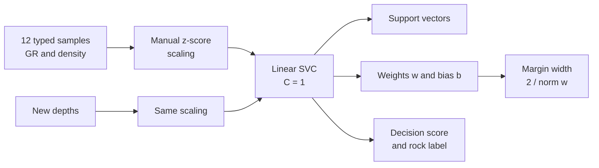
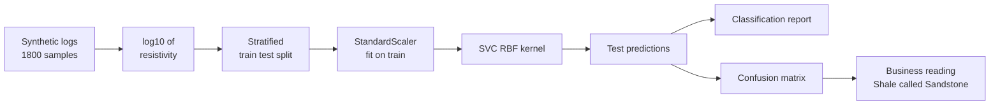
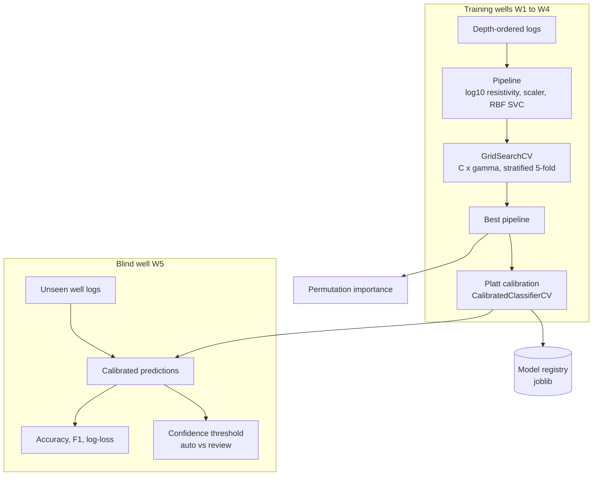
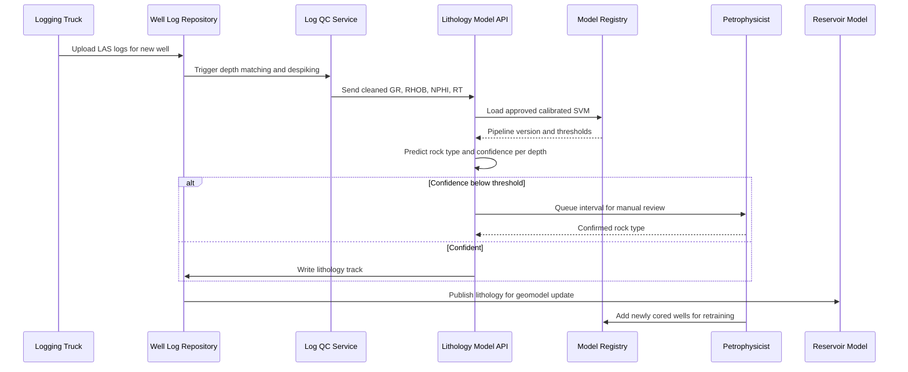

# 16. Support Vector Machine (SVM)

[](https://colab.research.google.com/github/EdwardSuresh/architects-ml-playbook/blob/main/notebooks/16-support-vector-machine.ipynb)  

[← 15. Convolutional Neural Network (CNN)](../15-convolutional-neural-network/README.md) · [All algorithms](../../README.md#-the-30-algorithms-ranked) · [17. k-Nearest Neighbors (k-NN) →](../17-k-nearest-neighbors/README.md)

> **An SVM finds the boundary that separates classes with the widest possible gap, and with kernels that boundary can curve.**

💡 **Analogy:** Imagine painting the widest possible road between two groups of houses so neither side's houses touch the road. Only the houses right at the road edge matter for where you paint it - those are the support vectors. A kernel is like letting the road bend around neighbourhoods instead of forcing it to be straight.

## The use case (same for Easy, Medium and Hard)
**Oil & Gas — Lithology classification from well logs**

Every new well produces logs of gamma ray, bulk density, neutron porosity and resistivity every half-foot, but rock type is only confirmed where expensive core is taken. Geologists spend days hand-interpreting lithology, and inconsistent picks between interpreters slow reservoir models and completion decisions. Using cored wells as labelled data, an SVM can produce a consistent Sandstone / Shale / Limestone track for every new well within minutes. Success means high accuracy on a blind well the model never saw, calibrated confidence, and only the uncertain intervals sent to a petrophysicist.

## Industry adoption
| Sector | Score | Where you meet it |
|---|---|---|
| Financial Services | ■■■□□ 3/5 | Classifying loan applications or flagging card transactions on modest, well-engineered feature sets. |
| Insurance | ■■■□□ 3/5 | Text classification of claim notes (e.g. injury vs property) using linear SVMs on TF-IDF features. |
| Supply Chain | ■■□□□ 2/5 | Classifying supplier quality defects from sensor readings on an inspection line. |
| Oil & Gas | ■■■■□ 4/5 | Lithology and facies classification from well logs, and seismic attribute classification. |

**Why rank #16:** SVMs were the go-to classifier for medium-sized, well-scaled numeric data before gradient boosting took over, and they remain common where data is limited and boundaries are smooth. In oil and gas, SVMs are a long-standing, widely published choice for lithology and facies classification from well logs. Elsewhere they have mostly been replaced by tree ensembles for tabular data, which keeps them mid-table.

## How it works
1. Scale every feature so no single measurement dominates the distance calculation.
2. Look for a boundary (hyperplane) that separates the classes with the largest margin.
3. Allow some points inside the margin or on the wrong side; the C parameter sets how costly those violations are.
4. Only the points on or inside the margin (support vectors) determine the boundary; all other points can be ignored.
5. For curved boundaries, apply a kernel (e.g. RBF) that measures similarity as if the data were mapped into a higher-dimensional space.
6. For more than two classes, train several one-vs-one SVMs and vote.
7. Classify a new point by which side of the boundary it falls on; distance from the boundary acts as a confidence score.

## Key terms
| Term | Meaning |
|---|---|
| Hyperplane | The boundary that splits the classes - a line in 2-D, a flat sheet in higher dimensions. |
| Margin | The empty gap on each side of the boundary; SVM maximises its width. |
| Support vectors | The training points closest to the boundary; they alone define it. |
| C | Penalty for margin violations: small C = wide, tolerant margin; large C = tight fit, risk of overfitting. |
| Kernel | A similarity function that lets SVM draw curved boundaries without explicitly creating new features. |
| gamma (RBF) | How far one training point's influence reaches; high gamma = very local, wiggly boundary. |
| Platt scaling | Fitting a sigmoid on SVM scores to turn them into calibrated probabilities. |

## 🟢 Easy — Draw the line between Sandstone and Shale
Fit a linear SVM on 12 hand-typed depth samples and see which samples become support vectors and how wide the margin is.

| 5W + H | |
|---|---|
| **Who** | A junior petrophysicist learning how a machine can read two well logs the way a geologist eyeballs a crossplot. |
| **What** | Classify depth samples as Sandstone or Shale using gamma ray (API) and bulk density (g/cc). |
| **When** | Right after logging a new well, before the geologist does a detailed interpretation. |
| **Where** | A notebook on the petrophysicist's laptop with a handful of samples typed in. |
| **Why** | Shale is radioactive (high gamma ray) and denser; a straight line on the GR-density crossplot often separates the two. |
| **How** | Scale the two logs, fit SVC(kernel='linear'), print support vectors, weights, margin width and the decision score for three new depths. |

**Architecture**



**🧠 ML concepts:** Maximum-margin hyperplane, Support vectors, Margin width = 2/||w||, Decision function sign and magnitude, Why feature scaling matters for SVM  
**🐍 Python concepts:** List of tuples, List comprehension with tuple unpacking, Conditional expression, numpy mean/std along an axis, f-string format specs

**Steps the code performs**
1. Type 12 depth samples as (GR, density, label) tuples
2. Convert to numpy arrays X and y
3. Standardise both logs
4. Fit a linear SVC
5. Print the support vectors and margin width
6. Score three new depths and say if they fall inside the margin

▶️ Code: [`easy.py`](easy.py) — run with `python easy.py`

<details><summary>Walkthrough</summary>

| Lines | What happens |
|---|---|
| 2-3 | Import numpy for arrays and SVC, scikit-learn's Support Vector Classifier. |
| 5-10 | A tiny hand-made dataset: each tuple is one half-foot of well log with gamma ray, density and the core-confirmed rock type. |
| 12-15 | Build the feature matrix X (12 rows x 2 columns) and the label vector y (1 = Shale, 0 = Sandstone) using list comprehensions. |
| 17-19 | Gamma ray is in the 30-130 range while density is around 2.3-2.6. We subtract the mean and divide by the standard deviation so both count equally in the distance-based SVM. |
| 21-23 | Fit a linear SVM. It looks for the straight line with the widest possible empty 'street' between the two rock types. |
| 25-30 | model.support_ gives the row numbers of the support vectors - here only two samples define the whole boundary. |
| 32-35 | Read the learned weights and bias and compute the margin width 2///w//. A wider margin usually generalises better. |
| 37-46 | Scale each new depth with the training mean/std, get the signed decision score, and label it. /score/ < 1 means the sample sits inside the margin, so it is a borderline call. |

</details>

<details><summary>Real output</summary>

```text
Support vector indices: [3 9]
  sample  3: GR=  50 API  RHOB=2.35  -> Sandstone
  sample  9: GR=  88 API  RHOB=2.48  -> Shale

Weights w = [0.853 0.885], bias b = 0.118
Margin width (scaled units) = 1.627
GR= 60 RHOB=2.36 -> score -0.67 -> Sandstone (inside margin)
GR= 85 RHOB=2.44 -> score +0.61 -> Shale     (inside margin)
GR=115 RHOB=2.53 -> score +2.08 -> Shale     (clear side)
```

</details>

**Try this next:** Change C to 0.01 and then 100 and see how many support vectors appear and how the margin width changes. · Add a sandstone sample with GR=90 (a 'hot' radioactive sand) and refit - which samples become support vectors now? · Remove the scaling line and fit on raw X - compare the weights and the predictions.

## 🟡 Medium — RBF SVM on 1,800 log samples, three rock types
Train an RBF-kernel SVC on four standardised well logs to classify Sandstone, Shale and Limestone and read its confusion matrix.

| 5W + H | |
|---|---|
| **Who** | A petrophysics team that wants a first-pass lithology log for every new well in a field. |
| **What** | A three-class classifier using gamma ray, density, neutron porosity and log10 resistivity. |
| **When** | After each well is logged, to produce a quick lithology track for the geologist to review. |
| **Where** | A Python script run by the subsurface data team on exported log data. |
| **Why** | Rock types overlap on any single log; a curved (RBF) boundary in four dimensions separates them far better than a cutoff on one curve. |
| **How** | Generate synthetic logs per rock type, split with stratify, fit StandardScaler on train only, compare scaled vs unscaled RBF SVC, then print a classification report and confusion matrix. |

**Architecture**



**🧠 ML concepts:** RBF kernel and the gamma parameter, Multi-class SVM (one-vs-one inside SVC), Fit scaler on training data only (no leakage), Stratified split, Precision, recall, F1 and confusion matrix  
**🐍 Python concepts:** Nested dict of tuples, Dict comprehension, dict.items() looping, pd.concat with ignore_index, Tuple of booleans to drive a loop, DataFrame for labelled confusion matrix

**Steps the code performs**
1. Define typical log responses for each rock
2. Generate 600 samples per rock and stack them
3. Log-transform resistivity
4. Stratified 75/25 split
5. Scale using training statistics
6. Compare RBF SVC with and without scaling
7. Print report and confusion matrix
8. Interpret the costly error type

▶️ Code: [`medium.py`](medium.py) — run with `python medium.py`

<details><summary>Walkthrough</summary>

| Lines | What happens |
|---|---|
| 9-10 | Fix the random seed so everyone gets the same synthetic data, and choose 600 samples per rock type. |
| 12-18 | Each rock type has a typical (mean, standard deviation) for every log, roughly matching textbook responses: shale is high GR and low resistivity, limestone is dense with low porosity. |
| 22-31 | Loop over rock types, draw random log values with a dict comprehension, tag each table with its lithology and stack all three into one DataFrame. |
| 32-34 | Resistivity spans orders of magnitude, so geoscientists always look at it on a log scale. We clip tiny values and take log10. |
| 36-39 | Pick the four model inputs and confirm the classes are balanced. |
| 41-42 | Hold back 25% for testing, keeping the same rock proportions in both parts. |
| 45-47 | Learn mean and std from the training set only and apply them to both sets - the test set must stay unseen. |
| 49-54 | Fit the same RBF SVM on raw and scaled data. The large accuracy gap shows why scaling is non-negotiable for SVMs. |
| 56-61 | Fit the final scaled model, count support vectors per class and print precision/recall/F1 for each rock. |
| 63-71 | Show a labelled confusion matrix and pull out the business-critical error: shale mistaken for sandstone could flag a non-reservoir zone as pay. |

</details>

<details><summary>Real output</summary>

```text
Rows per class:
 lithology
Sandstone    600
Shale        600
Limestone    600 

RBF SVM  scaled=False  test accuracy = 0.673
RBF SVM  scaled=True   test accuracy = 0.927

Support vectors per class: {'Limestone': 95, 'Sandstone': 154, 'Shale': 98}

Classification report (test):
              precision    recall  f1-score   support

   Limestone      0.972     0.920     0.945       150
   Sandstone      0.888     0.900     0.894       150
       Shale      0.923     0.960     0.941       150

    accuracy                          0.927       450
   macro avg      0.928     0.927     0.927       450
weighted avg      0.928     0.927     0.927       450

Confusion matrix:
                 pred_Limestone  pred_Sandstone  pred_Shale
true_Limestone             138              12           0
true_Sandstone               3             135          12
true_Shale                   1               5         144

Shale called Sandstone: 5 samples. These are the costly errors - a petrophysicist might flag a non-reservoir zone as pay.
```

</details>

**Try this next:** Try gamma=0.01 and gamma=10 in the final SVC and watch accuracy and support-vector counts change. · Drop log_resistivity from the features list - which class gets worse? · Make Shale and Sandstone GR means closer (e.g. 70 and 85) to simulate shaly sands and see the confusion grow.

## 🔴 Hard — Tuned, calibrated SVM tested on a blind well
Build a production lithology pipeline with grid-searched C and gamma, calibrated probabilities, a blind-well test in depth order, permutation importance and a review threshold.

| 5W + H | |
|---|---|
| **Who** | The subsurface data science team supporting geologists across a multi-well field development. |
| **What** | A deployable pipeline (log transform, scaler, RBF SVM, Platt calibration) that labels every depth sample with a rock type and a confidence. |
| **When** | Run automatically when a new well's logs land in the data store; low-confidence intervals are routed to a petrophysicist. |
| **Where** | Batch scoring service fed by the well-log repository, with the model artifact versioned in the model registry. |
| **Why** | Random splits over-state accuracy because neighbouring depths are near-duplicates; only a blind well tells you how the model will behave in a new hole. |
| **How** | Simulate five wells of stacked beds, hold out well W5, GridSearchCV over C and gamma with stratified folds, calibrate with CalibratedClassifierCV, score W5, explain with permutation importance and choose a confidence threshold. |

**Architecture**



**🧠 ML concepts:** Pipeline to prevent leakage inside CV, Grid search over C and gamma, Probability calibration (Platt scaling), Blind-well (group) validation vs random split, Permutation importance, Confidence threshold for human review  
**🐍 Python concepts:** Functions with docstrings, Star-unpacking into a list, FunctionTransformer wrapping a plain function, pivot_table for reshaping, sorted with key=lambda, os.path and tempfile for saving artifacts

**Steps the code performs**
1. Simulate five wells as stacks of beds with bed-level bias
2. Hold out W5 as the blind well
3. Grid-search C and gamma inside a pipeline
4. Calibrate the best model's probabilities
5. Score the blind well against a majority baseline
6. Rank logs by permutation importance
7. Pick a confidence threshold for review
8. Save the calibrated model

▶️ Code: [`hard.py`](hard.py) — run with `python hard.py`

<details><summary>Walkthrough</summary>

| Lines | What happens |
|---|---|
| 18-23 | Global constants: a reproducible random generator, the four log names, and typical (mean, std) responses per rock. |
| 27-42 | Build one well as a stack of beds. Each bed gets a random thickness and a small bed-level shift, so neighbouring samples are correlated like real logs. |
| 45-50 | A plain function that log-transforms resistivity; FunctionTransformer lets it live inside the pipeline so it is applied identically at train and score time. |
| 53-59 | The pipeline chains log transform, StandardScaler and an RBF SVC with class_weight='balanced' so minority limestone is not ignored. |
| 62-70 | Generate five wells, keep W1-W4 for training and lock W5 away as a blind test. |
| 72-83 | Search 16 C x gamma combinations with stratified 5-fold CV, scoring by macro-F1, and print the score grid so you can see the flat, stable region. |
| 85-89 | SVC decision scores are not probabilities. Platt (sigmoid) calibration maps them to 0-1 values a geologist can trust as confidence. |
| 91-103 | Score W5 with the calibrated model and a majority-class baseline; report accuracy, macro-F1, log-loss and a confusion matrix. |
| 105-111 | Permutation importance shuffles one log at a time on the blind well and measures the F1 drop - neutron and density matter most here. |
| 113-130 | Trade off automation against errors with a confidence threshold, show the depth log around the first miss, then save the model with joblib and print a model-risk note. |

</details>

<details><summary>Real output</summary>

```text
Train rows 1643 from wells ['W1', 'W2', 'W3', 'W4'], blind well W5 rows 481
Train mix: {'Shale': 0.45, 'Sandstone': 0.35, 'Limestone': 0.2}

Best params {'svm__C': 0.3, 'svm__gamma': 1.0}  CV macro-F1 0.901
param_svm__gamma   0.03   0.10   0.30   1.00
param_svm__C                                
0.3               0.885  0.899  0.899  0.901
1.0               0.893  0.896  0.898  0.894
10.0              0.898  0.898  0.889  0.885
50.0              0.898  0.893  0.886  0.878

Blind well W5 results:
  Baseline (always majority)  acc 0.414  macro-F1 0.195
  Calibrated SVM              acc 0.919  macro-F1 0.918
  Calibrated log-loss 0.281
           Limestone  Sandstone  Shale
Limestone        130          4      1
Sandstone          7        125     15
Shale              0         12    187

Permutation importance (drop in macro-F1):
  neutron_porosity   0.192 ###################
  density_g_cc       0.176 #################
  gamma_ray_api      0.133 #############
  resistivity_ohm_m  0.128 ############

Threshold | auto-labelled | errors in auto | depths to review
   0.5    |    481        |    39          |      0
   0.7    |    467        |    32          |     14
   0.8    |    452        |    26          |     29
   0.9    |    298        |     5          |    183

Depth log (blind well, around first miss):
   5013.0 ft  true Shale     pred Shale     conf 0.93
   5013.5 ft  true Shale     pred Shale     conf 0.93
   5014.0 ft  true Shale     pred Sandstone conf 0.69  <-- miss
   5014.5 ft  true Shale     pred Shale     conf 0.93

Saved calibrated model -> lithology_svm.joblib
Model-risk note: validate on blind wells per basin; document logs, tool vendors and depth ranges used; re-calibrate when a new field or logging suite is added.
```

</details>

**Try this next:** Replace the StratifiedKFold with GroupKFold over well names and compare the CV score with the blind-well score. · Change calibration method to 'isotonic' and compare the blind-well log-loss. · Add a fourth class 'Dolomite' to PROFILE (density about 2.75) and rerun the whole pipeline.

## 🔄 End-to-end production flow



## ⚠️ Pitfalls
- Forgetting to scale features - SVM distances get dominated by the largest-valued log. Always put StandardScaler inside the pipeline.
- Random train/test splits on depth data leak near-identical neighbouring samples into the test set. Validate on whole blind wells.
- Treating decision_function scores as probabilities. Calibrate with CalibratedClassifierCV before using them for thresholds.
- Tuning only C or only gamma - they interact. Search them together on a log-spaced grid.
- Using raw resistivity, which spans decades. Log-transform it as petrophysicists do.
- Training on very large datasets (hundreds of thousands of rows) with kernel SVC - training time grows roughly quadratically; use LinearSVC, a kernel approximation or a tree ensemble instead.

**When NOT to use it:** Avoid kernel SVMs on very large datasets or when you need fast retraining, native probabilities or feature-level explanations; gradient-boosted trees are usually stronger and easier on large tabular data.

## 🎤 Interview questions
<details><summary>What are support vectors and why do they matter?</summary>

They are the training points that lie on or inside the margin. The final boundary depends only on them, so the model is compact and robust to points far from the boundary.

</details>
<details><summary>How do C and gamma interact in an RBF SVM?</summary>

C controls how much margin violations are penalised and gamma controls how local each support vector's influence is. High values of both lead to a very wiggly, overfit boundary, so they should be tuned together with cross-validation.

</details>
<details><summary>Why is a blind-well test better than a random split for well-log models?</summary>

Adjacent depth samples are highly correlated, so a random split puts near-copies in train and test and inflates accuracy. Holding out entire wells mimics deployment on a new well and gives an honest estimate.

</details>

---
[← 15. Convolutional Neural Network (CNN)](../15-convolutional-neural-network/README.md) · [All algorithms](../../README.md#-the-30-algorithms-ranked) · [17. k-Nearest Neighbors (k-NN) →](../17-k-nearest-neighbors/README.md)
