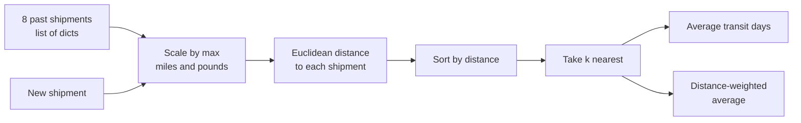
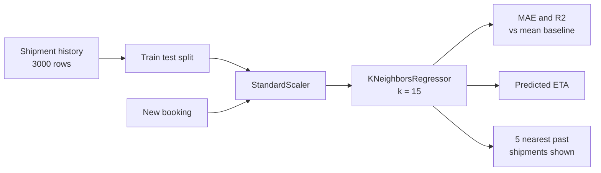
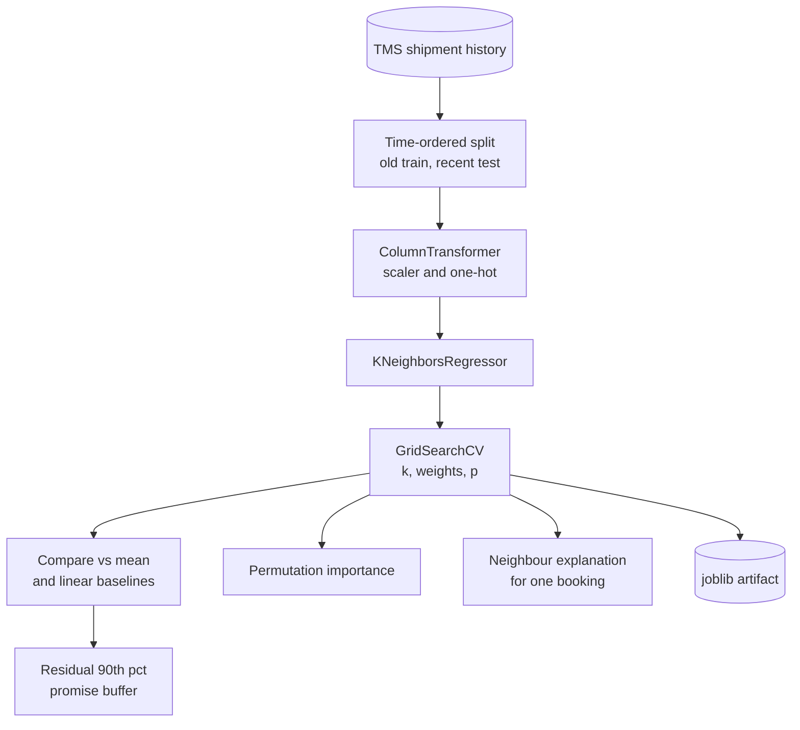
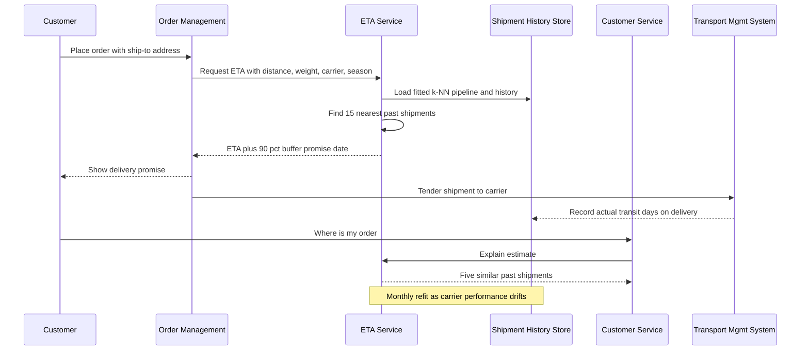

# 17. k-Nearest Neighbors (k-NN)

[](https://colab.research.google.com/github/EdwardSuresh/30-ai-algorithms/blob/main/notebooks/17-k-nearest-neighbors.ipynb)  

[← 16. Support Vector Machine (SVM)](../16-support-vector-machine/README.md) · [All algorithms](../../README.md#-the-30-algorithms-ranked) · [18. Markov Decision Process (MDP) →](../18-markov-decision-process/README.md)

> **k-NN predicts a new case by looking up the k most similar past cases and taking their majority vote or average.**

💡 **Analogy:** Pricing a house by asking: what did the three most similar houses on this street sell for? You do not build a formula - you just find the closest comparables and average them. Estate agents have done k-NN for decades.

## The use case (same for Easy, Medium and Hard)
**Supply Chain — Delivery transit-day estimation from similar past shipments**

Customers expect an accurate delivery date at checkout, but transit time depends on distance, weight, carrier, season and service level. Planners today use a static miles-per-day table, so promises are missed in peak season and over-padded the rest of the year. The transportation management system holds years of shipment history with actual transit days. Success means estimates within one day for most shipments, a promise date that hits about 90% on-time, and an explanation customer service can show ('similar shipments took 8 days').

## Industry adoption
| Sector | Score | Where you meet it |
|---|---|---|
| Financial Services | ■■■□□ 3/5 | Finding peer customers or comparable companies for credit benchmarking and imputing missing values. |
| Insurance | ■■■□□ 3/5 | Estimating claim reserves from the most similar closed claims. |
| Supply Chain | ■■■□□ 3/5 | Estimating delivery transit times or demand for a new product from similar shipments or SKUs. |
| Oil & Gas | ■■■□□ 3/5 | Predicting missing well-log curves or production from analogue wells. |

**Why rank #17:** k-NN is one of the first algorithms every practitioner learns and is widely used as a baseline, for similarity search and for 'find comparable cases' features. It is rarely the final production model on large tabular data because it is slow at prediction time and sensitive to scaling, but its explainability keeps it in steady use across all four industries.

## How it works
1. Store all training examples - there is no real training step.
2. Scale features so each one contributes fairly to distance.
3. For a new case, compute its distance to every stored example.
4. Pick the k examples with the smallest distance.
5. For regression, average their targets; for classification, take a majority vote.
6. Optionally weight each neighbour by 1/distance so closer ones count more.
7. Tune k (and the distance metric) with cross-validation.

## Key terms
| Term | Meaning |
|---|---|
| k | How many neighbours vote; small k is noisy, large k over-smooths. |
| Euclidean distance | Straight-line distance: square root of the sum of squared differences. |
| Manhattan distance | Sum of absolute differences, like walking city blocks (Minkowski p=1). |
| Lazy learner | A model that does no work at training time and all the work at prediction time. |
| Feature scaling | Rescaling columns to similar ranges so no single unit (miles vs pounds) dominates. |
| Curse of dimensionality | With many features, all points look roughly equally far apart and neighbours lose meaning. |

## 🟢 Easy — Find the 3 most similar past shipments by hand
Compute distances from a new shipment to 8 past shipments in plain Python and average the transit days of the nearest ones.

| 5W + H | |
|---|---|
| **Who** | A logistics planner who quotes delivery dates to customers. |
| **What** | Estimate transit days for a new 1,000-mile, 1,000-lb shipment from 8 past shipments. |
| **When** | At order time, when the customer asks 'when will it arrive?'. |
| **Where** | A small Python script - no ML library, just the math module. |
| **Why** | Shipments that look alike (similar distance and weight) usually take a similar number of days - that is the whole idea of k-NN. |
| **How** | Scale distance and weight by their max, compute Euclidean distance to each past shipment, sort, and average the k closest (plain and distance-weighted). |

**Architecture**



**🧠 ML concepts:** Instance-based (lazy) learning, Euclidean distance, Why features must be on similar scales, Choosing k, Distance weighting  
**🐍 Python concepts:** List of dicts, Generator expression inside max() and sum(), Defining a function with a docstring, sorted with key=lambda, Slicing [:k], enumerate

**Steps the code performs**
1. Type 8 past shipments
2. Find max distance and weight for scaling
3. Compute distance from the new shipment to each
4. Sort shipments by distance
5. Average the nearest k for k = 1, 3, 5
6. Compute a distance-weighted k=3 estimate

▶️ Code: [`easy.py`](easy.py) — run with `python easy.py`

<details><summary>Walkthrough</summary>

| Lines | What happens |
|---|---|
| 2 | Only the standard math module is needed for the square root. |
| 4-15 | Eight past shipments with distance, weight and actual transit days, plus the new shipment we want to estimate. |
| 17-20 | Find the largest distance and weight so we can divide by them and put both features on a 0-1 scale. |
| 22-27 | A function computing straight-line distance between two shipments on the scaled features. |
| 29-31 | Store each past shipment's distance to the new one directly in its dict. |
| 33-38 | Sort shipments from most to least similar and print the ranking so you can see who the neighbours are. |
| 40-46 | For k = 1, 3, 5 take the first k shipments and average their transit days - that average is the prediction. |
| 48-52 | Give each of the 3 neighbours a vote of 1/distance so the closest shipment counts most. |

</details>

<details><summary>Real output</summary>

```text
Past shipments ranked by similarity to the new one:
  S3    900 mi    800 lb  days=4  distance=0.079
  S2    450 mi   1200 lb  days=3  distance=0.239
  S5   1500 mi    600 lb  days=5  distance=0.247
  S1    300 mi    500 lb  days=2  distance=0.336
  S4   1200 mi   2000 lb  days=5  distance=0.344
  S6   2000 mi   1500 lb  days=7  distance=0.449
  S8    600 mi   2500 lb  days=3  distance=0.527
  S7   2400 mi   3000 lb  days=8  distance=0.886
k=1: neighbours [S3] -> predicted transit 4.00 days
k=3: neighbours [S3, S2, S5] -> predicted transit 4.00 days
k=5: neighbours [S3, S2, S5, S1, S4] -> predicted transit 3.80 days
k=3 distance-weighted -> 3.99 days
```

</details>

**Try this next:** Change the new shipment to 2,200 miles and 2,800 lb - which neighbours are picked now? · Remove the scaling (divide by 1 instead of max_d/max_w) and see how weight starts to dominate the distance. · Add a 'carrier_delay' field and include it in the distance function.

## 🟡 Medium — KNeighborsRegressor on 3,000 shipments
Train scikit-learn's KNeighborsRegressor on scaled shipment features, compare k values and scaling, and explain a prediction with its neighbours.

| 5W + H | |
|---|---|
| **Who** | A transportation analytics team at a shipper or 3PL. |
| **What** | Predict transit days from distance, weight and season flags (peak, winter). |
| **When** | When a shipment is booked, to set a customer-facing ETA. |
| **Where** | A batch model refreshed weekly from the transportation management system history. |
| **Why** | Rule tables (miles / 500 = days) ignore weight and seasonal congestion; a neighbour-based estimate reflects what really happened to similar loads. |
| **How** | Generate 3,000 synthetic shipments, split, scale with StandardScaler, compare k and scaled vs unscaled MAE against a mean baseline, then use kneighbors to show the 5 most similar past shipments. |

**Architecture**



**🧠 ML concepts:** k-NN regression, Bias-variance trade-off through k, Feature scaling for distance models, Baseline comparison, MAE and R-squared, Neighbour-based explanation  
**🐍 Python concepts:** numpy vectorised column creation, np.isin and astype, pandas describe and loc, Looping over tuples of arrays, DataFrame.assign, iloc indexing

**Steps the code performs**
1. Generate distance, weight and month for 3,000 shipments
2. Create transit days with seasonal delays and noise
3. Split 80/20
4. Scale features on training data
5. Compare k values with and without scaling
6. Fit k=15 and report MAE and R2
7. Predict a new December shipment and list its neighbours
8. Report share of shipments within one day

▶️ Code: [`medium.py`](medium.py) — run with `python medium.py`

<details><summary>Walkthrough</summary>

| Lines | What happens |
|---|---|
| 9-18 | Create realistic raw columns: uniform distances, log-normal weights (a few very heavy loads) and month, plus peak and winter flags. |
| 20-27 | The hidden rule generating transit days: about one day per 500 miles, slower for heavy freight and peak or winter months, plus noise. Wrap everything in a DataFrame. |
| 29-34 | Peek at the data, then split into 80% train and 20% test. |
| 37-39 | Fit the scaler on training data only and transform both sets. |
| 41-43 | A model that always predicts the average sets the bar every real model must clear. |
| 45-52 | Try k = 1, 5, 15, 40 on unscaled and scaled data. k=1 is noisy, scaling always helps. |
| 54-57 | Fit the chosen model and report MAE (average days off) and R2 (share of variance explained). |
| 59-66 | Predict a new December shipment and print the five actual past shipments the estimate was averaged from - k-NN's built-in explanation. |
| 68-70 | Translate the error into business terms: the share of shipments predicted within one day. |

</details>

<details><summary>Real output</summary>

```text
   distance_mi  weight_lb  is_peak  is_winter  transit_days
0       1080.0     2071.0        0          0           2.5
1       2664.0     1588.0        0          0           7.2
2       2063.0     1653.0        0          0           5.2
3       1696.0      483.0        0          0           4.9
4        479.0     2269.0        0          1           2.2 

      distance_mi  weight_lb  is_peak  is_winter  transit_days
mean       1424.7     1297.7      0.2        0.2           4.5
min          50.0      163.0      0.0        0.0           1.0
max        2799.0    11565.0      1.0        1.0           9.7 

Baseline (predict mean) MAE: 1.50 days

  k | MAE unscaled | MAE scaled
  1 |    0.95      |   0.72
  5 |    0.73      |   0.55
 15 |    0.69      |   0.52
 40 |    0.67      |   0.52

Chosen k=15  MAE 0.52 days   R2 0.868

New shipment 1400 mi, 2200 lb, December -> estimate 6.5 days
Five closest past shipments:
      distance_mi  weight_lb  is_peak  is_winter  transit_days
626        1322.0     2341.0        1          1           5.5
1932       1592.0     2199.0        1          1           6.8
1482       1547.0     2042.0        1          1           5.2
1757       1392.0     2475.0        1          1           6.5
2488       1669.0     2466.0        1          1           7.6

90% of test shipments predicted within +/- 1 day -> good enough to quote customer ETAs.
```

</details>

**Try this next:** Set weights='distance' in KNeighborsRegressor and compare MAE. · Remove is_peak from features and see what happens to the December prediction. · Change N to 300 and observe how k-NN suffers with less history.

## 🔴 Hard — Tuned k-NN pipeline with carriers, seasons and promise dates
Build a ColumnTransformer + KNeighborsRegressor pipeline, tune k, weights and metric, compare against baselines on a time-ordered test set, and set a buffered promise date.

| 5W + H | |
|---|---|
| **Who** | The supply chain data science team owning delivery-date promises for an e-commerce or B2B shipper. |
| **What** | A production ETA model using distance, weight, carrier, season and service level, with neighbour explanations for customer service. |
| **When** | At checkout or booking for every shipment, refit monthly as carrier performance drifts. |
| **Where** | An ETA microservice called by the order management system; model artifact saved with joblib. |
| **Why** | Promise dates that are too optimistic cause complaints and chargebacks; too pessimistic loses sales. A tuned model plus an error buffer hits a target on-time rate. |
| **How** | One-hot encode categories, scale numbers, GridSearchCV over k, weights and p, train on older shipments and test on the newest, compare with mean and linear baselines, use permutation importance, explain neighbours, and pick a 90th-percentile buffer. |

**Architecture**



**🧠 ML concepts:** ColumnTransformer for mixed data types, One-hot encoding inside a distance model, Hyperparameter tuning of k, weights and Minkowski p, Time-ordered validation, Permutation importance, Quantile-based safety buffer  
**🐍 Python concepts:** Module-level constants and dicts, np.select as vectorised if/elif, Series.map with a dict, Functions returning DataFrames, named_steps on a Pipeline, Dict of models looped with items()

**Steps the code performs**
1. Simulate 4,000 dated shipments with carrier, season and service effects
2. Split by date: oldest 80% train, newest 20% test
3. Build the preprocessing + k-NN pipeline
4. Grid-search k, weights and p with 5-fold CV
5. Compare with mean and linear-regression baselines
6. Compute permutation importance
7. Explain one new booking with its neighbours
8. Set a promise buffer and save the pipeline

▶️ Code: [`hard.py`](hard.py) — run with `python hard.py`

<details><summary>Walkthrough</summary>

| Lines | What happens |
|---|---|
| 19-23 | Constants: feature lists and the hidden delay each carrier and season adds. |
| 26-45 | Simulate shipments with dates, carriers and service level. np.select maps months to seasons, and transit days step up in whole driving days. |
| 48-54 | A ColumnTransformer scales numeric columns and one-hot encodes categorical ones, then feeds k-NN - one object to fit and deploy. |
| 57-63 | Sort by date and use the oldest 80% to train and the newest 20% to test, just as the model is used live. |
| 65-77 | Grid-search 16 combinations scored by MAE and print a k x weights table for the best p. |
| 79-91 | Fit a mean baseline, a linear regression and the tuned k-NN and compare MAE and hit rate within one day on the future period. |
| 93-99 | Permutation importance: distance dominates, then carrier and service level. |
| 102-111 | Use the fitted preprocessor and kneighbors to list the actual past shipments behind a prediction. |
| 114-118 | Estimate a peak-season CarrierC booking and show its five neighbours to customer service. |
| 120-130 | Add the 90th percentile of test errors as a buffer to the ETA, then save the pipeline and print a governance note. |

</details>

<details><summary>Real output</summary>

```text
Train 2024-01-01 -> 2025-05-26 (3200 rows)
Test  2025-05-26 -> 2025-10-01 (800 rows)

Best params: {'knn__n_neighbors': 15, 'knn__p': 2, 'knn__weights': 'distance'}  CV MAE 0.444 days
param_knn__weights      distance  uniform
param_knn__n_neighbors                   
3                          0.461    0.467
7                          0.451    0.468
15                         0.444    0.469
30                         0.451    0.487 

Model               | Test MAE (days) | within +/-1 day
Mean baseline       |     1.549       |   34%
Linear regression   |     0.448       |   93%
Tuned k-NN          |     0.460       |   92%

Permutation importance (MAE increase):
  distance_mi  1.427 ############################
  carrier      0.272 #####
  service      0.178 ###
  weight_lb    0.014 
  season       0.004 

New shipment: 1800 mi, 900 lb, CarrierC, Peak, Standard -> ETA 8.6 days
 distance_mi  weight_lb  carrier season  service  transit_days  distance
      1671.0      974.0 CarrierC   Peak Standard           8.0     0.184
      1835.0      651.0 CarrierC   Peak Standard           8.9     0.286
      1569.0      907.0 CarrierC   Peak Standard           8.2     0.293
      1533.0      856.0 CarrierC   Peak Standard           8.2     0.342
      2055.0     1007.0 CarrierC   Peak Standard           8.9     0.345

Quote ETA + 0.7 days to keep ~90% of promises -> promise 10 days
Saved pipeline -> transit_knn.joblib
Governance: k-NN stores the training data itself - purge per data-retention rules and re-fit monthly as carrier performance drifts.
```

</details>

**Try this next:** Add 'algorithm': ['ball_tree','brute'] to the grid and time the search. · Increase CARRIER_DELAY for CarrierB to 2.0 only in the last 300 rows to simulate drift and see test MAE rise. · Change the buffer quantile to 0.95 and see how the promise date moves.

## 🔄 End-to-end production flow



## ⚠️ Pitfalls
- Not scaling features - miles in the thousands swamp 0/1 flags. Put scaling inside the pipeline.
- Using a random split on time-dependent data - carrier performance drifts, so test on the most recent period.
- Choosing k by gut feel - tune it with cross-validation and check uniform vs distance weights.
- Throwing in dozens of weak features - irrelevant columns dilute distance; select features or weight them.
- Ignoring prediction latency - k-NN searches the whole history at scoring time; use tree indexes or approximate nearest-neighbour search for large volumes.
- Keeping stale or personal data in the model - k-NN stores raw training rows, so apply data-retention rules.

**When NOT to use it:** Avoid k-NN for very large datasets needing low-latency predictions, for high-dimensional sparse data, or when relationships are simple and global enough for a linear or tree model to capture more cheaply.

## 🎤 Interview questions
<details><summary>Why must features be scaled for k-NN?</summary>

k-NN relies entirely on distance, so a feature with large numeric range dominates. Scaling puts features on comparable ranges so each contributes according to its relevance.

</details>
<details><summary>How does k affect bias and variance?</summary>

Small k follows individual noisy points (low bias, high variance), while large k averages many points and smooths away real structure (high bias, low variance). Cross-validation finds the balance.

</details>
<details><summary>When would you choose k-NN over linear regression?</summary>

When the relationship is local or step-shaped and hard to write as a formula, when you need case-based explanations, and when the data is not too large or high-dimensional.

</details>

---
[← 16. Support Vector Machine (SVM)](../16-support-vector-machine/README.md) · [All algorithms](../../README.md#-the-30-algorithms-ranked) · [18. Markov Decision Process (MDP) →](../18-markov-decision-process/README.md)
