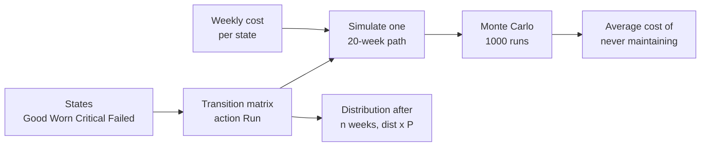
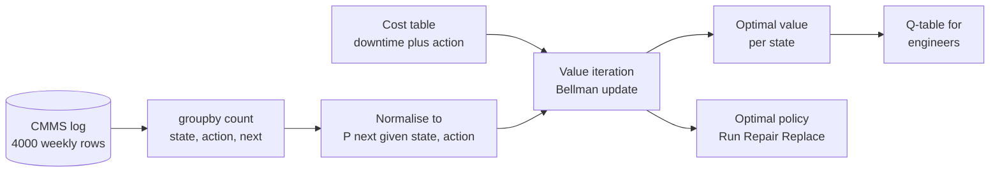
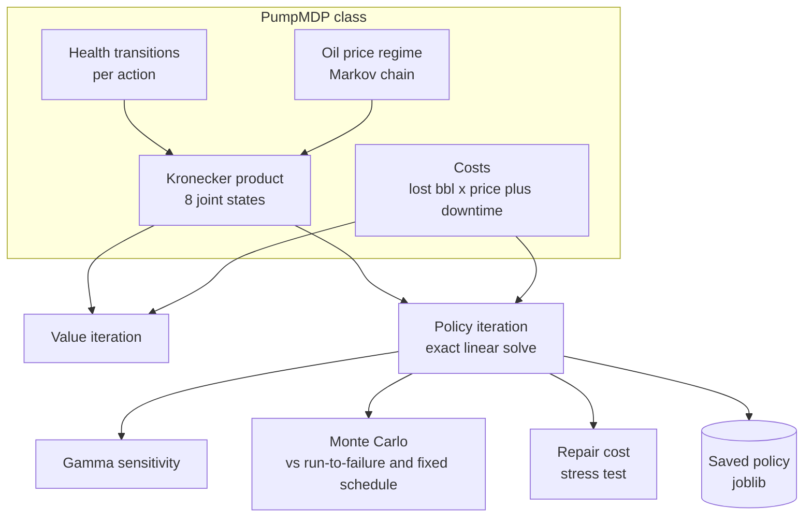
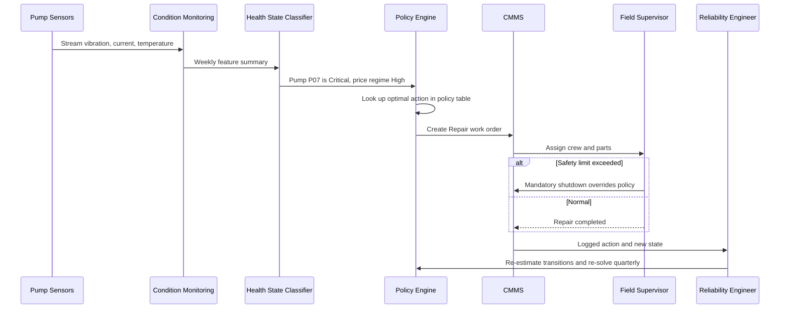

# 18. Markov Decision Process (MDP)

[](https://colab.research.google.com/github/EdwardSuresh/30-ai-algorithms/blob/main/notebooks/18-markov-decision-process.ipynb)  

[← 17. k-Nearest Neighbors (k-NN)](../17-k-nearest-neighbors/README.md) · [All algorithms](../../README.md#-the-30-algorithms-ranked) · [19. DBSCAN →](../19-dbscan/README.md)

> **An MDP models a sequence of decisions where each action changes the state with some probability and incurs a cost, and solving it gives the best action for every state.**

💡 **Analogy:** Think of looking after a car: in each condition (fine, noisy, smoking) you can keep driving, service it or replace it. Each choice has a cost today and changes the odds of what condition the car is in next month. An MDP works out the rule that keeps your total cost lowest over the years.

## The use case (same for Easy, Medium and Hard)
**Oil & Gas — Pump maintenance policy optimisation**

A field operates dozens of pumps that drift from Good to Worn to Critical and eventually fail, stopping production until replaced. Crews either run equipment to failure or service on a fixed calendar, and both waste money - failures cost thousands of barrels while unnecessary repairs cost downtime and parts. Condition-monitoring data and CMMS work orders show how pumps degrade and what each action costs. Success means a simple state-to-action rule that lowers two-year cost and failure weeks versus current practice, while respecting safety limits.

## Industry adoption
| Sector | Score | Where you meet it |
|---|---|---|
| Financial Services | ■■■□□ 3/5 | Collections strategy: which contact action to take for each delinquency stage to maximise recovery. |
| Insurance | ■■■□□ 3/5 | Policyholder retention offers chosen by customer lifecycle stage to maximise lifetime value. |
| Supply Chain | ■■■□□ 3/5 | Inventory replenishment: how much to order in each stock level to balance holding and stock-out cost. |
| Oil & Gas | ■■■□□ 3/5 | Condition-based maintenance of pumps and compressors: run, repair or replace by health state. |

**Why rank #18:** MDPs are the mathematical foundation of reinforcement learning and of many operations-research decisions such as maintenance, inventory replenishment, collections and customer-contact policies. They are used steadily across industries when states, actions and costs can be written down, but small explicit MDPs are less visible than predictive models, which places them mid-table.

## How it works
1. List the states the system can be in (e.g. Good, Worn, Critical, Failed).
2. List the actions available in each state (Run, Repair, Replace).
3. For each state and action, write the probabilities of each next state.
4. Assign an immediate cost or reward to each state and action.
5. Choose a discount factor gamma that says how much future costs matter.
6. Solve the Bellman equation with value iteration or policy iteration to get the value of each state.
7. Read off the policy: in each state pick the action with the lowest expected total cost.

## Key terms
| Term | Meaning |
|---|---|
| State | A snapshot of the situation that matters for the decision, such as pump health. |
| Action | A choice the decision-maker can make in a state. |
| Transition probability | The chance of moving to each next state after taking an action. |
| Discount factor (gamma) | A number between 0 and 1; lower values make the planner care less about the future. |
| Policy | A rule mapping every state to an action. |
| Bellman equation | Value of a state = best action's immediate cost + discounted expected value of the next state. |
| Value iteration | Repeatedly applying the Bellman update until values stop changing. |
| Policy iteration | Alternating exact evaluation of a policy and greedy improvement until the policy is stable. |

## 🟢 Easy — Simulate a pump wearing out week by week
Define pump health states and a transition matrix, simulate the 'never maintain' strategy, and see how fast failure probability grows.

| 5W + H | |
|---|---|
| **Who** | A reliability engineer at an oilfield operator responsible for electric submersible and transfer pumps. |
| **What** | A Markov chain of pump health (Good, Worn, Critical, Failed) and the cost of just running it. |
| **When** | During maintenance budgeting, to show why doing nothing is expensive. |
| **Where** | A short numpy script on the engineer's laptop. |
| **Why** | Before choosing a maintenance policy you must model how equipment degrades and what each state costs. |
| **How** | Write a 4x4 transition matrix, simulate random 20-week paths, propagate the state distribution with matrix multiplication, and average 1,000 runs. |

**Architecture**



**🧠 ML concepts:** States and transitions, Markov property, Transition probability matrix, State distribution propagation, Monte Carlo simulation  
**🐍 Python concepts:** Lists as index-to-name lookups, 2-D numpy arrays and row sums, Dicts for costs, Functions returning tuples, Matrix multiplication with @, Underscore digit separators in numbers

**Steps the code performs**
1. Name the four health states
2. Write the weekly transition matrix for Run
3. Check rows sum to 1
4. Simulate one 20-week path and its cost
5. Propagate the state distribution forward
6. Average the cost over 1,000 simulated pumps

▶️ Code: [`easy.py`](easy.py) — run with `python easy.py`

<details><summary>Walkthrough</summary>

| Lines | What happens |
|---|---|
| 4-6 | Seed the random generator and list the health states; the position in the list is the state's number. |
| 8-17 | Each row gives the chance of moving to each state next week if we just keep running. Failed is absorbing - it stays failed. Rows must sum to 1. |
| 19-20 | Cost per week in each state: lost production, energy waste and, for Failed, a full outage. |
| 22-31 | The simulate function draws the next state from the current state's row - only the current state matters. |
| 33-36 | Run one 20-week story and print it as letters (G W C F) with its total cost. |
| 38-44 | Starting 100% Good, multiply by P each week to get the probability of each state - by week 20 most pumps have failed. |
| 46-50 | Repeat the simulation 1,000 times and average the cost - the price of a run-to-failure strategy. |

</details>

<details><summary>Real output</summary>

```text
Rows sum to 1: True
One 20-week run: G W W W W W W C C F F F F F F F F F F F
Cost of that run: $289,000
Week  1: Good=0.85  Worn=0.15  Critical=0.00  Failed=0.00
Week  5: Good=0.44  Worn=0.35  Critical=0.12  Failed=0.09
Week 10: Good=0.20  Worn=0.27  Critical=0.16  Failed=0.38
Week 20: Good=0.04  Worn=0.08  Critical=0.06  Failed=0.82

Average 20-week cost if we never maintain: $209,972
Next step: add actions (Repair, Replace) and let an MDP choose the cheapest policy.
```

</details>

**Try this next:** Change the Worn -> Critical probability from 0.18 to 0.05 and see the average cost drop. · Extend weeks to 52 and compare the week-52 distribution. · Add a crude 'repair when Critical' rule inside simulate() by resetting s to 0 and adding $6,000.

## 🟡 Medium — Learn transitions from logs, solve with value iteration
Estimate transition probabilities for Run, Repair and Replace from a synthetic maintenance log, then use value iteration to find the cheapest action in each state.

| 5W + H | |
|---|---|
| **Who** | A reliability engineering team with a computerised maintenance management system (CMMS). |
| **What** | An MDP with 4 states and 3 actions whose transition probabilities are learned from 4,000 weekly records. |
| **When** | Quarterly, when the maintenance strategy for a pump fleet is reviewed. |
| **Where** | A Python analysis on exported CMMS work orders and condition-monitoring states. |
| **Why** | Engineers argue about when to intervene; an MDP turns costs and degradation data into a provably optimal rule for each condition. |
| **How** | Simulate 40 pumps for 100 weeks, count (state, action, next state) with groupby, normalise to probabilities, build a cost table, and iterate the Bellman equation until values converge. |

**Architecture**



**🧠 ML concepts:** MDP components: states, actions, transitions, costs, discount, Maximum-likelihood transition estimation, Bellman optimality equation, Value iteration and convergence, Q-values, Handling unseen state-action pairs  
**🐍 Python concepts:** f-string zero padding, List of dicts to DataFrame, groupby with multiple keys and size(), np.divide with where=, Broadcasting with None axes, np.einsum

**Steps the code performs**
1. Simulate a fleet maintenance log
2. Count transitions per state and action
3. Normalise counts to probabilities and fill gaps
4. Build the state x action cost table
5. Run value iteration until convergence
6. Print the optimal action per state and the Q-table

▶️ Code: [`medium.py`](medium.py) — run with `python medium.py`

<details><summary>Walkthrough</summary>

| Lines | What happens |
|---|---|
| 5-8 | Fix the seed and define the 4 health states and 3 actions. |
| 10-14 | The true transition probabilities are used only to generate data; the model must rediscover them from the log. |
| 17-31 | Simulate 40 pumps for 100 weeks with historically mixed crew decisions and store each week as a log row. |
| 33-39 | Count how often each (state, action, next state) happened using pandas groupby. |
| 40-48 | Divide counts by row totals to get probabilities. Pairs never seen in the log (Run while Failed) get a conservative 'stays put' assumption. |
| 52-56 | Weekly cost = production loss by state + cost of the chosen action, combined into a 4x3 table with broadcasting. |
| 58-68 | Repeatedly apply the Bellman update: the value of a state is the cheapest action's immediate cost plus the discounted expected future value. Stop when values stop changing. |
| 69-73 | Print the optimal action and expected discounted cost for each state. |
| 75-79 | Show the full Q-table so engineers can see how much worse the non-optimal actions are. |

</details>

<details><summary>Real output</summary>

```text
Maintenance log: 4000 rows, 40 pumps
pump_id  week state action next_state
    P00     0  Good    Run       Worn
    P00     1  Worn Repair       Good
    P00     2  Good    Run       Good
    P00     3  Good    Run       Worn 

No data for (Failed, Run) -> assume it stays Failed
Estimated P(next | state, Run):
          Good  Worn  Critical  Failed
Good      0.86  0.14      0.00    0.00
Worn      0.00  0.80      0.18    0.02
Critical  0.00  0.00      0.67    0.33
Failed    0.00  0.00      0.00    1.00 

Value iteration converged in 276 sweeps (gamma=0.95)

State     | Best action | Expected discounted cost
Good      | Run         | $    21,964
Worn      | Repair      | $    30,514
Critical  | Repair      | $    42,161
Failed    | Replace     | $    65,866

Q-table ($, lower is better):
            Run  Repair  Replace
Good      21964   27596    40866
Worn      32644   30514    41866
Critical  51411   42161    44866
Failed    87572   69940    65866

Reading: keep running healthy pumps, intervene before failure - the policy shows exactly where paying for maintenance beats risking a $25k/week outage.
```

</details>

**Try this next:** Lower gamma to 0.5 and see whether the policy stops repairing Worn pumps. · Raise the Repair cost to 15,000 and rerun. · Shrink the log to 5 pumps and check how noisy the estimated transition matrix becomes.

## 🔴 Hard — Policy vs value iteration with oil-price regimes and baselines
Solve an 8-state pump MDP (health x oil price) with both policy and value iteration, test discount sensitivity, and prove the policy beats run-to-failure and fixed-schedule maintenance in Monte Carlo.

| 5W + H | |
|---|---|
| **Who** | Asset-integrity and production engineering leads deciding maintenance strategy for a pump fleet. |
| **What** | A richer MDP whose costs depend on both pump health and the current oil price regime, solved and stress-tested. |
| **When** | Annual maintenance strategy review and whenever oil price or repair-cost assumptions change materially. |
| **Where** | A decision-support model whose policy table is published to the CMMS and field supervisors. |
| **Why** | Lost barrels cost more when prices are high, and downtime during repairs matters; leadership needs evidence the policy beats current practice. |
| **How** | Build joint transitions with a Kronecker product, solve with value and policy iteration, sweep gamma, simulate 1,000 pumps x 104 weeks for three strategies, test a repair-cost shock and save the policy. |

**Architecture**



**🧠 ML concepts:** Factored state spaces (health x price), Policy iteration: evaluation by linear solve + greedy improvement, Value iteration vs policy iteration convergence, Discount factor as planning horizon, Monte Carlo policy evaluation against baselines, Sensitivity analysis of the optimal policy  
**🐍 Python concepts:** Classes with __init__ and methods, Nested list comprehension for names, np.kron and np.stack, Fancy indexing P[policy, arange], Lambdas with a shared signature, time.perf_counter for benchmarking

**Steps the code performs**
1. Build the joint health x price MDP in a class
2. Solve with value iteration and time it
3. Solve with policy iteration and confirm same policy
4. Sweep gamma and print policies per regime
5. Simulate three strategies with Monte Carlo
6. Stress-test a doubled repair cost
7. Save the policy and print a safety note

▶️ Code: [`hard.py`](hard.py) — run with `python hard.py`

<details><summary>Walkthrough</summary>

| Lines | What happens |
|---|---|
| 9-15 | Define health states, price regimes and actions; the combined state space is 4 x 2 = 8 states. |
| 18-30 | Health transitions per action, plus an independent oil-price regime chain. np.kron combines them into one 8x8 transition matrix per action. |
| 31-41 | Cost = (barrels lost by health + downtime barrels from the action) x oil price + the maintenance spend. |
| 43-45 | Q(s,a) = immediate cost + gamma x expected value of the next state, computed for all states and actions at once. |
| 48-56 | Value iteration sweeps the Bellman update until values change by less than the tolerance. |
| 59-72 | Policy iteration evaluates the current policy exactly by solving a linear system, then improves it greedily, stopping when it no longer changes - usually in a handful of rounds. |
| 75-88 | Monte Carlo: run many pumps for two years under any decision rule and record cost and failed weeks. |
| 94-107 | Time both solvers, confirm they agree, and print the optimal action per state. |
| 109-118 | A short-sighted planner (gamma 0.5) avoids spending on Worn pumps; longer horizons repair early and replace failures. |
| 120-146 | Compare run-to-failure, an 8-week fixed schedule and the MDP policy, stress-test repair cost, save the policy and print a safety note. |

</details>

<details><summary>Real output</summary>

```text
Value iteration :  569 sweeps    12.5 ms
Policy iteration:    5 rounds     0.3 ms
Same policy? True   max value gap $0.00

State               | Optimal action | Discounted cost
Good/LowPrice       | Run            | $    96,460
Worn/LowPrice       | Repair         | $   113,562
Critical/LowPrice   | Repair         | $   135,827
Failed/LowPrice     | Replace        | $   176,909
Good/HighPrice      | Run            | $   103,517
Worn/HighPrice      | Repair         | $   129,320
Critical/HighPrice  | Repair         | $   163,911
Failed/HighPrice    | Replace        | $   238,864

Gamma | Policy (LowPrice: G W C F | HighPrice: G W C F)
 0.50 | Run Run Fix Fix  |  Run Run Fix Fix
 0.80 | Run Fix Fix New  |  Run Fix Fix New
 0.90 | Run Fix Fix New  |  Run Fix Fix New
 0.97 | Run Fix Fix New  |  Run Fix Fix New
 0.99 | Run Fix Fix New  |  Run Fix Fix New

Monte Carlo, 1000 pumps x 104 weeks:
Strategy               | Avg 2-yr cost | Std dev   | Failed weeks
Run to failure         | $    914,301 | $ 197,110 |  6.49
Fixed schedule (8wk)   | $    817,480 | $ 206,189 |  4.20
MDP optimal policy     | $    314,061 | $  83,126 |  0.00

MDP policy saves $600,240 per pump over 2 years vs run-to-failure (synthetic costs).
If repair cost doubles, policy changes in: ['Critical/LowPrice', 'Critical/HighPrice']
Saved policy -> pump_policy.joblib
Safety note: a cost-optimal policy must never override API/OSHA/PHMSA safety limits - Critical units on sour or high-pressure service need mandatory shutdown rules on top.
```

</details>

**Try this next:** Make oil price regimes more persistent (0.99 / 0.99) and see if the policy differs between regimes. · Add a fourth action 'Inspect' that costs $1,000 and slightly lowers failure odds. · Change the fixed schedule to every 4 weeks and compare its cost with the MDP policy.

## 🔄 End-to-end production flow



## ⚠️ Pitfalls
- Defining states that are not observable in practice - map each state to measurable sensor or inspection criteria.
- Estimating transitions from too little data - pool similar assets, use priors, and flag unseen state-action pairs instead of letting them default to zero.
- Leaving out downtime cost of the maintenance action itself - it changes when repair is worth it.
- Picking gamma arbitrarily - tie it to the planning horizon or cost of capital and run a sensitivity sweep.
- Trusting the solution without simulation - always Monte Carlo test the policy against current practice before rollout.
- Letting a cost-optimal policy override safety rules - layer mandatory safety and regulatory constraints on top.

**When NOT to use it:** Do not use an explicit MDP when the state space is huge or continuous and transitions cannot be estimated (use approximate RL or simulation optimisation), or when decisions are one-off with no sequential effect.

## 🎤 Interview questions
<details><summary>What is the difference between value iteration and policy iteration?</summary>

Value iteration repeatedly applies the Bellman optimality update to values and extracts a policy at the end. Policy iteration alternates exact evaluation of a fixed policy with greedy improvement and usually converges in far fewer, but more expensive, iterations.

</details>
<details><summary>What does the Markov property assume and when does it break?</summary>

It assumes the next state depends only on the current state and action, not on history. It breaks when hidden history matters (for example, time since last overhaul), which you fix by adding that information to the state.

</details>
<details><summary>How does the discount factor change the optimal policy?</summary>

A low gamma makes the planner short-sighted, avoiding spend today even if it causes failures later. A gamma near 1 values future costs, so preventive actions become worth it sooner.

</details>

---
[← 17. k-Nearest Neighbors (k-NN)](../17-k-nearest-neighbors/README.md) · [All algorithms](../../README.md#-the-30-algorithms-ranked) · [19. DBSCAN →](../19-dbscan/README.md)
