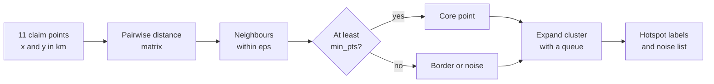
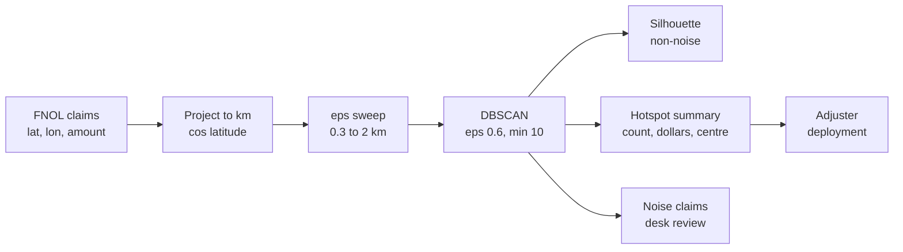
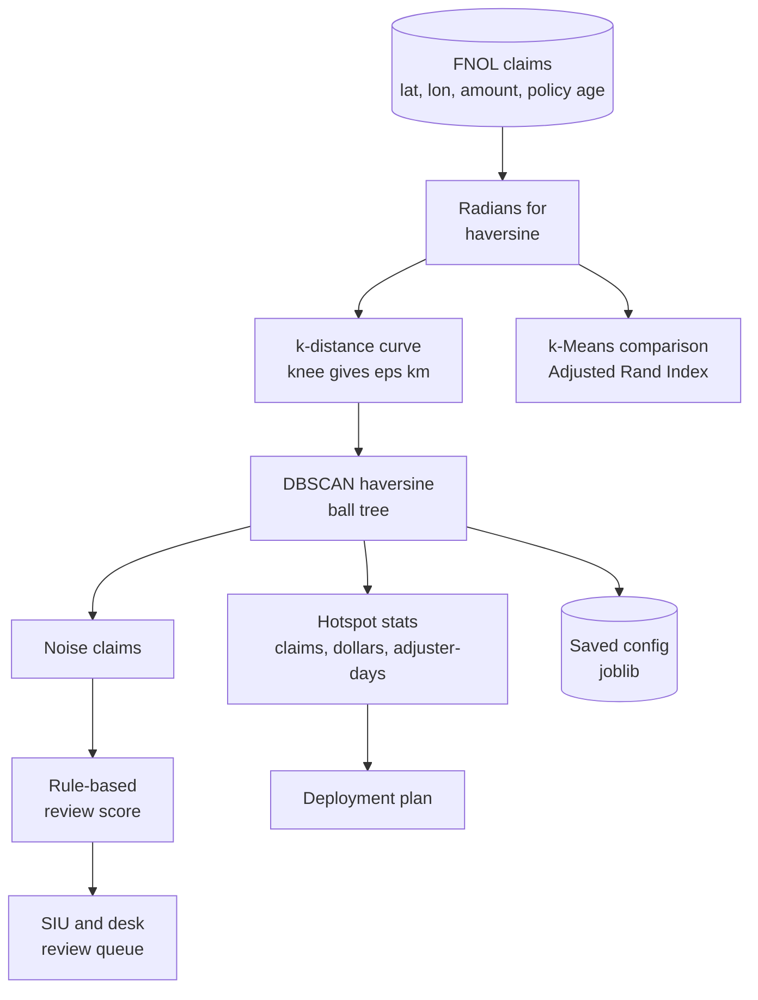
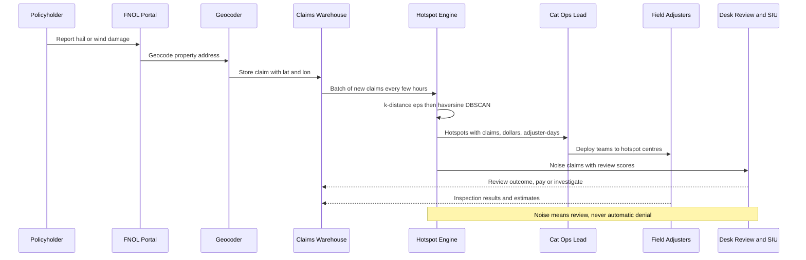

# 19. DBSCAN

[](https://colab.research.google.com/github/EdwardSuresh/architects-ml-playbook/blob/main/notebooks/19-dbscan.ipynb)  

[← 18. Markov Decision Process (MDP)](../18-markov-decision-process/README.md) · [All algorithms](../../README.md#-the-30-algorithms-ranked) · [20. Hierarchical Clustering →](../20-hierarchical-clustering/README.md)

> **DBSCAN groups points that are packed closely together and labels points in sparse areas as noise, without needing to know the number of clusters in advance.**

💡 **Analogy:** Picture a beach from above: groups of people huddled under umbrellas form clusters, while a lone jogger is nobody's neighbour. DBSCAN says: if enough people are within arm's reach of you, you are in a crowd; crowds that touch merge; anyone alone is just a passer-by.

## The use case (same for Easy, Medium and Hard)
**Insurance — Catastrophe claims hotspots after a hailstorm or tornado**

After a severe storm, thousands of first-notice-of-loss reports arrive within days, and the carrier must decide where to send a limited number of field adjusters. Policyholders in the hardest-hit areas suffer if adjusters are spread thinly, while isolated claims far from the storm path may be unrelated damage or occasionally suspicious. Each claim has a geocoded address, claim amount, policy age and reporting date. Success means hotspots that follow the actual storm path, a deployment plan sized by claims and dollars, and a short, prioritised review queue for isolated claims - without treating any claim unfairly.

## Industry adoption
| Sector | Score | Where you meet it |
|---|---|---|
| Financial Services | ■■■□□ 3/5 | Spotting clusters of ATM or card-fraud locations and grouping merchant locations. |
| Insurance | ■■■■□ 4/5 | Catastrophe claim hotspots after hail, tornado or flood to deploy adjusters and flag isolated claims. |
| Supply Chain | ■■■□□ 3/5 | Finding delivery-stop clusters and dwell-time hotspots from GPS pings. |
| Oil & Gas | ■■■□□ 3/5 | Grouping microseismic events around fractures and clustering well locations into pads. |

**Why rank #19:** DBSCAN is the standard choice when clusters have irregular shapes, the number of clusters is unknown, and outliers must be flagged - especially for geospatial data. It is heavily used for location hotspot analysis in insurance, logistics and field operations, but less common for general tabular segmentation where k-Means or Gaussian mixtures dominate.

## How it works
1. Choose eps (neighbourhood radius) and min_samples (points needed to be dense).
2. For each point, count the points within eps of it.
3. Points with at least min_samples neighbours are core points.
4. Connect core points that are within eps of each other into the same cluster.
5. Attach non-core points within eps of a core point as border points.
6. Label everything else as noise (-1).
7. Pick eps using a k-distance plot and check sensitivity.

## Key terms
| Term | Meaning |
|---|---|
| eps | The radius that defines a point's neighbourhood. |
| min_samples | Minimum points (including itself) within eps for a point to be a core point. |
| Core point | A point in a dense region that can grow a cluster. |
| Border point | A point near a core point but not dense enough to be core itself. |
| Noise | A point not reachable from any core point; labelled -1. |
| Haversine distance | Distance along the Earth's surface between two latitude/longitude points. |
| k-distance plot | Sorted distances to each point's k-th neighbour; its bend suggests a good eps. |

## 🟢 Easy — Spot 2 hotspots and 2 loners among 11 claims
Apply DBSCAN's core, border and noise rules by hand to 11 claim locations with eps = 1 km and min_pts = 3.

| 5W + H | |
|---|---|
| **Who** | A catastrophe claims manager learning how hotspots are found automatically. |
| **What** | Group 11 hail claims (x, y in km) into dense hotspots and flag isolated claims. |
| **When** | The morning after a hailstorm, when the first claims arrive. |
| **Where** | A pure numpy script with the points typed in. |
| **Why** | Adjuster teams should go where claims are dense; isolated claims need a different, desk-review path. |
| **How** | Compute all pairwise distances, count neighbours within eps, mark core points, expand clusters from cores with a queue, and label the rest as noise. |

**Architecture**



**🧠 ML concepts:** Density-based clustering, eps neighbourhood, min_samples / min_pts, Core, border and noise points, No need to choose the number of clusters  
**🐍 Python concepts:** Dict of tuples, numpy broadcasting for pairwise distances, Dict comprehension with nested list comprehension, List used as a queue with pop and extend, continue in loops, set() of labels

**Steps the code performs**
1. Type 11 claim coordinates
2. Compute the pairwise distance matrix
3. List neighbours within eps for each claim
4. Mark core points
5. Grow clusters from each unvisited core
6. Label unreached points as noise and print hotspots

▶️ Code: [`easy.py`](easy.py) — run with `python easy.py`

<details><summary>Walkthrough</summary>

| Lines | What happens |
|---|---|
| 4-13 | Eleven claims positioned in km east/north of the city centre: two neighbourhoods, one edge claim and two loners. eps = 1 km and min_pts = 3. |
| 15-17 | Keep a fixed list of ids and an 11 x 2 coordinate matrix. |
| 19-26 | Broadcasting computes all 121 pairwise distances in one line; each claim's neighbour list includes itself. Claims with 3 or more neighbours are core. |
| 28-43 | Start at each unlabelled core claim, give it a new cluster id and keep expanding through neighbours. Only core points spread the cluster further. |
| 45-47 | Any claim never reached is noise, marked -1. |
| 48-52 | Print hotspots to send adjuster teams to, and noise claims for individual review. C11 is a border point: not core itself, but reached from core C2. |

</details>

<details><summary>Real output</summary>

```text
C1   neighbours=['C1', 'C2', 'C3', 'C4']  -> CORE
C2   neighbours=['C1', 'C2', 'C3', 'C4', 'C11']  -> CORE
C3   neighbours=['C1', 'C2', 'C3', 'C4']  -> CORE
C4   neighbours=['C1', 'C2', 'C3', 'C4']  -> CORE
C5   neighbours=['C5', 'C6', 'C7', 'C8']  -> CORE
C6   neighbours=['C5', 'C6', 'C7', 'C8']  -> CORE
C7   neighbours=['C5', 'C6', 'C7']  -> CORE
C8   neighbours=['C5', 'C6', 'C8']  -> CORE
C9   neighbours=['C9']  -> not core (border if a core point reaches it)
C10  neighbours=['C10']  -> not core (border if a core point reaches it)
C11  neighbours=['C2', 'C11']  -> not core (border if a core point reaches it)

Final labels: {'C1': 1, 'C2': 1, 'C3': 1, 'C4': 1, 'C5': 2, 'C6': 2, 'C7': 2, 'C8': 2, 'C9': -1, 'C10': -1, 'C11': 1}
  NOISE - review individually: ['C9', 'C10']
  Hotspot 1 - send an adjuster team: ['C1', 'C2', 'C3', 'C4', 'C11']
  Hotspot 2 - send an adjuster team: ['C5', 'C6', 'C7', 'C8']
```

</details>

**Try this next:** Set EPS = 0.5 and see the hotspots break up. · Set MIN_PTS = 5 and see which hotspot survives. · Move C9 to (2.0, 2.0) - does it join hotspot 1 as a border point?

## 🟡 Medium — sklearn DBSCAN on 1,010 hailstorm claims
Cluster synthetic claim latitude/longitude with scikit-learn's DBSCAN after converting to km, compare eps values, and summarise hotspots by count and dollars.

| 5W + H | |
|---|---|
| **Who** | A property insurer's catastrophe response team. |
| **What** | Find hail-swath hotspots among about 1,000 claims and size each by total dollars. |
| **When** | In the first 48 hours after a hailstorm, as first notice of loss reports pour in. |
| **Where** | A Python job on the claims data warehouse, output shared with the field operations lead. |
| **Why** | Hail falls in long thin swaths, not round blobs; DBSCAN follows any shape and does not need to know how many swaths there are. |
| **How** | Generate three swaths plus scattered claims, project lat/lon to km, test eps values, fit DBSCAN with eps 0.6 km, compute silhouette, summarise by groupby and compare with the known swaths. |

**Architecture**



**🧠 ML concepts:** DBSCAN in scikit-learn, Choosing eps in physical units, Effect of eps on clusters and noise, Silhouette score excluding noise, Comparing clusters with known groups  
**🐍 Python concepts:** List of dicts as configuration, Tuple unpacking of nested tuples, np.column_stack, Set difference to drop the noise label, groupby with named aggregation, pd.crosstab

**Steps the code performs**
1. Simulate three hail swaths and scattered claims
2. Attach claim amounts
3. Project latitude and longitude to km
4. Sweep eps and count clusters and noise
5. Fit final DBSCAN and compute silhouette
6. Summarise hotspots and check against true swaths
7. Report noise claims for review

▶️ Code: [`medium.py`](medium.py) — run with `python medium.py`

<details><summary>Walkthrough</summary>

| Lines | What happens |
|---|---|
| 7-13 | Each swath is described by a start point, end point and number of claims - like a real storm track. |
| 15-22 | Place claims at random positions along each swath with a little sideways spread. |
| 23-30 | Add 60 scattered claims across the region, stack all claims and attach log-normal claim amounts. |
| 32-34 | One degree of latitude is about 111 km; a degree of longitude shrinks by cos(latitude). Converting means eps is in real km. |
| 36-42 | Try four eps values. Too small shatters swaths into many fragments and flags half the claims as noise; larger values stabilise at 3 hotspots. |
| 44-49 | Fit the final model and compute silhouette on non-noise points to check that hotspots are well separated. |
| 51-58 | Summarise each hotspot: claim count, total dollars and centre point, sorted by exposure. |
| 60-62 | Compare found clusters with the true swaths; almost every scattered claim lands in noise. |
| 64-68 | Turn the result into actions: adjuster teams to each hotspot, desk review for isolated claims. |

</details>

<details><summary>Real output</summary>

```text
1010 claims loaded. Sample:
         lat        lon    true_area  claim_amount
0  36.216225 -97.090066  North swath       29182.0
1  36.243930 -97.009457  North swath       10958.0
2  36.232710 -97.039816  North swath       18137.0

 eps_km | clusters | noise claims
   0.3 |    22    |    454
   0.6 |     3    |     60
   1.0 |     3    |     52
   2.0 |     3    |     49

Chosen eps=0.6 km. Silhouette (non-noise) = 0.693

Hotspots ranked by exposure:
         claims   total_usd  centre_lat  centre_lon
cluster                                            
0           450  $5,403,643     36.2197    -97.0752
1           300  $3,907,474     36.1154    -96.9501
2           200  $2,527,998     36.1150    -97.0650

True area vs DBSCAN label:
cluster      -1    0    1    2
true_area                     
East swath    3    0  297    0
North swath   2  448    0    0
Scattered    54    2    3    1
Town core     1    0    0  199

950 claims sit in 3 hotspots -> deploy adjuster teams to each centre.
60 isolated claims ($820,000) -> desk review; a hail claim far from any swath deserves a closer look.
```

</details>

**Try this next:** Change min_samples from 10 to 30 and watch the smallest swath behave. · Skip the km conversion and cluster raw degrees with eps=0.006 - is the result the same? · Add a fourth swath with only 15 claims and see whether it is found or treated as noise.

## 🔴 Hard — Haversine DBSCAN hotspot engine with k-distance eps and noise triage
Cluster claims on true great-circle distance, pick eps from the k-distance knee, compare with k-Means, prioritise noise claims for review and produce an adjuster deployment plan.

| 5W + H | |
|---|---|
| **Who** | A carrier's catastrophe operations centre and special investigations unit (SIU). |
| **What** | A repeatable hotspot engine after a tornado plus hail event: haversine DBSCAN, data-driven eps, cluster dollar stats, k-Means comparison and a scored review queue. |
| **When** | Re-run every few hours during the first weeks after a catastrophe as claims arrive. |
| **Where** | A scheduled job on the claims platform feeding a field-deployment dashboard and SIU queue. |
| **Why** | Tornado tracks are long and narrow while hail cores are wide; the right method must follow shape, ignore isolated claims and scale to any region without retuning by hand. |
| **How** | Simulate the event, find eps from the k-distance curve knee, run DBSCAN with the haversine metric and ball tree, test eps sensitivity, compare ARI with k-Means, score noise claims with simple rules, plan adjuster-days and save the config. |

**Architecture**



**🧠 ML concepts:** Haversine (great-circle) distance on radians, k-distance plot and knee detection for eps, Ball-tree indexing for neighbour search, Sensitivity analysis of eps, Adjusted Rand Index vs ground truth, DBSCAN vs k-Means on non-spherical clusters  
**🐍 Python concepts:** Functions returning multiple values, Tuples of specs unpacked in a for loop, Named aggregation in groupby, Boolean Series arithmetic, Category codes for labels, tempfile and joblib

**Steps the code performs**
1. Simulate tornado track, hail cores and scattered claims
2. Compute the k-distance curve and its knee
3. Run haversine DBSCAN with that eps
4. Report hotspot stats and adjuster-days
5. Test eps at half and double
6. Compare with k-Means using ARI
7. Score and rank noise claims
8. Save configuration and print compliance note

▶️ Code: [`hard.py`](hard.py) — run with `python hard.py`

<details><summary>Walkthrough</summary>

| Lines | What happens |
|---|---|
| 13-15 | Constants: random generator, Earth radius in km and how many claims one adjuster can inspect per day. |
| 18-40 | Simulate one storm: a narrow tornado track with large claims, two hail cores, and 50 scattered claims, some on very new policies. |
| 43-54 | For each claim find the distance to its 12th neighbour using haversine, sort, and pick the knee - where the curve bends upward. That distance becomes eps. |
| 57-64 | Summarise each hotspot with claim count, total and average dollars, centre and adjuster-days needed. |
| 67-80 | Convert lat/lon to radians, print the k-distance percentiles as ASCII bars and show the suggested eps. |
| 82-89 | Run DBSCAN with metric='haversine' (eps converted from km to radians) and print the hotspot report. |
| 91-96 | Halving eps fragments the hotspots; doubling it barely changes them - evidence the knee choice is stable. |
| 98-110 | k-Means with the same number of clusters scores much lower ARI and forces every scattered claim into a hotspot. |
| 112-123 | Score each noise claim on brand-new policy, large amount and late reporting, and list the top ones for review. |
| 125-134 | Total adjuster-days and the share of dollars in the largest hotspot, then save the config and print the fair-claims compliance note. |

</details>

<details><summary>Real output</summary>

```text
1050 claims after the event, total incurred $24,465,471

k-distance curve (k=12) percentiles, km:
  p10  0.25 ##
  p50  0.43 ####
  p80  0.67 ######
  p90  0.81 ########
  p95  1.29 ############
  p99 15.10 ########################################
Knee suggests eps = 1.12 km

DBSCAN found 3 hotspots, 47 noise claims
        claims   total_usd  avg_usd     lat     lon  adjuster_days
dbscan                                                            
0          352  15968588.0  45365.0  36.114 -97.103             59
1          402   4550331.0  11319.0  36.260 -97.079             67
2          249   2981348.0  11973.0  36.109 -96.835             42

 eps_km | hotspots | noise
   0.56 |    13    |  148
   1.12 |     3    |   47
   2.23 |     3    |   43

Agreement with true storm zones (Adjusted Rand Index, 1 = perfect):
  DBSCAN  0.992
  k-Means 0.665
  k-Means forced all 50 scattered claims into a hotspot; DBSCAN flagged 46 of them as noise

Top noise claims for SIU/desk review (of 47):
claim_id    lat     lon  claim_usd  policy_age_days  days_after_event  review_score
CLM01015 36.170 -97.048    91238.0               10                18             3
CLM01006 36.187 -97.065    29392.0               45                23             3
CLM01030 36.229 -97.024    27463.0               10                22             3
CLM01021 36.318 -97.377    22932.0               25                27             3
CLM01016 36.209 -96.801    15511.0               45                23             3
CLM01002 35.987 -97.130    10049.0               45                22             3

Deploy plan: 168 adjuster-days across 3 hotspots; largest hotspot holds 65% of incurred $
Saved hotspot config -> cat_hotspots.joblib
Compliance: noise flags trigger review, not denial - state unfair claims settlement rules (NAIC model act) require prompt, fair handling of every claim.
```

</details>

**Try this next:** Change MIN_SAMPLES to 6 and 25 and see how the knee eps and the hotspots change. · Replace DBSCAN with sklearn's HDBSCAN (metric='haversine') and compare noise counts. · Add a 'roof_age_years' column and include it in the review score.

## 🔄 End-to-end production flow



## ⚠️ Pitfalls
- Clustering raw latitude/longitude with Euclidean distance - degrees of longitude shrink with latitude. Use haversine on radians or project to km.
- Passing eps in km to the haversine metric - it expects radians, so divide by Earth's radius (6371 km).
- Choosing eps by guesswork - use a k-distance plot and test sensitivity at half and double.
- One eps for regions of very different density (city vs rural) - consider HDBSCAN or cluster per region.
- Treating noise as fraud - noise is a review queue; decisions must follow fair claims handling rules.
- Forgetting to rerun as claims keep arriving - hotspots evolve in the first days; schedule refreshes.

**When NOT to use it:** Avoid DBSCAN when clusters have very different densities, in high-dimensional feature spaces where distance loses meaning, or when every point must be assigned to a group.

## 🎤 Interview questions
<details><summary>How does DBSCAN differ from k-Means?</summary>

DBSCAN finds clusters by density, so it handles arbitrary shapes, does not need the number of clusters, and labels outliers as noise. k-Means needs k, assumes roughly round clusters, and forces every point into a cluster.

</details>
<details><summary>How would you choose eps?</summary>

Plot each point's distance to its k-th nearest neighbour (k = min_samples) in sorted order and choose the distance at the knee where the curve bends sharply. Then check that results are stable for nearby values.

</details>
<details><summary>Why use the haversine metric for claim locations?</summary>

Latitude and longitude are angles on a sphere, so Euclidean distance on degrees distorts east-west distances. Haversine gives true surface distance, so eps has a consistent meaning in km.

</details>

---
[← 18. Markov Decision Process (MDP)](../18-markov-decision-process/README.md) · [All algorithms](../../README.md#-the-30-algorithms-ranked) · [20. Hierarchical Clustering →](../20-hierarchical-clustering/README.md)
