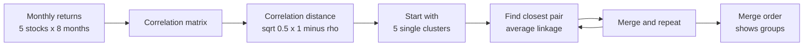
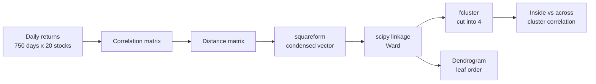
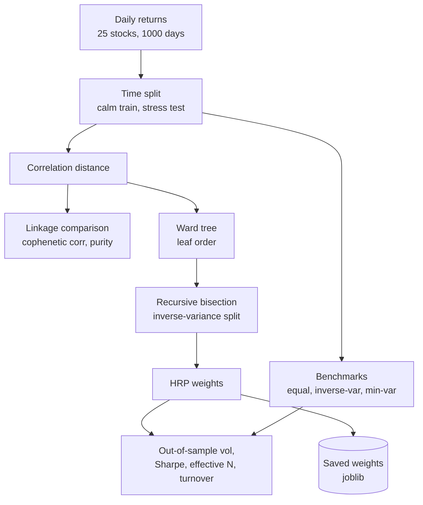
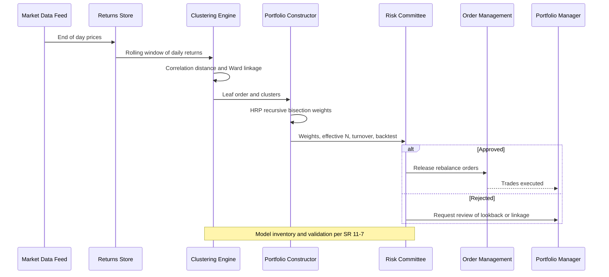

# 20. Hierarchical Clustering

[](https://colab.research.google.com/github/EdwardSuresh/architects-ml-playbook/blob/main/notebooks/20-hierarchical-clustering.ipynb)  

[← 19. DBSCAN](../19-dbscan/README.md) · [All algorithms](../../README.md#-the-30-algorithms-ranked) · [21. Q-Learning →](../21-q-learning/README.md)

> **Hierarchical clustering builds a tree of nested groups by repeatedly merging the most similar items, so you can cut it at any level to get as many clusters as you need.**

💡 **Analogy:** It is like building a family tree for a football league: first pair up players who play almost identically, then merge those pairs into positions, then positions into defence and attack. You can stop at any level - 2 groups, 5 groups or 11 - by deciding where to cut the tree.

## The use case (same for Concept, Build and Production)
**Financial Services — Portfolio diversification with correlation clustering and HRP**

A portfolio that holds 25 stocks may still be concentrated if many of them move together, and that concentration shows up painfully in a market sell-off. Traditional mean-variance optimisation produces extreme, unstable weights because it inverts a noisy covariance matrix. Daily return history is available for every holding. Success means clusters that reveal what really moves together, a robust allocation that spreads risk across clusters, and lower out-of-sample volatility with low turnover than naive alternatives.

## Industry adoption
| Sector | Score | Where you meet it |
|---|---|---|
| Financial Services | ■■■■□ 4/5 | Grouping stocks by return correlation and allocating with Hierarchical Risk Parity. |
| Insurance | ■■□□□ 2/5 | Grouping lines of business or regions with similar loss development patterns. |
| Supply Chain | ■■□□□ 2/5 | Building product families from similar demand profiles for planning. |
| Oil & Gas | ■■□□□ 2/5 | Grouping wells with similar production decline curves or rock samples by properties. |

**Why rank #20:** Hierarchical clustering is widely used in finance for correlation-based asset grouping, risk-factor analysis and Hierarchical Risk Parity allocation, and the dendrogram is easy to explain to committees. Outside finance it appears in exploratory analysis and small segmentation tasks but scales poorly beyond tens of thousands of points, which limits wider production use.

## How it works
1. Compute a distance between every pair of items (e.g. correlation distance between stocks).
2. Start with every item as its own cluster.
3. Merge the two closest clusters according to a linkage rule (single, complete, average or Ward).
4. Record the merge height and repeat until one cluster remains.
5. Visualise the merges as a dendrogram; leaf order places similar items side by side.
6. Cut the tree at a height or a desired number of clusters to get groups.

## Key terms
| Term | Meaning |
|---|---|
| Agglomerative | Bottom-up: start with single items and merge. |
| Linkage | The rule for distance between clusters: nearest pair (single), farthest (complete), mean (average) or variance increase (Ward). |
| Dendrogram | The tree diagram showing which clusters merged at what height. |
| Cophenetic correlation | How well tree heights preserve the original pairwise distances (closer to 1 is better). |
| Correlation distance | sqrt(0.5 x (1 - correlation)); 0 when assets move identically. |
| Hierarchical Risk Parity (HRP) | An allocation method that uses the cluster tree to split risk evenly instead of inverting the covariance matrix. |

## 🟢 Concept — Merge 5 stocks step by step by correlation
Compute correlation distances between 5 stocks and perform agglomerative average-linkage merges by hand to see which assets belong together.

| 5W + H | |
|---|---|
| **Who** | A portfolio analyst at a wealth manager learning how diversification can be measured. |
| **What** | Group two banks, two tech stocks and a utility by how similarly their monthly returns move. |
| **When** | When reviewing a client portfolio that looks diversified by name count but may not be. |
| **Where** | A short numpy script with 8 months of returns typed in. |
| **Why** | Holding many stocks that move together gives little diversification; clustering reveals hidden concentration. |
| **How** | Build the correlation matrix, convert to distance sqrt(0.5 x (1 - corr)), start with each stock alone and repeatedly merge the two clusters with the smallest average distance. |

**Architecture**



**🧠 ML concepts:** Agglomerative (bottom-up) clustering, Correlation as similarity, Correlation distance, Average linkage, Merge heights as dissimilarity  
**🐍 Python concepts:** Dict of lists, np.corrcoef, zip to pair names and rows, Tuples as cluster members, min() over a generator of tuples, enumerate with a filter

**Steps the code performs**
1. Type monthly returns for 5 stocks
2. Compute correlation and distance matrices
3. Print the correlation matrix
4. Represent each stock as its own cluster
5. Find and merge the closest pair repeatedly
6. Read off which stock diversifies best

▶️ Code: [`easy.py`](easy.py) — run with `python easy.py`

<details><summary>Walkthrough</summary>

| Lines | What happens |
|---|---|
| 4-14 | Five synthetic stocks with 8 monthly returns each, turned into a 5 x 8 matrix (one row per stock). |
| 16-18 | np.corrcoef gives correlations between rows. Converting to distance means 0 for identical movement and 1 for opposite movement. |
| 19-22 | Print the correlation matrix: banks correlate 0.99 with each other, tech too, the utility is negative with both. |
| 24-26 | Each stock begins as its own one-member cluster stored as a tuple. |
| 28-31 | Average linkage: the distance between two clusters is the mean distance over all member pairs. |
| 33-42 | Loop: find the closest pair of clusters, merge them, print the merge and repeat until one cluster remains. |
| 44-45 | The last to join is the least correlated - the best diversifier for this portfolio. |

</details>

<details><summary>Real output</summary>

```text
Correlation matrix:
  BANK1   1.00   0.99  -0.29  -0.40  -0.36
  BANK2   0.99   1.00  -0.20  -0.31  -0.42
  TECH1  -0.29  -0.20   1.00   0.99  -0.43
  TECH2  -0.40  -0.31   0.99   1.00  -0.34
  UTIL1  -0.36  -0.42  -0.43  -0.34   1.00
Step 1: merge ('TECH1',) + ('TECH2',) at distance 0.067
Step 2: merge ('BANK1',) + ('BANK2',) at distance 0.077
Step 3: merge ('TECH1', 'TECH2') + ('BANK1', 'BANK2') at distance 0.806
Step 4: merge ('UTIL1',) + ('TECH1', 'TECH2', 'BANK1', 'BANK2') at distance 0.832

Reading: the two tech names merge first, then the banks; the utility joins last -> best diversifier.
```

</details>

**Try this next:** Change cluster_dist to use min (single linkage) or max (complete linkage) and compare merge heights. · Add a gold miner stock that moves opposite to tech and see where it merges. · Make BANK2 noisier and see whether the banks still merge first.

## 🟡 Build — scipy linkage on 20 stocks, cut into sector clusters
Cluster 20 stocks from 3 years of synthetic daily returns with scipy's Ward linkage, cut the tree into 4 groups and print a text dendrogram order.

| 5W + H | |
|---|---|
| **Who** | An investment risk team at an asset manager. |
| **What** | Discover sector-like groups among 20 stocks purely from how their returns co-move. |
| **When** | At each quarterly rebalance, or when adding new holdings. |
| **Where** | A Python analysis using scipy on daily return data from the market data platform. |
| **Why** | Official sector labels can mislead; return-based clusters show what actually moves together and so where risk is concentrated. |
| **How** | Simulate market, sector and stock-specific returns, compute correlation distance, run Ward linkage, cut with fcluster, read the dendrogram leaf order and compare clusters with true sectors. |

**Architecture**



**🧠 ML concepts:** Linkage matrix Z, Ward linkage, Cutting a dendrogram into k clusters, Dendrogram leaf ordering, Within vs between cluster similarity  
**🐍 Python concepts:** Dict of sector to tickers, DataFrame column reordering by permutation, squareform conversion, groupby on a Series, Dict comprehension to invert a mapping, Boolean masks with broadcasting

**Steps the code performs**
1. Simulate market, sector and idiosyncratic returns
2. Shuffle the stock order
3. Compute correlation distance
4. Run Ward linkage and print the last merges
5. Cut into 4 clusters
6. Print leaf order and compare with true sectors
7. Compare correlation inside vs across clusters

▶️ Code: [`medium.py`](medium.py) — run with `python medium.py`

<details><summary>Walkthrough</summary>

| Lines | What happens |
|---|---|
| 7-17 | Set up 20 synthetic tickers in 4 sectors, each sector with its own volatility. |
| 19-27 | Each stock's daily return = part of the market + its sector factor + its own noise, so stocks in a sector are correlated. |
| 28-31 | Shuffle columns so the algorithm cannot rely on the original order, then preview the data. |
| 33-37 | Convert correlation to a distance matrix and to scipy's condensed format. |
| 39-44 | Run Ward linkage and print the final 5 merges; the big jump in height (0.5 to 1.2) shows where natural groups end. |
| 46-52 | fcluster with maxclust=4 cuts the tree into 4 groups and we list the members. |
| 54-57 | dendrogram(no_plot=True) gives the leaf order without drawing - similar stocks sit next to each other. |
| 59-63 | Cross-tabulate clusters against true sectors - a perfect match here. |
| 65-70 | Average correlation is high inside clusters and near zero across them, so diversify across clusters, not just tickers. |

</details>

<details><summary>Real output</summary>

```text
Daily returns: 750 days x 20 stocks
     BNK2    BNK5    BNK1    TEC4    UTL1    ENG4
0 -0.0095 -0.0162 -0.0023 -0.0162  0.0178 -0.0176
1 -0.0046 -0.0275 -0.0211 -0.0175  0.0003  0.0196
2 -0.0200 -0.0211 -0.0150 -0.0192 -0.0035 -0.0255 

Last 5 merges (cluster_a, cluster_b, height, size):
    4 +  32  at height 0.496  -> 3 stocks
   33 +  34  at height 0.507  -> 5 stocks
   31 +  35  at height 1.203  -> 10 stocks
   27 +  36  at height 1.330  -> 15 stocks
   25 +  37  at height 1.398  -> 20 stocks

Clusters found (cut at 4):
  Cluster 1: ['ENG1', 'ENG2', 'ENG3', 'ENG4', 'ENG5']
  Cluster 2: ['TEC1', 'TEC2', 'TEC3', 'TEC4', 'TEC5']
  Cluster 3: ['BNK1', 'BNK2', 'BNK3', 'BNK4', 'BNK5']
  Cluster 4: ['UTL1', 'UTL2', 'UTL3', 'UTL4', 'UTL5']

Dendrogram leaf order: ENG5 ENG2 ENG1 ENG4 ENG3 TEC2 TEC3 TEC5 TEC4 TEC1 BNK5 BNK2 BNK1 BNK3 BNK4 UTL4 UTL3 UTL1 UTL5 UTL2

Cluster vs true sector:
true_sector  Banks  Energy  Tech  Utilities
cluster                                    
1                0       5     0          0
2                0       0     5          0
3                5       0     0          0
4                0       0     0          5

Avg correlation inside clusters : 0.72
Avg correlation across clusters : 0.09
Holding 5 stocks from ONE cluster is close to holding one stock - spread picks across clusters.
```

</details>

**Try this next:** Switch method to 'single' or 'complete' and compare the last merge heights. · Halve the sector volatilities and see if clusters still match sectors. · Cut with criterion='distance' and t=0.8 instead of maxclust.

## 🔴 Production — Hierarchical Risk Parity vs equal weight, out of sample
Compare linkage methods by cophenetic correlation, build HRP-style weights from the cluster tree, and test volatility, concentration and turnover against equal-weight, inverse-variance and min-variance portfolios out of sample.

| 5W + H | |
|---|---|
| **Who** | A quantitative portfolio construction team at an asset manager or bank treasury. |
| **What** | A 25-stock allocation using Hierarchical Risk Parity, validated on a later, more volatile period. |
| **When** | At monthly or quarterly rebalances, with weights reviewed by the investment risk committee. |
| **Where** | A portfolio construction library whose weights feed the order management system. |
| **Why** | Classic minimum-variance optimisation inverts a noisy covariance matrix, giving extreme, unstable weights; HRP uses the cluster tree to spread risk more robustly. |
| **How** | Simulate returns with a stress regime, split train/test in time, compare single/average/complete/ward linkage, compute HRP weights by recursive bisection, evaluate test volatility, Sharpe, effective N and turnover, then save weights. |

**Architecture**



**🧠 ML concepts:** Correlation distance as a metric, Cophenetic correlation to compare linkages, Quasi-diagonalisation via leaf order, Recursive bisection risk allocation (HRP), Out-of-sample evaluation across regimes, Weight stability, turnover and effective number of bets  
**🐍 Python concepts:** Helper functions with docstrings, np.r_ to join arrays, np.ix_ for sub-matrix selection, List comprehensions as a work queue, groupby with a function of the index, Dict of portfolios looped with items()

**Steps the code performs**
1. Simulate 25 stocks with a later stress regime
2. Split into calm train and stressed test halves
3. Compare four linkage methods
4. Print the Ward leaf order
5. Build equal, inverse-variance, HRP and min-variance portfolios
6. Evaluate train and test volatility and Sharpe
7. Show HRP weight by sector and turnover
8. Save weights with a model-risk note

▶️ Code: [`hard.py`](hard.py) — run with `python hard.py`

<details><summary>Walkthrough</summary>

| Lines | What happens |
|---|---|
| 10-12 | Five sectors with different volatilities, five stocks each, 1,000 trading days. |
| 15-29 | Market + sector + idiosyncratic returns, with volatility multiplied by 1.6 in the second half to mimic a stress period. |
| 32-40 | Helpers: correlation distance, and inverse-variance weights (less volatile assets get more weight). |
| 43-47 | The variance of a cluster when its members are inverse-variance weighted - used to split money between halves. |
| 50-70 | HRP: cluster, order assets by the tree's leaves, then repeatedly split the list in half and give more weight to the lower-variance half. |
| 73-75 | Annualised volatility and Sharpe ratio of a weighted portfolio. |
| 83-94 | Cophenetic correlation shows how faithfully each tree preserves original distances; purity checks sector recovery. |
| 101-114 | Fit all portfolios on the calm training half, including an unconstrained minimum-variance optimiser. |
| 116-122 | Compare train vs test volatility, Sharpe and weight extremes. Min-variance looks best in-sample but loses its edge out of sample and goes short. |
| 124-152 | Show HRP weight by sector, rebalance turnover, effective N, then save weights and print an SR 11-7 note. |

</details>

<details><summary>Real output</summary>

```text
25 stocks, train 500 days, test 500 days (higher-vol regime)

Linkage  | cophenetic corr | sector purity at 5 clusters
single   |      0.986      |   1.00
average  |      0.990      |   1.00
complete |      0.986      |   1.00
ward     |      0.916      |   1.00

Ward leaf order: ENE1 ENE5 ENE3 ENE4 ENE2 TEC1 TEC2 TEC3 TEC4 TEC5 BAN2 BAN5 BAN3 BAN1 BAN4 HEA4 HEA3 HEA2 HEA5 HEA1 UTI1 UTI4 UTI5 UTI2 UTI3

Portfolio                    | train vol | test vol | test Sharpe | max weight | min weight
Equal weight                 |  14.43%  | 22.49%  |    0.19     |   4.00%   |   4.00%
Inverse variance             |  13.13%  | 20.79%  |   -0.01     |   8.60%   |   1.83%
HRP (single)                 |  13.32%  | 20.97%  |    0.04     |   7.21%   |   1.21%
HRP (ward)                   |  13.32%  | 20.97%  |    0.04     |   7.21%   |   1.21%
Min-variance (unconstrained) |  12.42%  | 21.07%  |    0.20     |  15.98%   |  -7.77%

HRP (ward) weight by sector:
  UTI  31.88% ###############################
  HEA  24.71% ########################
  BAN  19.82% ###################
  TEC  14.57% ##############
  ENE   9.02% #########
Rebalance turnover HRP (ward)                  :  14.7%
Rebalance turnover Min-variance (unconstrained): 112.0%
HRP single vs ward identical? True (clean sector blocks give the same leaf order)
Effective N (Equal weight):  25.0
Effective N (HRP (ward)):  20.8
Effective N (Min-variance (unconstrained)):   7.9

Saved HRP weights -> hrp_weights.joblib
Model-risk note (SR 11-7): document distance, linkage and lookback choices; backtest across regimes; check weight stability before every rebalance.
```

</details>

**Try this next:** Use 'average' linkage inside hrp_weights and compare test volatility. · Shorten the training window to 120 days and watch min-variance turnover explode. · Add a sixth sector with very high volatility and see how HRP down-weights it.

## 🔄 End-to-end production flow



## ⚠️ Pitfalls
- Using raw correlation as a distance - convert with sqrt(0.5 x (1 - rho)) so it behaves like a proper metric.
- Picking a linkage by habit - compare cophenetic correlation and stability; single linkage can chain unrelated assets together.
- Applying Ward to non-Euclidean distances - Ward assumes Euclidean geometry; correlation distance qualifies, but arbitrary dissimilarities may not.
- Estimating on one calm period only - test out of sample and across stress regimes.
- Ignoring weight stability - track turnover between rebalances because unstable weights incur trading cost.
- Running on very large datasets - standard implementations need the full distance matrix (memory grows with n squared); sample or use other methods.

**When NOT to use it:** Avoid hierarchical clustering on very large datasets (memory and time grow quickly) or when you need to assign new points to clusters routinely; k-Means or a classifier is simpler for that.

## 🎤 Interview questions
<details><summary>How do single, complete, average and Ward linkage differ?</summary>

Single uses the closest pair and tends to chain; complete uses the farthest pair and gives compact clusters; average uses the mean pairwise distance; Ward merges the pair that least increases within-cluster variance and gives balanced clusters.

</details>
<details><summary>What is cophenetic correlation used for?</summary>

It measures how well the dendrogram's merge heights preserve the original pairwise distances. It helps compare linkage methods - higher means the tree is a more faithful summary.

</details>
<details><summary>Why can HRP be more robust than mean-variance optimisation?</summary>

Mean-variance inverts the covariance matrix, which amplifies estimation noise into extreme weights. HRP only uses the cluster ordering and variances of sub-clusters, so weights are more stable and stay long-only.

</details>

---
[← 19. DBSCAN](../19-dbscan/README.md) · [All algorithms](../../README.md#-the-30-algorithms-ranked) · [21. Q-Learning →](../21-q-learning/README.md)
