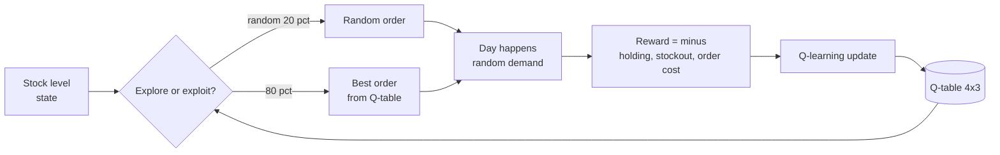
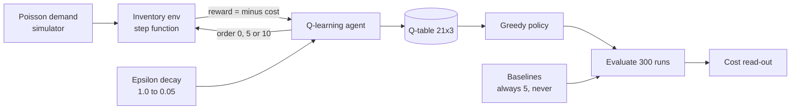
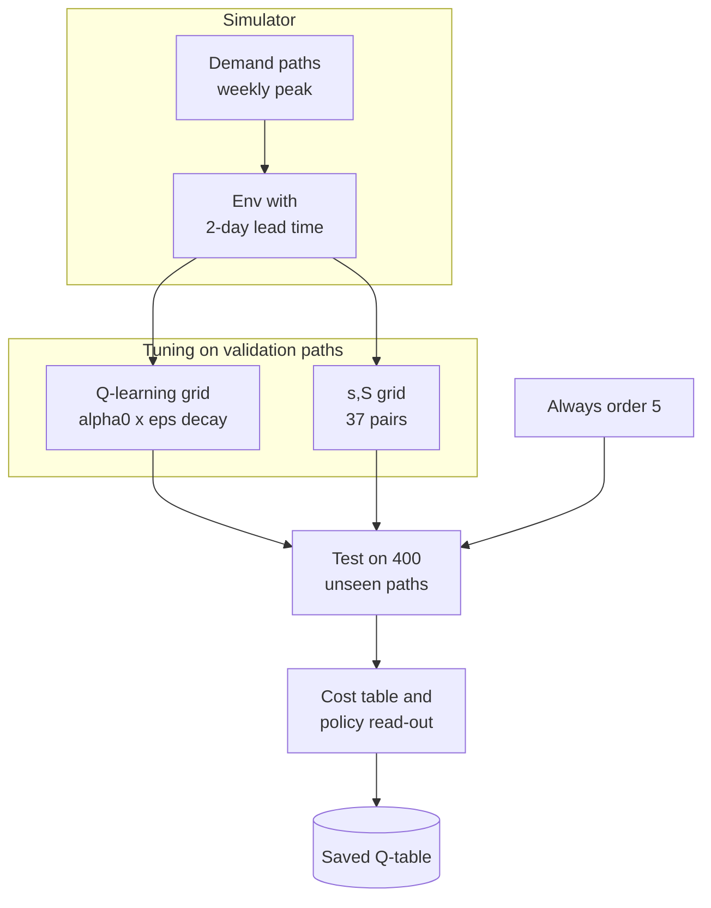
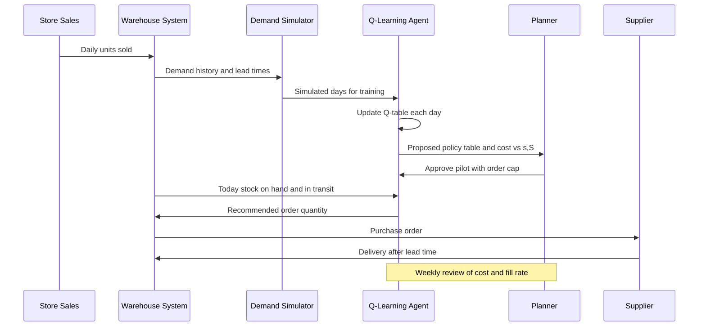

# 21. Q-Learning

[](https://colab.research.google.com/github/EdwardSuresh/architects-ml-playbook/blob/main/notebooks/21-q-learning.ipynb)  

[← 20. Hierarchical Clustering](../20-hierarchical-clustering/README.md) · [All algorithms](../../README.md#-the-30-algorithms-ranked) · [22. Genetic Algorithms →](../22-genetic-algorithms/README.md)

> **Q-learning learns, by trial and error, a table that scores every action in every situation so an agent can pick the action with the best long-run payoff.**

💡 **Analogy:** Think of a new shop manager keeping a notebook: for each shelf level, they jot down how each ordering choice worked out over the following weeks. After months of notes, they simply look up the shelf level and pick the choice with the best track record. Early on they try odd choices on purpose, just to learn.

## The use case (same for Concept, Build and Production)
**Supply Chain — Inventory reorder policy for one SKU**

A regional distributor reorders a fast-moving SKU every day, and planners use gut feel or a fixed 'order 5 daily' rule. Too much stock ties up cash and shelf space, while too little loses sales and annoys retailers. The company has daily sales history, supplier lead times and cost estimates for holding, stockouts and placing orders. Success means a reorder rule that lowers total monthly cost and is at least as good as a well-tuned (s,S) policy, explained in a form planners can check.

## Industry adoption
| Sector | Score | Where you meet it |
|---|---|---|
| Financial Services | ■■□□□ 2/5 | Research and pilots on order execution, splitting a large trade over time to cut market impact. |
| Insurance | ■■□□□ 2/5 | Experimental next-best-action for retention offers, usually with deep RL or bandits rather than tables. |
| Supply Chain | ■■■□□ 3/5 | Inventory replenishment and dynamic reorder rules in simulators, benchmarked against (s,S) policies. |
| Oil & Gas | ■■□□□ 2/5 | Research on drilling-parameter control and production choke settings in simulated reservoirs. |

**Why rank #21:** Q-learning is the textbook entry point to reinforcement learning and is used in pilots for inventory, pricing and dispatch, but few production systems run pure tabular Q-learning. Real problems usually have too many states, so firms either use classic operations-research policies or move to deep RL. It ranks here because the idea is foundational even though direct adoption is modest.

## How it works
1. Define states (e.g. stock on hand), actions (order 0, 5 or 10) and a reward (minus cost).
2. Start a Q-table of zeros: one row per state, one column per action.
3. Each step, pick an action: usually the best in the table, sometimes a random one (epsilon-greedy).
4. Observe the reward and the next state from the environment.
5. Update: Q(s,a) moves toward reward + gamma x the best Q in the next state.
6. Repeat over many episodes while slowly reducing exploration.
7. The final policy is: in each state, take the action with the highest Q.

## Key terms
| Term | Meaning |
|---|---|
| State | What the agent observes before acting, e.g. units on the shelf plus units on order. |
| Action | A choice the agent can make, e.g. order 0, 5 or 10 units. |
| Reward | The score after an action; here minus the day's holding, stockout and ordering cost. |
| Q-value | Expected total future reward from taking an action in a state and acting well afterwards. |
| Epsilon-greedy | Act on the best known action most of the time, but explore a random one with probability epsilon. |
| Discount factor (gamma) | How much future rewards count compared with today's, between 0 and 1. |
| Learning rate (alpha) | How far each update moves the Q-value toward the new target. |
| (s,S) policy | Classic inventory rule: when stock position drops to s or below, order back up toward S. |

## 🟢 Concept — Fill a 4x3 Q-table for a toy stockroom
Hand-run 8 days of Q-learning on a 4-state version of the reorder problem and print the Q-table.

| 5W + H | |
|---|---|
| **Who** | A store inventory planner learning how an RL agent thinks about reordering one SKU. |
| **What** | A Q-table with 4 stock levels (0, 5, 10, 15) and 3 order sizes (0, 5, 10), updated one day at a time. |
| **When** | Every day after demand is known, the agent books the cost and updates one cell of the table. |
| **Where** | A single stockroom with capacity 15 units; plain numpy, no RL library. |
| **Why** | To see the Q-learning update rule work cell by cell before scaling it up. |
| **How** | Epsilon-greedy picks an order, random demand arrives, reward = minus cost, then Q is nudged toward reward plus discounted best future value. |

**Architecture**



**🧠 ML concepts:** State, action, reward, Q-table as a lookup of expected long-run value, Epsilon-greedy exploration, Bellman / temporal-difference update, Discount factor gamma  
**🐍 Python concepts:** Lists and list.index(), numpy 2-D arrays and argmax, Functions returning tuples, for loops with range, f-string alignment, enumerate

**Steps the code performs**
1. Define 4 stock states and 3 order actions
2. Create an all-zero Q-table
3. Write step(): random demand, sales, leftover, cost
4. Loop 8 days choosing actions epsilon-greedily
5. Apply the Q-learning update after each day
6. Print the final Q-table and best action per state

▶️ Code: [`easy.py`](easy.py) — run with `python easy.py`

<details><summary>Walkthrough</summary>

| Lines | What happens |
|---|---|
| 6-7 | Python lists define the 4 possible stock levels (states) and 3 order sizes (actions) for our single SKU. |
| 9 | The Q-table: a 4x3 grid of numbers. Each cell estimates the long-run value of taking that order size at that stock level. It starts at zero because the agent knows nothing. |
| 11-12 | Hyperparameters and business costs. alpha is how big each learning step is, gamma how much future cost matters, epsilon how often we explore. Stockouts are 10x worse than holding a unit. |
| 15-25 | The environment, i.e. one simulated day: random demand arrives, we sell what we can, leftover stock incurs holding cost and unmet demand incurs stockout cost. Reward is the negative of total cost. |
| 31-36 | Epsilon-greedy choice: 20% of the time pick a random order (explore), otherwise pick the order with the highest Q-value (exploit). |
| 40-41 | The heart of Q-learning: the target is today's reward plus the discounted value of the best action tomorrow. We move the current cell a fraction alpha toward that target. |
| 43-45 | Print what happened each day so you can follow one cell changing at a time, then move to the next state. |
| 50-52 | Print the final Q-table. The best action per row is the learned policy; with only 8 days it is rough, which is why Build trains for thousands of days. |

</details>

<details><summary>Real output</summary>

```text
Day 1: stock=10 order= 0 demand= 0 -> stock=10 reward= -10.0 Q[10,0]= -5.00
Day 2: stock=10 order= 0 demand= 0 -> stock=10 reward= -10.0 Q[10,0]= -7.50
Day 3: stock=10 order=10 demand=10 -> stock= 5 reward=  -7.0 Q[10,10]= -3.50
Day 4: stock= 5 order= 0 demand=10 -> stock= 0 reward= -50.0 Q[5,0]=-25.00
Day 5: stock= 0 order= 5 demand= 5 -> stock= 0 reward=  -2.0 Q[0,5]= -1.00
Day 6: stock= 0 order= 0 demand= 0 -> stock= 0 reward=  -0.0 Q[0,0]=  0.00
Day 7: stock= 0 order= 0 demand= 5 -> stock= 0 reward= -50.0 Q[0,0]=-25.00
Day 8: stock= 0 order=10 demand= 0 -> stock=10 reward= -12.0 Q[0,10]= -6.00

Q-table (rows = stock level, cols = order size)
stock | order0  order5 order10 | best
    0 | -25.00   -1.00   -6.00 | order 5
    5 | -25.00    0.00    0.00 | order 5
   10 |  -7.50    0.00   -3.50 | order 5
   15 |   0.00    0.00    0.00 | order 0
```

</details>

**Try this next:** Set epsilon = 0 and rerun: does the agent ever try ordering 10? · Raise STOCKOUT_COST to 30 and see how the Q-values for order 0 change. · Run 200 days instead of 8 and check whether the best-order column stabilises.

## 🟡 Build — Tabular Q-learning for a 21-state stockroom
Train a full tabular Q-learning agent over 1,500 simulated months and compare its policy to simple rules.

| 5W + H | |
|---|---|
| **Who** | A replenishment analyst who wants a data-driven reorder rule for one fast-moving SKU. |
| **What** | A 21x3 Q-table (stock 0-20, order 0/5/10) learned from Poisson demand with holding, stockout and fixed ordering costs. |
| **When** | Trained offline in a simulator; the learned policy would be reviewed before being used daily. |
| **Where** | One SKU in one warehouse with a 20-unit shelf limit, simulated in numpy. |
| **Why** | Fixed rules like 'order 5 every day' waste money; RL finds a state-dependent rule that balances holding against stockouts. |
| **How** | Epsilon-greedy exploration with decaying epsilon, Bellman updates every day, then a greedy evaluation against two baseline rules. |

**Architecture**



**🧠 ML concepts:** Episodes and the exploration-exploitation trade-off, Epsilon decay schedule, Learning curve via average episode cost, Greedy policy extraction from Q, Policy evaluation against baselines  
**🐍 Python concepts:** numpy Generator (default_rng), Docstrings, Nested loops, Lambda functions, pandas DataFrame and iloc slicing, Generator expressions with join

**Steps the code performs**
1. Set business costs and the order sizes
2. Write a step() that simulates one day with Poisson demand
3. Run 1,500 episodes of 30 days with epsilon-greedy updates
4. Decay epsilon after every episode
5. Print early vs late learning cost
6. Turn the Q-table into a readable policy table
7. Evaluate the greedy policy vs two fixed rules
8. Print a business read-out

▶️ Code: [`medium.py`](medium.py) — run with `python medium.py`

<details><summary>Walkthrough</summary>

| Lines | What happens |
|---|---|
| 8-13 | Business inputs as constants: shelf limit, allowed order sizes, and the three costs that the agent must balance. |
| 16-28 | The simulator for one day. Demand comes from a Poisson distribution (a standard model for counts like units sold). Costs are added up and returned as a negative reward. |
| 32-35 | Create the 21x3 Q-table and the training settings: learning rate 0.1, discount 0.95, start fully exploratory (epsilon 1.0). |
| 38-52 | Training loop. Each episode is a 30-day month from a random starting stock. Every day: choose an action epsilon-greedily, simulate it, and apply the Bellman update. |
| 53-55 | Record the month's cost and shrink epsilon by 0.3% per episode, so the agent explores early and exploits later, never below 5%. |
| 58-59 | A simple learning curve: average monthly cost at the start vs the end of training. |
| 62-70 | Build a pandas table from the Q-table: for each stock level, the best order and the Q-values behind it. iloc[::2] prints every second row. |
| 73-87 | Evaluate any policy (passed as a function) with no exploration over 300 months. Lambdas create the two baseline rules in one line each. |
| 94-97 | Print the full learned policy and a business read-out of savings versus the naive daily rule. |

</details>

<details><summary>Real output</summary>

```text
Avg 30-day cost, first 100 episodes: $301.5
Avg 30-day cost, last 100 episodes : $187.2

Learned policy (every 2nd stock level):
 stock  best_order  Q_order0  Q_order5  Q_order10
     0          10    -149.1    -129.7     -124.0
     2          10    -132.6    -125.8     -123.7
     4          10    -124.7    -125.3     -123.9
     6           0    -119.9    -125.6     -125.3
     8           0    -119.0    -124.3     -125.3
    10           0    -118.3    -123.3     -124.9
    12           0    -117.8    -121.5     -123.1
    14           0    -118.2    -121.3     -120.1
    16           0    -118.6    -119.6     -120.0
    18           0    -118.7    -119.0     -119.0
    20           0    -114.3    -115.1     -116.1

Policy evaluation (mean cost over 30 days, 300 runs):
  Q-learning policy : $  175.1
  Always order 5    : $  396.7
  Never order       : $  877.2

Full policy, stock 0..20: 10 10 10 10 10 10 0 0 0 0 0 0 0 0 0 0 0 0 0 10 0
Business read-out: the agent mostly reorders when stock < 6 units, saving $222 per month vs a fixed 'order 5 daily' rule.
```

</details>

**Try this next:** Change MEAN_DAILY_DEMAND to 6 and see whether the reorder point moves up. · Set ORDER_FIXED_COST to 0: does the agent start ordering small amounts more often? · Use a faster decay (0.99) and compare the last-100-episode cost.

## 🔴 Production — Lead time, tuning and an (s,S) showdown
Add a 2-day supplier lead time and weekly demand peaks, tune Q-learning, and test it against a tuned (s,S) policy on the same demand.

| 5W + H | |
|---|---|
| **Who** | A supply chain data science team deciding whether RL is worth deploying over the classic (s,S) rule. |
| **What** | A richer inventory environment with in-transit orders, weekend demand peaks, unit and fixed order costs, and a rigorous head-to-head test. |
| **When** | Before a pilot: policies are tuned on validation demand and judged on 400 unseen 8-week demand paths. |
| **Where** | A Python simulator that mirrors the warehouse's reorder process; outputs a saved Q-table for a pilot. |
| **Why** | An RL policy must beat or match a well-tuned textbook policy before anyone trusts it with real inventory dollars. |
| **How** | Inventory-position state, per-state decaying learning rate, grid search over alpha and epsilon decay, grid search over (s,S), common random numbers for a fair test. |

**Architecture**



**🧠 ML concepts:** Markov state design (inventory position includes in-transit stock), Per-state-action decaying learning rate, Hyperparameter search for RL, Validation vs test separation for policies, Common random numbers for fair comparison, Baseline policy (s,S) from operations research  
**🐍 Python concepts:** Classes with __init__ and methods, Tuples as dict keys and setdefault, Closures (functions returning functions), itertools.product grid search, list.pop(0) as a simple queue, if __name__ == '__main__' guard

**Steps the code performs**
1. Build an InventoryEnv class with a lead-time pipeline
2. Compress state to inventory position
3. Train Q-learning with decaying alpha and epsilon
4. Generate separate validation and test demand paths
5. Grid-search Q-learning settings and (s,S) parameters on validation
6. Compare all policies on the test paths
7. Print the learned policy for explainability
8. Save the Q-table to a temp dir

▶️ Code: [`hard.py`](hard.py) — run with `python hard.py`

<details><summary>Walkthrough</summary>

| Lines | What happens |
|---|---|
| 9-18 | A class bundles the warehouse rules: shelf limit, lead time, and the four cost parameters. Each environment has its own random generator so runs are reproducible. |
| 20-29 | reset() starts a new episode and creates the pipeline: a list with one slot per day of lead time holding orders still on the truck. |
| 36-48 | One day: the oldest order arrives (pop(0)), today's order joins the end of the queue, demand is served, and costs are booked including a per-unit purchase cost. |
| 51-55 | State design is the most important RL decision. Inventory position (on hand plus in transit) keeps the problem close to Markov with only 41 states. |
| 58-80 | Q-learning with a learning rate that shrinks per state-action as it is visited more (alpha0 / n^0.6) and epsilon that decays each episode. |
| 83-95 | Every policy replays exactly the same demand paths, so differences in cost come from the policy, not luck. |
| 98-103 | Both policies are built as closures: functions that remember their parameters (the Q-table, or s and S) and return an order decision. |
| 122-136 | Tune Q-learning on validation demand only, looping over every combination of alpha0 and epsilon decay. |
| 139-143 | Tune the (s,S) baseline the same way. A fair comparison gives the baseline the same tuning budget. |
| 146-174 | Final test on unseen demand, the printed policy, a model-risk note, and saving the Q-table. Note the honest result: tabular RL only matches a tuned (s,S) here. |

</details>

<details><summary>Real output</summary>

```text
== Tuning Q-learning (alpha0 x epsilon decay) on validation demand ==
  alpha0=0.3  eps_decay=0.997  states_seen=  41  val_cost=$  764.0
  alpha0=0.3  eps_decay=0.999  states_seen=  41  val_cost=$  691.1
  alpha0=0.6  eps_decay=0.997  states_seen=  41  val_cost=$  688.1
  alpha0=0.6  eps_decay=0.999  states_seen=  41  val_cost=$  684.7
  -> best config alpha0=0.6, eps_decay=0.999

== Tuning (s, S) baseline on the same validation demand ==
  searched 37 (s,S) pairs -> best s=14, S=22 val_cost=$688.1

== Final test on 400 unseen 8-week demand paths ==
  Q-learning (tuned)   mean=$  680.6  sd=$ 47.9  #################
  (s,S)=(14,22)        mean=$  686.0  sd=$ 58.7  #################
  Always order 5       mean=$  987.3  sd=$ 84.5  ########################

Q-learning vs (s,S): +0.8% cost saving per 8 weeks

Learned order qty by inventory position (on hand + in transit):
  position:  0  1  2  3  4  5  6  7  8  9 10 11 12 13 14 15 16 17 18 19 20 21 22 23 24 25 26 27 28 29 30
  order   : 10 10 10 10 10 10 10 10 10 10 10 10 10 10 10 10  0  0  0  0  0  0  0  0  0  0  0  0  0 10  0

Model-risk note: keep (s,S) as a fallback, cap order size, monitor service level weekly,
and retrain when the demand pattern drifts (new promo calendar, new supplier lead time).
Saved Q-table + configs -> q_table.npy in a temp dir
```

</details>

**Try this next:** Set lead_time=4 in InventoryEnv and see which policy degrades more. · Put day-of-week back into full_state and train 10,000 episodes: can RL now beat (s,S)? · Raise the stockout cost to 20 and compare the new reorder point with the (s,S) answer.

## 🔄 End-to-end production flow



## ⚠️ Pitfalls
- Leaving in-transit orders out of the state: the problem stops being Markov and learning stalls. Use inventory position or include the pipeline.
- State explosion: adding every feature multiplies table size. Keep the state small, or move to function approximation (deep Q-networks).
- Not comparing against a tuned (s,S) baseline. RL often only matches it, so prove the gain before deploying.
- Evaluating with exploration still on, or on the same random demand used for tuning. Evaluate greedily on fresh demand paths.
- A simulator that does not match reality (wrong demand distribution or lead time) gives a policy that fails live. Validate the simulator against history first.
- No guardrails in production: cap order sizes, keep a fallback rule, and monitor fill rate and cost weekly.

**When NOT to use it:** Avoid it when the state space is large or continuous, when you cannot build a trustworthy simulator, or when a simple tuned rule like (s,S) already performs well and is easier to govern.

## 🎤 Interview questions
<details><summary>Why is Q-learning called off-policy?</summary>

Its update target uses the best action in the next state (the max), regardless of which action the agent actually takes while exploring. So it learns the greedy policy's value while following an exploratory one.

</details>
<details><summary>When would you choose a classic (s,S) policy over Q-learning for inventory?</summary>

When demand is stationary and the cost structure is simple, (s,S) is near-optimal, easy to explain and cheap to tune. Q-learning earns its place when there are complex constraints, seasonality or many interacting decisions that closed-form rules cannot handle.

</details>
<details><summary>What breaks tabular Q-learning at scale, and what replaces it?</summary>

The table grows with every state variable, so most states are rarely visited and estimates stay poor. Function approximation such as Deep Q-Networks, or policy-gradient methods, generalise across similar states instead.

</details>

---
[← 20. Hierarchical Clustering](../20-hierarchical-clustering/README.md) · [All algorithms](../../README.md#-the-30-algorithms-ranked) · [22. Genetic Algorithms →](../22-genetic-algorithms/README.md)
