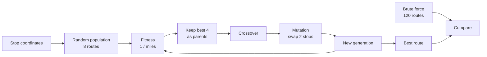
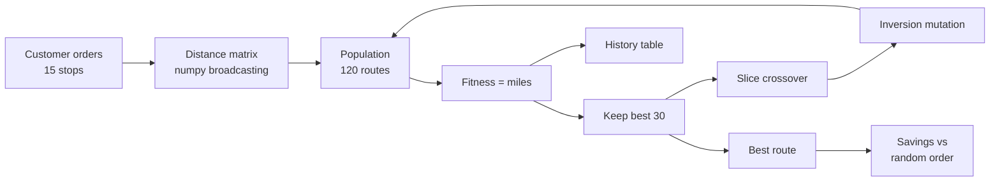
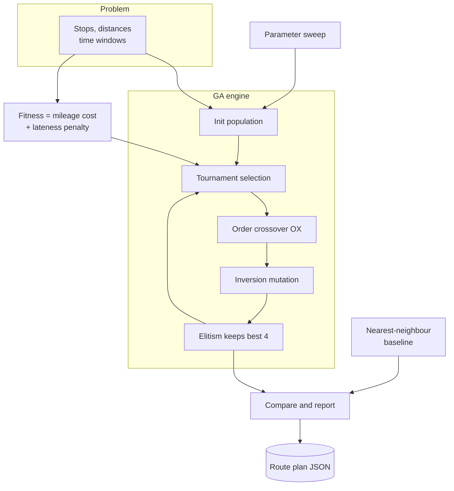
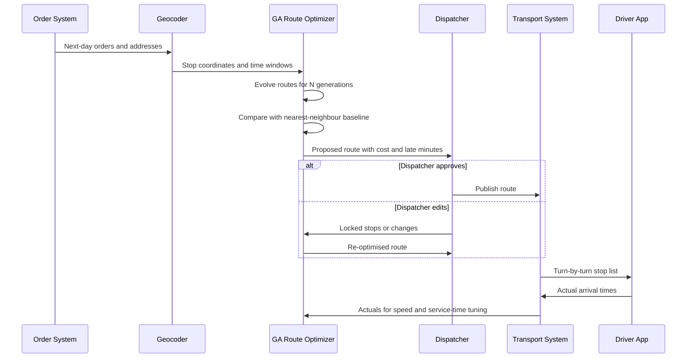

# 22. Genetic Algorithms

[](https://colab.research.google.com/github/EdwardSuresh/architects-ml-playbook/blob/main/notebooks/22-genetic-algorithms.ipynb)  

[← 21. Q-Learning](../21-q-learning/README.md) · [All algorithms](../../README.md#-the-30-algorithms-ranked) · [23. Recurrent Neural Network (RNN) →](../23-recurrent-neural-network/README.md)

> **A genetic algorithm finds good solutions by keeping a population of candidates and repeatedly breeding and mutating the best ones, imitating natural selection.**

💡 **Analogy:** Picture a football coach trying line-ups: he keeps the best-performing line-ups, mixes players from two good ones to make new combinations, and sometimes swaps a player at random to try something new. Over many matches the line-ups get steadily better without him ever testing every possible combination.

## The use case (same for Easy, Medium and Hard)
**Supply Chain — Delivery route optimization for one truck**

A distributor sends one truck each day to 15 customers, and the driver chooses the order of stops from experience. Extra miles waste fuel and driver hours, and late arrivals outside receiving windows cause overtime, refused deliveries and credits. The company knows each customer's address, order size and receiving window, plus average speed and unloading time. Success means a daily route that cuts total cost (miles plus lateness) compared with the current 'nearest next stop' habit, and that the dispatcher can review and override.

## Industry adoption
| Sector | Score | Where you meet it |
|---|---|---|
| Financial Services | ■■□□□ 2/5 | Portfolio construction with awkward constraints such as lot sizes and cardinality limits; feature selection for models. |
| Insurance | ■■□□□ 2/5 | Tuning rating-factor groupings and searching reinsurance programme structures. |
| Supply Chain | ■■■□□ 3/5 | Vehicle routing, warehouse slotting and production scheduling when exact solvers are too slow. |
| Oil & Gas | ■■■□□ 3/5 | Well-placement and field-development optimisation coupled with reservoir simulators; history matching. |

**Why rank #22:** Genetic algorithms are a flexible, well-known way to search huge spaces of options such as routes, schedules, portfolios and well placements when exact methods are too slow. In industry they often lose to specialised solvers (MIP, OR-Tools, local search), so they tend to appear inside tools rather than as headline models. Supply chain and oil & gas use them the most.

## How it works
1. Encode a solution as a 'chromosome', e.g. a route as an ordered list of stops.
2. Create a random population of candidate solutions.
3. Score each candidate with a fitness function (e.g. miles plus lateness penalty).
4. Select parents, favouring fitter candidates (truncation or tournament selection).
5. Create children by crossover (mixing two parents) while keeping solutions valid.
6. Apply mutation (small random changes) to keep diversity.
7. Keep the best few unchanged (elitism) and repeat for many generations.

## Key terms
| Term | Meaning |
|---|---|
| Chromosome | One encoded candidate solution, here a route as an ordered list of stop numbers. |
| Fitness | The score that says how good a candidate is, e.g. total cost of the route. |
| Crossover | Combining parts of two parent solutions to make a child. |
| Order crossover (OX) | A crossover for orderings that copies a slice from one parent and fills the rest in the other parent's order. |
| Mutation | A small random change, such as swapping or reversing stops, that keeps the search exploring. |
| Tournament selection | Pick k random candidates and let the best one become a parent. |
| Elitism | Copy the best few candidates into the next generation unchanged so they are never lost. |
| Penalty method | Turning a hard rule (deliver within the window) into an extra cost so the optimiser can handle it. |

## 🟢 Easy — Evolve a 5-stop delivery route
Watch a tiny genetic algorithm evolve one truck's 5-stop route over 10 generations and check it against brute force.

| 5W + H | |
|---|---|
| **Who** | A dispatcher who wants to see how 'evolving' routes can find a short trip. |
| **What** | A population of 8 candidate routes, scored by miles, improved through selection, crossover and mutation. |
| **When** | Each morning before the truck leaves the depot, for a handful of stops. |
| **Where** | A depot and 5 customer stops on a simple x/y mile grid, in plain Python. |
| **Why** | To understand the four GA ideas (population, fitness, crossover, mutation) on a problem small enough to check by hand. |
| **How** | Score routes by total miles, keep the best 4 as parents, breed 4 children by crossover plus mutation, repeat, then compare with all 120 possible routes. |

**Architecture**



**🧠 ML concepts:** Population of candidate solutions, Fitness function, Selection of parents, Crossover that keeps routes valid, Mutation for exploration, Checking against the exact optimum  
**🐍 Python concepts:** Dictionaries of tuples, zip(path, path[1:]) for pairs, List comprehensions, random.sample and random.choice, Tuple-unpacking swap, itertools.permutations

**Steps the code performs**
1. Define depot and 5 stops with coordinates
2. Write route_miles() and fitness()
3. Write crossover() and mutate()
4. Create 8 random routes
5. Loop 10 generations: sort, select, breed
6. Print best and worst miles each generation
7. Compare the GA answer with brute force

▶️ Code: [`easy.py`](easy.py) — run with `python easy.py`

<details><summary>Walkthrough</summary>

| Lines | What happens |
|---|---|
| 8-9 | A dict maps each stop to its (x, y) location in miles; customers is the list of stops the truck must visit. |
| 12-16 | Total trip miles: add the depot at both ends, pair each stop with the next using zip, and sum straight-line distances. |
| 19-21 | Fitness turns cost into 'goodness': a shorter route gets a higher score. |
| 24-29 | Crossover: copy the first 2 stops of parent 1, then add parent 2's stops in order, skipping duplicates, so each customer is still visited exactly once. |
| 32-39 | Mutation: 30% of the time swap two stops. This keeps diversity so the population does not all become copies. |
| 44-50 | Start with 8 random routes. Each generation sorts by fitness and prints the best and worst trip. |
| 52-54 | Selection and breeding: the best 4 survive, and 4 children are created from random pairs of parents. |
| 56-59 | Compare the GA route with the true optimum found by checking all 120 orders. The GA's route is the same loop driven in reverse. |

</details>

<details><summary>Real output</summary>

```text
Gen 0: best=A-B-C-D-E  miles=30.96  worst=41.27
Gen 1: best=A-B-C-D-E  miles=30.96  worst=37.43
Gen 2: best=E-A-D-C-B  miles=25.37  worst=37.43
Gen 3: best=E-A-D-C-B  miles=25.37  worst=37.43
Gen 4: best=E-A-D-C-B  miles=25.37  worst=37.87
Gen 5: best=E-A-D-C-B  miles=25.37  worst=37.15
Gen 6: best=E-A-D-C-B  miles=25.37  worst=37.87
Gen 7: best=E-A-D-C-B  miles=25.37  worst=30.80
Gen 8: best=E-A-D-C-B  miles=25.37  worst=25.37
Gen 9: best=E-A-D-C-B  miles=25.37  worst=38.26

GA route : Depot-E-A-D-C-B-Depot  25.37 mi
Best route: Depot-B-C-D-A-E-Depot  25.37 mi
```

</details>

**Try this next:** Set the mutation rate to 0 and see whether the GA gets stuck. · Keep only the top 2 as parents: does it converge faster or worse? · Add a sixth stop F at (7, 4) and check the brute-force count (720 routes).

## 🟡 Medium — GA for a 15-stop daily route
Run a full genetic algorithm over 300 generations to plan a 15-stop route and quantify the savings.

| 5W + H | |
|---|---|
| **Who** | A regional distributor's routing analyst planning one truck's daily run. |
| **What** | A GA with 120 routes per generation, slice-based crossover and inversion mutation over a precomputed distance matrix. |
| **When** | Nightly, after orders close and before drivers are dispatched. |
| **Where** | A 40 x 40 mile service area with the depot in the middle, using numpy and pandas. |
| **Why** | 15 stops have about 1.3 trillion possible orders, far too many to check, so we need a search method that finds a good route quickly. |
| **How** | Score with total miles, keep the 30 best, breed the rest with crossover and inversion mutation, track progress, and compare with random routes. |

**Architecture**



**🧠 ML concepts:** Permutation encoding of routes, Truncation selection, Inversion mutation (2-opt-like), Convergence tracking, Baseline comparison  
**🐍 Python concepts:** numpy broadcasting for pairwise distances, Fancy indexing with arrays, np.argsort to rank, while loops, pandas DataFrame from a list of tuples, Slicing with [::-1] to reverse

**Steps the code performs**
1. Generate 15 customer stops with order sizes
2. Precompute the depot-plus-stops distance matrix
3. Define route length, crossover and mutation
4. Initialise 120 random routes
5. Evolve for 300 generations, keeping the best 30
6. Print the progress table and best route
7. Compare with random routes and print annual savings

▶️ Code: [`medium.py`](medium.py) — run with `python medium.py`

<details><summary>Walkthrough</summary>

| Lines | What happens |
|---|---|
| 10-14 | Build a table of 15 synthetic customers with random x/y coordinates and order sizes. |
| 16-21 | Stack the depot and customers into one array, then use broadcasting to compute every pairwise distance in one line. Index 0 is the depot. |
| 24-28 | Route length via fancy indexing: path[:-1] and path[1:] give the from and to stops of every leg, which are looked up in the matrix at once. |
| 31-36 | Crossover keeps a random middle slice of parent 1 and fills the remaining positions with parent 2's stops in order, so the child is always a valid route. |
| 39-45 | Inversion mutation reverses a segment of the route. Reversing a segment is how you untangle crossing legs, so it suits routing problems. |
| 48-51 | Settings and the starting population: 120 random permutations of stops 1 to 15. |
| 52-64 | The evolution loop: score and sort, record history, keep the best 30, and fill the rest with mutated children of random parent pairs. |
| 66-78 | Report progress every 50 generations, the best route, and an average random route as a baseline. |
| 80-83 | Turn miles saved into dollars per year, the language a business sponsor understands. |

</details>

<details><summary>Real output</summary>

```text
GA progress (every 50 generations):
 generation  best_miles  avg_miles
          0       260.1      335.9
         50       141.4      145.5
        100       141.4      144.7
        150       141.4      145.1
        200       141.4      144.8
        250       141.4      147.3

Best GA route  :  141.4 miles
Avg random route:  334.2 miles

Stop sequence: Depot -> C11 -> C13 -> C03 -> C14 -> C01 -> C07 -> C12 -> C06 -> C08 -> C04 -> C10 -> C09 -> C05 -> C15 -> C02 -> Depot

Business read-out: at $2.1/mile and 250 delivery days, the GA route saves about $101,251/year vs an unplanned order of stops.
```

</details>

**Try this next:** Change POP to 40 and GENS to 100: how close do you get? · Replace inversion mutation with a simple swap and compare final miles. · Set KEEP to 5 (strong selection) and watch diversity collapse in avg_miles.

## 🔴 Hard — Time windows, OX, tournaments and a parameter sweep
Build a production-style GA with order crossover, tournament selection, elitism and a time-window penalty, tune it, and beat nearest-neighbour.

| 5W + H | |
|---|---|
| **Who** | A transportation planning team replacing a manual 'nearest next stop' habit with an optimiser. |
| **What** | A GA that minimises mileage cost plus lateness penalties for customers with morning or afternoon receiving windows. |
| **When** | In the nightly planning batch; output is a route plan the dispatcher can review and override. |
| **Where** | 15 stops in a 30-mile area, 30 mph average speed, 10 minutes service per stop. |
| **Why** | Shortest miles is not enough: late deliveries cost overtime and customer credits, so the optimiser must trade miles against punctuality. |
| **How** | Penalty-based fitness, OX crossover, tournament selection with elitism, inversion mutation, a seeded variant, and a multi-seed sweep over population, tournament size and mutation rate. |

**Architecture**



**🧠 ML concepts:** Penalty method for constraints, Order crossover (OX), Tournament selection and selection pressure, Elitism, Seeding a GA with a heuristic, Multi-seed parameter sweeps for stochastic search  
**🐍 Python concepts:** dataclasses with a @property, Functions with keyword defaults, Sets for fast membership tests, np.roll for cyclic shifts, json.dump with type conversion, Unpacking nested tuples in assignment

**Steps the code performs**
1. Build a Problem dataclass with distances and windows
2. Define cost = miles x rate + minutes late x penalty
3. Implement OX crossover, inversion mutation and tournament selection
4. Run the GA with elitism
5. Sweep population, tournament size and mutation rate over 2 seeds
6. Compare GA with nearest-neighbour
7. Print an arrival-vs-window table for dispatcher review
8. Save the route plan as JSON

▶️ Code: [`hard.py`](hard.py) — run with `python hard.py`

<details><summary>Walkthrough</summary>

| Lines | What happens |
|---|---|
| 10-13 | Business constants: average speed, unloading time, lateness penalty and cost per mile. Changing these changes what 'best' means. |
| 16-24 | A dataclass holds the problem data neatly; the n property returns the number of customer stops (excluding the depot). |
| 27-36 | Create stops and windows: about half the customers can receive in the morning and half only in the afternoon. |
| 39-53 | Simulate the truck: drive, wait if early, record lateness, unload. The total cost combines mileage and a lateness penalty (the penalty method). |
| 56-67 | Order crossover (OX): copy a slice from parent 1 in place, then fill the remaining positions in parent 2's cyclic order, skipping stops already copied. |
| 79-82 | Tournament selection: pick k random routes and return the cheapest. Bigger k means stronger pressure toward the current best. |
| 85-101 | The GA loop with elitism (the top 4 are copied unchanged) plus an option to seed the population with a heuristic route. |
| 104-113 | The baseline heuristic: always drive to the closest unvisited stop. It is fast but ignores time windows. |
| 128-137 | Parameter sweep averaged over seeds, because a GA is random and one run can be lucky. |
| 140-173 | Final comparison, the savings explanation, an arrival-vs-window check for the dispatcher, a compliance note and the saved plan. |

</details>

<details><summary>Real output</summary>

```text
Problem: 15 stops, 7 with afternoon windows

== Parameter sweep (population x tournament size x mutation rate), 2 seeds, 80 gens ==
  pop= 40 k=2 mut=0.1  mean_cost=$  323.1  sd=$ 39.5
  pop= 40 k=2 mut=0.4  mean_cost=$  354.0  sd=$ 25.3
  pop= 40 k=5 mut=0.1  mean_cost=$  328.2  sd=$ 20.2
  pop= 40 k=5 mut=0.4  mean_cost=$  331.8  sd=$ 32.3
  pop= 80 k=2 mut=0.1  mean_cost=$  344.9  sd=$  7.5
  pop= 80 k=2 mut=0.4  mean_cost=$  329.9  sd=$ 27.9
  pop= 80 k=5 mut=0.1  mean_cost=$  307.2  sd=$ 49.5
  pop= 80 k=5 mut=0.4  mean_cost=$  305.2  sd=$ 23.4
  -> chosen pop=80, k=5, mut=0.4

== Final comparison ==
  Nearest neighbour            cost=$ 1732.4  miles= 117.8  late_min= 742.5
  GA (tuned, random start)     cost=$  257.7  miles= 121.8  late_min=   1.0
  GA (seeded with NN)          cost=$  257.7  miles= 121.8  late_min=   1.0

GA saving vs nearest neighbour: $1474.7/day (~$368,682/year at 250 delivery days)
  Most of that saving is avoided lateness penalty, not fewer miles - check the penalty rate with the business.

First 8 stops of the chosen route (arrival vs window, minutes after 8:00):
  stop  2: arrive    23  window [  0,300]  ok
  stop  5: arrive    48  window [  0,300]  ok
  stop  9: arrive    81  window [  0,300]  ok
  stop  1: arrive   114  window [  0,300]  ok
  stop 10: arrive   129  window [  0,300]  ok
  stop 14: arrive   180  window [180,480]  ok
  stop  3: arrive   200  window [  0,300]  ok
  stop  4: arrive   228  window [180,480]  ok

Compliance note: route drive time 4.1h; verify against FMCSA hours-of-service and keep a human dispatcher able to override the plan.
Saved route plan -> route_plan.json in a temp dir
```

</details>

**Try this next:** Set LATE_PENALTY_PER_MIN to 0 and see the GA chase miles only. · Change elite to 0 and observe whether the best route is ever lost. · Make all windows morning-only (opens = 0) and see how lateness changes.

## 🔄 End-to-end production flow



## ⚠️ Pitfalls
- Using a crossover that creates invalid routes (duplicate or missing stops). Use permutation-safe operators such as OX or PMX.
- Judging settings from a single run. GAs are random, so average several seeds before choosing parameters.
- Premature convergence: too much selection pressure or no mutation makes everyone identical. Watch the average fitness and keep diversity.
- Badly scaled penalties: too low and constraints are ignored, too high and the search cannot move. Agree on penalty rates with the business.
- Skipping a strong baseline. Compare with nearest-neighbour plus 2-opt or a solver like OR-Tools; a GA is not always the winner.
- Straight-line miles in place of road miles. Use a road-network distance matrix before trusting savings estimates.

**When NOT to use it:** Skip GAs when a specialised exact or heuristic solver exists for the problem (e.g. OR-Tools for standard vehicle routing) or when the objective is smooth enough for gradient-based methods; GAs are slower and need tuning.

## 🎤 Interview questions
<details><summary>Why can't you use simple one-point crossover for routing problems?</summary>

Cutting two routes and joining the pieces usually duplicates some stops and drops others, giving an invalid route. Permutation operators like order crossover (OX) or PMX keep every stop exactly once.

</details>
<details><summary>How does elitism help, and what is its risk?</summary>

Elitism guarantees the best solution found so far is never lost to a bad crossover or mutation, so the best cost never gets worse. Too much elitism lowers diversity and can cause the population to converge early on a local optimum.

</details>
<details><summary>When would you prefer a GA over a MIP solver?</summary>

When the objective is messy, nonlinear or comes from a black-box simulator (e.g. reservoir models), or when you need a good answer fast rather than a proven optimum. For clean linear problems a MIP or a specialised routing solver is usually better.

</details>

---
[← 21. Q-Learning](../21-q-learning/README.md) · [All algorithms](../../README.md#-the-30-algorithms-ranked) · [23. Recurrent Neural Network (RNN) →](../23-recurrent-neural-network/README.md)
