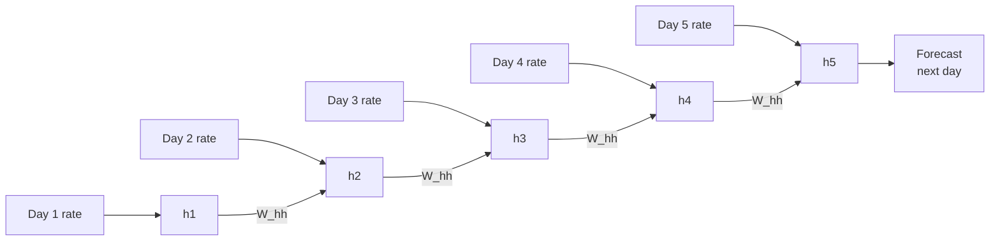
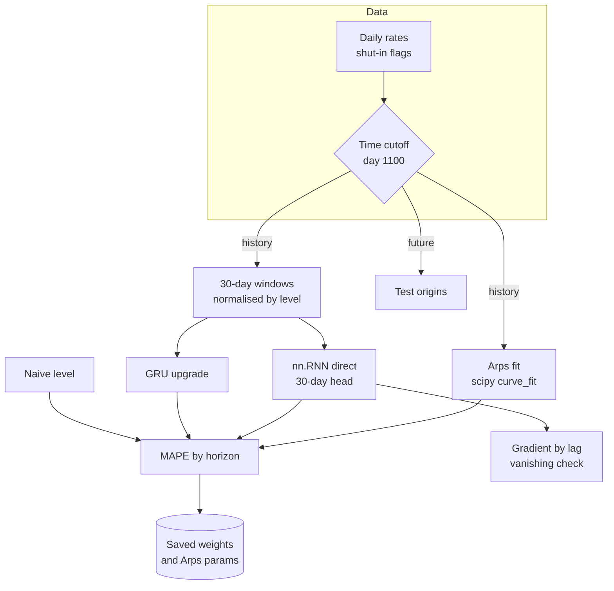
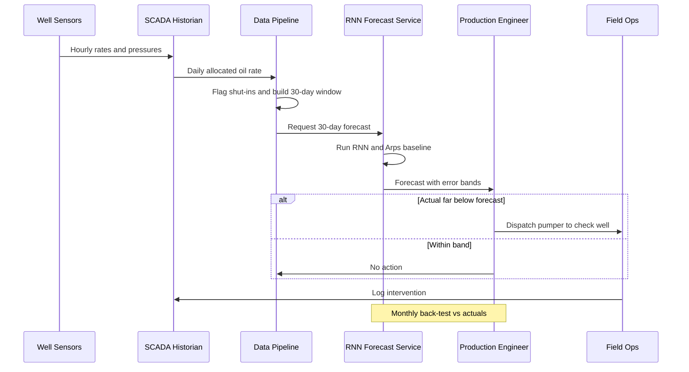

# 23. Recurrent Neural Network (RNN)

[](https://colab.research.google.com/github/EdwardSuresh/architects-ml-playbook/blob/main/notebooks/23-recurrent-neural-network.ipynb)  

[← 22. Genetic Algorithms](../22-genetic-algorithms/README.md) · [All algorithms](../../README.md#-the-30-algorithms-ranked) · [24. AdaBoost →](../24-adaboost/README.md)

> **A recurrent neural network reads a sequence one step at a time and carries a hidden 'memory' forward, so each prediction can depend on what came before.**

💡 **Analogy:** It is like a cricket commentator who keeps a running sense of the innings: after each ball, they update their mental summary of momentum and use it to predict the next over. They do not replay every ball; they carry a compressed memory forward.

## The use case (same for Concept, Build and Production)
**Oil & Gas — Daily oil production rate forecasting for a well**

An operator needs short-term production forecasts for each well to plan trucking, sales nominations and field crew visits. Rates decline over time, but noise, shut-ins and choke changes make simple decline curves miss short-term behaviour. The SCADA historian holds daily oil rates, shut-in flags and well age. Success means forecasts for the next 30 days that beat the decline-curve and naive baselines on producing days, plus a clear flag when actual production falls well below forecast.

## Industry adoption
| Sector | Score | Where you meet it |
|---|---|---|
| Financial Services | ■■□□□ 2/5 | Transaction-sequence models for fraud and intraday volume forecasting, often now as LSTMs or Transformers. |
| Insurance | ■■□□□ 2/5 | Sequences of claim events or telematics trips to predict claim severity or driving risk. |
| Supply Chain | ■■■□□ 3/5 | Demand forecasting and lead-time prediction from order histories across many SKUs. |
| Oil & Gas | ■■■□□ 3/5 | Production-rate forecasting, sensor-sequence anomaly detection on pumps and compressors. |

**Why rank #23:** RNNs introduced the idea of a network with memory for sequences, and their gated variants (LSTM, GRU) are widely used for time-series forecasting and sensor data. The plain RNN itself is rarely deployed today because of vanishing gradients, and many teams now prefer gradient boosting on lag features or Transformers. It ranks here for its foundational role and steady use in supply chain and oil & gas time series.

## How it works
1. Split the series into windows, e.g. the last 14 days of oil rate.
2. Start with an empty hidden state (a small vector of numbers).
3. At each time step, combine the new input with the previous hidden state using shared weights and a tanh.
4. After the last step, pass the hidden state to an output layer to make the forecast.
5. Compare with the actual value and backpropagate the error through all time steps (BPTT).
6. Repeat over many windows; clip gradients to keep training stable.
7. Upgrade to LSTM or GRU cells when longer memory is needed.

## Key terms
| Term | Meaning |
|---|---|
| Hidden state | The network's running memory, a vector updated at every time step. |
| Sliding window | A fixed-length chunk of recent history used as one training input. |
| BPTT | Backpropagation through time: errors are passed back across every step of the sequence. |
| Vanishing gradient | Learning signals shrink as they flow back through many steps, so early inputs barely influence learning. |
| LSTM / GRU | RNN cells with gates that decide what to keep or forget, so they can hold longer memory. |
| Arps decline curve | Classic petroleum-engineering equation for how a well's rate falls over time. |
| Shut-in | A period when a well is closed (maintenance, failure), so production drops to near zero. |
| Direct multi-step forecast | Predicting all future days at once instead of feeding predictions back in one day at a time. |

## 🟢 Concept — Watch an RNN remember 5 days of oil
Compute an RNN's hidden state by hand in numpy over 5 days of a well's oil rate and see how memory carries forward.

| 5W + H | |
|---|---|
| **Who** | A production engineer curious how a neural network can 'remember' yesterday's rate. |
| **What** | A 3-unit RNN cell applied to 5 daily oil rates, printing the hidden state after each day. |
| **When** | Each new day's rate is fed in as it arrives, updating the network's memory. |
| **Where** | One producing well, using plain numpy with no deep-learning library. |
| **Why** | Seeing the hidden-state update makes LSTMs, GRUs and PyTorch's nn.RNN much less mysterious. |
| **How** | h_t = tanh(W_xh x_t + W_hh h_(t-1) + b), with the same weights reused every day, and a least-squares output layer to show learning. |

**Architecture**



**🧠 ML concepts:** Hidden state as memory, Weight sharing across time steps, tanh activation, Input scaling, Fitting an output layer  
**🐍 Python concepts:** numpy arrays and division by a scalar, Matrix multiplication with @, enumerate with start=1, Generator expressions inside join, Star-unpacking (W_fit, *_), .item() and .ravel()

**Steps the code performs**
1. Type 5 daily oil rates and scale them
2. Create random input, recurrent and output weights
3. Loop over days updating the hidden state
4. Print the hidden state each day
5. Collect hidden states and fit the output layer with least squares
6. Print next-day predictions vs actuals

▶️ Code: [`easy.py`](easy.py) — run with `python easy.py`

<details><summary>Walkthrough</summary>

| Lines | What happens |
|---|---|
| 6-8 | Five daily oil rates in barrels per day, scaled to roughly 0 to 1 so the tanh function works in its useful range. |
| 10-16 | Create the three weight matrices: input-to-hidden, hidden-to-hidden (the memory path) and hidden-to-output. The same weights are used on every day. |
| 18-20 | The hidden state starts at zero: before day 1, the network has no memory. |
| 22-25 | The RNN update. New memory mixes today's input with yesterday's memory and squashes the result into -1 to 1 with tanh. |
| 26-29 | Compute the raw output and print the 3 hidden numbers each day so you can watch memory build up. |
| 32 | After 5 days, the hidden state is a compact summary of the whole history; forecasts are made from it. |
| 36-41 | A taste of training: rerun the RNN, collect hidden states, and use least squares to fit output weights that predict the next day's rate. |
| 42-45 | Convert predictions back to barrels per day and compare with actuals. With 3 weights and 4 points this is only illustrative. |

</details>

<details><summary>Real output</summary>

```text
day | rate_bbl/d | hidden state h (3 numbers)      | raw output
 1  |    520.0   | [+0.212 -0.060 +0.274]          | -0.153
 2  |    505.0   | [+0.332 +0.022 +0.273]          | -0.216
 3  |    498.0   | [+0.401 +0.148 +0.282]          | -0.337
 4  |    470.0   | [+0.421 +0.248 +0.256]          | -0.407
 5  |    462.0   | [+0.424 +0.304 +0.242]          | -0.448

Final hidden state summarises the whole 5-day history: [0.424 0.304 0.242]
Day 2: predicted  503.9 bbl/d   actual  505.0
Day 3: predicted  485.4 bbl/d   actual  498.0
Day 4: predicted  497.3 bbl/d   actual  470.0
Day 5: predicted  446.6 bbl/d   actual  462.0
```

</details>

**Try this next:** Multiply W_hh by 3 and watch the hidden values saturate near +1 or -1. · Set W_hh to zeros: the RNN now has no memory. What changes in the printout? · Add a shut-in day (rate 0) in the middle and watch the hidden state react.

## 🟡 Build — PyTorch RNN on 3 years of well data
Train a PyTorch nn.RNN on sliding 14-day windows to forecast tomorrow's oil rate and compare it with a naive baseline.

| 5W + H | |
|---|---|
| **Who** | A production surveillance analyst forecasting next-day rates to spot under-performing days. |
| **What** | A 16-unit RNN that reads the last 14 days of rate and predicts tomorrow, trained on 3 years of synthetic data. |
| **When** | Daily, after the morning production report is loaded. |
| **Where** | One well whose rate follows a hyperbolic decline with noise and random shut-ins, in PyTorch on CPU. |
| **Why** | A forecast gives an 'expected' rate; days far below it can be flagged for a pumper or engineer to check. |
| **How** | Scale with train-period stats, build sliding windows, split by time, train with Huber loss and gradient clipping, then compare with 'same as yesterday'. |

**Architecture**


**🧠 ML concepts:** Sliding windows for sequence data, Time-ordered train/test split, Scaling without leakage, Residual prediction, Huber loss for outliers, Gradient clipping  
**🐍 Python concepts:** Classes inheriting from nn.Module, super().__init__(), List comprehension with np.stack, Adding a dimension with [..., None], torch.no_grad() context manager, Boolean masks

**Steps the code performs**
1. Simulate 3 years of decline with noise and shut-ins
2. Scale using train-period max only
3. Build 14-day sliding windows
4. Split by time into train and test
5. Define the RNN model class
6. Train 40 epochs with Huber loss and clipping
7. Score MAE vs a naive forecast, including normal days only
8. Print a business read-out

▶️ Code: [`medium.py`](medium.py) — run with `python medium.py`

<details><summary>Walkthrough</summary>

| Lines | What happens |
|---|---|
| 12-15 | Three years of days and the Arps hyperbolic decline curve, the standard petroleum-engineering model of falling well rates. |
| 16-22 | Add 4% noise and 12 random shut-ins (pump failures, workovers) where the rate drops near zero, then store everything in a DataFrame. |
| 26-28 | Scale using only the training period's maximum, so no information from the future leaks into training. |
| 33-38 | Sliding windows turn one long series into many examples: the last 14 days as input, the next day as target. |
| 41-46 | Time-ordered split: the first 80% of days train the model and the last 20% test it. [..., None] adds the feature dimension that nn.RNN expects. |
| 50-62 | The model: nn.RNN reads the 14 days and its last hidden state goes to a linear layer. The output is added to the last observed rate, so the network learns the change. |
| 65-68 | Adam optimiser and Huber loss, which treats big shut-in errors gently so they do not dominate training. |
| 69-83 | Mini-batch training: shuffle windows, backpropagate through time, clip gradients to avoid explosions, and update weights. |
| 85-97 | Predict on the future period and compare MAE with the naive 'same as yesterday' forecast, both overall and on normal producing days. |
| 98-103 | Show a few predictions and an honest read-out: for one day ahead, the RNN only ties the naive baseline. |

</details>

<details><summary>Real output</summary>

```text
            mean  min     max
day        547.0  0.0  1094.0
oil_bbl_d  310.9  0.4   943.5

Train windows: 862  Test windows: 219
epoch 10  train Huber loss=0.00042
epoch 20  train Huber loss=0.00008
epoch 30  train Huber loss=0.00045
epoch 40  train Huber loss=0.00053

Test MAE  RNN:  10.2 bbl/d   naive 'same as yesterday':   9.9 bbl/d
Normal days only (200): RNN   6.8  naive   6.8 bbl/d

Last 5 test days:
  actual   10.9  predicted   12.0
  actual  137.4  predicted   12.8
  actual  141.5  predicted  128.6
  actual  137.7  predicted  139.9
  actual  141.3  predicted  136.8

Business read-out: mean test rate 143 bbl/d; RNN error 10 bbl/d (7.1%). For a ONE-day horizon it only ties the naive rule -
so always report a naive baseline. The value of sequence models shows up in multi-day forecasts (Production).
```

</details>

**Try this next:** Change WINDOW to 30 and see if test MAE improves. · Remove the residual (return the head output directly) and compare MAE. · Swap nn.RNN for nn.GRU (same arguments) and rerun.

## 🔴 Production — 30-day forecast: RNN vs Arps decline curve
Forecast the next 30 days with an RNN and a GRU, compare them with an Arps decline fit and a naive baseline, and measure vanishing gradients.

| 5W + H | |
|---|---|
| **Who** | An asset team's production engineer and data scientist building a short-term forecast for operations planning. |
| **What** | A direct multi-step RNN forecaster (30 days in, 30 days out) with shut-in flags and well age as inputs, benchmarked against scipy-fitted Arps. |
| **When** | Every two weeks for the monthly operations plan, and on demand after interventions such as choke changes. |
| **Where** | One well with 4 years of daily data including a choke cut, run in PyTorch and scipy on CPU. |
| **Why** | Arps curves are trusted for reserves but react slowly to operational changes; a sequence model re-anchors to the latest behaviour. |
| **How** | Strict time split, per-window normalisation, masked loss that ignores future shut-ins, MAPE by horizon, a gradient-by-lag check, and saving weights. |

**Architecture**



**🧠 ML concepts:** Direct multi-step forecasting, Physics-based baseline (Arps), Masked loss for missing or outage days, Per-window normalisation, Vanishing gradients in plain RNNs, LSTM/GRU as gated upgrades  
**🐍 Python concepts:** Dictionaries mapping names to classes, Lambda as a small helper, Boolean masks with ~, requires_grad and .grad for sensitivity, torch.save of a state_dict, scipy curve_fit with bounds

**Steps the code performs**
1. Simulate 4 years of decline with a choke cut and shut-ins
2. Fit Arps on the training period with scipy
3. Build 30-day input and 30-day output windows normalised by recent level
4. Train RNN and GRU with a masked loss
5. Forecast from test origins after the cutoff
6. Compare MAPE by horizon for naive, Arps, RNN and GRU
7. Measure input sensitivity by lag
8. Save weights and Arps parameters

▶️ Code: [`hard.py`](hard.py) — run with `python hard.py`

<details><summary>Walkthrough</summary>

| Lines | What happens |
|---|---|
| 19-29 | Simulate 4 years: hyperbolic decline, a 15% choke cut at day 900, 4% noise and 15 random shut-ins, with a boolean shut-in flag. |
| 32-43 | The Arps decline baseline fitted with scipy curve_fit on producing days only, with bounds keeping b physically sensible. |
| 46-59 | The model reads 30 days of three features and outputs all 30 future days at once. exp() keeps forecasts positive as multiples of the recent level. |
| 62-73 | Build windows. Each is normalised by its last 7 producing days, so the network learns shapes rather than absolute levels. |
| 76-89 | Training with a masked loss: future shut-in days are excluded because no rate model can predict an unplanned outage. |
| 92-98 | Vanishing-gradient check: how strongly does the forecast respond to each input day? We take gradients with respect to the inputs. |
| 102-114 | Strict time split at day 1100: training windows end before it, test forecasts start after it. Arps is fitted on the same history. |
| 116-126 | Train an RNN and a GRU with the same seed, then build the Arps and naive forecasts for the same test origins. |
| 128-140 | Score each model by mean absolute percentage error on producing days, split into week 1 and weeks 2 to 5. |
| 147-158 | Print the gradient-by-lag table, a model-risk note on reserves vs operations use, and save the weights and Arps parameters. |

</details>

<details><summary>Real output</summary>

```text
Train windows 520 (days 30-1100)  |  test forecast origins 22 (days 1100+)
Arps fit on train: qi=989 bbl/d  Di=0.0037/day  b=0.68

30-day forecast error on unseen future (MAPE, producing days):
  Model                         days 1-7  days 8-30    all
  Naive (last 7-day level)          3.7%       4.1%   4.0%
  Arps decline (scipy)              7.6%       8.0%   7.9%
  RNN (nn.RNN)                      3.6%       3.9%   3.9%
  GRU upgrade                       3.6%       4.1%   4.0%

Note: naive is a strong baseline on a smooth decline - the RNN edges it, it does not crush it.
Why Arps struggles here: the choke cut at day 900 shifted the level; Arps fitted the whole
history and cannot 'see' it, while sequence models re-anchor on the latest 30 days.

Vanishing-gradient check (input sensitivity relative to the most recent day):
   1 days back: 1.000 ########################################
   5 days back: 0.347 #############
  10 days back: 0.020 
  20 days back: 0.002 
  30 days back: 0.000 
  -> a plain RNN barely uses inputs from 3-4 weeks back; LSTM/GRU gates are designed to keep it.

Model-risk note: reserves (SEC/PRMS) still rely on Arps-type curves an engineer can defend;
use the RNN for short-term ops forecasting and anomaly flags, validated monthly vs actuals.
Saved RNN weights + Arps params -> oil_rnn.pt in a temp dir
```

</details>

**Try this next:** Remove the choke cut (factor 1.0) and see whether Arps catches up with the RNN. · Set WINDOW = 60 and rerun the gradient-by-lag check for RNN vs GRU. · Add 'lstm' to the model loop and compare its MAPE.

## 🔄 End-to-end production flow



## ⚠️ Pitfalls
- Random train/test splits on time series leak the future. Always split by time and scale using training data only.
- Skipping a naive baseline. 'Same as yesterday' is often hard to beat one day ahead; report it every time.
- Training on shut-in days as if they were normal. Flag them as inputs and mask them out of the loss.
- Using a plain RNN for long windows. Vanishing gradients make it forget early inputs; use GRU or LSTM.
- Recursive multi-step forecasting that feeds errors back in. Prefer a direct multi-step head or check error growth by horizon.
- Replacing engineering models for reserves. Regulators and auditors expect defensible decline analysis; use RNNs for operations.

**When NOT to use it:** Avoid plain RNNs for long sequences or tiny datasets; use GRU/LSTM, gradient boosting on lag features, or a physics-based decline model instead, especially where results must be defended to auditors.

## 🎤 Interview questions
<details><summary>Why do plain RNNs struggle with long sequences?</summary>

During backpropagation through time, gradients are multiplied by the recurrent weights at every step, so they shrink (vanish) or grow (explode) exponentially. The network then learns little from early inputs; LSTM and GRU gates create paths that keep the gradient alive.

</details>
<details><summary>How would you evaluate a 30-day production forecast fairly?</summary>

Use a strict time cutoff, forecast from many origins after it, and score error by horizon on producing days only. Compare against naive and physics-based baselines such as Arps.

</details>
<details><summary>When would you choose an Arps curve over an RNN?</summary>

For long-term forecasts and reserves booking, where explainability and regulatory acceptance matter and data per well is limited. RNNs suit short-term operational forecasts with rich recent history.

</details>

---
[← 22. Genetic Algorithms](../22-genetic-algorithms/README.md) · [All algorithms](../../README.md#-the-30-algorithms-ranked) · [24. AdaBoost →](../24-adaboost/README.md)
