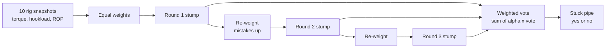
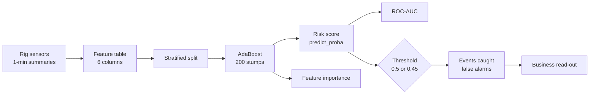
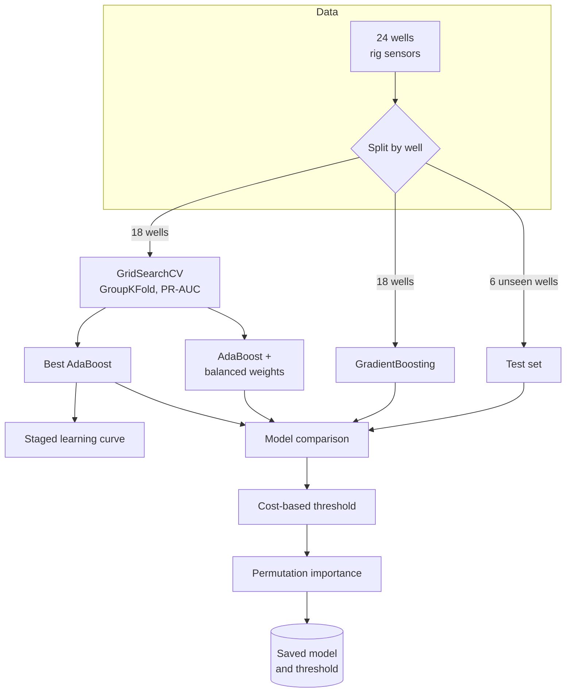
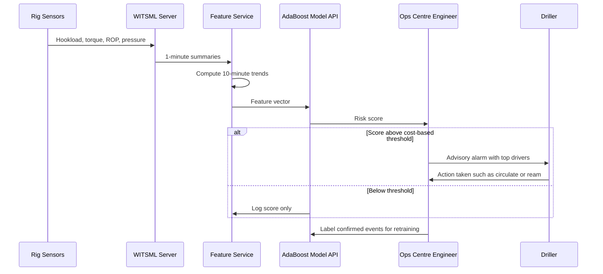

# 24. AdaBoost

[](https://colab.research.google.com/github/EdwardSuresh/architects-ml-playbook/blob/main/notebooks/24-adaboost.ipynb)  

[← 23. Recurrent Neural Network (RNN)](../23-recurrent-neural-network/README.md) · [All algorithms](../../README.md#-the-30-algorithms-ranked) · [25. k-Means++ →](../25-k-means-plus-plus/README.md)

> **AdaBoost builds a strong classifier by training many tiny decision rules in sequence, each one focusing more on the cases the previous rules got wrong.**

💡 **Analogy:** Think of a team of junior bank tellers screening cheques: the first checks one obvious thing, the next pays extra attention to the cheques the first one misjudged, and so on. At the end they vote, with the more reliable tellers getting a louder voice.

## The use case (same for Easy, Medium and Hard)
**Oil & Gas — Drilling stuck-pipe early warning**

Stuck pipe is one of the costliest drilling problems: freeing the string or sidetracking can cost hundreds of thousands of dollars and days of rig time. Drillers watch hookload, torque, rate of penetration, mud weight and standpipe pressure, but early signs are subtle and easy to miss on a long shift. The operations centre already streams these parameters every few seconds from each rig. Success means an alarm that catches most precursors early enough to circulate or ream, with a false-alarm rate the crew will tolerate, validated on wells the model has never seen.

## Industry adoption
| Sector | Score | Where you meet it |
|---|---|---|
| Financial Services | ■■□□□ 2/5 | Legacy credit and fraud scorecards built on boosted stumps; mostly replaced by gradient boosting. |
| Insurance | ■■□□□ 2/5 | Claims triage and fraud flags in older analytics stacks, often as a benchmark model. |
| Supply Chain | ■■□□□ 2/5 | Supplier late-delivery risk and quality-defect classification on modest tabular data. |
| Oil & Gas | ■■□□□ 2/5 | Drilling-event detection (stuck pipe, kicks) and equipment-failure flags from sensor summaries. |

**Why rank #24:** AdaBoost was the first practical boosting algorithm and still appears in textbooks, older production systems and face-detection pipelines. In most new tabular projects, gradient boosting libraries (XGBoost, LightGBM, CatBoost) have replaced it because they are more accurate and robust to noisy labels. It ranks here for its teaching value and some remaining use rather than as a default choice.

## How it works
1. Give every training row the same weight.
2. Train a weak learner, usually a one-split tree called a stump, that minimises weighted error.
3. Compute its say (alpha): the lower its error, the bigger its vote.
4. Increase the weights of misclassified rows and decrease the rest, then normalise.
5. Train the next stump on the re-weighted data.
6. Repeat for n_estimators rounds, optionally shrinking each vote with learning_rate.
7. Predict with the weighted vote of all stumps.

## Key terms
| Term | Meaning |
|---|---|
| Weak learner | A simple model only a bit better than guessing, like a one-question decision stump. |
| Decision stump | A decision tree with a single split, e.g. 'torque trend >= 1.2?'. |
| Alpha | The weight of a learner's vote, computed from its weighted error. |
| learning_rate | Shrinks each learner's alpha; smaller values need more estimators but generalise better. |
| staged_predict | Predictions after 1, 2, 3 ... learners, useful as a learning curve. |
| PR-AUC | Area under the precision-recall curve; better than ROC-AUC for judging rare events. |
| Stuck pipe | When the drill string cannot be moved up or down, often costing days of rig time to free. |
| GroupKFold | Cross-validation that keeps all rows of a group (here a well) in the same fold. |

## 🟢 Easy — Three stumps that spot stuck pipe
Run 3 rounds of AdaBoost by hand on 10 drilling snapshots and watch the row weights shift toward hard cases.

| 5W + H | |
|---|---|
| **Who** | A drilling engineer learning how boosting combines simple rules into an alarm. |
| **What** | Three one-question rules (decision stumps) on torque, hookload and ROP, weighted and combined into one vote. |
| **When** | At each round the algorithm re-weights rows it got wrong before training the next stump. |
| **Where** | Ten hand-typed rig snapshots in a numpy array, no ML library. |
| **Why** | Seeing the weight updates explains why AdaBoost focuses on the tricky cases and how alpha sets each rule's say. |
| **How** | Find the stump with the lowest weighted error, compute alpha, boost weights of misclassified rows, and sum alpha-weighted votes. |

**Architecture**



**🧠 ML concepts:** Decision stump (weak learner), Weighted error, Learner weight alpha, Sample re-weighting, Weighted majority vote  
**🐍 Python concepts:** 2-D numpy arrays, np.full and np.unique, np.where as vectorised if/else, Nested for loops, Functions returning tuples, Conditional expressions inside f-strings

**Steps the code performs**
1. Type 10 rows of torque, hookload and ROP with labels
2. Start every row at weight 0.1
3. Search all stumps for the lowest weighted error
4. Compute alpha and update the weights
5. Repeat for 3 rounds, printing weights
6. Combine stumps into a weighted vote and print predictions

▶️ Code: [`easy.py`](easy.py) — run with `python easy.py`

<details><summary>Walkthrough</summary>

| Lines | What happens |
|---|---|
| 5-11 | Ten rig snapshots with torque, hookload and rate of penetration (ROP). Labels use +1 for stuck pipe in the next hour and -1 for normal. |
| 14 | Every row starts with the same weight, 0.1, so all mistakes count equally in round 1. |
| 17-29 | Brute-force search: for every feature, threshold and direction, compute weighted error and keep the best stump. |
| 33-38 | Each round picks the best stump and computes alpha. Low error means a large alpha, so the stump gets more say. |
| 40-43 | The key AdaBoost step: weights of wrong rows grow, weights of right rows shrink, and all are normalised to sum to 1. |
| 44 | Add this stump's weighted vote to the running ensemble score for every row. |
| 47-51 | The final prediction is the sign of the summed votes. Rows 4, 6 and 7 each fooled one stump, but the other stumps outvote that mistake; their scores sit closest to zero. |

</details>

<details><summary>Real output</summary>

```text
Round 1: stump 'hookload >= 250'  weighted_error=0.100  alpha=1.099
   new weights: 0.06 0.06 0.06 0.06 0.06 0.06 0.06 0.50 0.06 0.06
Round 2: stump 'hookload >= 260'  weighted_error=0.056  alpha=1.417
   new weights: 0.03 0.03 0.03 0.03 0.50 0.03 0.03 0.26 0.03 0.03
Round 3: stump 'rop <= 40'  weighted_error=0.029  alpha=1.748
   new weights: 0.02 0.02 0.02 0.02 0.26 0.02 0.50 0.14 0.02 0.02

row | torque hookload rop | actual | vote   | predicted
  0 |    12      210   85 |   -1   | -4.26  |   -1
  1 |    13      215   80 |   -1   | -4.26  |   -1
  2 |    18      260   40 |   +1   | +4.26  |   +1
  3 |    11      205   90 |   -1   | -4.26  |   -1
  4 |    19      250   35 |   +1   | +1.43  |   +1
  5 |    17      240   70 |   -1   | -4.26  |   -1
  6 |    14      262   72 |   +1   | +0.77  |   +1
  7 |    12      255   75 |   -1   | -2.07  |   -1
  8 |    15      265   30 |   +1   | +4.26  |   +1
  9 |    16      220   42 |   -1   | -4.26  |   -1

Training accuracy: 100%
```

</details>

**Try this next:** Run 1 round only: which rows are wrong? · Change row 6's ROP to 40 and see how the chosen stumps change. · Add a fourth feature column (mud weight) and update names accordingly.

## 🟡 Medium — AdaBoostClassifier on 4,000 rig snapshots
Train scikit-learn's AdaBoostClassifier on synthetic drilling data, tune the alarm threshold, and read feature importance.

| 5W + H | |
|---|---|
| **Who** | A real-time drilling operations centre wanting an early warning for stuck pipe. |
| **What** | 200 boosted stumps scoring each 1-minute snapshot of hookload, torque, ROP, mud weight, standpipe pressure and torque trend. |
| **When** | Every minute while drilling, so the driller has time to circulate or ream before the pipe sticks. |
| **Where** | Data from the rig's surface sensors via WITSML into the operations centre, simulated here with numpy/pandas. |
| **Why** | A stuck-pipe event can cost hundreds of thousands of dollars in fishing and sidetrack time; a warning lets the crew act early. |
| **How** | Stratified split, AdaBoost with depth-1 trees, ROC-AUC, comparison of two thresholds, classification report and feature importances. |

**Architecture**



**🧠 ML concepts:** AdaBoost with decision stumps, Rare-event classification, Stratified splitting, ROC-AUC, Threshold tuning for recall, Feature importance  
**🐍 Python concepts:** Dict of arrays to DataFrame, Vectorised pandas arithmetic, astype for type conversion, Unpacking ravel() into four variables, Series.sort_values and .items(), Keyword arguments

**Steps the code performs**
1. Simulate 4,000 drilling snapshots with a hidden risk formula
2. Split into train and test with stratification
3. Fit AdaBoostClassifier with 200 stumps
4. Compute ROC-AUC on test
5. Compare events caught and false alarms at two thresholds
6. Print a classification report
7. Print feature importance and a business read-out

▶️ Code: [`medium.py`](medium.py) — run with `python medium.py`

<details><summary>Walkthrough</summary>

| Lines | What happens |
|---|---|
| 16-22 | Simulate 4,000 one-minute drilling snapshots with realistic column names and ranges. |
| 25-29 | A hidden risk formula makes stuck pipe more likely with rising torque, overpull, slow ROP and heavy mud. The logistic function turns risk into a probability, then a 0/1 outcome. |
| 32-35 | Separate features from the label, and split 75/25 with stratify=y so both sets have the same event rate. |
| 38-44 | AdaBoost with 200 depth-1 trees. learning_rate=0.5 shrinks each stump's vote, which usually generalises better. |
| 47-48 | Get a risk score per snapshot and measure ROC-AUC, the chance that a random event row scores above a random normal row. |
| 52-58 | Compare two alarm thresholds. AdaBoost scores cluster near 0.5, so a small move roughly doubles the events caught. |
| 61-65 | Feature importance shows torque trend dominates, matching the physics of differential sticking and pack-offs. |
| 67-68 | Translate the threshold choice into rig-floor terms: cheap pauses versus very expensive fishing jobs. |

</details>

<details><summary>Real output</summary>

```text
Rows: 4000   stuck-pipe rate: 8.0%
Test ROC-AUC: 0.910

Threshold 0.5: caught 22/80 events, 14 false alarms

Threshold 0.45: caught 46/80 events, 61 false alarms
              precision    recall  f1-score   support

      normal      0.962     0.934     0.948       920
       stuck      0.430     0.575     0.492        80

    accuracy                          0.905      1000
   macro avg      0.696     0.754     0.720      1000
weighted avg      0.919     0.905     0.911      1000

Feature importance:
  torque_trend_10min   0.386 #######################
  hookload_klb         0.219 #############
  rop_ft_hr            0.201 ############
  mud_weight_ppg       0.098 #####
  standpipe_psi        0.077 ####
  torque_kftlb         0.018 #

Business read-out: lowering the threshold from 0.5 to 0.45 roughly doubles events caught;
each false alarm costs a short pause to circulate/ream, far cheaper than a fishing job.
```

</details>

**Try this next:** Set learning_rate=1.0 and n_estimators=50: how does AUC change? · Try threshold 0.40 and count the extra false alarms. · Drop torque_trend_10min from X and see how much AUC falls.

## 🔴 Hard — Well-grouped tuning, GBM comparison, cost-based alarms
Tune AdaBoost with well-grouped cross-validation, inspect its staged learning curve, compare with GradientBoosting, and set the alarm threshold by dollar cost.

| 5W + H | |
|---|---|
| **Who** | A drilling analytics team taking a stuck-pipe model from prototype to a rig advisory tool. |
| **What** | A tuned AdaBoost model, a weighted variant for imbalance, a GradientBoosting challenger, a cost-optimal threshold and permutation importance. |
| **When** | Retrained per field campaign; scores every minute while drilling. |
| **Where** | 24 wells of synthetic data; 18 for training and CV, 6 held out entirely as unseen wells. |
| **Why** | A model that only works on wells it has seen, or picks a threshold by accuracy, will fail on the next rig or flood the driller with alarms. |
| **How** | GroupKFold by well, PR-AUC scoring, staged_predict_proba learning curve, balanced sample weights, cost curve over thresholds and joblib save. |

**Architecture**



**🧠 ML concepts:** Grouped cross-validation to avoid leakage, PR-AUC for rare events, n_estimators vs learning_rate trade-off, Staged predictions as a learning curve, Class imbalance with sample weights, Cost-sensitive threshold selection  
**🐍 Python concepts:** Module-level constants, pd.concat of a list of frames, Dict comprehension filtering get_params(), np.quantile for threshold grids, Sorting with key=lambda, joblib.dump of a dict bundle

**Steps the code performs**
1. Simulate 24 wells with their own baselines
2. Hold out 6 whole wells for testing
3. Grid-search AdaBoost with GroupKFold and PR-AUC
4. Print the staged learning curve on test wells
5. Train a balanced-weight AdaBoost and a GradientBoosting challenger
6. Compare ROC-AUC and PR-AUC
7. Pick the alarm threshold that minimises expected cost
8. Print permutation importance, a safety note and save

▶️ Code: [`hard.py`](hard.py) — run with `python hard.py`

<details><summary>Walkthrough</summary>

| Lines | What happens |
|---|---|
| 17-19 | Business costs (a missed event is about 60 times worse than a false alarm) and the feature list kept in one place. |
| 23-46 | Each well gets its own hookload and mud-weight baseline. Risk depends on trends and an interaction (overpull together with slow ROP). |
| 49-53 | Turn a threshold into dollars: missed events times their cost plus false alarms times theirs. |
| 57-64 | Hold out whole wells. A random row split would let the model memorise each well's baseline and look better than it really is. |
| 66-77 | Grid search over the number of trees, learning rate and tree depth, with GroupKFold so each fold's validation wells are unseen. Scored by PR-AUC. |
| 80-83 | An imbalance variant: balanced sample weights make each rare event row count more during training. |
| 87-92 | staged_predict_proba replays the model one tree at a time, giving a free learning curve. AUC rises fast, then plateaus. |
| 95-105 | Compare against GradientBoosting, which fits residuals with a smooth loss. Here it edges AdaBoost slightly. |
| 112-118 | Scan thresholds and pick the one with the lowest expected dollar cost, compared with having no warning system. |
| 121-131 | Permutation importance on the unseen wells, an advisory-only safety note, and save the model with its threshold. |

</details>

<details><summary>Real output</summary>

```text
Train: 4500 rows / 18 wells, event rate 2.8%  |  Test: 1500 rows / 6 wells, event rate 2.3%
== AdaBoost grid search (3-fold GroupKFold, PR-AUC) ==
 param_n_estimators  param_learning_rate  param_estimator__max_depth  mean_test_score
                150                  0.1                           2            0.304
                 50                  0.1                           2            0.302
                150                  0.5                           1            0.283
                150                  0.1                           1            0.280
                 50                  0.5                           2            0.275
== Staged learning curve on test wells (ROC-AUC as stumps are added) ==
     1 estimators  AUC=0.571 #####
     5 estimators  AUC=0.603 ########
    20 estimators  AUC=0.793 #######################
    50 estimators  AUC=0.801 ########################
    75 estimators  AUC=0.788 #######################
   150 estimators  AUC=0.795 #######################
== Model comparison on 6 unseen wells ==
  AdaBoost (tuned)     ROC-AUC=0.795  PR-AUC=0.186
  AdaBoost + balanced  ROC-AUC=0.805  PR-AUC=0.184
  GradientBoosting     ROC-AUC=0.823  PR-AUC=0.193
== Alarm threshold by expected cost (AdaBoost) ==
  thr=0.163  missed=  5  false_alarms=1020  cost=$ 5.33M
  thr=0.187  missed=  5  false_alarms= 873  cost=$ 4.74M
  thr=0.205  missed=  5  false_alarms= 727  cost=$ 4.16M
  thr=0.212  missed=  6  false_alarms= 573  cost=$ 3.79M
  thr=0.231  missed=  9  false_alarms= 429  cost=$ 3.97M
  thr=0.251  missed= 11  false_alarms= 294  cost=$ 3.93M
  thr=0.286  missed= 15  false_alarms= 157  cost=$ 4.38M
  thr=0.388  missed= 27  false_alarms=  24  cost=$ 6.85M
  -> threshold 0.212: $3.79M vs $8.50M with no warning system
== Permutation importance (PR-AUC drop) ==
  torque_trend_10min     +0.136
  hookload_trend_10min   +0.084
  mud_weight_ppg         +0.044
  hookload_klb           +0.000
  rop_ft_hr              +0.000
  standpipe_psi          -0.001
  torque_kftlb           -0.008
Safety note: this is an ADVISORY tool - the driller keeps authority (API RP 59 well-control
practice, BSEE SEMS). Log every alarm and response; re-validate per field and formation.
Saved model + threshold -> stuck_pipe_ada.joblib in a temp dir
```

</details>

**Try this next:** Replace GroupKFold with a plain KFold and compare the CV score with the test score. · Change COST_MISSED_EVENT to 50,000 and see the optimal threshold move. · Add learning_rate 1.0 back into the grid and look at the staged curve for overfitting.

## 🔄 End-to-end production flow



## ⚠️ Pitfalls
- Splitting rows at random when they come from the same wells: the model memorises well baselines. Split and cross-validate by well.
- Judging a rare-event model by accuracy. Use PR-AUC, recall at a fixed false-alarm rate, and dollar cost.
- Leaving the threshold at 0.5. AdaBoost scores are poorly calibrated and cluster near 0.5; choose the threshold by business cost.
- Noisy or mislabelled events: AdaBoost's exponential loss chases them hard. Clean labels, or try gradient boosting with a robust loss.
- Too many estimators with a high learning rate can overfit; check staged_predict curves on held-out wells.
- Treating alarms as automatic control. Keep the driller in charge and log every alarm and response for review.

**When NOT to use it:** Avoid AdaBoost when labels are noisy or when a modern gradient-boosting library is available and accuracy matters most; also avoid it for very high-dimensional sparse data where linear models shine.

## 🎤 Interview questions
<details><summary>How does AdaBoost differ from gradient boosting?</summary>

AdaBoost re-weights training rows so later learners focus on past mistakes, which corresponds to minimising exponential loss. Gradient boosting fits each new tree to the gradient (residuals) of any chosen loss, which makes it more flexible and usually more robust to noisy labels.

</details>
<details><summary>Why is AdaBoost sensitive to label noise?</summary>

Misclassified rows get exponentially larger weights each round. Mislabelled rows keep being 'wrong', so they can come to dominate training and pull the model away from the real pattern.

</details>
<details><summary>How do n_estimators and learning_rate interact?</summary>

A smaller learning rate shrinks each learner's vote, so you need more estimators to reach the same fit, but the result usually generalises better. Tune them together and check a staged learning curve.

</details>

---
[← 23. Recurrent Neural Network (RNN)](../23-recurrent-neural-network/README.md) · [All algorithms](../../README.md#-the-30-algorithms-ranked) · [25. k-Means++ →](../25-k-means-plus-plus/README.md)
