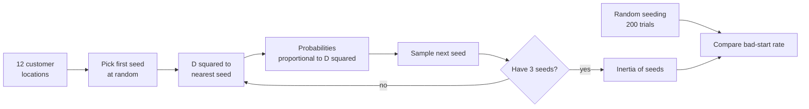
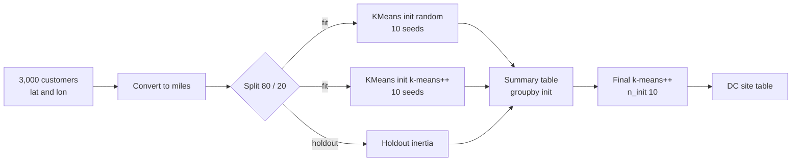
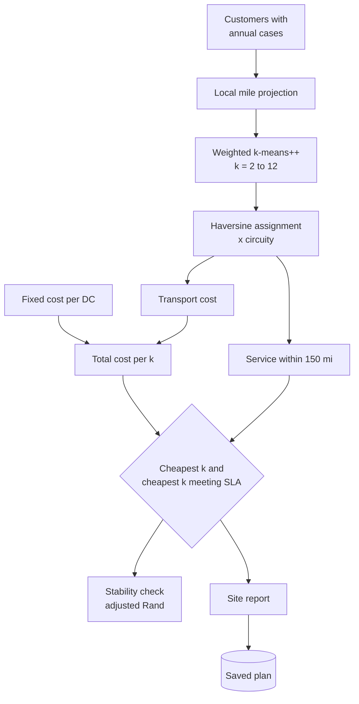
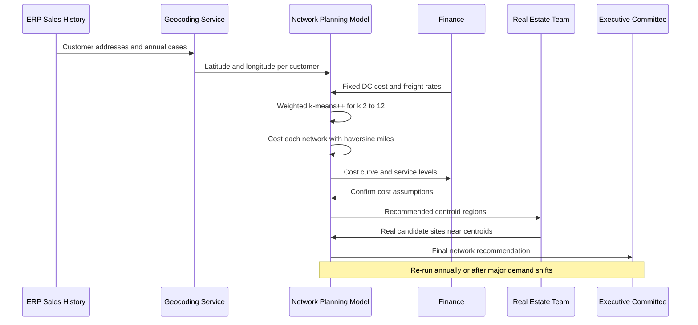

# 25. k-Means++

[](https://colab.research.google.com/github/EdwardSuresh/architects-ml-playbook/blob/main/notebooks/25-k-means-plus-plus.ipynb)  

[← 24. AdaBoost](../24-adaboost/README.md) · [All algorithms](../../README.md#-the-30-algorithms-ranked) · [26. t-SNE →](../26-t-sne/README.md)

> **k-means++ is a smarter way to choose k-means' starting centers: each new center is picked at random but strongly favouring points far from the centers already chosen.**

💡 **Analogy:** Imagine placing 3 ice-cream vans on a beach. Instead of dropping them at random (and maybe parking two side by side), you put the first one anywhere, then place each next van where people are farthest from any existing van, with some randomness. Then you let them drift toward their crowds.

## The use case (same for Easy, Medium and Hard)
**Supply Chain — Choosing distribution center locations**

A distributor serving retailers across the south-central US is reviewing its warehouse footprint as leases expire. Too few DCs means long, expensive truck runs and missed next-day deliveries; too many means paying fixed costs for half-empty buildings. The company has every customer's location and annual case volume, plus freight rates and DC operating costs. Success means a recommended number and rough placement of DCs that minimises total annual cost while meeting a next-day service target, ready to be refined against real candidate sites.

## Industry adoption
| Sector | Score | Where you meet it |
|---|---|---|
| Financial Services | ■■□□□ 2/5 | Customer and branch-catchment segmentation; ATM placement studies. |
| Insurance | ■■□□□ 2/5 | Grouping policyholders into territories and claim-adjuster zone design. |
| Supply Chain | ■■■□□ 3/5 | Distribution-center siting, delivery zone design and SKU segmentation. |
| Oil & Gas | ■■□□□ 2/5 | Grouping wells by production behaviour and siting shared facilities such as compressor stations. |

**Why rank #25:** k-means++ is the default way k-means is initialised in scikit-learn and most libraries, so it is used whenever k-means is. As a named technique it ranks below plain k-means because people rarely choose it on its own; it is a better start for the same algorithm. Supply chain uses it most visibly for facility location and customer zoning.

## How it works
1. Pick the first center uniformly at random from the data points.
2. For each point, compute D(x): the distance to the nearest center chosen so far.
3. Choose the next center at random with probability proportional to D(x) squared.
4. Repeat until k centers are chosen.
5. Run normal k-means: assign points to the nearest center, move centers to the (weighted) mean, repeat until stable.
6. Run several restarts (n_init) and keep the solution with the lowest inertia.

## Key terms
| Term | Meaning |
|---|---|
| Centroid | The center of a cluster; here a candidate DC location. |
| Inertia | Sum of squared distances from points to their nearest centroid; k-means minimises it. |
| D-squared sampling | Choosing the next seed with probability proportional to its squared distance from existing seeds. |
| n_init | Number of separate k-means runs with different seeds; the best result is kept. |
| sample_weight | A per-point weight (e.g. annual cases) so heavy-demand customers pull centroids more. |
| Haversine distance | Great-circle distance between two latitude/longitude points on Earth. |
| Circuity factor | Multiplier converting straight-line miles to typical road miles, often about 1.2. |
| Adjusted Rand index | Score from 0 to 1 for how similar two clusterings are, corrected for chance. |

## 🟢 Easy — Seed 3 DC sites the k-means++ way
Step through k-means++ seeding by hand on 12 customer towns and compare it with random seeding over 200 trials.

| 5W + H | |
|---|---|
| **Who** | A network-planning analyst learning why the starting points of k-means matter for warehouse siting. |
| **What** | Picking 3 starting distribution-center locations from 12 customer points, with probability proportional to squared distance (D squared). |
| **When** | Before any k-means iterations: this is only the initialisation step. |
| **Where** | Three customer clusters (west, north-east, south-east) on a simple mile grid, in plain numpy. |
| **Why** | Random starts often put two DCs in the same region and none in another; k-means++ makes such bad starts rare. |
| **How** | Pick the first seed at random, compute each customer's squared distance to its nearest seed, sample the next seed in proportion, and repeat. |

**Architecture**



**🧠 ML concepts:** Centroid initialisation, k-means++ D-squared sampling, Inertia (within-cluster sum of squares), Bad local starts, Comparing methods over many random trials  
**🐍 Python concepts:** numpy broadcasting with None axes, Functions with default arguments, while loops, rng.choice with custom probabilities, Lists converted to numpy arrays, Boolean mean as a percentage

**Steps the code performs**
1. Type 12 customer coordinates in 3 regions
2. Write a squared-distance-to-nearest-seed helper
3. Implement k-means++ seeding with verbose prints
4. Compute inertia for the chosen seeds
5. Run 200 trials of random vs k-means++ seeding
6. Print mean inertia and bad-start rates

▶️ Code: [`easy.py`](easy.py) — run with `python easy.py`

<details><summary>Walkthrough</summary>

| Lines | What happens |
|---|---|
| 5-10 | Twelve customer towns in three obvious regions; we want 3 distribution centers. |
| 12-16 | Broadcasting computes squared distance from every customer to every seed, then min picks the nearest seed: this is D(x) squared. |
| 18-20 | k-means++ step 1: choose the first seed uniformly at random from the customers. |
| 21-24 | Step 2: turn squared distances into probabilities. Customers far from all current seeds are much more likely to be chosen next. |
| 25-32 | Sample the next seed with those probabilities and print each step. Notice that probabilities in the already-covered cluster fall to 0.00. |
| 34-36 | Inertia sums every customer's squared distance to its nearest seed; it is the quantity k-means tries to minimise. |
| 38-41 | Run the seeding once with printing, and show the seeds and their inertia. |
| 44-53 | Repeat 200 times for both methods. A 'bad start' (inertia above 100) means two seeds share a region; k-means++ makes that rare. |

</details>

<details><summary>Real output</summary>

```text
k-means++ seeding, step by step:
  pick probs: 0.00 0.00 0.00 0.00 0.11 0.11 0.13 0.10 0.13 0.14 0.12 0.15
  chose center #2 at [19. 20.]
  pick probs: 0.00 0.00 0.00 0.00 0.00 0.01 0.00 0.00 0.23 0.28 0.23 0.24
  chose center #3 at [32.  5.]
k-means++ seeds:
[[ 3.  2.]
 [19. 20.]
 [32.  5.]]
inertia = 57.0

Seeding only (before any k-means iterations), 200 trials:
  random    : mean inertia  1496.9, bad starts (>100) 67%
  k-means++ : mean inertia   110.8, bad starts (>100) 3%
```

</details>

**Try this next:** Set K = 4 and see where the extra seed tends to land. · Use probabilities proportional to D (not D squared) and compare the bad-start rate. · Move the south-east cluster closer to the west one and rerun.

## 🟡 Medium — Random vs k-means++ across 10 seeds
Cluster 3,000 customer locations into 8 DC sites and measure how initialisation affects inertia, iterations and bad solutions.

| 5W + H | |
|---|---|
| **Who** | A supply chain analyst proposing 8 regional DC sites across the south-central US. |
| **What** | KMeans with init='random' vs init='k-means++' (one start each) over 10 seeds, then a final 10-restart k-means++ solution. |
| **When** | During a network-design study, before detailed site and cost analysis. |
| **Where** | 3,000 synthetic customers around 8 metros, converted from lat/lon to approximate miles. |
| **Why** | A bad initialisation can leave a whole metro without a nearby DC; the analyst needs to know how reliable the method is. |
| **How** | Project to miles, hold out 20% of customers, run both inits across seeds, summarise with pandas, then report the recommended sites. |

**Architecture**



**🧠 ML concepts:** Effect of initialisation on k-means, Local optima, Inertia and n_iter_, Holdout check for clustering, Multiple restarts (n_init)  
**🐍 Python concepts:** pandas DataFrame creation and describe(), np.column_stack, Nested loops building a list of dicts, DataFrame.pivot, groupby with named aggregations, assign and boolean columns

**Steps the code performs**
1. Generate 3,000 customers around 8 metros
2. Convert lat/lon to approximate miles
3. Split off 20% as holdout customers
4. Run KMeans with each init for 10 seeds
5. Print a pivot table and summary statistics
6. Count runs more than 5% worse than the best
7. Fit the final model and print DC sites with average distance

▶️ Code: [`medium.py`](medium.py) — run with `python medium.py`

<details><summary>Walkthrough</summary>

| Lines | What happens |
|---|---|
| 12-16 | Eight metro areas with their latitude, longitude and share of customers. |
| 20-25 | Draw 3,000 customers: each picks a metro by market share and is scattered around it, with a lognormal weekly order size. |
| 31-33 | Convert degrees to miles: a degree of latitude is about 69 miles, while a degree of longitude shrinks with cos(latitude). k-means needs equal units in both directions. |
| 35 | Hold out 20% of customers to check that the DC sites also serve customers the model did not see. |
| 39-45 | For 10 seeds, fit both inits with a single start each and record inertia, iterations and holdout inertia. |
| 50-56 | Pivot shows each seed side by side; groupby summarises mean, worst case, spread and iterations per method. |
| 58-61 | Count how often each method ends more than 5% worse than the best solution found, a practical measure of a bad answer. |
| 64-73 | Final recommended model: k-means++ with 10 restarts on all customers. Centroids are converted back to lat/lon with customer counts and average distance. |
| 74-75 | The business read-out: typical customer distance and why initialisation matters. |

</details>

<details><summary>Real output</summary>

```text
        lat     lon  weekly_cases
mean  34.64  -96.34         23.87
min   28.66 -106.27          3.00
max   40.85  -89.09        242.00

Training inertia (millions of sq-miles) per seed:
init  k-means++  random
seed                   
0          2.95    5.41
1          2.95    5.38
2          2.95   13.90
3          3.99    4.52
4          4.40    2.95
5          2.95    3.91
6          3.88    5.40
7          2.95   15.25
8          2.95   13.76
9          2.95   15.33

Summary over 10 seeds:
           mean_inertia  worst    sd  avg_iters  holdout
init                                                    
k-means++          3.29   4.40  0.56        3.8     0.81
random             8.58  15.33  5.22       11.3     2.20

Share of runs >5% worse than best: random 90%, k-means++ 30%

Recommended DC sites (k-means++, n_init=10):
  lat     lon  customers  avg_miles
32.78  -96.79        678      31.20
29.78  -95.35        584      31.30
39.74 -104.99        365      30.72
39.11  -94.61        327      31.06
35.46  -97.56        311      29.67
35.15  -90.08        274      30.31
36.17  -95.94        243      31.05
34.75  -92.31        218      31.88

Business read-out: average customer is 31 miles from its DC. Random init often
puts two DCs in one metro and leaves another metro unserved - k-means++ makes that rare.
```

</details>

**Try this next:** Set n_init=5 in the loop for both inits: does random catch up? · Change K to 6 and see which metros share a DC. · Remove the miles conversion (use raw degrees) and compare the site table.

## 🔴 Hard — Demand-weighted DC network sized by total cost
Use demand-weighted k-means++ to place DCs, choose k by fixed plus transport cost in haversine road miles, check stability and report the network.

| 5W + H | |
|---|---|
| **Who** | A network strategy team preparing a DC footprint recommendation for the CFO. |
| **What** | Weighted k-means++ for k = 2 to 12, each network costed with real great-circle miles, a road circuity factor, fixed DC cost and a 150-mile service check. |
| **When** | During annual network-design reviews or before a major lease decision. |
| **Where** | 4,000 customers around 12 metros with annual case volumes; runs in seconds with scikit-learn. |
| **Why** | More DCs cut transport cost but add fixed cost; the right number of DCs is a cost and service trade-off, not a statistics question. |
| **How** | sample_weight = annual cases, assign customers by haversine distance, compute total cost per k, add a service-level constraint, check seed stability, and save. |

**Architecture**



**🧠 ML concepts:** Weighted clustering with sample_weight, Choosing k by a business objective, Haversine distance, Service-level constraint, Stability via adjusted Rand index, Limits of squared-distance objectives  
**🐍 Python concepts:** Classes with helper methods, map() over a tuple, Broadcasting [:, None] for an all-pairs matrix, List comprehension filters, groupby.agg with lambda, joblib.dump

**Steps the code performs**
1. Simulate 4,000 customers with demand skewed to big metros
2. Project to miles and fit weighted k-means++
3. Assign customers by haversine distance and cost transport
4. Loop k = 2 to 12 and add fixed DC cost
5. Pick the cheapest k and the cheapest k meeting a 95% service level
6. Compare weighted vs unweighted transport cost
7. Check stability across seeds
8. Print the site report, a model-risk note and save

▶️ Code: [`hard.py`](hard.py) — run with `python hard.py`

<details><summary>Walkthrough</summary>

| Lines | What happens |
|---|---|
| 13-17 | Business inputs: fixed annual cost per DC, cost per case-mile, a 20% road circuity factor and the next-day service radius. |
| 20-34 | 4,000 customers around 12 metros. Larger metros also order more per customer, so demand is uneven, which is where weighting matters. |
| 38-43 | Haversine formula: great-circle miles between latitude/longitude points, vectorised over whole arrays. |
| 46-57 | The planner projects lat/lon to approximate miles for k-means and can convert centroids back to lat/lon. |
| 61-65 | Weighted k-means++: sample_weight = annual cases pulls each centroid toward heavy-demand customers. |
| 67-79 | Cost a network: assign customers to the nearest DC by real haversine miles, apply circuity, and sum transport, fixed cost and service level. |
| 90-99 | Try k from 2 to 12. Transport falls and fixed cost rises; the cheapest total is the cost-optimal number of DCs. |
| 102-106 | A business constraint: the cheapest k that serves 95% of demand within 150 miles may need more DCs than the pure cost optimum. |
| 109-116 | Show the value of demand weighting in dollars, then check that different seeds give nearly identical assignments (adjusted Rand close to 1). |
| 120-133 | Build the site report with groupby, print a model-risk note (centroids are a starting point, not a lease decision) and save the plan. |

</details>

<details><summary>Real output</summary>

```text
4000 customers, 4.79M cases/year

== Choosing k by total annual cost (demand-weighted k-means++) ==
  k  fixed$M  transport$M  total$M  served<150mi
  2      2.8        14.02    16.82    29.9%  #############
  3      4.2        10.04    14.24    46.2%  ########
  4      5.6         8.20    13.80    57.6%  #######
  5      7.0         6.33    13.33    73.1%  ######
  6      8.4         5.03    13.43    85.5%  ######
  7      9.8         4.08    13.88    95.2%  #######
  8     11.2         3.39    14.59    97.3%  #########
  9     12.6         2.99    15.59    98.7%  ###########
 10     14.0         2.75    16.75    99.5%  #############
 11     15.4         2.56    17.96    99.9%  ###############
 12     16.8         2.38    19.18   100.0%  ##################
  -> cheapest network: k=5 at $13.33M/year
  -> cheapest k meeting 95% within 150 mi: k=7 at $13.88M/year

== Weighted vs unweighted clustering at k=5 ==
  unweighted transport $6.48M  vs  weighted $6.33M  (saving $141K/year)

Stability across seeds (adjusted Rand index, 1.0 = identical): [1.0, 0.989, 1.0]

== Recommended DC sites (k=5) ==
    customers  cases_K  avg_road_mi  max_road_mi   lat    lon  demand_share
dc                                                                         
3        1110   1399.3        116.5        280.2  33.6  -96.9          29.2
2        1015   1263.7         88.6        229.4  29.9  -96.2          26.4
1         798    891.4        132.7        271.1  39.0  -95.6          18.6
0         678    781.1        164.5        262.4  36.8  -90.6          16.3
4         399    455.8         39.4        117.0  39.8 -105.0           9.5

Model-risk note: centroids are a STARTING point - snap each to real candidate sites (labour,
zoning, interstate access, incentives) and re-run cost with a road-network router before
committing capital. Re-validate when demand shifts >10% in any region.
Saved model + site table -> dc_plan.joblib in a temp dir
```

</details>

**Try this next:** Halve FIXED_COST_PER_DC and see how many DCs become optimal. · Set SERVICE_RADIUS_MI to 100 and find the new cheapest compliant k. · Give one metro 5x demand and see whether a centroid moves toward it.

## 🔄 End-to-end production flow



## ⚠️ Pitfalls
- Clustering raw latitude/longitude: a degree of longitude is shorter than a degree of latitude. Project to miles or use haversine for costing.
- Ignoring demand: unweighted k-means treats a tiny shop like a big-box store. Use sample_weight with volume.
- Choosing k with the elbow plot alone. Use a business objective such as fixed plus transport cost and a service-level target.
- Treating centroids as final sites. Snap them to real candidate locations near highways and labour pools, then re-cost.
- Forgetting that k-means minimises squared distance while freight cost is roughly linear in miles; refine with a facility-location model if needed.
- Running a single initialisation. Use k-means++ with several restarts (n_init) and check stability across seeds.

**When NOT to use it:** Avoid k-means++ when clusters are non-spherical or very different in size or density (consider DBSCAN or Gaussian mixtures), or when you need an optimal facility plan with capacities and real road networks (use a MIP facility-location model).

## 🎤 Interview questions
<details><summary>Why does k-means++ sample in proportion to D squared rather than always taking the farthest point?</summary>

Always taking the farthest point tends to pick outliers as centers. Sampling with probability proportional to D squared still favours far-away regions but is random enough to avoid outliers, and it has a proven O(log k) approximation guarantee.

</details>
<details><summary>How would you pick the number of distribution centers?</summary>

Cost each k as fixed DC cost plus transport cost using realistic distances, add service-level constraints, and choose the cheapest network that meets them. Statistical tools like the elbow or silhouette are secondary for this decision.

</details>
<details><summary>What does sample_weight change in k-means?</summary>

Each centroid becomes a weighted mean, so high-volume customers pull it closer, and inertia is weighted too. That matches freight cost, which scales with volume shipped.

</details>

---
[← 24. AdaBoost](../24-adaboost/README.md) · [All algorithms](../../README.md#-the-30-algorithms-ranked) · [26. t-SNE →](../26-t-sne/README.md)
