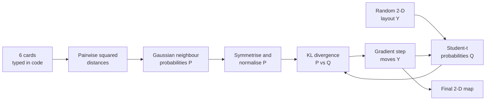
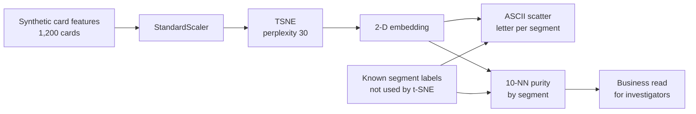
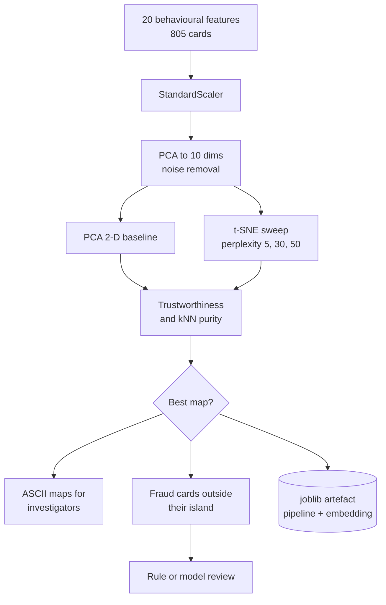
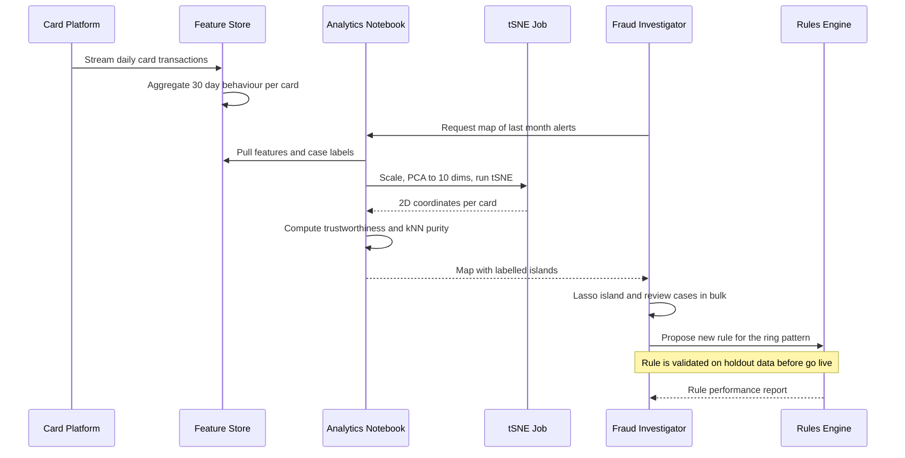

# 26. t-SNE

[](https://colab.research.google.com/github/EdwardSuresh/architects-ml-playbook/blob/main/notebooks/26-t-sne.ipynb)  

[← 25. k-Means++](../25-k-means-plus-plus/README.md) · [All algorithms](../../README.md#-the-30-algorithms-ranked) · [27. Deep Q-Network (DQN) →](../27-deep-q-network/README.md)

> **t-SNE squashes many-column data into a 2-D map where records that were neighbours in the original data stay neighbours on the map.**

💡 **Analogy:** Imagine seating 500 wedding guests at round tables so that people who know each other sit together. You do not care how far apart table 3 and table 17 are; you only care that friends end up at the same table. t-SNE is that seating planner for data points.

## The use case (same for Easy, Medium and Hard)
**Financial Services — Visualising card-transaction behaviour to reveal fraud clusters**

A card issuer's fraud investigators review thousands of alerts a week and suspect that some fraud comes in organised rings that look alike. Each card has dozens of behavioural features (spend amount, night-time share, foreign share, velocity, merchant diversity), which nobody can picture. A t-SNE map gives investigators a 2-D picture where similar cards sit together, so a tight island of confirmed fraud can be reviewed in bulk and new rules drafted. Success means fraud types form clean islands (high neighbourhood purity) and investigators find rings faster, without anyone treating map distances as a score.

## Industry adoption
| Sector | Score | Where you meet it |
|---|---|---|
| Financial Services | ■■□□□ 2/5 | Fraud and AML analysts map card or account behaviour to spot rings and mule clusters before writing rules. |
| Insurance | ■■□□□ 2/5 | Claims teams visualise claim narratives or features to find clusters of suspicious or mis-coded claims. |
| Supply Chain | ■□□□□ 1/5 | Occasionally used to visualise SKU or supplier similarity before segmentation projects. |
| Oil & Gas | ■■□□□ 2/5 | Geoscientists visualise well-log or seismic attribute patterns to see facies groupings. |

**Why rank #26:** t-SNE is a visualisation tool, not a production scoring model, so it rarely appears in deployed pipelines. Analysts in fraud, claims and research teams use it to eyeball clusters in high-dimensional data, and it is common in notebooks and model-validation decks, but UMAP and PCA increasingly replace it.

## How it works
1. Measure the distance between every pair of records in the original (high-dimensional) space.
2. Turn each distance into a 'neighbour probability' with a Gaussian bell curve; perplexity sets how many neighbours each point effectively considers.
3. Scatter the points randomly (or by PCA) on a 2-D canvas.
4. Compute 2-D neighbour probabilities with a heavy-tailed Student-t curve, which lets dissimilar groups spread far apart.
5. Measure the mismatch between the two sets of probabilities with KL divergence.
6. Move the 2-D points by gradient descent to shrink that mismatch, repeat for hundreds of iterations.
7. Read the final map for islands and outliers, never for exact distances or cluster sizes.

## Key terms
| Term | Meaning |
|---|---|
| perplexity | Roughly how many neighbours each point pays attention to; typical values 5-50. |
| KL divergence | A score of how different two probability tables are; t-SNE minimises it. |
| Student-t distribution | A bell curve with fat tails, used in 2-D so separate clusters do not crowd together. |
| embedding | The new low-dimensional coordinates produced for each record. |
| trustworthiness | A 0-1 score of how many map-neighbours were genuinely neighbours in the original data. |
| kNN purity | Share of a point's nearest map-neighbours that carry the same known label. |
| PCA pre-reduction | Compressing to ~10-50 dimensions with PCA first to remove noise and speed up t-SNE. |

## 🟢 Easy — Neighbour probabilities for 6 cards by hand
Compute t-SNE's similarity tables for 6 cards in plain numpy and watch a few gradient steps pull fraud-like cards together.

| 5W + H | |
|---|---|
| **Who** | A new fraud analyst who wants to understand what t-SNE actually calculates. |
| **What** | Six cards with two features (average spend, night-time share): three normal, three fraud-like. |
| **When** | Before trusting any t-SNE picture in an investigation pack. |
| **Where** | A plain Python script with numpy only, no machine-learning library. |
| **Why** | Knowing that t-SNE preserves neighbours, not distances, prevents the most common misreading of its maps. |
| **How** | Compute pairwise distances, Gaussian probabilities P, Student-t probabilities Q, KL divergence, then 200 gradient steps. |

**Architecture**



**🧠 ML concepts:** Pairwise distance matrix, Neighbour probabilities (Gaussian kernel), Student-t low-dimensional similarity, KL divergence as a loss, Gradient descent on point positions  
**🐍 Python concepts:** Lists of tuples, numpy broadcasting with None axes, In-place functions like np.fill_diagonal, keepdims in reductions, zip and generator expressions in str.join, f-strings with format specs

**Steps the code performs**
1. Type six cards as (spend, night share) tuples
2. Build the 6x6 squared-distance matrix
3. Convert distances to row-normalised Gaussian probabilities
4. Symmetrise into the joint table P
5. Start from a random 2-D layout and compute Student-t table Q
6. Measure KL(P||Q)
7. Run 200 gradient steps and print the final map
8. Print each card's strongest neighbour

▶️ Code: [`easy.py`](easy.py) — run with `python easy.py`

<details><summary>Walkthrough</summary>

| Lines | What happens |
|---|---|
| 6-9 | Six cards typed as tuples. N1-N3 are low-spend daytime customers; F1-F3 spend big at night. np.array turns them into a 6x2 matrix. |
| 11-14 | Broadcasting subtracts every row from every other row at once, giving all 36 pairwise squared distances without a loop. |
| 16-22 | A Gaussian bell curve turns small distances into big numbers. Zeroing the diagonal stops a card being its own neighbour; dividing by the row sum makes each row a probability table. |
| 23-25 | Averaging P with its transpose makes similarity mutual (p_ij = p_ji). The printout shows N-cards only 'see' N-cards and F-cards only 'see' F-cards. |
| 27-33 | A random 2-D starting map. Similarity there uses 1/(1+d^2), the Student-t curve whose fat tails let clusters drift far apart. |
| 34-37 | KL divergence scores how badly the random map betrays the real neighbourhoods. Only entries where P>0 count. |
| 39-51 | Each step recomputes Q and applies the t-SNE gradient: pairs with p>q get pulled together, p<q pushed apart. KL drops towards zero and the two groups separate. |
| 52-55 | zip walks labels and rows together; argmax picks each card's most similar partner, confirming that neighbours stay inside their own group. |

</details>

<details><summary>Real output</summary>

```text
Squared distances:
 [[ 0.     0.01   0.003 12.74  14.253 11.982]
 [ 0.01   0.     0.004 12.022 13.493 11.287]
 [ 0.003  0.004  0.    12.421 13.915 11.671]
 [12.74  12.022 12.421  0.     0.043  0.013]
 [14.253 13.493 13.915  0.043  0.     0.1  ]
 [11.982 11.287 11.671  0.013  0.1    0.   ]]

High-dim similarity P (rows sum ~1/6):
 [[0.    0.083 0.083 0.    0.    0.   ]
 [0.083 0.    0.083 0.    0.    0.   ]
 [0.083 0.083 0.    0.    0.    0.   ]
 [0.    0.    0.    0.    0.083 0.084]
 [0.    0.    0.    0.083 0.    0.082]
 [0.    0.    0.    0.084 0.082 0.   ]]

KL(P||Q) for a random 2-D layout: 1.352
step   1  KL=1.352
step  50  KL=0.049
step 200  KL=0.019
Final 2-D map: N1=(-3.45,-1.07), N2=(-3.45,-1.07), N3=(-3.45,-1.07), F1=(3.48,0.48), F2=(3.49,0.48), F3=(3.47,0.47)
N1: strongest neighbour = N3  (p=0.083)
N2: strongest neighbour = N3  (p=0.083)
N3: strongest neighbour = N1  (p=0.083)
F1: strongest neighbour = F3  (p=0.084)
F2: strongest neighbour = F1  (p=0.083)
F3: strongest neighbour = F1  (p=0.084)
```

</details>

**Try this next:** Change sigma to 0.1 and to 5.0: how do the P values change, and does the map still separate? · Move F1 to (1.0, 0.2) so it looks almost normal and rerun: where does it land on the 2-D map? · Replace the Student-t Q with a Gaussian (np.exp(-DY)) and compare the final KL and spread.

## 🟡 Medium — Map 1,200 card customers with scikit-learn t-SNE
Run scikit-learn's TSNE on realistic synthetic card behaviour, draw an ASCII map and measure how cleanly the fraud ring forms its own island.

| 5W + H | |
|---|---|
| **Who** | A fraud analytics team preparing a monthly investigator briefing. |
| **What** | 1,200 cards across four behaviour segments, including a 50-card fraud ring, described by five behavioural features. |
| **When** | After the monthly feature refresh, before the investigator review meeting. |
| **Where** | A Python notebook or batch job using pandas and scikit-learn. |
| **Why** | Investigators can lasso a visible island of similar cards and review them together instead of one alert at a time. |
| **How** | Scale features, run TSNE(perplexity=30), print a character scatter plot, then compute 10-nearest-neighbour purity per segment. |

**Architecture**



**🧠 ML concepts:** Feature scaling before distance-based methods, Perplexity as neighbourhood size, KL divergence of the final fit, Using labels only for evaluation, not fitting, k-nearest-neighbour purity as a quantitative check  
**🐍 Python concepts:** Helper functions returning DataFrames, pd.concat with ignore_index, List comprehensions for column lists, List-of-lists as a text canvas, numpy fancy indexing with a 2-D index array, groupby + mean + to_string

**Steps the code performs**
1. Generate four customer segments with realistic column names
2. Print the average profile of each segment
3. Standardise the five features
4. Fit t-SNE to get 2-D coordinates
5. Draw the coordinates as an ASCII scatter plot
6. Compute 10-NN purity in the map per segment
7. Print a business interpretation

▶️ Code: [`medium.py`](medium.py) — run with `python medium.py`

<details><summary>Walkthrough</summary>

| Lines | What happens |
|---|---|
| 15-23 | A helper that builds one segment as a DataFrame with columns like avg_txn_amount and night_txn_share. np.clip keeps shares between 0 and 1. |
| 25-34 | Four segments are stacked with pd.concat. The fraud ring deliberately overlaps travellers (high foreign share) and students (night-time use) so the map has real work to do. |
| 36-37 | StandardScaler puts every feature on mean 0, std 1. Without it, dollar amounts would dominate the distance and t-SNE would just sort cards by spend. |
| 39-42 | TSNE with init='pca' (more stable than random) and a fixed seed. kl_divergence_ is the final mismatch between high-dim and 2-D neighbourhoods. |
| 45-60 | Since matplotlib is off-limits, a list of lists acts as a canvas. Coordinates are rescaled to grid cells and the fraud ring is drawn last so it stays visible. |
| 63-70 | NearestNeighbors finds the 10 closest map-neighbours of each card (11 including itself). Purity is the share with the same segment label. |
| 71-76 | Average purity per segment, then a plain-English sentence for investigators. High fraud-ring purity means the island is worth a bulk review. |

</details>

<details><summary>Real output</summary>

```text
           avg_txn_amount  night_txn_share  foreign_txn_share  txn_per_day  distinct_merchants_7d
segment                                                                                          
FraudRing          301.15             0.28               0.34         4.14                  14.70
Retail              59.37             0.08               0.06         1.97                   7.85
Student             24.33             0.38               0.06         5.90                  19.75
Traveler           240.64             0.12               0.31         1.00                   5.08

Final KL divergence: 0.867

t-SNE map (R=Retail T=Traveler S=Student F=FraudRing)
+------------------------------------------------------------+
|                         F                                  |
|                      FFFFF                                 |
|   TTTTTTTTTFTTT     T  FFFFF                               |
|  TTTTTTTTTTTTTTTTFTTT                                      |
|  TT TTTTTTTTTTTTTTTTT                        S             |
|TTTTTTTTTTTTTTTTTTTTTT                     FSSSSSSS S SSSS  |
|  TTTTTT TTTTTT  TTT                    SSSSSSSSSSSSSSSSSSSS|
|      TTTTT  T                          RSSSSSSSS SSSSSS    |
|        FRR T TTRRR  R   T                 S   S  S         |
|        RRRRRRRRR FRRRRRRT                                  |
|        RRR RRRRRR RRRRR   RRRRRRR                          |
|     RRRRR RRRRRRRRRRR  RRRRRRRRRRR                         |
|     TRRRRRRRRRR   RRRRRRRRRRR RRR                          |
|        RRRRRRR   RR RRRRRRRRRRRRRR                         |
|            RRRRRRRRRRRRRRRRRRRRRRR                         |
|           RRRRRRRRRR RRRR R  R RR                          |
|          RRRRRRRRRRRRRRRRRRRR                              |
|                    RRRRRRRRR R                             |
+------------------------------------------------------------+

10-NN purity in the 2-D map, by segment:
segment
FraudRing    0.886
Retail       0.970
Student      0.992
Traveler     0.942

Business read: 89% of a fraud-ring card's map neighbours are also fraud-ring cards,
so investigators can lasso that island and review those accounts together.
```

</details>

**Try this next:** Set perplexity to 5 and then 100: how does the map change and what happens to FraudRing purity? · Remove the StandardScaler line (use df[features].values) and see which segments merge. · Shrink the fraud ring to 15 cards: is it still visible as an island?

## 🔴 Hard — Investigator-grade fraud map: PCA, perplexity sweep, trust checks
Build a reproducible pipeline that pre-reduces with PCA, sweeps perplexity, scores maps with trustworthiness and kNN purity, compares with PCA 2-D and saves the artefacts.

| 5W + H | |
|---|---|
| **Who** | A fraud data-science team delivering maps that investigators and model-risk reviewers will scrutinise. |
| **What** | 805 cards, 20 behavioural features (6 informative, 14 noise), five segments including account-takeover and card-testing fraud. |
| **When** | Monthly, or whenever a new fraud pattern is suspected and the team wants a visual hypothesis. |
| **Where** | A scheduled batch job; the embedding and preprocessing pipeline are versioned to a model store. |
| **Why** | A single t-SNE run can mislead. Sweeping settings and scoring the map shows whether the islands are real or an artefact. |
| **How** | Pipeline(StandardScaler, PCA 10) then TSNE at perplexity 5/30/50, choose by trustworthiness + purity, compare with PCA 2-D, audit fraud cards outside islands, save with joblib. |

**Architecture**



**🧠 ML concepts:** PCA pre-reduction before t-SNE, Perplexity sensitivity analysis, Trustworthiness as map-quality metric, kNN purity per class, Linear (PCA) vs non-linear (t-SNE) embeddings, Why t-SNE has no transform for new data  
**🐍 Python concepts:** Module-level constants and dicts of tuples, Functions with docstrings and default arguments, sklearn Pipeline and named_steps, Building a results table from a list of dicts, np.isin boolean masks, if __name__ == '__main__' entry point

**Steps the code performs**
1. Generate 20 features with signal in only six
2. Scale and PCA-reduce to 10 dimensions
3. Score a PCA 2-D baseline
4. Run t-SNE at three perplexities and score each map
5. Pick the best map and draw it beside PCA
6. Report per-segment purity and fraud cards outside islands
7. Save the pipeline and embedding with joblib
8. Print the model-risk guidance

▶️ Code: [`hard.py`](hard.py) — run with `python hard.py`

<details><summary>Walkthrough</summary>

| Lines | What happens |
|---|---|
| 17-21 | Configuration at the top: segment sizes and the letter each segment gets on the map. Fraud is rare (65 of 805), as in real life. |
| 24-41 | Each segment gets a different mean on six informative features; the other 14 columns are pure noise. This mimics real feature stores where many fields add nothing. |
| 44-48 | Reusable purity function: for each point, the share of its k nearest map-neighbours that share its label. |
| 74-78 | A scikit-learn Pipeline chains scaling and PCA so the exact same preprocessing can be saved and replayed. PCA to 10 dims strips noise and speeds t-SNE. |
| 80-83 | The first two PCA components act as a baseline map. Trustworthiness compares map-neighbours with neighbours in the 10-D PCA space. |
| 85-96 | Three t-SNE runs with different perplexities. Each is scored on trustworthiness and purity; the best combined score is kept. t-SNE wins clearly on trustworthiness. |
| 98-104 | Prints the comparison table and both maps. PCA squeezes fraud types into the legit mass; t-SNE pulls card-testing into its own corner. |
| 106-115 | Per-segment purity and a triage count of fraud cards whose neighbours are mostly other segments: these are the cases a map-only review would miss. |
| 117-120 | joblib saves the fitted pipeline, the embedding and the chosen perplexity so the exact picture can be reproduced for auditors. |
| 122-126 | The SR 11-7 style guidance: t-SNE is for exploration, its distances and cluster sizes are not meaningful, and it must never score live transactions. |

</details>

<details><summary>Real output</summary>

```text
Customers: 805, features: 20, mix: {'Retail': 400, 'Traveler': 200, 'Student': 140, 'AccountTakeover': 40, 'CardTesting': 25}
PCA(10) keeps 62.8% of variance; first 3 PCs: [0.116 0.07  0.063]
Method comparison (higher trust/purity = better local fidelity):
method perplexity  trust@10  purity@10  secs
PCA-2D          -     0.727      0.868 0.000
 t-SNE          5     0.889      0.772 1.327
 t-SNE         30     0.914      0.819 1.321
 t-SNE         50     0.908      0.826 1.660
Best t-SNE map (perplexity=50) R=Retail T=Traveler S=Student A=AcctTakeover C=CardTest
+----------------------------------------------------------------+
|                                 R                              |
|                        SR RRRR  R  R RRR  RR                   |
|          T   R T  R  RRRRRRRT RRRRRRRRRRRSSRS   S  R           |
|    TA TTT  TTR T RRRRRRRRRTRRRRRRRRRRRRRR RRSR  R RR           |
|  TTT TT TT TTTTT  R RRRRRRRTRRRR RRRRRRRRRSSRRRSSSSRSSS        |
| TTT TTTTTTTTTTRTTTRT RRRRRRRTSRRRSRRRR R SRSSSSSS S SS SSSS    |
|TTTTTTT TTTTTTTT TTTRTRRR RR RRSRRRRRRRSRRRSSSSSS SSSSSSSSSSS S |
|RR TTTTTTT TTTTTT TTTRRRTRR R  RRRRRR  R SS SSS SSSSS SSCSCCCCCC|
|   T TT TTTT T AAT ATT TTRR RRRRR S  SS  A RS SSSRSS SS  CCCCC  |
|        RT TTTRATR    A T AT  R   AR AAAAAAAAAA    C   S        |
|                  AAA    A  R     AA AA A AS                    |
+----------------------------------------------------------------+
PCA 2-D map for comparison:
+----------------------------------------------------------------+
|                                                                |
|                                   AAA  A                       |
|      T T  TTTT T T AA  AAAA AAAAA   AA     C C C  CCCCCC C   C |
| T TTTTTTTTTTTTTTTTTTTRTTATATAARASAASSSSSSSCSSSCSSSCSC C CC  C  |
|TT T TTTTTT TTTTTTRRRTRRRRRRSRSRRSSSSSSSSSSSSSSSS  S            |
|        T    R RRRRRRRRRRRRRRRRSRSRSSSSSS S          SS         |
+----------------------------------------------------------------+
Per-segment 10-NN purity on best t-SNE map: {'AccountTakeover': 0.65, 'CardTesting': 0.87, 'Retail': 0.85, 'Student': 0.76, 'Traveler': 0.85}
Fraud cards whose map neighbours are mostly other segments: 16 of 65
Saved preprocessing pipeline + embedding to /tmp/tmpXXXXXX
MODEL-RISK NOTE (SR 11-7 / investigator guidance):
 - t-SNE is an EXPLORATION tool. Cluster sizes and gaps between islands are NOT meaningful distances.
 - It has no transform() for new cards: never score live transactions with a t-SNE coordinate.
 - Use islands to form hypotheses, then confirm with a validated, documented fraud model + case review.
 - Record perplexity, seed and PCA settings so the picture shown to investigators is reproducible.
```

</details>

**Try this next:** Change PCA n_components to 3 and to 20: how do trustworthiness and fraud purity move? · Add perplexity 100 to the sweep and see whether the global layout changes. · Run with three different random_state values and check whether the same islands appear each time.

## 🔄 End-to-end production flow



## ⚠️ Pitfalls
- Reading distances between islands as meaningful. t-SNE preserves local neighbours only; use PCA or the original features for distance-based statements.
- Trusting one run. Results depend on perplexity and seed; sweep perplexity and check that islands persist across seeds.
- Forgetting to scale features. Unscaled dollar columns dominate distances; always standardise first.
- Feeding hundreds of raw columns. Pre-reduce with PCA to 10-50 dimensions to cut noise and runtime.
- Using t-SNE coordinates as model features or scores. It has no transform for new records and changes every run; build a proper model instead.
- Judging cluster size or density from the map. t-SNE expands dense clusters and shrinks sparse ones, so area tells you nothing about volume.

**When NOT to use it:** Do not use t-SNE when you need distances, cluster sizes or a reusable transform for new data, or on millions of rows without sampling; use PCA, UMAP or a supervised model instead.

## 🎤 Interview questions
<details><summary>Why does t-SNE use a Student-t distribution in the low-dimensional space?</summary>

The fat tails of the Student-t let moderately distant points sit far apart in 2-D, which fixes the 'crowding problem' where everything would collapse into the middle. It makes clusters visually distinct.

</details>
<details><summary>What does perplexity control and how do you choose it?</summary>

Perplexity is roughly the number of effective neighbours each point considers. Small values emphasise very local structure and can fragment clusters; large values show more global shape. Sweep a few values (5-50) and check stability and trustworthiness.

</details>
<details><summary>Can you use t-SNE to score new fraud transactions in production?</summary>

No. Standard t-SNE has no transform method for unseen points, its layout changes run to run, and its distances are not calibrated. Use it to form hypotheses, then build and validate a supervised model or rules for production.

</details>

---
[← 25. k-Means++](../25-k-means-plus-plus/README.md) · [All algorithms](../../README.md#-the-30-algorithms-ranked) · [27. Deep Q-Network (DQN) →](../27-deep-q-network/README.md)
