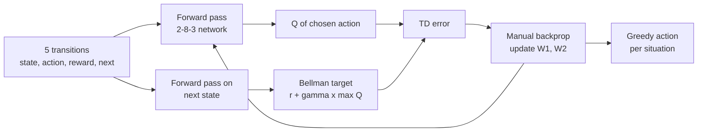
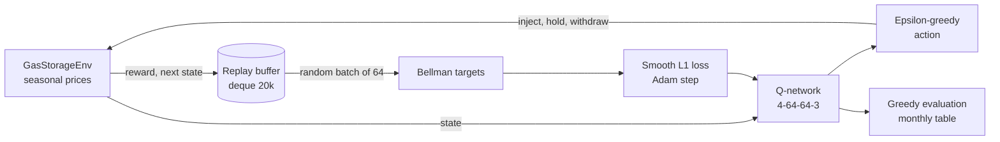
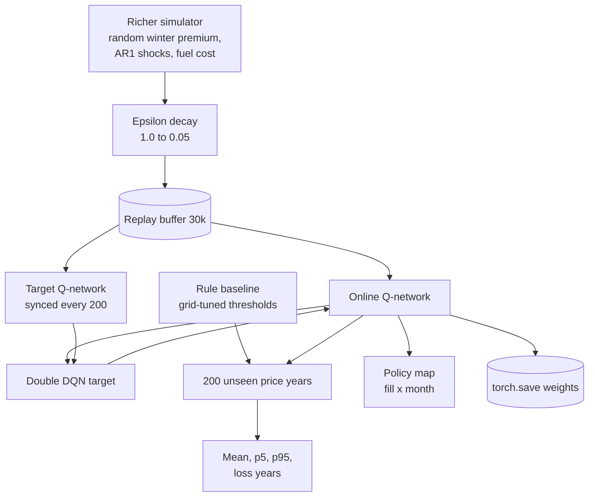
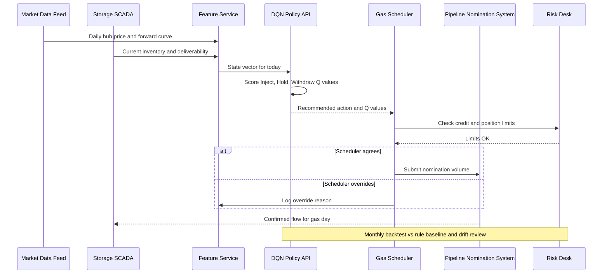

# 27. Deep Q-Network (DQN)

[](https://colab.research.google.com/github/EdwardSuresh/architects-ml-playbook/blob/main/notebooks/27-deep-q-network.ipynb)  

[← 26. t-SNE](../26-t-sne/README.md) · [All algorithms](../../README.md#-the-30-algorithms-ranked) · [28. Actor-Critic →](../28-actor-critic/README.md)

> **DQN is a neural network that learns, by trial and error in a simulator, how much long-term profit each possible action is worth in each situation.**

💡 **Analogy:** Think of a new gas scheduler who keeps a notebook of 'if the price is X and the tank is Y full, injecting today tends to pay Z by year end'. At first the notebook is guesses; after many simulated years it becomes a reliable rulebook. DQN is that notebook, written by a neural network.

## The use case (same for Easy, Medium and Hard)
**Oil & Gas — Natural gas storage: daily Inject / Hold / Withdraw decisions**

A midstream operator leases a 100,000 MMBtu storage field and must decide each day whether to inject gas, hold, or withdraw and sell. Prices are cheap in summer and expensive in winter, but the size of the winter premium and short-term shocks change every year. Schedulers today use simple buy-below/sell-above rules that leave money on the table and sometimes never trigger. Data available: daily hub prices, forward curves, storage levels, injection/withdrawal limits and fuel costs. Success means a policy that beats the rule-based baseline out-of-sample, with fewer loss-making years, inside all physical and contractual limits.

## Industry adoption
| Sector | Score | Where you meet it |
|---|---|---|
| Financial Services | ■■□□□ 2/5 | Research desks test DQN for trade execution and market-making in simulators before any live use. |
| Insurance | ■□□□□ 1/5 | Rare; occasionally explored for sequential claims-handling or reinsurance purchase decisions in research. |
| Supply Chain | ■■□□□ 2/5 | Inventory replenishment and warehouse dispatch pilots where a digital twin simulator exists. |
| Oil & Gas | ■■□□□ 2/5 | Gas storage, battery and pumped-hydro dispatch, where daily inject/withdraw decisions follow seasonal prices. |

**Why rank #27:** DQN made deep reinforcement learning famous, but real businesses use it sparingly because it needs a trustworthy simulator, careful tuning and heavy validation. It appears in research desks, energy storage and inventory pilots, rarely as a core production system.

## How it works
1. Describe the situation as a state (price, storage level, time of year) and list the allowed actions (Inject, Hold, Withdraw).
2. A neural network takes the state and outputs one Q-value per action: the expected total future reward of taking that action.
3. The agent acts epsilon-greedily: usually the best Q-value, sometimes a random action to explore.
4. Each experience (state, action, reward, next state) is stored in a replay buffer.
5. Random mini-batches from the buffer train the network toward the Bellman target: reward + discount x best next Q-value.
6. A slowly-updated target network computes those targets so learning does not chase its own tail.
7. Exploration is reduced over time and the final greedy policy is evaluated against a baseline.

## Key terms
| Term | Meaning |
|---|---|
| Q-value | Expected total future reward of taking an action in a state and acting well afterwards. |
| Bellman target | Reward now plus discounted best Q-value of the next state; the label the network learns from. |
| replay buffer | A memory of past experiences sampled randomly to break day-to-day correlation. |
| target network | A frozen copy of the Q-network, refreshed every N updates, used to compute stable targets. |
| epsilon-greedy | Pick a random action with probability epsilon, otherwise the best known action. |
| discount factor (gamma) | How much future rewards count versus today's; 0.97 per step values the winter payoff. |
| mark-to-market reward | Daily change in value of cash plus inventory, giving a dense learning signal. |

## 🟢 Easy — A tiny neural Q-function on five storage transitions
Train a 2-8-3 neural network by hand in numpy so it learns which of Inject/Hold/Withdraw is worth most in two storage situations.

| 5W + H | |
|---|---|
| **Who** | A storage analyst new to reinforcement learning. |
| **What** | Five hand-typed transitions (state, action, reward, next state) from a gas field, with price and fill level as the state. |
| **When** | Before building a full simulator: to see what a Q-network is and how the Bellman target trains it. |
| **Where** | A single numpy script, no deep-learning library, so every gradient is visible. |
| **Why** | DQN is just this idea scaled up; understanding the target and the backprop removes the mystery. |
| **How** | Forward pass, Bellman target r + gamma x max Q(next), squared error on the chosen action, manual backprop, repeat 300 epochs. |

**Architecture**



**🧠 ML concepts:** Q-function approximated by a neural network, Bellman target, Temporal-difference (TD) error, Backpropagation through one hidden layer, Greedy policy from Q-values  
**🐍 Python concepts:** Lists of tuples holding numpy arrays, Functions returning multiple values, The @ matrix-multiplication operator, Tuple unpacking in for-loops, In-place array updates with -=, np.outer for gradient matrices

**Steps the code performs**
1. Type five storage transitions
2. Initialise a small two-layer network
3. For each transition compute Q(s) and Q(next)
4. Build the Bellman target and TD error
5. Backpropagate only through the chosen action
6. Repeat for 300 epochs and print the error
7. Print Q-values and the chosen action for summer and winter

▶️ Code: [`easy.py`](easy.py) — run with `python easy.py`

<details><summary>Walkthrough</summary>

| Lines | What happens |
|---|---|
| 5-16 | The action list and five transitions. State = [scaled price, fill fraction]. Rewards encode the business: injecting cheap gas gains value, withdrawing when nearly empty and cheap is penalised. |
| 18-22 | Random weights for a 2-input, 8-hidden, 3-output network: one output per action. |
| 25-27 | Forward pass: ReLU hidden layer then a linear output layer. Returning h as well lets us reuse it for backprop. |
| 29-37 | For each transition: Q-values now and next, the Bellman target r + gamma x max Q(next), and the error on the action actually taken. |
| 39-47 | Manual backprop. Only the chosen action's output gets an error signal; the chain rule pushes it through the ReLU to the first layer. |
| 48-49 | Progress print: the squared TD error falls toward zero as the network fits the targets. |
| 51-54 | Query two situations. Cheap summer with an empty tank -> Inject; pricey winter with a full tank -> Withdraw. |

</details>

<details><summary>Real output</summary>

```text
epoch   0  squared TD error = 115.845
epoch 100  squared TD error = 0.317
epoch 200  squared TD error = 0.001
epoch 300  squared TD error = 0.000
Summer, cheap, nearly empty    Q=[ 6.14  2.91 -1.89] -> Inject
Winter, pricey, fairly full    Q=[ 8.64  4.22 15.1 ] -> Withdraw
```

</details>

**Try this next:** Set gamma to 0.9 and lr to 0.05: does training still converge, or do Q-values blow up (a classic DQN instability)? · Add a transition where withdrawing in summer earns +1 and see how the summer Q-values change. · Increase the hidden layer to 32 units and compare the final Q-values.

## 🟡 Medium — DQN with replay buffer on a seasonal gas-price year
Train a PyTorch DQN with a replay buffer on a simulated storage year and show its month-by-month inject/withdraw pattern.

| 5W + H | |
|---|---|
| **Who** | A commercial analytics team prototyping an RL scheduler for one storage field. |
| **What** | A simulator with 120 three-day decision steps per year, seasonal prices plus noise, 100k MMBtu capacity and 8k MMBtu max flow per step. |
| **When** | Prototype phase, before investing in a richer simulator with fuel costs and price shocks. |
| **Where** | A Python script with PyTorch on CPU; trains in seconds. |
| **Why** | Shows whether a learning agent discovers the fill-in-summer, sell-in-winter pattern on its own. |
| **How** | Epsilon-greedy actions, experiences stored in a deque, random mini-batches trained toward r + gamma x max Q(next) with Smooth L1 loss. |

**Architecture**



**🧠 ML concepts:** Environment / agent loop, Experience replay, Epsilon-greedy exploration, Mark-to-market reward shaping, Huber (Smooth L1) loss for Q-learning, Greedy evaluation after training  
**🐍 Python concepts:** Classes with methods and class constants, collections.deque with maxlen, zip(*batch) to transpose a list of tuples, torch.no_grad context manager, Tensor gather and max, f-string column alignment

**Steps the code performs**
1. Define the storage environment
2. Build the Q-network and optimiser
3. Run 60 simulated years with epsilon=0.1
4. Store every transition in the replay buffer
5. Train on random mini-batches every other step
6. Evaluate greedily on a fresh price year
7. Print the most common action and storage level per month

▶️ Code: [`medium.py`](medium.py) — run with `python medium.py`

<details><summary>Walkthrough</summary>

| Lines | What happens |
|---|---|
| 15-24 | The simulator. reset() draws a new year of prices: about $2 in summer, $4 in winter, plus noise. Storage starts empty. |
| 26-30 | The state the agent sees: price minus $3, fill fraction, and sin/cos of the calendar so December and January look close together. |
| 32-46 | Applies an action within capacity and rate limits. The reward is the change in value of the gas held (mark-to-market) minus a storage fee, a dense signal that is easier to learn from. |
| 49-54 | A 4-64-64-3 network, Adam optimiser and a replay buffer that keeps the latest 20,000 experiences. |
| 57-62 | Epsilon-greedy: with probability eps a random action, otherwise the action with the highest predicted Q-value. |
| 65-71 | The training loop: act, observe, and store each experience tuple. |
| 74-84 | A random mini-batch is unpacked with zip(*...). gather picks the Q-value of the action actually taken; the target uses the best next Q. Smooth L1 loss limits the impact of big errors. |
| 88-104 | Run one fresh year with no exploration and summarise each month's typical action and end storage. The agent fills from July and sells into January-March. |

</details>

<details><summary>Real output</summary>

```text
episode 10  mark-to-market P&L=$  136.9k  buffer=1200
episode 20  mark-to-market P&L=$  133.6k  buffer=2400
episode 30  mark-to-market P&L=$  187.4k  buffer=3600
episode 40  mark-to-market P&L=$  166.3k  buffer=4800
episode 50  mark-to-market P&L=$  178.1k  buffer=6000
episode 60  mark-to-market P&L=$  176.1k  buffer=7200

Month  avg_price  most_common_action  end_storage
  Apr  $    2.82            Withdraw           8
  May  $    2.31            Withdraw           8
  Jun  $    2.14            Withdraw           8
  Jul  $    1.93              Inject          72
  Aug  $    2.23              Inject         100
  Sep  $    2.66              Inject         100
  Oct  $    3.25              Inject         100
  Nov  $    3.79              Inject          84
  Dec  $    3.90                Hold          60
  Jan  $    4.00            Withdraw           0
  Feb  $    3.74                Hold           0
  Mar  $    3.32            Withdraw           0

Business read: year-end value (cash + gas left) = $237k on a 100k MMBtu field.
A good policy fills in the cheap summer months and withdraws into the winter price peak.
```

</details>

**Try this next:** Set eps to 0.3 during training: does the policy get better or worse? · Change the reward to cash only (-vol * p) and see how much harder learning becomes. · Double FEE to 0.02 and check whether the agent starts filling later in the summer.

## 🔴 Hard — Double DQN with target network vs tuned buy-low-sell-high rule
Train a Double DQN with target network and epsilon decay on a richer storage simulator, then compare it with a tuned rule over 200 unseen price years.

| 5W + H | |
|---|---|
| **Who** | A storage optimisation team preparing evidence for the trading risk committee. |
| **What** | Random winter premium each year, persistent AR(1) price shocks, injection and withdrawal fuel costs, 120 decisions a year. |
| **When** | Before any pilot: the agent must beat the incumbent rule out-of-sample with fewer loss-making years. |
| **Where** | An offline training job; weights saved with torch.save for the policy service. |
| **Why** | Rules with fixed thresholds miss mild winters and price shocks; a learned policy can adapt to time of year, inventory and price together. |
| **How** | Target network synced every 200 updates, Double-DQN targets, gradient clipping, epsilon decay 1.0 to 0.05, thresholds of the rule tuned on training years. |

**Architecture**



**🧠 ML concepts:** Target network for stable targets, Double DQN to reduce over-estimation, Epsilon decay schedule, Gradient clipping, Out-of-sample evaluation over many episodes, Tuning the baseline fairly, Policy maps for explainability  
**🐍 Python concepts:** Per-object RandomState for reproducible, separate data streams, Closures (functions that return functions), Passing functions as arguments, map(np.array, zip(*...)) for batching, state_dict save/load, Percentiles with numpy

**Steps the code performs**
1. Build a richer environment with fuel costs and AR(1) shocks
2. Grid-search the rule's buy and sell thresholds on training years
3. Train Double DQN with target network and epsilon decay
4. Evaluate do-nothing, rule and DQN on 200 unseen years
5. Report mean, p5, p95 and share of loss years
6. Print a policy map across fill level and month
7. Save weights and print the model-risk note

▶️ Code: [`hard.py`](hard.py) — run with `python hard.py`

<details><summary>Walkthrough</summary>

| Lines | What happens |
|---|---|
| 19-37 | A richer simulator: each year has a random winter premium and AR(1) noise so shocks persist. Each env owns a RandomState so training and test years never overlap. |
| 44-56 | Fuel costs for injection and withdrawal plus a storage fee. The mark-to-market reward sums exactly to final cash plus inventory value. |
| 63-71 | Two networks start identical. Epsilon falls linearly from 1.0 to 0.05 over 70% of training, moving from exploration to exploitation. |
| 84-91 | Double DQN: the online network chooses the best next action, the target network scores it. This curbs the over-optimistic Q-values of plain DQN. |
| 92-99 | Smooth L1 loss, gradient clipping at norm 5, and a hard sync of the target network every 200 updates. |
| 106-122 | One evaluator for every policy (any function from state to action). The rule baseline is a closure that remembers its two thresholds. |
| 127-136 | Tune the rule's thresholds on training years first, so the comparison is fair; then train the DQN. |
| 142-151 | Out-of-sample comparison: mean value, 5th and 95th percentiles and share of loss-making years. The DQN wins on mean and has no loss years. |
| 153-167 | A policy map: for empty, half and full storage at each month, which action does the network pick? Schedulers can sanity-check it against intuition. |
| 169-175 | Weights are saved with torch.save, and a model-risk note reminds that physical, tariff and credit limits must be enforced outside the model. |

</details>

<details><summary>Real output</summary>

```text
Best rule on training years: buy < $2.2, sell > $3.8 (avg $101.7k)
Training Double DQN with target network...
  episode  30  eps=0.65  train value=$ 133.6k  updates=1301
  episode  60  eps=0.30  train value=$ 151.0k  updates=3101
  episode  90  eps=0.05  train value=$ 171.2k  updates=4901
  episode 120  eps=0.05  train value=$ 109.6k  updates=6701
Training + tuning time: 11.8s

Out-of-sample results over 200 price years ($k per year):
policy            mean      p5     p95  loss yrs
Do nothing         0.0     0.0     0.0      0.0%
Rule (tuned)     114.9     0.0   182.8      3.5%
DQN              132.7    44.4   190.5      0.0%
DQN beats rule in 72% of years; mean uplift $17.8k

Policy map (rows = fill level, cols = month index, price at seasonal average):
fill   1  2  3  4  5  6  7  8  9 10 11 12
 0.0  W  W  H  I  I  I  I  I  I  H  W  W
 0.5  W  W  H  I  I  I  I  I  W  W  W  W
 1.0  W  I  W  H  H  H  H  W  W  W  I  I
(I=Inject H=Hold W=Withdraw; month 1 = April)

Saved Q-network weights to /tmp/tmpXXXXXX/gas_storage_dqn.pt
MODEL-RISK NOTE: treat the agent as decision SUPPORT. Pipeline nominations, FERC/tariff limits,
ratchets and credit limits must be hard constraints outside the model; re-validate when the
forward curve regime changes (SR 11-7 style ongoing monitoring for trading models).
```

</details>

**Try this next:** Set sync_every to 1 (no real target network) and compare the out-of-sample mean. · Raise INJ_COST to 0.10 and see how the policy map and uplift over the rule change. · Train for 60 episodes instead of 120: how much performance do you lose?

## 🔄 End-to-end production flow



## ⚠️ Pitfalls
- Trusting a simulator that is too simple. If prices in the simulator lack real shocks, the policy will be overconfident; calibrate to history and stress-test.
- Comparing against a weak baseline. Tune the incumbent rule on the same training data before claiming uplift.
- Sparse rewards. Paying out only when gas is sold makes learning slow; use mark-to-market rewards that sum to the same total.
- Unstable training from bootstrapping. Use a target network, replay buffer, Huber loss and gradient clipping.
- Letting the agent enforce physical limits. Ratchets, nominations and credit limits must be hard constraints outside the network.
- Evaluating on training years. Always test on unseen price paths and report the downside (p5, loss years), not just the mean.

**When NOT to use it:** Skip DQN when there is no credible simulator, when the action space is continuous (use actor-critic methods), or when a linear program or dynamic programme on the forward curve already solves the problem exactly.

## 🎤 Interview questions
<details><summary>Why does DQN need a replay buffer and a target network?</summary>

Consecutive experiences are highly correlated, which makes neural-network training unstable; random replay breaks that correlation. A target network keeps the regression target fixed for a while so the network is not chasing a moving target.

</details>
<details><summary>What problem does Double DQN solve?</summary>

Taking the max over noisy Q-estimates systematically over-estimates values. Double DQN lets the online network pick the next action and the target network evaluate it, which reduces that optimistic bias.

</details>
<details><summary>How would you convince a risk committee that a DQN storage policy is safe to pilot?</summary>

Show out-of-sample results on many simulated and historical years against a tuned incumbent rule, including downside metrics. Keep hard limits outside the model, run it in advisory mode with human override, and monitor drift monthly.

</details>

---
[← 26. t-SNE](../26-t-sne/README.md) · [All algorithms](../../README.md#-the-30-algorithms-ranked) · [28. Actor-Critic →](../28-actor-critic/README.md)
