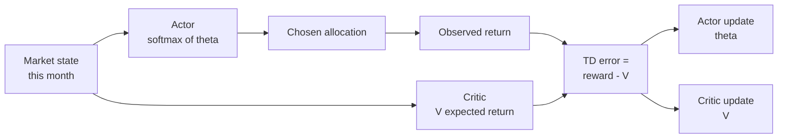
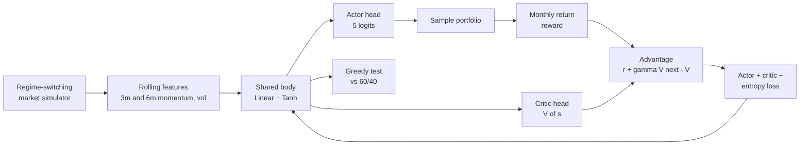
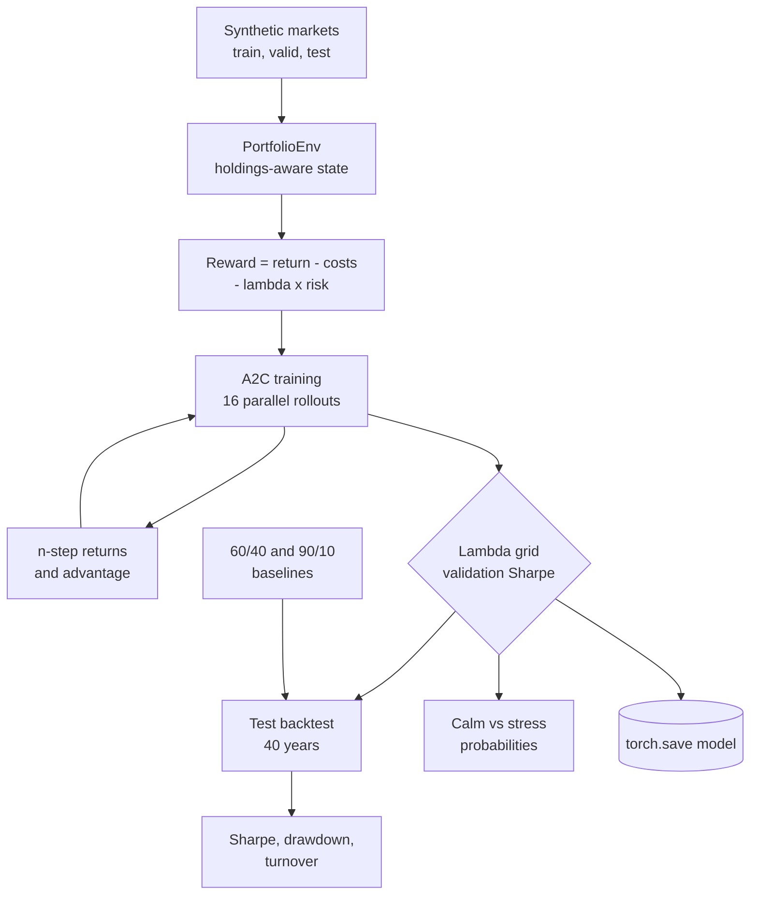
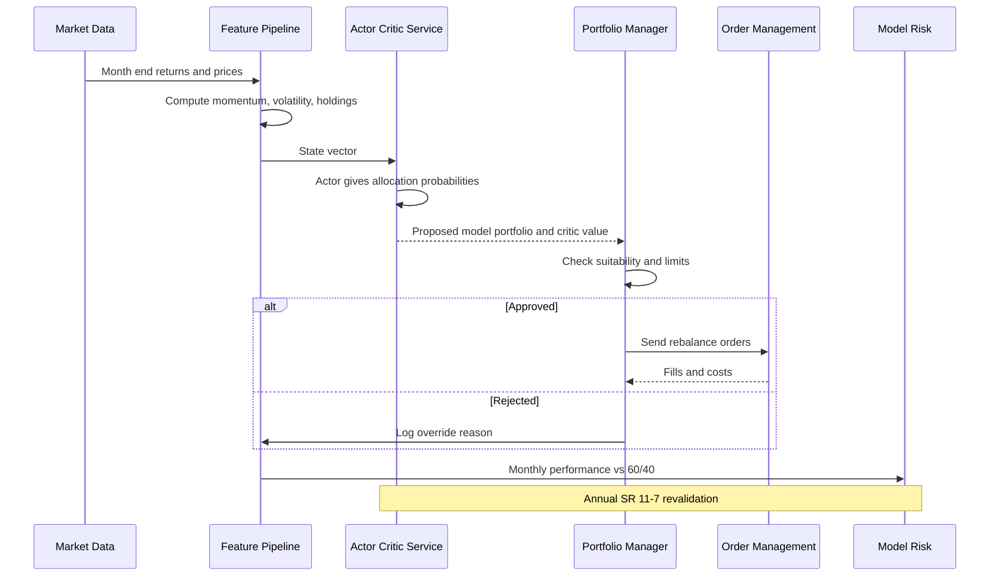

# 28. Actor-Critic

[](https://colab.research.google.com/github/EdwardSuresh/30-ai-algorithms/blob/main/notebooks/28-actor-critic.ipynb)  

[← 27. Deep Q-Network (DQN)](../27-deep-q-network/README.md) · [All algorithms](../../README.md#-the-30-algorithms-ranked) · [29. Policy Gradient (REINFORCE) →](../29-policy-gradient/README.md)

> **Actor-critic RL trains two models together: an actor that chooses actions and a critic that judges how good the situation is, so the actor learns from the critic's feedback.**

💡 **Analogy:** A cricket batter (the actor) chooses shots, while the coach (the critic) watches and says 'that was better or worse than I expected from this position'. The batter does more of the shots that beat the coach's expectation, and the coach keeps refining what to expect.

## The use case (same for Easy, Medium and Hard)
**Financial Services — Monthly Stocks / Bonds / Cash allocation**

A wealth manager rebalances balanced portfolios monthly and wants to know whether a learning agent can tilt between growth and defensive mixes better than a static 60/40. Market regimes switch between calm bull markets and stressed bear markets, and nobody announces the switch. Data available: monthly asset returns, rolling volatility and momentum, current holdings and trading costs. Success means a higher Sharpe ratio than 60/40 on unseen periods after costs, with explainable behaviour and a governance trail that model risk can validate.

## Industry adoption
| Sector | Score | Where you meet it |
|---|---|---|
| Financial Services | ■■□□□ 2/5 | Asset managers and quant desks research actor-critic for tactical allocation and trade execution. |
| Insurance | ■□□□□ 1/5 | Rare; explored for asset-liability management of insurer investment portfolios. |
| Supply Chain | ■■□□□ 2/5 | Inventory and replenishment control with continuous order quantities in simulators. |
| Oil & Gas | ■□□□□ 1/5 | Research on refinery and compressor control where actions are continuous set-points. |

**Why rank #28:** Actor-critic methods (A2C, PPO, SAC) power most modern deep RL, but in regulated industries they mostly live in research and pilot projects. Portfolio construction, execution and inventory control are the main experiments; explainability and model-risk demands keep production use limited.

## How it works
1. Observe the state, e.g. recent stock and bond returns, volatility and current holdings.
2. The actor outputs a probability for each possible action (here, each model portfolio) and samples one.
3. The environment returns a reward (risk-adjusted monthly return after costs) and the next state.
4. The critic estimates the value V(s) of the current and next state.
5. Advantage = reward + discounted V(next) - V(now): did things go better or worse than the critic expected?
6. Update the actor to make actions with positive advantage more likely; update the critic to predict values more accurately.
7. Repeat over many rollouts, often in parallel, then evaluate greedily against a benchmark.

## Key terms
| Term | Meaning |
|---|---|
| actor | The policy network that outputs action probabilities. |
| critic | The value network that predicts expected future reward from a state. |
| advantage | How much better an outcome was than the critic expected; the actor's learning signal. |
| TD error | Reward + discounted next value - current value; the one-step advantage estimate. |
| entropy bonus | A small reward for keeping the policy uncertain, which encourages exploration. |
| Sharpe ratio | Excess return over cash divided by volatility; return per unit of risk. |
| turnover | How much of the portfolio is traded; drives transaction costs. |

## 🟢 Easy — One actor-critic update by hand: Risk-On vs Risk-Off
Perform three actor-critic updates by hand on a two-action allocation choice and watch both the policy and the critic's expectation move.

| 5W + H | |
|---|---|
| **Who** | An investment analyst learning how actor-critic differs from plain trial-and-error. |
| **What** | Two choices (Risk-On 80% stocks, Risk-Off 20% stocks), a critic expecting +0.6% a month and three observed months. |
| **When** | Before touching neural networks: to see the advantage and both update rules in plain numbers. |
| **Where** | A numpy script with a softmax over two preference numbers. |
| **Why** | The whole family (A2C, PPO, SAC) reuses this exact loop: compare outcome with expectation, then update both parts. |
| **How** | Compute TD error = reward - V, push the chosen action's preference by alpha x TD error x grad log pi, nudge V toward the reward. |

**Architecture**



**🧠 ML concepts:** Policy as softmax over preferences, Critic value estimate, TD error as advantage, Gradient of log-softmax, Separate actor and critic learning rates  
**🐍 Python concepts:** Dicts keyed by integers, Functions with default arguments, List comprehensions inside f-strings, Array copy vs view, Dict comprehensions with zip, Converting numpy scalars with float()

**Steps the code performs**
1. Define the two allocations and their observed returns
2. Initialise actor preferences and critic value
3. Compute policy probabilities with softmax
4. Pick an action and compute the TD error
5. Update the actor along grad log pi
6. Update the critic toward the observed reward
7. Print the final policy

▶️ Code: [`easy.py`](easy.py) — run with `python easy.py`

<details><summary>Walkthrough</summary>

| Lines | What happens |
|---|---|
| 5-6 | Two allocation choices and the monthly return (in percent) we observed after each. |
| 8-12 | The actor is two preference numbers (theta). The critic is one number V: the return it expects in a typical month. gamma=0 makes each month a one-step episode. |
| 15-17 | Softmax turns preferences into probabilities that sum to 1. Subtracting the max avoids overflow. |
| 19-28 | Each month: print the policy, take an action, compute the TD error. Positive means better than the critic expected. |
| 29-33 | For softmax, the gradient of log pi(a) is one-hot(a) minus probs. Multiplying by the TD error raises or lowers the chosen action's preference. |
| 34-36 | The critic moves V halfway toward what actually happened, so next month's expectation is better calibrated. |
| 39-40 | After two good Risk-On months and one weak Risk-Off month, the policy leans 69/31 toward Risk-On. |

</details>

<details><summary>Real output</summary>

```text
Month 1: policy probs = ['0.50', '0.50'], critic V = 0.600
   chose Risk-On (80% stocks), reward = +1.2%, TD error = +0.600
   new theta = [ 0.15 -0.15], new V = 0.900
Month 2: policy probs = ['0.57', '0.43'], critic V = 0.900
   chose Risk-On (80% stocks), reward = +1.2%, TD error = +0.300
   new theta = [ 0.214 -0.214], new V = 1.050
Month 3: policy probs = ['0.61', '0.39'], critic V = 1.050
   chose Risk-Off (20% stocks), reward = +0.4%, TD error = -0.650
   new theta = [ 0.411 -0.411], new V = 0.725

Final policy: {'Risk-On (80% stocks)': 0.694, 'Risk-Off (20% stocks)': 0.306}
Positive surprise raised Risk-On; the below-average Risk-Off month lowered Risk-Off.
```

</details>

**Try this next:** Set the Risk-Off reward to 1.5% in month 3: which way does the policy move now? · Start the critic at V = 2.0 (very optimistic): what happens to the actor after a +1.2% month? · Run 20 months alternating actions and print how fast V settles.

## 🟡 Medium — A2C in PyTorch choosing among five model portfolios
Train an advantage actor-critic network on regime-switching synthetic markets and compare its allocations with a static 60/40.

| 5W + H | |
|---|---|
| **Who** | A quant research team in an asset manager. |
| **What** | About 100 years of synthetic monthly returns with hidden bull/bear regimes; five model portfolios from 90/10 to 0/30/70. |
| **When** | Early research: does an RL allocator find any signal before investing in a full backtest framework? |
| **Where** | A PyTorch script on CPU; one shared network body with actor and critic heads. |
| **Why** | Static 60/40 ignores regime changes; an agent that reads momentum and volatility may tilt better. |
| **How** | 24-month rollouts, one-step TD advantage, actor loss -log pi x advantage, critic MSE, entropy bonus, then greedy test on 30 unseen years. |

**Architecture**



**🧠 ML concepts:** Shared network with two heads, One-step TD advantage, Detaching targets and advantages, Entropy regularisation, Out-of-sample evaluation vs benchmark  
**🐍 Python concepts:** Subclassing nn.Module, List comprehension over a rolling window, torch.distributions.Categorical, Tensor fancy indexing weights[a], lambda functions, enumerate over a list of tuples

**Steps the code performs**
1. Simulate regime-switching monthly returns
2. Build rolling momentum and volatility features
3. Define the shared actor-critic network
4. Sample 24-month rollouts and compute rewards
5. Compute TD advantages and the combined loss
6. Train for 800 updates
7. Evaluate greedily on 30 unseen years versus 60/40
8. Print how often each portfolio was chosen

▶️ Code: [`medium.py`](medium.py) — run with `python medium.py`

<details><summary>Walkthrough</summary>

| Lines | What happens |
|---|---|
| 11 | Five allowed model portfolios as (stocks, bonds, cash) tuples. Discrete choices keep the actor simple and auditable. |
| 14-25 | Bull regimes last about two years, bear regimes about eight months. Stocks fall and bonds rally in bears. The agent never sees the regime label. |
| 28-32 | Features from the last 3 and 6 months: stock momentum, stock volatility, bond momentum and last month's stock return. |
| 35-46 | One shared Tanh layer feeds two heads: actor logits for the 5 portfolios and a single critic value. |
| 56-64 | Each update samples a random 24-month window, samples a portfolio per month and computes its return in percent. |
| 65-73 | Advantage = r + gamma x V(next) - V(now). The actor loss uses the detached advantage; the critic minimises its square; a small entropy bonus keeps exploring. |
| 77-84 | Greedy choices on 30 unseen years versus 60/40, reported as annualised return and volatility. |
| 87-91 | Action frequencies explain the result: mostly 90/10 with defensive switches. Higher return but higher volatility, which motivates the risk-adjusted reward in Hard. |

</details>

<details><summary>Real output</summary>

```text
epoch 160  avg reward +1.352%/mo  critic loss 11.270
epoch 320  avg reward +1.027%/mo  critic loss 7.859
epoch 480  avg reward +0.374%/mo  critic loss 14.413
epoch 640  avg reward +0.873%/mo  critic loss 6.722
epoch 800  avg reward +1.268%/mo  critic loss 9.803

Test period (30 years)   ann_return  ann_vol
A2C agent                   4.13%   12.18%
60/40 static                1.98%   10.08%

How often each model portfolio was chosen:
  stocks 90% / bonds 10% / cash 0%: 75%
  stocks 70% / bonds 30% / cash 0%: 3%
  stocks 50% / bonds 40% / cash 10%: 1%
  stocks 30% / bonds 50% / cash 20%: 0%
  stocks 0% / bonds 30% / cash 70%: 21%
Business read: the agent mostly holds the growth mix and switches to the defensive mix in some months.
It earned more than 60/40 here but with more volatility - the Hard level adds risk and cost penalties.
```

</details>

**Try this next:** Set gamma to 0.9: does the critic loss get noisier and does the policy change? · Remove the entropy term and see whether the policy collapses to one portfolio early. · Add 'last month's bond return' as a fifth feature and compare test results.

## 🔴 Hard — Risk-adjusted A2C with costs, tuning and Sharpe vs 60/40
Build a production-style A2C allocator with transaction costs, a mean-variance reward tuned on validation data, and a test-period Sharpe comparison against 60/40.

| 5W + H | |
|---|---|
| **Who** | A quant team presenting an RL allocator to the investment committee and model risk management. |
| **What** | Separate train (100y), validation (30y) and test (40y) synthetic markets, holdings-aware state, 10 bps costs, five model portfolios. |
| **When** | Pre-pilot validation: one shot at the test set after tuning on validation. |
| **Where** | An offline research pipeline; the chosen model and its settings are saved with torch.save. |
| **Why** | Return alone rewards reckless risk; costs punish flip-flopping. Sharpe after costs is what clients and committees care about. |
| **How** | Batched 16-episode rollouts, n-step returns, gradient clipping, lambda grid on validation Sharpe, test-period Sharpe, drawdown and turnover vs 60/40 and 90/10. |

**Architecture**



**🧠 ML concepts:** Risk-adjusted (mean-variance) reward, Transaction costs in the state and reward, n-step returns with bootstrap, Hyperparameter tuning on a validation period, Sharpe ratio and max drawdown, Model risk and suitability constraints  
**🐍 Python concepts:** Classes with helper methods, np.stack and np.tile for batching, zip(*...) to unzip results, Closures returning policy functions, Dict of name -> function, Nested format specs in f-strings

**Steps the code performs**
1. Simulate train, validation and test markets
2. Define the environment with costs and risk penalty
3. Train A2C with batched rollouts for each lambda
4. Choose lambda by validation Sharpe
5. Backtest agent, 60/40 and 90/10 on the test period
6. Print allocation probabilities in calm vs stressed markets
7. Save the model and print the model-risk note

▶️ Code: [`hard.py`](hard.py) — run with `python hard.py`

<details><summary>Walkthrough</summary>

| Lines | What happens |
|---|---|
| 12 | 10 basis points per unit of turnover: commissions, spread and impact. |
| 27-40 | The state adds current weights to market features, so the agent can see what a switch would cost. batch_features scores many episodes at once. |
| 42-49 | Cost = turnover x 10 bps. Reward = net return minus lambda x squared deviation from 0.5%, a simple monthly mean-variance utility. |
| 63-71 | Each update starts 16 episodes at random months, all beginning from 60/40 holdings. |
| 73-83 | For 24 months: score all 16 states, sample portfolios, step the environment, and keep log-probs, values, rewards and entropies. |
| 86-98 | Discounted returns are built backwards from the critic's value of the last state. Advantage = return - value; the loss combines actor, critic and entropy terms with gradient clipping. |
| 102-114 | A cost-aware backtest reporting annual return, volatility, Sharpe, maximum drawdown and turnover. |
| 127-137 | Lambda is chosen on the validation period only, so the test period stays untouched. Here the plain return reward scored best on validation Sharpe. |
| 139-146 | One test-period run per strategy. The agent beats 60/40 on Sharpe (0.32 vs 0.24) but with more volatility and drawdown, an honest trade-off to show the committee. |
| 148-163 | Probabilities in a calm vs stressed scenario show the agent spreads into defensive mixes under stress. The model is saved with its settings and the SR 11-7 / suitability note is printed. |

</details>

<details><summary>Real output</summary>

```text
Tuning risk aversion (validation Sharpe):
  lambda=0.0  valid Sharpe= 0.46
  lambda=3.0  valid Sharpe= 0.41
  lambda=8.0  valid Sharpe= 0.32
Chosen lambda = 0.0

Test period (40 unseen years), after 10 bps transaction costs:
strategy        ann_ret%  ann_vol%  sharpe  max_dd%  turnover/yr
A2C agent           6.37     12.33    0.32   -41.22         1.43
60/40 static        4.68      9.42    0.24   -33.23         0.00
Always 90/10        5.23     13.95    0.20   -51.82         0.02
calm uptrend      P(90/10, 70/30, 60/40, 40/50/10, 10/40/50) = [0.91 0.03 0.06 0.   0.  ]
stressed selloff  P(90/10, 70/30, 60/40, 40/50/10, 10/40/50) = [0.37 0.25 0.15 0.14 0.09]

Saved model to /tmp/tmpXXXXXX/a2c_allocator.pt
MODEL-RISK NOTE (SR 11-7): synthetic regimes are not history. Validate on real out-of-sample data,
stress-test 2008/2020/2022-style scenarios, cap allocation changes, and keep a human PM sign-off.
Suitability (Reg BI / fiduciary duty) still applies: the agent cannot know a client's risk tolerance.
```

</details>

**Try this next:** Set TC to 0.0050 (50 bps) and see how turnover and Sharpe change. · Force lambda = 8.0 and compare drawdown with the chosen model. · Add a sixth portfolio of 100% cash and check whether the agent uses it in the stress scenario.

## 🔄 End-to-end production flow



## ⚠️ Pitfalls
- Optimising raw return. The agent learns to max out equity risk; use a risk-adjusted reward and judge on Sharpe and drawdown.
- Ignoring transaction costs. Without them, RL allocators flip monthly and the paper gains vanish after trading.
- Tuning on the test period. Keep separate train, validation and test periods and touch the test once.
- Trusting synthetic or short histories. Validate on real out-of-sample data and stress scenarios such as 2008, 2020 and 2022.
- Unstable training. Use advantage normalisation or batching, gradient clipping and entropy bonuses, and check results across several seeds.
- Skipping governance. Document assumptions, limits and overrides for SR 11-7, and ensure suitability rules still apply to each client.

**When NOT to use it:** Avoid actor-critic when a closed-form or convex optimisation (mean-variance, risk parity) answers the question, when there is no realistic simulator, or when stakeholders need fully transparent rule-based decisions.

## 🎤 Interview questions
<details><summary>What is the advantage in actor-critic, and why use it instead of the raw reward?</summary>

The advantage is the reward plus discounted next-state value minus the current-state value. Subtracting the critic's expectation removes noise that is not caused by the action, so the actor's gradient has much lower variance than REINFORCE with raw returns.

</details>
<details><summary>Why include current holdings in the state for a portfolio agent?</summary>

Transaction costs depend on how far the new allocation is from the current one. Without holdings in the state the agent cannot know the cost of an action, which makes the problem non-Markov and encourages excessive trading.

</details>
<details><summary>How would model risk management validate an RL allocator under SR 11-7?</summary>

They would review conceptual soundness of the reward and environment, test out-of-sample and under stress, check stability across seeds, benchmark against simple strategies, and require ongoing monitoring with clear override and limit controls.

</details>

---
[← 27. Deep Q-Network (DQN)](../27-deep-q-network/README.md) · [All algorithms](../../README.md#-the-30-algorithms-ranked) · [29. Policy Gradient (REINFORCE) →](../29-policy-gradient/README.md)
