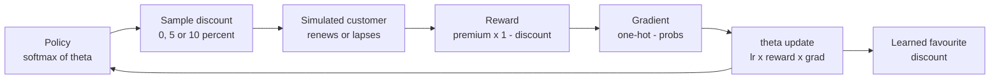
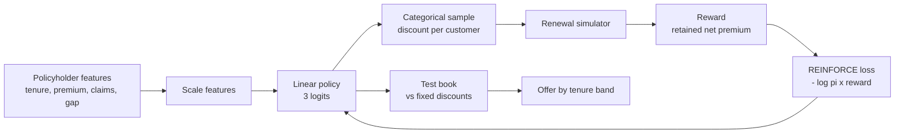
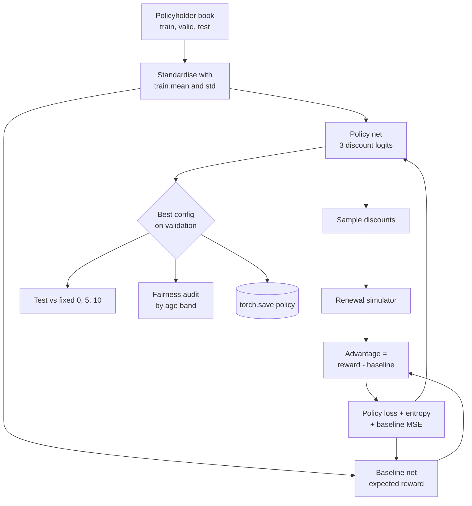
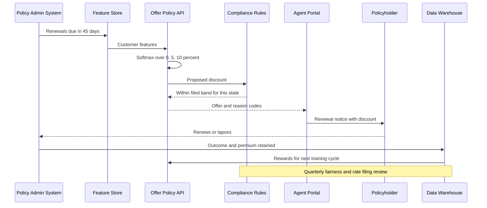

# 29. Policy Gradient (REINFORCE)

[](https://colab.research.google.com/github/EdwardSuresh/architects-ml-playbook/blob/main/notebooks/29-policy-gradient.ipynb)  

[← 28. Actor-Critic](../28-actor-critic/README.md) · [All algorithms](../../README.md#-the-30-algorithms-ranked) · [30. SARSA →](../30-sarsa/README.md)

> **REINFORCE learns a probability for each action directly, making actions that led to high rewards more likely and those that led to low rewards less likely.**

💡 **Analogy:** A shop manager tries different window displays. Each week, if sales were good, she becomes a bit more likely to reuse that display; if poor, a bit less likely. Over months, the best displays dominate, but she still occasionally tries others. That is REINFORCE.

## The use case (same for Concept, Build and Production)
**Insurance — Renewal retention offers: which discount for which policyholder**

A personal-auto carrier loses many policyholders at renewal, and its blanket 5% loyalty discount is expensive for customers who would have stayed anyway. The retention team wants a policy that chooses 0%, 5% or 10% per customer to maximise retained premium net of discount cost. Data available: tenure, premium, claims history, competitor quote gap and multi-policy flag, plus past renewal outcomes. Success means higher retained premium than any fixed discount on a held-out book, no unfair skew across protected groups, and compliance with state rules on price optimization.

## Industry adoption
| Sector | Score | Where you meet it |
|---|---|---|
| Financial Services | ■■□□□ 2/5 | Banks test policy-gradient learners for next-best-offer and credit-card promotion targeting. |
| Insurance | ■□□□□ 1/5 | Carriers experiment with retention offers and outreach choices, within rate-filing and anti-price-optimization limits. |
| Supply Chain | ■□□□□ 1/5 | Learning dynamic promotion or allocation policies in retail simulations. |
| Oil & Gas | ■□□□□ 1/5 | Research on drilling-parameter or well-control policies in simulators. |

**Why rank #29:** REINFORCE is the simplest policy-gradient method and the foundation for actor-critic and PPO, so it is widely taught. In industry it appears mainly in offer, pricing and recommendation experiments, often as a contextual-bandit learner, and is usually replaced by lower-variance methods in production.

## How it works
1. Define a policy: a model that maps a customer's features to a probability for each action (0%, 5%, 10% discount).
2. Sample an action from those probabilities for each customer.
3. Observe the reward: retained premium net of discount if the customer renews, zero if not.
4. Compute the gradient of log-probability of the chosen action.
5. Scale that gradient by the reward (or by reward minus a baseline) and step the policy parameters uphill.
6. Optionally add an entropy bonus so the policy keeps exploring.
7. Repeat over many customers, then evaluate the greedy policy against fixed strategies.

## Key terms
| Term | Meaning |
|---|---|
| policy | A function giving the probability of each action in a given situation. |
| log-probability gradient | The direction that makes the chosen action more likely; REINFORCE scales it by reward. |
| baseline | An expected reward subtracted from the actual reward to reduce noise without biasing learning. |
| variance | How much gradient estimates jump around between batches; high variance means slow, unstable learning. |
| entropy bonus | Extra reward for keeping probabilities spread out, so the policy does not lock in too early. |
| contextual bandit | A one-step RL problem: see context, take action, get reward, no future state. |
| price optimization | Setting prices partly on predicted willingness to pay or stay, rather than cost and risk; restricted for insurance in many states. |

## 🟢 Concept — REINFORCE on a 3-arm discount bandit
Use plain numpy REINFORCE to learn which of three renewal discounts earns the most expected retained premium for a single customer type.

| 5W + H | |
|---|---|
| **Who** | A pricing analyst new to policy-gradient methods. |
| **What** | One customer type, three discount levels with hidden renewal probabilities 70%, 82%, 86%, and a $1,200 premium. |
| **When** | Before adding customer features: to see how sampling and reward-scaled gradients steer a policy. |
| **Where** | A short numpy script, no deep-learning library. |
| **Why** | Shows that the best arm is not the one with the highest renewal rate but the one with the best net premium. |
| **How** | Sample a discount from softmax(theta), simulate renewal, update theta += lr x reward x (one_hot - probs), for 3,000 customers. |

**Architecture**



**🧠 ML concepts:** Stochastic policy via softmax, Sampling actions for exploration, Log-probability gradient, Reward-weighted updates, Expected value vs renewal rate  
**🐍 Python concepts:** Parallel lists with zip, Module-level constants, np.random.choice with p=, Conditional expressions, Tuple membership test (step in (...))

**Steps the code performs**
1. Define discounts, hidden renewal probabilities and premium
2. Print the true expected value of each arm
3. Start with equal preferences
4. Sample a discount and simulate renewal
5. Apply the REINFORCE update
6. Print the policy at checkpoints
7. Report the favoured discount

▶️ Code: [`easy.py`](easy.py) — run with `python easy.py`

<details><summary>Walkthrough</summary>

| Lines | What happens |
|---|---|
| 6-8 | Three parallel lists: discount levels, the hidden renewal probability at each, and the premium. |
| 10-12 | The ground truth the agent must discover: 5% gives the best expected net premium ($934.80), slightly ahead of 10%. |
| 14-21 | The policy starts indifferent (all preferences zero). Softmax turns preferences into probabilities. |
| 23-29 | Each step is one customer: sample a discount from the policy, simulate renewal, and compute the net premium reward. |
| 30-33 | The log-softmax gradient is one-hot minus probs. Scaling by the reward means every renewal nudges the chosen arm up, with bigger nudges for bigger payoffs. |
| 35-39 | Checkpoint prints show the noisy path: early on 0% even looks good. By 3,000 customers the policy puts 81% on the 5% discount. |

</details>

<details><summary>Real output</summary>

```text
discount   0%: true expected retained premium = $ 840.00
discount   5%: true expected retained premium = $ 934.80
discount  10%: true expected retained premium = $ 928.80
step    1  probs(0%,5%,10%) = [0.333 0.333 0.333]
step   10  probs(0%,5%,10%) = [0.348 0.328 0.324]
step  100  probs(0%,5%,10%) = [0.423 0.275 0.302]
step  500  probs(0%,5%,10%) = [0.434 0.433 0.133]
step 1000  probs(0%,5%,10%) = [0.237 0.457 0.306]
step 3000  probs(0%,5%,10%) = [0.036 0.807 0.158]

Learned policy favours a 5% discount.
```

</details>

**Try this next:** Change renew_prob for 10% to 0.92: does the policy switch to 10%? · Replace reward with reward - 900 (a crude baseline) and compare how quickly it converges. · Lower lr to 0.01 and see how many steps are needed.

## 🟡 Build — Feature-conditioned softmax policy in PyTorch
Train a PyTorch softmax policy that picks a discount per customer from tenure, premium, claims and competitor gap, and compare it with blanket discounts.

| 5W + H | |
|---|---|
| **Who** | A retention analytics team at a personal-lines carrier. |
| **What** | 4,000 synthetic training and 1,000 test policyholders with tenure_years, annual_premium, claims_last_3y and competitor_quote_gap. |
| **When** | Before a pilot, using a response simulator calibrated from past renewal campaigns. |
| **Where** | A PyTorch script; the policy is a single linear layer producing three logits. |
| **Why** | New customers and those with a cheaper rival quote respond to discounts; loyal customers do not. A personalised policy avoids wasting discount on the loyal. |
| **How** | Mini-batches of 256 customers, sample discounts, simulate renewals, minimise -(log pi x reward), then compare expected value on the test book. |

**Architecture**



**🧠 ML concepts:** Contextual policy (features -> action probabilities), Mini-batch REINFORCE, Simulated environment for offline learning, Comparing to fixed strategies and an oracle, Interpreting policy behaviour by segment  
**🐍 Python concepts:** DataFrame from a dict of arrays, np.c_ to stack columns, Vectorised pandas arithmetic and clip, torch.distributions.Categorical, pd.cut for banding, groupby with observed=True

**Steps the code performs**
1. Generate train and test policyholders
2. Define the hidden renewal-response function
3. Scale features into a tensor
4. Train a linear softmax policy for 400 batches
5. Score fixed 0/5/10% strategies, the learned policy and an oracle
6. Summarise the average discount by tenure band

▶️ Code: [`medium.py`](medium.py) — run with `python medium.py`

<details><summary>Walkthrough</summary>

| Lines | What happens |
|---|---|
| 13-19 | Synthetic policyholders with realistic columns. A positive competitor_quote_gap means a rival quoted cheaper. |
| 23-27 | The hidden world: a logistic renewal model in which discount sensitivity falls with tenure. The agent never sees this formula. |
| 30-33 | Features are rescaled to similar ranges so the gradient treats them fairly. |
| 38-40 | A single linear layer maps four features to three logits, one per discount. |
| 42-50 | Each batch: sample a discount per customer, simulate renewals, and compute net retained premium in $1000s. |
| 51-58 | Loss = -(log pi(a/x) x reward). Minimising it raises the probability of discounts that paid off. |
| 61-74 | Expected value on the test book for each fixed discount, the learned policy and an oracle that knows the hidden model. The policy beats every fixed strategy. |
| 76-80 | Average discount offered by tenure band shows the policy gives slightly more to short-tenure customers. |

</details>

<details><summary>Real output</summary>

```text
epoch 100  avg reward $ 1138.9  action mix (0/5/10%) [0.03 0.64 0.33]
epoch 200  avg reward $ 1121.3  action mix (0/5/10%) [0.02 0.66 0.33]
epoch 300  avg reward $ 1132.7  action mix (0/5/10%) [0.  0.7 0.3]
epoch 400  avg reward $ 1149.8  action mix (0/5/10%) [0.   0.53 0.46]

Test set: expected retained premium per customer
  everyone gets   0%:          $ 1060.27
  everyone gets   5%:          $ 1111.05
  everyone gets  10%:          $ 1114.40
  learned personalised policy:  $ 1135.19
  oracle (perfect knowledge):   $ 1165.96

Average discount offered by tenure band:
tenure_band
1-3y     8.1%
4-7y     7.3%
8-14y    7.0%
```

</details>

**Try this next:** Increase training to 1,000 epochs: does the policy get closer to the oracle? · Replace nn.Linear(4, 3) with a small two-layer network and compare. · Subtract the batch-average reward from reward before the loss and see whether learning is smoother.

## 🔴 Production — REINFORCE with baseline, entropy bonus and fairness audit
Build a production-style renewal-offer policy with a learned baseline and entropy bonus, choose settings on a validation book, beat fixed discounts on a test book and audit fairness.

| 5W + H | |
|---|---|
| **Who** | A pricing and retention team preparing a filing-ready proposal for actuarial, compliance and model risk. |
| **What** | 6,000 train, 2,000 validation and 2,000 test policyholders with five features; age band kept aside for auditing only. |
| **When** | Before a controlled pilot in states where personalised retention discounts are permitted. |
| **Where** | An offline training job; the policy and its scaling parameters are saved with torch.save. |
| **Why** | Plain REINFORCE is noisy. A baseline cuts variance, entropy prevents early lock-in, and regulators expect fairness evidence and documented limits. |
| **How** | Ablation of baseline and entropy, selection on validation, test-book comparison, partial-dependence-style table, age-band audit, regulatory note. |

**Architecture**



**🧠 ML concepts:** Baseline subtraction for variance reduction, Entropy regularisation, Ablation study, Validation-based model selection, Explainability through segment tables, Fairness auditing on attributes not used by the model  
**🐍 Python concepts:** Default None arguments to reuse training statistics, nn.Module with two sub-networks, retain_graph for two backward passes, Generator expressions inside sum(), Format conversion !s in f-strings, pivot_table and DataFrame.map

**Steps the code performs**
1. Generate train, validation and test books
2. Standardise features using training statistics
3. Train four configurations (with/without baseline, entropy levels)
4. Measure gradient-noise and validation value for each
5. Pick the best on validation and score the test book once
6. Compare with fixed discounts and estimate book-level uplift
7. Explain offers by tenure and competitor gap
8. Audit outcomes by age band and save the policy

▶️ Code: [`hard.py`](hard.py) — run with `python hard.py`

<details><summary>Walkthrough</summary>

| Lines | What happens |
|---|---|
| 15-25 | Synthetic book with five model features. age_band is created only for fairness auditing and is never fed to the policy. |
| 28-33 | Hidden response curve: short-tenure customers and those with a cheaper rival quote respond most to discounts. |
| 36-41 | Standardisation that reuses training mean and std on other books, avoiding leakage. |
| 44-52 | Two small networks: the policy head producing discount logits, and a baseline head predicting the expected reward for each customer. |
| 69-73 | Advantage = reward - baseline (if enabled). The entropy bonus is subtracted from the loss; the baseline learns by mean-squared error. |
| 75-81 | A diagnostic backward pass measures the policy-gradient size each batch; its standard deviation shows how noisy learning is. |
| 95-111 | Four configurations are trained and scored on the validation book. The baseline roughly halves gradient noise (0.038 to 0.020). |
| 113-119 | The chosen policy is scored once on the test book against fixed discounts and translated into dollars for a 500k-policy book. |
| 121-127 | A pivot table explains behaviour: long-tenure customers without a cheaper rival get almost no discount; shoppers get close to 10%. |
| 129-142 | Average offer, premium and renewal by age band show no material skew. The policy is saved and the price-optimization regulatory note is printed. |

</details>

<details><summary>Real output</summary>

```text
config                         grad-norm std  valid $/customer
baseline=False entropy=0.00            0.038          1197.62
baseline=True  entropy=0.00            0.021          1199.94
baseline=True  entropy=0.01            0.023          1201.23
baseline=True  entropy=0.05            0.020          1201.52
Chosen: baseline=True  entropy=0.05

Strategy comparison on held-out book (expected retained premium net of discount):
  fixed   0% for everyone   $ 1094.07
  fixed   5% for everyone   $ 1143.75
  fixed  10% for everyone   $ 1141.79
  REINFORCE policy         $ 1187.19
  uplift vs best fixed: $43.44/customer = $21.72M on a 500k-policy book

Average offer by tenure band and whether a rival quote is >5% cheaper:
rival_cheaper False  True 
tenure_band               
1-3y           7.1%  10.0%
4-7y           5.0%   9.7%
8-14y          0.6%   6.4%

Fairness audit by age band (not a model input):
          avg_offer  avg_premium  renew_rate
age_band                                    
18-34         0.043     1383.250       0.901
35-54         0.044     1378.251       0.895
55+           0.047     1390.147       0.900

Saved policy to /tmp/tmpXXXXXX/renewal_policy.pt
REGULATORY NOTE: many US states restrict or ban 'price optimization' - setting renewal prices
by predicted willingness to stay rather than risk (see NAIC 2015 white paper, CA/NY/FL bulletins).
Where banned, use this only for non-price retention actions; elsewhere, file rating rules, keep
discounts within approved bands, and test for disparate impact before deployment.
```

</details>

**Try this next:** Add age_band to FEATS (one-hot) and rerun the audit: what changes, and why would compliance object? · Set entropy to 0.2: does the policy become too random to beat fixed 5%? · Make the competitor gap twice as volatile and check whether the uplift grows or shrinks.

## 🔄 End-to-end production flow



## ⚠️ Pitfalls
- Using raw rewards with no baseline. Gradients become very noisy; subtract a learned or average baseline.
- Letting the policy collapse early. Add an entropy bonus or minimum exploration so other discounts keep being tested.
- Learning only from a simulator you invented. Calibrate response curves on past randomised offers before trusting the policy.
- Ignoring regulation. Many US states restrict price optimization in insurance; involve compliance and stay within filed rating plans and discount bands.
- Skipping fairness checks. Audit outcomes across protected or proxy groups even when those attributes are excluded from the model.
- Selecting settings on the test set. Tune on a validation book and report the test book once.

**When NOT to use it:** Avoid REINFORCE when you can run a simple A/B test or a contextual bandit with confidence bounds, when rewards are very delayed and sparse (prefer actor-critic), or when regulation forbids behaviour-based pricing.

## 🎤 Interview questions
<details><summary>Why does subtracting a baseline not bias the REINFORCE gradient?</summary>

The expected value of the log-probability gradient is zero, so subtracting any term that does not depend on the action leaves the expected gradient unchanged. It only removes noise, lowering variance.

</details>
<details><summary>What does the entropy bonus do in policy-gradient training?</summary>

It rewards keeping action probabilities spread out, which preserves exploration and prevents the policy from locking onto one action because of early lucky rewards. Too much entropy makes the policy random.

</details>
<details><summary>What regulatory issues arise when using RL to set insurance renewal discounts?</summary>

Many states consider price optimization based on predicted retention rather than risk to be unfairly discriminatory, so discounts must follow filed rating rules. Carriers also need fairness testing, documentation and explainable reason codes for regulators and consumers.

</details>

---
[← 28. Actor-Critic](../28-actor-critic/README.md) · [All algorithms](../../README.md#-the-30-algorithms-ranked) · [30. SARSA →](../30-sarsa/README.md)
