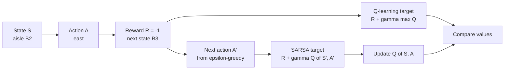
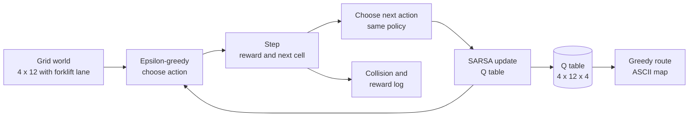
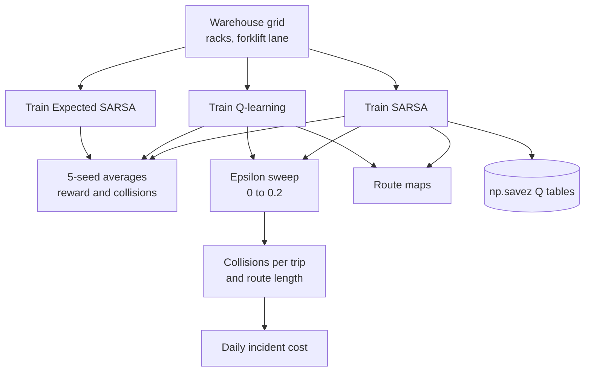
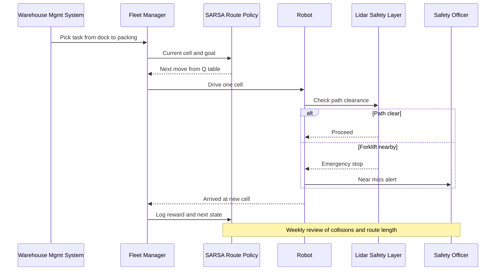

# 30. SARSA

[](https://colab.research.google.com/github/EdwardSuresh/architects-ml-playbook/blob/main/notebooks/30-sarsa.ipynb)  

[← 29. Policy Gradient (REINFORCE)](../29-policy-gradient/README.md) · [All algorithms](../../README.md#-the-30-algorithms-ranked)

> **SARSA learns the value of each action in each state from the actions the agent actually takes next, so it learns safer behaviour when exploration can be dangerous.**

💡 **Analogy:** A new forklift driver learns routes while sometimes taking a wrong turn. A careful driver (SARSA) remembers that 'I sometimes slip up, so I avoid the edge of the loading dock'. A bold driver (Q-learning) plans as if they never make mistakes and hugs the edge for the shortest route.

## The use case (same for Easy, Medium and Hard)
**Supply Chain — Warehouse robot learning a safe route past a forklift lane**

An e-commerce fulfilment centre runs mobile robots from a receiving dock to a packing station, and the shortest path runs right beside a forklift lane. Robots still explore and occasionally make random moves, and any step into the lane risks a collision, equipment damage and an OSHA-reportable incident. Data available: a grid map of aisles, racks and the forklift lane, move costs, and incident logs. Success means a learned route that keeps collisions near zero while robots keep exploring, with only a few extra moves per trip compared with the shortest path.

## Industry adoption
| Sector | Score | Where you meet it |
|---|---|---|
| Financial Services | ■□□□□ 1/5 | Rarely used directly; occasionally a teaching baseline in execution or collections-strategy simulators. |
| Insurance | ■□□□□ 1/5 | Rare; academic work on sequential claims-handling or inspection decisions. |
| Supply Chain | ■■□□□ 2/5 | Warehouse robot routing and dock scheduling in small grid simulations where safety during learning matters. |
| Oil & Gas | ■□□□□ 1/5 | Research on safe control policies for small discrete process-control or drilling simulators. |

**Why rank #30:** SARSA is a classic tabular RL algorithm used mostly for teaching and small, discrete control problems. Its on-policy, safety-aware behaviour makes it relevant for robotics and warehouse routing research, but real deployments usually rely on planners or deep RL instead.

## How it works
1. Split the world into states (grid cells) and actions (up, right, down, left), and start a Q-table of zeros.
2. In state S, choose action A with an epsilon-greedy rule.
3. Take A, observe reward R and next state S'.
4. Choose the next action A' with the same epsilon-greedy rule.
5. Update Q(S,A) toward R + gamma x Q(S',A'): the value of what you will actually do next.
6. Move to S' and A' and repeat until the episode ends.
7. After many episodes, the greedy route from the Q-table reflects the risk of the agent's own exploration.

## Key terms
| Term | Meaning |
|---|---|
| on-policy | Learning the value of the policy you are actually following, including its exploration. |
| off-policy | Learning the value of a different (usually greedy) policy than the one generating data, as Q-learning does. |
| Q-table | A table of expected future reward for each (state, action) pair. |
| TD target | R + gamma x Q(S',A'); the number the current estimate moves toward. |
| epsilon-greedy | Take a random action with probability epsilon, otherwise the best known action. |
| Expected SARSA | A variant that averages over all next actions weighted by the policy's probabilities. |
| learning rate (alpha) | How far each update moves Q toward the target; 0.5 means halfway. |

## 🟢 Easy — One SARSA update by hand next to the forklift lane
Perform a single SARSA update on a tiny Q-table and compare it with the Q-learning update for the same experience.

| 5W + H | |
|---|---|
| **Who** | A supply-chain engineer meeting reinforcement learning for the first time. |
| **What** | A five-entry Q-table for two aisle cells, one experience where exploration picks a move into the forklift lane. |
| **When** | Before running a full grid: to see exactly why SARSA ends up more cautious than Q-learning. |
| **Where** | A plain Python script with a dict as the Q-table. |
| **Why** | The difference between SARSA and Q-learning is one line of maths; seeing it with numbers makes the safety argument concrete. |
| **How** | Compute the SARSA target R + gamma x Q(S',A') and the Q-learning target R + gamma x max Q(S',.), then apply alpha x TD error. |

**Architecture**



**🧠 ML concepts:** State, action, reward, next state, next action, On-policy TD target, Off-policy (Q-learning) target, Learning rate alpha, Why exploration risk enters SARSA's values  
**🐍 Python concepts:** Dicts keyed by tuples, Tuple unpacking in for-loops over .items(), Multiple assignment on one line, Generator expressions with filters in max(), f-string width formatting

**Steps the code performs**
1. Build a small Q-table as a dict
2. Print the current values
3. Record one experience S, A, R, S', A'
4. Compute the SARSA and Q-learning targets
5. Compute the TD error and the new Q-value
6. Compare with what Q-learning would store

▶️ Code: [`easy.py`](easy.py) — run with `python easy.py`

<details><summary>Walkthrough</summary>

| Lines | What happens |
|---|---|
| 3-10 | A dict whose keys are (state, action) tuples. Stepping south from aisle_B3 into the forklift lane is already known to be very bad (-20). |
| 11-15 | Learning settings and a printout. .items() gives ((state, action), value) pairs that unpack directly in the loop header. |
| 17-22 | One experience: from B2 the robot moved east (-1) to B3, and epsilon-greedy then explored south toward the lane. These five pieces are S-A-R-S'-A'. |
| 24-30 | SARSA uses the value of the action it will really take (-20), giving -21. Q-learning uses the best next action (-2), giving -3. |
| 32-37 | TD error = target - old value. SARSA drops Q(B2, east) from -3 to -12; Q-learning would leave it at -3. |
| 38-39 | Because SARSA counts its own occasional bad moves, cells next to the hazard look worse, so it learns routes that keep a buffer. |

</details>

<details><summary>Real output</summary>

```text
Q-table before:
  Q(aisle_B2, east ) =  -3.00
  Q(aisle_B2, north) =  -4.00
  Q(aisle_B3, east ) =  -2.00
  Q(aisle_B3, north) =  -3.50
  Q(aisle_B3, south) = -20.00

Experience: S=aisle_B2, A=east, R=-1.0, S'=aisle_B3, A'=south  <- the 5 letters S-A-R-S-A
SARSA target      = -1.0 + 1.0 * Q(aisle_B3, south) = -21.00
Q-learning target = -1.0 + 1.0 * max Q(aisle_B3, .)  = -3.00

TD error = -21.00 - (-3.00) = -18.00
Q(aisle_B2, east): -3.00 -> -12.00   (Q-learning would give -3.00)

Takeaway: because SARSA 'remembers' that its own exploration sometimes goes wrong,
it rates risky moves lower than Q-learning does - that is why it learns safer routes.
```

</details>

**Try this next:** Change a_next to 'east' (no exploration this time) and compare both targets. · Set alpha to 0.1: how far does Q(B2, east) move now? · Add ('aisle_B3', 'west') with value -5 and check whether the Q-learning target changes.

## 🟡 Medium — Tabular SARSA on a 4x12 warehouse grid
Train tabular SARSA on a cliff-walking style warehouse grid and print the safe route the robot learns.

| 5W + H | |
|---|---|
| **Who** | A robotics engineer at a fulfilment centre prototyping route learning. |
| **What** | A 4x12 grid: dock bottom-left, packing station bottom-right, and a forklift lane along the bottom between them. |
| **When** | Prototype stage in simulation, before any physical robot follows a learned route. |
| **Where** | A numpy script with a 4x12x4 Q-table. |
| **Why** | The shortest route hugs the lane; with exploration still switched on, that route causes collisions. SARSA should learn to keep its distance. |
| **How** | 500 episodes of epsilon-greedy SARSA (alpha 0.5, epsilon 0.1), -1 per move, -100 and reset for entering the lane, then draw the greedy route. |

**Architecture**



**🧠 ML concepts:** Episodic tasks, Tabular Q-values, Epsilon-greedy with random tie-breaking, SARSA update rule, Learning curves (reward and collisions per 100 episodes)  
**🐍 Python concepts:** Set comprehensions, Dicts mapping actions to moves, min/max clamping, Tuple indexing into numpy arrays, zip(*list) to unzip, Nested list comprehensions for a grid

**Steps the code performs**
1. Define the grid, hazard lane and moves
2. Write the step and epsilon-greedy functions
3. Run 500 SARSA episodes
4. Log reward and collisions per episode
5. Print learning progress in blocks of 100
6. Follow the greedy policy and draw the route

▶️ Code: [`medium.py`](medium.py) — run with `python medium.py`

<details><summary>Walkthrough</summary>

| Lines | What happens |
|---|---|
| 5-10 | The warehouse map. A set comprehension marks every bottom-row cell between dock and packing station as the forklift lane. |
| 13-21 | One move: clamp to the walls, return -100 and reset to the dock if the robot enters the lane, otherwise -1 per move. |
| 24-30 | Epsilon-greedy with random tie-breaking, so early on the robot does not always pick 'up'. |
| 33-36 | A 4x12x4 array of zeros: one value per cell per action. |
| 37-53 | The SARSA loop. The next action a2 is chosen before the update and then actually taken, which is what makes SARSA on-policy. |
| 55-61 | Learning curve: collisions fall from 30 in the first 100 episodes to almost none later. |
| 63-76 | Following the greedy action from the dock draws the route. SARSA climbs to the top row and travels as far from the lane as possible. |

</details>

<details><summary>Real output</summary>

```text
Last 100 training episodes: avg reward -21.3, collisions 2
  episodes   0- 99: avg reward   -65.3, collisions  30
  episodes 100-199: avg reward   -22.5, collisions   3
  episodes 200-299: avg reward   -23.8, collisions   3
  episodes 300-399: avg reward   -20.2, collisions   0
  episodes 400-499: avg reward   -21.3, collisions   2

Greedy route learned by SARSA (17 moves). F = forklift lane:
> > > > > > > > > > v .
^ . . . . . . . . . > v
^ . . . . . . . . . . v
S F F F F F F F F F F G

Business read: SARSA keeps a buffer row away from the forklift lane, accepting a few extra
moves because the robot's own random exploration could otherwise drift into traffic.
```

</details>

**Try this next:** Set eps to 0.01: does SARSA still choose the top-row route? · Change the collision penalty to -10 and see whether the route moves closer to the lane. · Replace Q[s2][a2] with Q[s2].max() (Q-learning) and compare the route.

## 🔴 Hard — SARSA vs Q-learning vs Expected SARSA under exploration
Compare SARSA, Q-learning and Expected SARSA on a richer warehouse with racks, sweep the exploration rate, draw both routes and convert collisions into daily cost.

| 5W + H | |
|---|---|
| **Who** | A warehouse automation team deciding which learning rule to use in their robot simulator and presenting safety evidence to operations. |
| **What** | A 5x12 grid with storage racks, a forklift lane, optional wheel slip, three algorithms, four exploration levels and five seeds. |
| **When** | Before deployment, and whenever the layout changes or exploration settings are revisited. |
| **Where** | A numpy simulation; Q-tables are saved with np.savez for the fleet manager. |
| **Why** | The shortest route is not the safest when robots keep exploring. Operations needs collisions per trip and dollars, not only average reward. |
| **How** | Shared training and evaluation functions parameterised by method, multi-seed averages, an epsilon sweep, route maps and a cost model of $2,500 per incident. |

**Architecture**



**🧠 ML concepts:** On-policy vs off-policy learning, Expected SARSA, Evaluating with the exploration that stays on in operation, Multi-seed averaging, Exploration-rate sweep as tuning, Turning RL metrics into business cost  
**🐍 Python concepts:** Classes wrapping an environment, Chained comparisons, Functions parameterised by a method string, Sets to detect loops, Dict comprehension with ** unpacking into np.savez, Thousands separators in f-strings

**Steps the code performs**
1. Define the warehouse with racks and lane
2. Implement one TD-target function for three algorithms
3. Train each algorithm over five seeds
4. Sweep the exploration rate and evaluate with that rate
5. Draw the greedy routes for SARSA and Q-learning
6. Convert collisions into daily incident cost
7. Save Q-tables and print the safety note

▶️ Code: [`hard.py`](hard.py) — run with `python hard.py`

<details><summary>Walkthrough</summary>

| Lines | What happens |
|---|---|
| 6-12 | Layout constants: a forklift lane on the bottom row, a rack block with one gap in the middle row, and an optional slip probability. |
| 15-30 | The environment: bumping into walls or racks keeps the robot in place; entering the lane returns -100 and ends the trip. |
| 40-51 | The only difference between the algorithms: SARSA uses Q(S',A'), Q-learning uses max Q(S',.), Expected SARSA averages over the epsilon-greedy probabilities. |
| 54-70 | A generic training loop that logs reward and collisions per episode for any method. |
| 73-86 | Evaluation keeps the same exploration that would stay on in operation, which is where the safety difference shows. |
| 89-106 | Follows the greedy action from the dock and draws arrows; a seen-set prevents infinite loops. |
| 111-119 | Training averages over five seeds: Q-learning collides about six times as often as SARSA (0.240 vs 0.042 per episode). |
| 121-128 | With eps=0 Q-learning is shorter and equally safe; as exploration rises, its collisions climb far faster than SARSA's. |
| 131-133 | Route maps: SARSA goes over the racks along the top; Q-learning runs one row above the lane. |
| 135-148 | At 400 trips/day and $2,500 per incident, SARSA's route costs about $20k/day in incidents vs about $237k for Q-learning. Q-tables are saved and a safety note is printed. |

</details>

<details><summary>Real output</summary>

```text
Training (eps=0.1, alpha=0.5), mean over 5 seeds, last 100 episodes:
method          train reward  collisions/ep
SARSA                  -24.3          0.042
Q-learning             -36.4          0.240
Expected SARSA         -21.5          0.028

Exploration sweep - evaluated WITH the same eps the robot keeps in operation:
  eps method           avg reward  collisions/trip  avg moves
 0.00 SARSA                 -17.0            0.000       17.0
 0.00 Q-learning            -13.0            0.000       13.0
 0.05 SARSA                 -21.8            0.020       19.8
 0.05 Q-learning            -31.5            0.123       19.3
 0.10 SARSA                 -27.6            0.053       22.3
 0.10 Q-learning            -37.6            0.240       13.9
 0.20 SARSA                 -27.8            0.063       21.5
 0.20 Q-learning            -57.5            0.457       12.3

SARSA greedy route (19 moves). F=forklift lane, #=rack:
  . . . . > > > > > > > v
  > > > > ^ . . . . . . v
  ^ . . # # # . # # . . v
  ^ . . . . . . . . . . v
  S F F F F F F F F F F G

Q-learning greedy route (13 moves). F=forklift lane, #=rack:
  . . . . . . . . . . . .
  . . . . . . . . . . . .
  . . . # # # . # # . . .
  > > > > > > > > > > > v
  S F F F F F F F F F F G

Daily risk cost at eps=0.1 (400 trips/day, $2,500 per forklift incident):
  SARSA      :   8.0 incidents/day -> $   20,000  (avg 20.8 moves/trip)
  Q-learning :  94.7 incidents/day -> $  236,667  (avg 14.5 moves/trip)

Saved Q-tables to /tmp/tmpXXXXXX
SAFETY NOTE: RL routing is a planning aid, not a safety system. Physical separation, speed limits,
lidar e-stops and ANSI/RIA R15.08 / OSHA 1910.178 controls must stay in place regardless of policy.
```

</details>

**Try this next:** Set SLIP to 0.05 and rerun: how does wheel slip change the gap between the two methods? · Remove the gap in the rack row (c != 6) and see how SARSA's route changes. · Decay epsilon from 0.2 to 0.0 during training and check whether SARSA's route converges to Q-learning's.

## 🔄 End-to-end production flow



## ⚠️ Pitfalls
- Evaluating with exploration switched off. The safety benefit of SARSA only appears when the deployed policy still explores or slips; evaluate under realistic conditions.
- Treating the RL policy as the safety system. Lidar, speed limits and physical separation must stay regardless of the learned route.
- Too few episodes or a single seed. Tabular RL results are noisy; average over seeds and check learning curves.
- Badly scaled penalties. If the collision penalty is too small relative to move cost, the agent accepts collisions to save steps.
- Using tabular SARSA on huge state spaces. Real warehouses need function approximation or classic path planners plus traffic rules.
- Not retraining after layout changes. A moved rack or new lane makes the old Q-table wrong; retrain and re-validate.

**When NOT to use it:** Avoid tabular SARSA for large or continuous state spaces, or when a deterministic shortest-path planner with hard safety constraints already solves the routing problem.

## 🎤 Interview questions
<details><summary>What is the difference between SARSA and Q-learning?</summary>

SARSA updates toward the value of the next action actually chosen by its exploring policy, so it is on-policy. Q-learning updates toward the best next action regardless of what is taken, so it is off-policy and learns the optimal greedy policy.

</details>
<details><summary>Why does SARSA learn a safer path in cliff-walking?</summary>

Because its values include the occasional random moves it makes, cells next to the cliff look costly. It therefore prefers a path with a buffer, while Q-learning hugs the edge and falls off more often when exploring.

</details>
<details><summary>When would you choose Expected SARSA?</summary>

When you want on-policy, safety-aware learning with lower variance. It averages over all next actions weighted by the policy's probabilities, so updates do not depend on one random next action.

</details>

---
[← 29. Policy Gradient (REINFORCE)](../29-policy-gradient/README.md) · [All algorithms](../../README.md#-the-30-algorithms-ranked)
